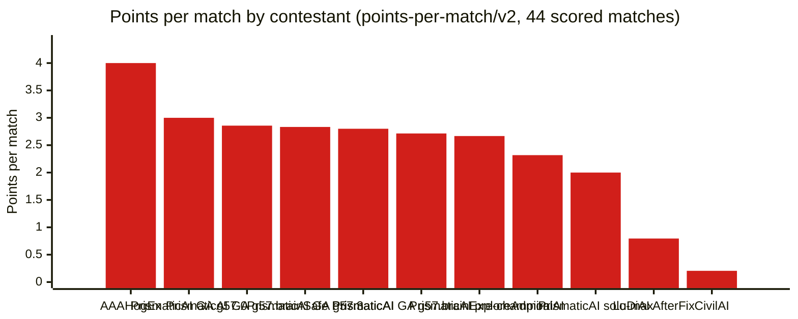
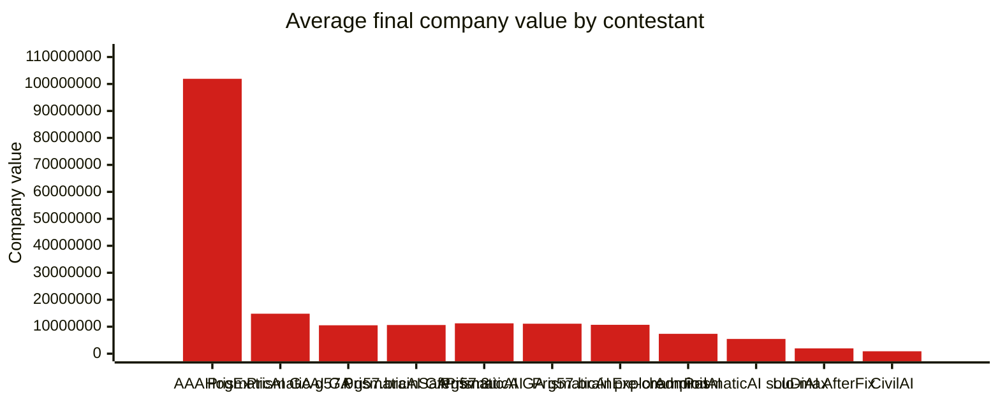
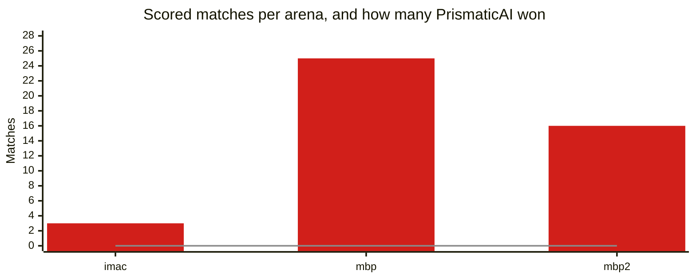

# battle-20261119T204305-7bf45fd5

Derived from `battle-20261119T204305-7bf45fd5.json` by `tools/research/ai-battle/battle.py report`; do not edit.

- Edition `7bf45fd5815fee26`: PrismaticAI and referee at `ebf7516b54d7130fa0908c68ff298075c517fb41`, base set `opengfx-8.0.tar`
- 20-year free-for-all from 1960, map 256x256 temperate, breakdowns 1
- 44 scored match(es) on `imac` (20261119-master-gdf1e05e7d8), `mbp` (20261119-master-m356d6e49c0), `mbp2` (20261119-master-gdf1e05e7d8)
- Replays: 1 of 2 identical to their original on another arena

| # | Contestant | Played | Wins | Points | Points/match | Avg rank | Avg final value | Squirrel errors | Matches with anomalies |
|---|---|---|---|---|---|---|---|---|---|
| 1 | AAAHogEx | 44 | 44 | 176 | 4.0 | 1.0 | 101.9 M | 0 | 0 |
| 2 | PrismaticAI GA g57.0 | 6 | 0 | 18 | 3.0 | 2.0 | 14.8 M | 0 | 2 |
| 3 | PrismaticAI GA g57.brainSafe | 7 | 0 | 20 | 2.857 | 2.14 | 10.5 M | 0 | 3 |
| 4 | PrismaticAI GA g57.3 | 6 | 0 | 17 | 2.833 | 2.17 | 10.6 M | 0 | 2 |
| 5 | PrismaticAI | 5 | 0 | 14 | 2.8 | 2.2 | 11.2 M | 0 | 0 |
| 6 | PrismaticAI GA g57.brainExplore | 7 | 0 | 19 | 2.714 | 2.29 | 11.1 M | 0 | 0 |
| 7 | PrismaticAI pre-champion | 6 | 0 | 16 | 2.667 | 2.33 | 10.7 M | 0 | 0 |
| 8 | AdmiralAI | 44 | 0 | 102 | 2.318 | 2.68 | 7.4 M | 0 | 1 |
| 9 | PrismaticAI solo-max | 7 | 0 | 14 | 2.0 | 3.0 | 5.5 M | 0 | 7 |
| 10 | LuDiAI AfterFix | 44 | 0 | 35 | 0.795 | 4.2 | 2.0 M | 0 | 0 |
| 11 | CivilAI | 44 | 0 | 9 | 0.205 | 4.8 | 884.9 k | 37 | 12 |

```mermaid
---
config:
  xyChart:
    width: 900
    height: 360
  themeVariables:
    xyChart:
      plotColorPalette: "#d11f1a, #8a8a8a, #0b0b0b, #ece4d6"
---
xychart-beta
    title "Final company value per scored match: winner vs best PrismaticAI"
    x-axis ["m-0001", "m-0002", "m-0003", "m-0004", "m-0005", "m-0006", "m-0007", "m-0008", "m-0009", "m-0010", "m-0011", "m-0012", "m-0013", "m-0014", "m-0015", "m-0016", "m-0017", "m-0018", "m-0019", "m-0020", "m-0021", "m-0022", "m-0023", "m-0024", "m-0025", "m-0026", "m-0027", "m-0028", "m-0036", "m-0037", "m-0038", "m-0039", "m-0040", "m-0041", "m-0042", "m-0043", "m-0044", "m-0046", "m-0052", "m-0053", "m-0054", "m-0055", "m-0057", "m-0061"]
    %% series: Winner | Best PrismaticAI
    %% links: battle-20261119T204305-7bf45fd5.md?col=Match&filter=m-0001 | battle-20261119T204305-7bf45fd5.md?col=Match&filter=m-0002 | battle-20261119T204305-7bf45fd5.md?col=Match&filter=m-0003 | battle-20261119T204305-7bf45fd5.md?col=Match&filter=m-0004 | battle-20261119T204305-7bf45fd5.md?col=Match&filter=m-0005 | battle-20261119T204305-7bf45fd5.md?col=Match&filter=m-0006 | battle-20261119T204305-7bf45fd5.md?col=Match&filter=m-0007 | battle-20261119T204305-7bf45fd5.md?col=Match&filter=m-0008 | battle-20261119T204305-7bf45fd5.md?col=Match&filter=m-0009 | battle-20261119T204305-7bf45fd5.md?col=Match&filter=m-0010 | battle-20261119T204305-7bf45fd5.md?col=Match&filter=m-0011 | battle-20261119T204305-7bf45fd5.md?col=Match&filter=m-0012 | battle-20261119T204305-7bf45fd5.md?col=Match&filter=m-0013 | battle-20261119T204305-7bf45fd5.md?col=Match&filter=m-0014 | battle-20261119T204305-7bf45fd5.md?col=Match&filter=m-0015 | battle-20261119T204305-7bf45fd5.md?col=Match&filter=m-0016 | battle-20261119T204305-7bf45fd5.md?col=Match&filter=m-0017 | battle-20261119T204305-7bf45fd5.md?col=Match&filter=m-0018 | battle-20261119T204305-7bf45fd5.md?col=Match&filter=m-0019 | battle-20261119T204305-7bf45fd5.md?col=Match&filter=m-0020 | battle-20261119T204305-7bf45fd5.md?col=Match&filter=m-0021 | battle-20261119T204305-7bf45fd5.md?col=Match&filter=m-0022 | battle-20261119T204305-7bf45fd5.md?col=Match&filter=m-0023 | battle-20261119T204305-7bf45fd5.md?col=Match&filter=m-0024 | battle-20261119T204305-7bf45fd5.md?col=Match&filter=m-0025 | battle-20261119T204305-7bf45fd5.md?col=Match&filter=m-0026 | battle-20261119T204305-7bf45fd5.md?col=Match&filter=m-0027 | battle-20261119T204305-7bf45fd5.md?col=Match&filter=m-0028 | battle-20261119T204305-7bf45fd5.md?col=Match&filter=m-0036 | battle-20261119T204305-7bf45fd5.md?col=Match&filter=m-0037 | battle-20261119T204305-7bf45fd5.md?col=Match&filter=m-0038 | battle-20261119T204305-7bf45fd5.md?col=Match&filter=m-0039 | battle-20261119T204305-7bf45fd5.md?col=Match&filter=m-0040 | battle-20261119T204305-7bf45fd5.md?col=Match&filter=m-0041 | battle-20261119T204305-7bf45fd5.md?col=Match&filter=m-0042 | battle-20261119T204305-7bf45fd5.md?col=Match&filter=m-0043 | battle-20261119T204305-7bf45fd5.md?col=Match&filter=m-0044 | battle-20261119T204305-7bf45fd5.md?col=Match&filter=m-0046 | battle-20261119T204305-7bf45fd5.md?col=Match&filter=m-0052 | battle-20261119T204305-7bf45fd5.md?col=Match&filter=m-0053 | battle-20261119T204305-7bf45fd5.md?col=Match&filter=m-0054 | battle-20261119T204305-7bf45fd5.md?col=Match&filter=m-0055 | battle-20261119T204305-7bf45fd5.md?col=Match&filter=m-0057 | battle-20261119T204305-7bf45fd5.md?col=Match&filter=m-0061
    y-axis "Company value" 0 --> 188000000
    bar [98936550, 92092320, 125838654, 72378190, 84887146, 99258394, 67322364, 79105340, 74123460, 82118197, 79092947, 58535821, 59997253, 131288488, 95715106, 104088366, 96658910, 97180151, 118890870, 113651209, 131673760, 171165428, 137169049, 157552561, 116779521, 170524943, 154665138, 69941104, 96525797, 99651831, 85491602, 86327599, 98632231, 109165041, 120291282, 131300813, 105124097, 101713630, 68968617, 73411181, 85678434, 68348895, 106829395, 106545242]
    line [4709168, 12599272, 17641535, 12299471, 13476668, 13787312, 10805697, 6237167, 9114259, 10216020, 7481167, 7320842, 11273097, 4949101, 5051927, 10554737, 8478839, 8744392, 4775139, 4640832, 15640686, 5672900, 17735568, 26866696, 14580974, 18988445, 10731606, 11967607, 6191034, 4171964, 14034295, 8811603, 9315483, 10039282, 12884307, 4901668, 10026705, 11789997, 11675230, 9946908, 12171500, 13278710, 5443311, 11718628]
```

<!-- battle-charts:begin -->
<!-- derived from battle-20261119T204305-7bf45fd5.json by `battle.py render`; `battle.py check` fails when it is stale -->

<!-- battle-charts:end -->

| Seed | Original | Replay | Arenas | Identical |
|---|---|---|---|---|
| 1112118503 | m-0010 | m-0048 | imac / mbp | NO |
| 1112118503 | m-0013 | m-0056 | mbp2 / mbp | yes |

| Match | Arena | Seed | Winner | Value | Last | Anomalies |
|---|---|---|---|---|---|---|
| m-0001 | mbp | 1109050220 | AAAHogEx | 98.9 M | CivilAI | PrismaticAI solo-max: fleet_drop:46->21 |
| m-0002 | mbp | 1109050220 | AAAHogEx | 92.1 M | CivilAI | CivilAI: no_vehicles |
| m-0003 | mbp | 1109050220 | AAAHogEx | 125.8 M | CivilAI | - |
| m-0004 | mbp | 1109050220 | AAAHogEx | 72.4 M | LuDiAI AfterFix | PrismaticAI GA g57.brainSafe: fleet_drop:111->77 |
| m-0005 | mbp | 1109050220 | AAAHogEx | 84.9 M | CivilAI | - |
| m-0006 | mbp | 1109050220 | AAAHogEx | 99.3 M | CivilAI | - |
| m-0007 | mbp | 1112118503 | AAAHogEx | 67.3 M | CivilAI | CivilAI: fleet_drop:18->12 |
| m-0008 | mbp | 1112118503 | AAAHogEx | 79.1 M | CivilAI | PrismaticAI solo-max: fleet_drop:39->19; CivilAI: squirrel_errors:37 |
| m-0009 | mbp | 1112118503 | AAAHogEx | 74.1 M | CivilAI | - |
| m-0010 | imac | 1112118503 | AAAHogEx | 82.1 M | CivilAI | PrismaticAI GA g57.0: fleet_drop:105->59 |
| m-0011 | imac | 1112118503 | AAAHogEx | 79.1 M | CivilAI | AdmiralAI: fleet_drop:278->174 |
| m-0012 | imac | 1112118503 | AAAHogEx | 58.5 M | CivilAI | - |
| m-0013 | mbp2 | 1112118503 | AAAHogEx | 60.0 M | CivilAI | - |
| m-0014 | mbp2 | 852326241 | AAAHogEx | 131.3 M | CivilAI | - |
| m-0015 | mbp2 | 852326241 | AAAHogEx | 95.7 M | LuDiAI AfterFix | PrismaticAI solo-max: fleet_drop:34->15 |
| m-0016 | mbp2 | 852326241 | AAAHogEx | 104.1 M | LuDiAI AfterFix | - |
| m-0017 | mbp2 | 852326241 | AAAHogEx | 96.7 M | LuDiAI AfterFix | CivilAI: fleet_drop:116->70 |
| m-0018 | mbp2 | 852326241 | AAAHogEx | 97.2 M | LuDiAI AfterFix | PrismaticAI GA g57.brainSafe: fleet_drop:55->25; CivilAI: fleet_drop:66->40 |
| m-0019 | mbp2 | 852326241 | AAAHogEx | 118.9 M | CivilAI | CivilAI: fleet_drop:63->43 |
| m-0020 | mbp2 | 852326241 | AAAHogEx | 113.7 M | CivilAI | PrismaticAI GA g57.3: fleet_drop:73->45 |
| m-0021 | mbp2 | 329105105 | AAAHogEx | 131.7 M | CivilAI | - |
| m-0022 | mbp2 | 329105105 | AAAHogEx | 171.2 M | CivilAI | PrismaticAI solo-max: fleet_drop:52->23 |
| m-0023 | mbp2 | 329105105 | AAAHogEx | 137.2 M | CivilAI | - |
| m-0024 | mbp2 | 329105105 | AAAHogEx | 157.6 M | CivilAI | CivilAI: fleet_drop:69->46 |
| m-0025 | mbp2 | 329105105 | AAAHogEx | 116.8 M | LuDiAI AfterFix | - |
| m-0026 | mbp2 | 329105105 | AAAHogEx | 170.5 M | CivilAI | - |
| m-0027 | mbp2 | 329105105 | AAAHogEx | 154.7 M | LuDiAI AfterFix | - |
| m-0028 | mbp2 | 156064259 | AAAHogEx | 69.9 M | CivilAI | - |
| m-0036 | mbp | 1840741089 | AAAHogEx | 96.5 M | CivilAI | PrismaticAI solo-max: fleet_drop:39->17 |
| m-0037 | mbp | 1840741089 | AAAHogEx | 99.7 M | CivilAI | - |
| m-0038 | mbp | 1840741089 | AAAHogEx | 85.5 M | CivilAI | PrismaticAI GA g57.0: fleet_drop:74->42 |
| m-0039 | mbp | 1840741089 | AAAHogEx | 86.3 M | CivilAI | - |
| m-0040 | mbp | 1840741089 | AAAHogEx | 98.6 M | CivilAI | CivilAI: fleet_drop:29->18 |
| m-0041 | mbp | 1840741089 | AAAHogEx | 109.2 M | CivilAI | - |
| m-0042 | mbp | 586763458 | AAAHogEx | 120.3 M | CivilAI | - |
| m-0043 | mbp | 586763458 | AAAHogEx | 131.3 M | CivilAI | PrismaticAI solo-max: fleet_drop:44->21; CivilAI: fleet_drop:42->11 |
| m-0044 | mbp | 586763458 | AAAHogEx | 105.1 M | CivilAI | - |
| m-0046 | mbp | 586763458 | AAAHogEx | 101.7 M | LuDiAI AfterFix | PrismaticAI GA g57.brainSafe: fleet_drop:151->79 |
| m-0048 (replay) | mbp | 1112118503 | AAAHogEx | 84.5 M | CivilAI | PrismaticAI GA g57.0: fleet_drop:105->59 |
| m-0052 | mbp | 172069589 | AAAHogEx | 69.0 M | CivilAI | CivilAI: fleet_drop:61->29 |
| m-0053 | mbp | 172069589 | AAAHogEx | 73.4 M | CivilAI | - |
| m-0054 | mbp | 172069589 | AAAHogEx | 85.7 M | CivilAI | - |
| m-0055 | mbp | 172069589 | AAAHogEx | 68.3 M | CivilAI | PrismaticAI GA g57.3: fleet_drop:93->65; CivilAI: fleet_drop:95->57 |
| m-0056 (replay) | mbp | 1112118503 | AAAHogEx | 60.0 M | CivilAI | - |
| m-0057 | mbp | 867861223 | AAAHogEx | 106.8 M | CivilAI | PrismaticAI solo-max: fleet_drop:49->25; CivilAI: fleet_drop:58->23 |
| m-0061 | mbp | 867861223 | AAAHogEx | 106.5 M | LuDiAI AfterFix | - |
