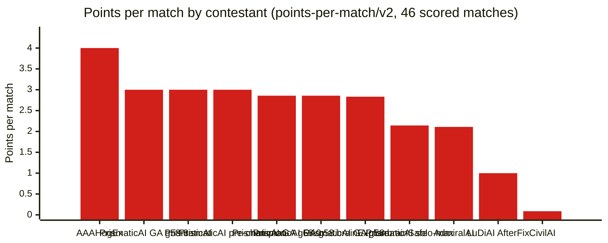
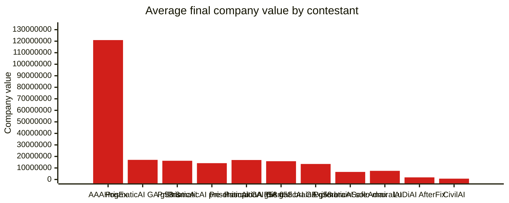
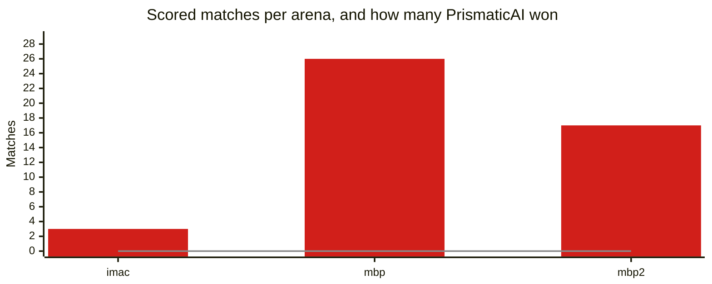

# battle-20261119T205335-124ea7a2

Derived from `battle-20261119T205335-124ea7a2.json` by `tools/research/ai-battle/battle.py report`; do not edit.

- Edition `124ea7a2e839f7bd`: PrismaticAI and referee at `ebf7516b54d7130fa0908c68ff298075c517fb41`, base set `opengfx-8.0.tar`
- 20-year free-for-all from 1960, map 256x256 temperate, breakdowns 1
- 46 scored match(es) on `imac` (20261119-master-gdf1e05e7d8), `mbp` (20261119-master-m356d6e49c0), `mbp2` (20261119-master-gdf1e05e7d8)
- Replays: 0 of 0 identical to their original on another arena

| # | Contestant | Played | Wins | Points | Points/match | Avg rank | Avg final value | Squirrel errors | Matches with anomalies |
|---|---|---|---|---|---|---|---|---|---|
| 1 | AAAHogEx | 46 | 46 | 184 | 4.0 | 1.0 | 121.0 M | 0 | 0 |
| 2 | PrismaticAI GA g58.3 | 6 | 0 | 18 | 3.0 | 2.0 | 17.0 M | 0 | 3 |
| 3 | PrismaticAI | 6 | 0 | 18 | 3.0 | 2.0 | 16.2 M | 0 | 0 |
| 4 | PrismaticAI pre-champion | 7 | 0 | 21 | 3.0 | 2.0 | 14.2 M | 0 | 1 |
| 5 | PrismaticAI GA g58.0 | 7 | 0 | 20 | 2.857 | 2.14 | 16.9 M | 0 | 4 |
| 6 | PrismaticAI GA g58.brainExplore | 7 | 0 | 20 | 2.857 | 2.14 | 15.9 M | 0 | 2 |
| 7 | PrismaticAI GA g58.brainSafe | 6 | 0 | 17 | 2.833 | 2.17 | 13.5 M | 0 | 5 |
| 8 | PrismaticAI solo-max | 7 | 0 | 15 | 2.143 | 2.86 | 6.6 M | 0 | 7 |
| 9 | AdmiralAI | 46 | 0 | 97 | 2.109 | 2.89 | 7.5 M | 0 | 1 |
| 10 | LuDiAI AfterFix | 46 | 0 | 46 | 1.0 | 4.0 | 1.8 M | 0 | 2 |
| 11 | CivilAI | 46 | 0 | 4 | 0.087 | 4.91 | 720.8 k | 3670 | 6 |

```mermaid
---
config:
  xyChart:
    width: 900
    height: 360
  themeVariables:
    xyChart:
      plotColorPalette: "#d11f1a, #8a8a8a, #0b0b0b, #ece4d6"
---
xychart-beta
    title "Final company value per scored match: winner vs best PrismaticAI"
    x-axis ["m-0001", "m-0002", "m-0003", "m-0004", "m-0005", "m-0006", "m-0007", "m-0008", "m-0009", "m-0010", "m-0011", "m-0012", "m-0013", "m-0014", "m-0015", "m-0016", "m-0017", "m-0018", "m-0019", "m-0020", "m-0021", "m-0022", "m-0023", "m-0024", "m-0025", "m-0026", "m-0027", "m-0028", "m-0036", "m-0037", "m-0038", "m-0039", "m-0040", "m-0041", "m-0042", "m-0043", "m-0044", "m-0045", "m-0047", "m-0049", "m-0050", "m-0051", "m-0052", "m-0053", "m-0054", "m-0062"]
    %% series: Winner | Best PrismaticAI
    %% links: battle-20261119T205335-124ea7a2.md?col=Match&filter=m-0001 | battle-20261119T205335-124ea7a2.md?col=Match&filter=m-0002 | battle-20261119T205335-124ea7a2.md?col=Match&filter=m-0003 | battle-20261119T205335-124ea7a2.md?col=Match&filter=m-0004 | battle-20261119T205335-124ea7a2.md?col=Match&filter=m-0005 | battle-20261119T205335-124ea7a2.md?col=Match&filter=m-0006 | battle-20261119T205335-124ea7a2.md?col=Match&filter=m-0007 | battle-20261119T205335-124ea7a2.md?col=Match&filter=m-0008 | battle-20261119T205335-124ea7a2.md?col=Match&filter=m-0009 | battle-20261119T205335-124ea7a2.md?col=Match&filter=m-0010 | battle-20261119T205335-124ea7a2.md?col=Match&filter=m-0011 | battle-20261119T205335-124ea7a2.md?col=Match&filter=m-0012 | battle-20261119T205335-124ea7a2.md?col=Match&filter=m-0013 | battle-20261119T205335-124ea7a2.md?col=Match&filter=m-0014 | battle-20261119T205335-124ea7a2.md?col=Match&filter=m-0015 | battle-20261119T205335-124ea7a2.md?col=Match&filter=m-0016 | battle-20261119T205335-124ea7a2.md?col=Match&filter=m-0017 | battle-20261119T205335-124ea7a2.md?col=Match&filter=m-0018 | battle-20261119T205335-124ea7a2.md?col=Match&filter=m-0019 | battle-20261119T205335-124ea7a2.md?col=Match&filter=m-0020 | battle-20261119T205335-124ea7a2.md?col=Match&filter=m-0021 | battle-20261119T205335-124ea7a2.md?col=Match&filter=m-0022 | battle-20261119T205335-124ea7a2.md?col=Match&filter=m-0023 | battle-20261119T205335-124ea7a2.md?col=Match&filter=m-0024 | battle-20261119T205335-124ea7a2.md?col=Match&filter=m-0025 | battle-20261119T205335-124ea7a2.md?col=Match&filter=m-0026 | battle-20261119T205335-124ea7a2.md?col=Match&filter=m-0027 | battle-20261119T205335-124ea7a2.md?col=Match&filter=m-0028 | battle-20261119T205335-124ea7a2.md?col=Match&filter=m-0036 | battle-20261119T205335-124ea7a2.md?col=Match&filter=m-0037 | battle-20261119T205335-124ea7a2.md?col=Match&filter=m-0038 | battle-20261119T205335-124ea7a2.md?col=Match&filter=m-0039 | battle-20261119T205335-124ea7a2.md?col=Match&filter=m-0040 | battle-20261119T205335-124ea7a2.md?col=Match&filter=m-0041 | battle-20261119T205335-124ea7a2.md?col=Match&filter=m-0042 | battle-20261119T205335-124ea7a2.md?col=Match&filter=m-0043 | battle-20261119T205335-124ea7a2.md?col=Match&filter=m-0044 | battle-20261119T205335-124ea7a2.md?col=Match&filter=m-0045 | battle-20261119T205335-124ea7a2.md?col=Match&filter=m-0047 | battle-20261119T205335-124ea7a2.md?col=Match&filter=m-0049 | battle-20261119T205335-124ea7a2.md?col=Match&filter=m-0050 | battle-20261119T205335-124ea7a2.md?col=Match&filter=m-0051 | battle-20261119T205335-124ea7a2.md?col=Match&filter=m-0052 | battle-20261119T205335-124ea7a2.md?col=Match&filter=m-0053 | battle-20261119T205335-124ea7a2.md?col=Match&filter=m-0054 | battle-20261119T205335-124ea7a2.md?col=Match&filter=m-0062
    y-axis "Company value" 0 --> 184000000
    bar [111440756, 101700398, 99040126, 103497178, 101960212, 107256688, 131966754, 116653423, 87627593, 91844653, 89709985, 101922439, 111311263, 121213015, 119312290, 114483700, 123972853, 124346160, 146673145, 126604810, 116986152, 141337661, 159753243, 147211502, 152684724, 138818615, 139398001, 70496406, 114643155, 133091266, 131424008, 129234863, 120518673, 117147174, 115872324, 82440462, 84849362, 110253710, 92634787, 162998307, 152120248, 143681816, 147863988, 154291725, 167123282, 104531187]
    line [7241750, 18749980, 18231462, 12029271, 14003972, 16180996, 14796341, 7213712, 18133924, 19434434, 16997931, 16480744, 21665061, 20032908, 5621387, 11663251, 14719698, 10185873, 19323856, 14597655, 23273983, 7036818, 15052101, 18072540, 21250622, 19440385, 23620177, 7264478, 4931275, 10062114, 8346043, 5992899, 7410890, 12860085, 11945069, 7994490, 10919003, 16770311, 19801668, 20123560, 5940404, 14589242, 22721216, 14320629, 14583880, 13240656]
```

<!-- battle-charts:begin -->
<!-- derived from battle-20261119T205335-124ea7a2.json by `battle.py render`; `battle.py check` fails when it is stale -->

<!-- battle-charts:end -->

| Match | Arena | Seed | Winner | Value | Last | Anomalies |
|---|---|---|---|---|---|---|
| m-0001 | mbp | 1803520005 | AAAHogEx | 111.4 M | CivilAI | PrismaticAI solo-max: fleet_drop:36->18 |
| m-0002 | mbp | 1803520005 | AAAHogEx | 101.7 M | CivilAI | - |
| m-0003 | mbp | 1803520005 | AAAHogEx | 99.0 M | CivilAI | - |
| m-0004 | mbp | 1803520005 | AAAHogEx | 103.5 M | CivilAI | PrismaticAI GA g58.brainSafe: fleet_drop:107->72; CivilAI: fleet_drop:40->15 |
| m-0005 | mbp | 1803520005 | AAAHogEx | 102.0 M | CivilAI | - |
| m-0006 | mbp | 1803520005 | AAAHogEx | 107.3 M | CivilAI | - |
| m-0007 | mbp | 1312020152 | AAAHogEx | 132.0 M | CivilAI | - |
| m-0008 | mbp | 1312020152 | AAAHogEx | 116.7 M | CivilAI | PrismaticAI solo-max: fleet_drop:46->20 |
| m-0009 | mbp | 1312020152 | AAAHogEx | 87.6 M | CivilAI | CivilAI: fleet_drop:39->15 |
| m-0010 | imac | 1312020152 | AAAHogEx | 91.8 M | CivilAI | PrismaticAI GA g58.0: fleet_drop:108->74; CivilAI: fleet_drop:43->23 |
| m-0011 | imac | 1312020152 | AAAHogEx | 89.7 M | CivilAI | PrismaticAI GA g58.brainSafe: fleet_drop:127->72 |
| m-0012 | imac | 1312020152 | AAAHogEx | 101.9 M | CivilAI | PrismaticAI GA g58.brainExplore: fleet_drop:150->84 |
| m-0013 | mbp2 | 1312020152 | AAAHogEx | 111.3 M | CivilAI | - |
| m-0014 | mbp2 | 1761879243 | AAAHogEx | 121.2 M | CivilAI | - |
| m-0015 | mbp2 | 1761879243 | AAAHogEx | 119.3 M | CivilAI | PrismaticAI solo-max: fleet_drop:42->18 |
| m-0016 | mbp2 | 1761879243 | AAAHogEx | 114.5 M | CivilAI | CivilAI: fleet_drop:10->6 |
| m-0017 | mbp2 | 1761879243 | AAAHogEx | 124.0 M | LuDiAI AfterFix | PrismaticAI GA g58.0: fleet_drop:120->72; LuDiAI AfterFix: fleet_drop:34->23 |
| m-0018 | mbp2 | 1761879243 | AAAHogEx | 124.3 M | CivilAI | - |
| m-0019 | mbp2 | 1761879243 | AAAHogEx | 146.7 M | CivilAI | - |
| m-0020 | mbp2 | 1761879243 | AAAHogEx | 126.6 M | CivilAI | - |
| m-0021 | mbp2 | 1962217684 | AAAHogEx | 117.0 M | CivilAI | - |
| m-0022 | mbp2 | 1962217684 | AAAHogEx | 141.3 M | CivilAI | PrismaticAI solo-max: fleet_drop:57->21 |
| m-0023 | mbp2 | 1962217684 | AAAHogEx | 159.8 M | LuDiAI AfterFix | PrismaticAI pre-champion: fleet_drop:122->62 |
| m-0024 | mbp2 | 1962217684 | AAAHogEx | 147.2 M | CivilAI | PrismaticAI GA g58.0: fleet_drop:102->61 |
| m-0025 | mbp2 | 1962217684 | AAAHogEx | 152.7 M | CivilAI | PrismaticAI GA g58.brainSafe: fleet_drop:117->53; CivilAI: squirrel_errors:3670 |
| m-0026 | mbp2 | 1962217684 | AAAHogEx | 138.8 M | CivilAI | PrismaticAI GA g58.brainExplore: fleet_drop:173->106 |
| m-0027 | mbp2 | 1962217684 | AAAHogEx | 139.4 M | CivilAI | PrismaticAI GA g58.3: fleet_drop:149->65 |
| m-0028 | mbp2 | 1686605870 | AAAHogEx | 70.5 M | CivilAI | - |
| m-0036 | mbp | 423149738 | AAAHogEx | 114.6 M | CivilAI | PrismaticAI solo-max: fleet_drop:44->18 |
| m-0037 | mbp | 423149738 | AAAHogEx | 133.1 M | CivilAI | - |
| m-0038 | mbp | 423149738 | AAAHogEx | 131.4 M | CivilAI | - |
| m-0039 | mbp | 423149738 | AAAHogEx | 129.2 M | CivilAI | PrismaticAI GA g58.brainSafe: fleet_drop:64->38; LuDiAI AfterFix: fleet_drop:75->45 |
| m-0040 | mbp | 423149738 | AAAHogEx | 120.5 M | CivilAI | - |
| m-0041 | mbp | 423149738 | AAAHogEx | 117.1 M | CivilAI | PrismaticAI GA g58.3: fleet_drop:89->59 |
| m-0042 | mbp | 1575379504 | AAAHogEx | 115.9 M | CivilAI | - |
| m-0043 | mbp | 1575379504 | AAAHogEx | 82.4 M | CivilAI | PrismaticAI solo-max: fleet_drop:47->21 |
| m-0044 | mbp | 1575379504 | AAAHogEx | 84.8 M | CivilAI | - |
| m-0045 | mbp2 | 1575379504 | AAAHogEx | 110.3 M | AdmiralAI | AdmiralAI: fleet_drop:43->30 |
| m-0047 | mbp | 1575379504 | AAAHogEx | 92.6 M | CivilAI | - |
| m-0049 | mbp | 934827674 | AAAHogEx | 163.0 M | CivilAI | - |
| m-0050 | mbp | 934827674 | AAAHogEx | 152.1 M | CivilAI | PrismaticAI solo-max: fleet_drop:54->28 |
| m-0051 | mbp | 934827674 | AAAHogEx | 143.7 M | CivilAI | - |
| m-0052 | mbp | 934827674 | AAAHogEx | 147.9 M | CivilAI | PrismaticAI GA g58.0: fleet_drop:117->77 |
| m-0053 | mbp | 934827674 | AAAHogEx | 154.3 M | CivilAI | PrismaticAI GA g58.brainSafe: fleet_drop:216->130; CivilAI: fleet_drop:13->9 |
| m-0054 | mbp | 934827674 | AAAHogEx | 167.1 M | CivilAI | - |
| m-0062 | mbp | 736741205 | AAAHogEx | 104.5 M | LuDiAI AfterFix | PrismaticAI GA g58.3: fleet_drop:90->46 |
