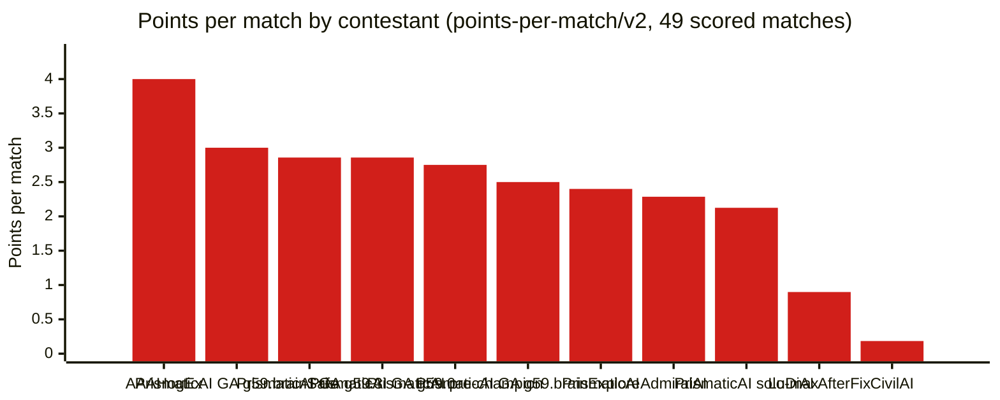
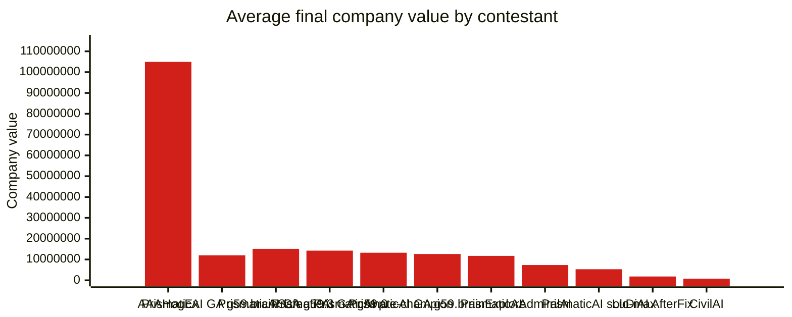
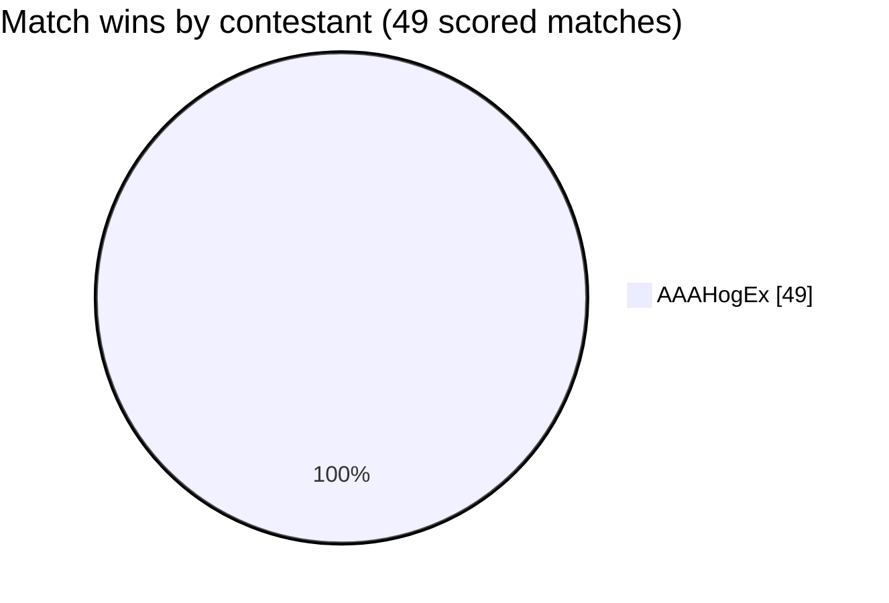
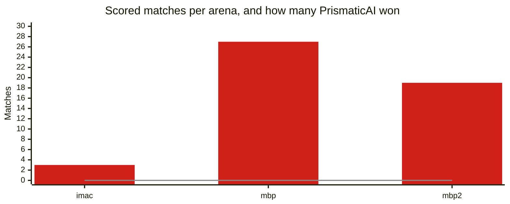

# battle-20261119T210410-9cc73010

Derived from `battle-20261119T210410-9cc73010.json` by `tools/research/ai-battle/battle.py report`; do not edit.

- Edition `9cc7301036c2c1d6`: PrismaticAI and referee at `ebf7516b54d7130fa0908c68ff298075c517fb41`, base set `opengfx-8.0.tar`
- 20-year free-for-all from 1960, map 256x256 temperate, breakdowns 1
- 49 scored match(es) on `imac` (20261119-master-gdf1e05e7d8), `mbp` (20261119-master-m356d6e49c0), `mbp2` (20261119-master-gdf1e05e7d8)
- Replays: 2 of 2 identical to their original on another arena

| # | Contestant | Played | Wins | Points | Points/match | Avg rank | Avg final value | Squirrel errors | Matches with anomalies |
|---|---|---|---|---|---|---|---|---|---|
| 1 | AAAHogEx | 49 | 49 | 196 | 4.0 | 1.0 | 104.9 M | 0 | 0 |
| 2 | PrismaticAI GA g59.brainSafe | 6 | 0 | 18 | 3.0 | 2.0 | 12.0 M | 0 | 1 |
| 3 | PrismaticAI GA g59.3 | 7 | 0 | 20 | 2.857 | 2.14 | 15.1 M | 0 | 2 |
| 4 | PrismaticAI GA g59.0 | 7 | 0 | 20 | 2.857 | 2.14 | 14.2 M | 0 | 4 |
| 5 | PrismaticAI pre-champion | 8 | 0 | 22 | 2.75 | 2.25 | 13.2 M | 0 | 0 |
| 6 | PrismaticAI GA g59.brainExplore | 8 | 0 | 20 | 2.5 | 2.5 | 12.6 M | 0 | 8 |
| 7 | PrismaticAI | 5 | 0 | 12 | 2.4 | 2.6 | 11.7 M | 0 | 1 |
| 8 | AdmiralAI | 49 | 0 | 112 | 2.286 | 2.71 | 7.3 M | 59 | 3 |
| 9 | PrismaticAI solo-max | 8 | 0 | 17 | 2.125 | 2.88 | 5.3 M | 0 | 8 |
| 10 | LuDiAI AfterFix | 49 | 0 | 44 | 0.898 | 4.1 | 1.8 M | 0 | 2 |
| 11 | CivilAI | 49 | 0 | 9 | 0.184 | 4.82 | 741.5 k | 0 | 5 |

```mermaid
---
config:
  xyChart:
    width: 900
    height: 360
  themeVariables:
    xyChart:
      plotColorPalette: "#d11f1a, #8a8a8a, #0b0b0b, #ece4d6"
---
xychart-beta
    title "Final company value per scored match: winner vs best PrismaticAI"
    x-axis ["m-0001", "m-0002", "m-0003", "m-0004", "m-0005", "m-0006", "m-0007", "m-0008", "m-0009", "m-0010", "m-0011", "m-0012", "m-0013", "m-0014", "m-0015", "m-0016", "m-0017", "m-0018", "m-0019", "m-0020", "m-0021", "m-0022", "m-0023", "m-0024", "m-0025", "m-0026", "m-0027", "m-0028", "m-0036", "m-0037", "m-0038", "m-0039", "m-0040", "m-0041", "m-0042", "m-0043", "m-0044", "m-0047", "m-0050", "m-0051", "m-0052", "m-0057", "m-0058", "m-0061", "m-0062", "m-0066", "m-0067", "m-0068", "m-0069"]
    %% series: Winner | Best PrismaticAI
    %% links: battle-20261119T210410-9cc73010.md?col=Match&filter=m-0001 | battle-20261119T210410-9cc73010.md?col=Match&filter=m-0002 | battle-20261119T210410-9cc73010.md?col=Match&filter=m-0003 | battle-20261119T210410-9cc73010.md?col=Match&filter=m-0004 | battle-20261119T210410-9cc73010.md?col=Match&filter=m-0005 | battle-20261119T210410-9cc73010.md?col=Match&filter=m-0006 | battle-20261119T210410-9cc73010.md?col=Match&filter=m-0007 | battle-20261119T210410-9cc73010.md?col=Match&filter=m-0008 | battle-20261119T210410-9cc73010.md?col=Match&filter=m-0009 | battle-20261119T210410-9cc73010.md?col=Match&filter=m-0010 | battle-20261119T210410-9cc73010.md?col=Match&filter=m-0011 | battle-20261119T210410-9cc73010.md?col=Match&filter=m-0012 | battle-20261119T210410-9cc73010.md?col=Match&filter=m-0013 | battle-20261119T210410-9cc73010.md?col=Match&filter=m-0014 | battle-20261119T210410-9cc73010.md?col=Match&filter=m-0015 | battle-20261119T210410-9cc73010.md?col=Match&filter=m-0016 | battle-20261119T210410-9cc73010.md?col=Match&filter=m-0017 | battle-20261119T210410-9cc73010.md?col=Match&filter=m-0018 | battle-20261119T210410-9cc73010.md?col=Match&filter=m-0019 | battle-20261119T210410-9cc73010.md?col=Match&filter=m-0020 | battle-20261119T210410-9cc73010.md?col=Match&filter=m-0021 | battle-20261119T210410-9cc73010.md?col=Match&filter=m-0022 | battle-20261119T210410-9cc73010.md?col=Match&filter=m-0023 | battle-20261119T210410-9cc73010.md?col=Match&filter=m-0024 | battle-20261119T210410-9cc73010.md?col=Match&filter=m-0025 | battle-20261119T210410-9cc73010.md?col=Match&filter=m-0026 | battle-20261119T210410-9cc73010.md?col=Match&filter=m-0027 | battle-20261119T210410-9cc73010.md?col=Match&filter=m-0028 | battle-20261119T210410-9cc73010.md?col=Match&filter=m-0036 | battle-20261119T210410-9cc73010.md?col=Match&filter=m-0037 | battle-20261119T210410-9cc73010.md?col=Match&filter=m-0038 | battle-20261119T210410-9cc73010.md?col=Match&filter=m-0039 | battle-20261119T210410-9cc73010.md?col=Match&filter=m-0040 | battle-20261119T210410-9cc73010.md?col=Match&filter=m-0041 | battle-20261119T210410-9cc73010.md?col=Match&filter=m-0042 | battle-20261119T210410-9cc73010.md?col=Match&filter=m-0043 | battle-20261119T210410-9cc73010.md?col=Match&filter=m-0044 | battle-20261119T210410-9cc73010.md?col=Match&filter=m-0047 | battle-20261119T210410-9cc73010.md?col=Match&filter=m-0050 | battle-20261119T210410-9cc73010.md?col=Match&filter=m-0051 | battle-20261119T210410-9cc73010.md?col=Match&filter=m-0052 | battle-20261119T210410-9cc73010.md?col=Match&filter=m-0057 | battle-20261119T210410-9cc73010.md?col=Match&filter=m-0058 | battle-20261119T210410-9cc73010.md?col=Match&filter=m-0061 | battle-20261119T210410-9cc73010.md?col=Match&filter=m-0062 | battle-20261119T210410-9cc73010.md?col=Match&filter=m-0066 | battle-20261119T210410-9cc73010.md?col=Match&filter=m-0067 | battle-20261119T210410-9cc73010.md?col=Match&filter=m-0068 | battle-20261119T210410-9cc73010.md?col=Match&filter=m-0069
    y-axis "Company value" 0 --> 166000000
    bar [143943534, 128913622, 119525873, 102756449, 133265156, 136931070, 105796290, 137708090, 117678377, 117511452, 151290992, 127623711, 97052755, 103241797, 126599757, 105956661, 71059140, 102581525, 90126814, 112795483, 75222495, 70231059, 71972501, 83456316, 87748521, 74534627, 85763106, 78590343, 100109081, 81409708, 97864122, 92330185, 77381572, 105403631, 148859859, 117783691, 129460429, 111915859, 102208964, 89394711, 84261070, 112945889, 115671003, 85116332, 130512453, 92582274, 132066585, 78165243, 95906965]
    line [7150090, 15139159, 17569725, 21193284, 18725132, 20402080, 12678182, 3295982, 19385730, 9326927, 10341657, 11082117, 17812180, 19969153, 5764440, 16652054, 18000489, 15671815, 19116287, 15233600, 11286537, 5570141, 11059640, 14821371, 8482949, 7346535, 17338899, 12649878, 4262094, 8106495, 18655522, 9227519, 14215454, 13377751, 2033398, 5026330, 7548638, 9053939, 4144034, 10651387, 13465274, 7229421, 17324522, 12184109, 10265185, 7850071, 7036937, 9268515, 11382155]
```

<!-- battle-charts:begin -->
<!-- derived from battle-20261119T210410-9cc73010.json by `battle.py render`; `battle.py check` fails when it is stale -->

<!-- battle-charts:end -->

| Seed | Original | Replay | Arenas | Identical |
|---|---|---|---|---|
| 143963714 | m-0001 | m-0048 | mbp / mbp2 | yes |
| 143963714 | m-0002 | m-0056 | mbp / mbp2 | yes |

| Match | Arena | Seed | Winner | Value | Last | Anomalies |
|---|---|---|---|---|---|---|
| m-0001 | mbp | 143963714 | AAAHogEx | 143.9 M | CivilAI | PrismaticAI solo-max: fleet_drop:44->20 |
| m-0002 | mbp | 143963714 | AAAHogEx | 128.9 M | CivilAI | - |
| m-0003 | mbp | 143963714 | AAAHogEx | 119.5 M | CivilAI | PrismaticAI GA g59.0: fleet_drop:137->73 |
| m-0004 | mbp | 143963714 | AAAHogEx | 102.8 M | CivilAI | - |
| m-0005 | mbp | 143963714 | AAAHogEx | 133.3 M | LuDiAI AfterFix | PrismaticAI GA g59.brainExplore: fleet_drop:165->72 |
| m-0006 | mbp | 143963714 | AAAHogEx | 136.9 M | LuDiAI AfterFix | - |
| m-0007 | mbp | 1091188390 | AAAHogEx | 105.8 M | CivilAI | - |
| m-0008 | mbp | 1091188390 | AAAHogEx | 137.7 M | CivilAI | PrismaticAI solo-max: fleet_drop:51->23 |
| m-0009 | mbp | 1091188390 | AAAHogEx | 117.7 M | CivilAI | CivilAI: fleet_drop:82->51 |
| m-0010 | imac | 1091188390 | AAAHogEx | 117.5 M | CivilAI | PrismaticAI GA g59.0: fleet_drop:168->87 |
| m-0011 | imac | 1091188390 | AAAHogEx | 151.3 M | CivilAI | - |
| m-0012 | imac | 1091188390 | AAAHogEx | 127.6 M | CivilAI | PrismaticAI GA g59.brainExplore: fleet_drop:223->43 |
| m-0013 | mbp2 | 1091188390 | AAAHogEx | 97.1 M | CivilAI | - |
| m-0014 | mbp2 | 1675497933 | AAAHogEx | 103.2 M | CivilAI | - |
| m-0015 | mbp2 | 1675497933 | AAAHogEx | 126.6 M | CivilAI | PrismaticAI solo-max: fleet_drop:41->26 |
| m-0016 | mbp2 | 1675497933 | AAAHogEx | 106.0 M | CivilAI | - |
| m-0017 | mbp2 | 1675497933 | AAAHogEx | 71.1 M | CivilAI | CivilAI: fleet_drop:82->52 |
| m-0018 | mbp2 | 1675497933 | AAAHogEx | 102.6 M | CivilAI | - |
| m-0019 | mbp2 | 1675497933 | AAAHogEx | 90.1 M | CivilAI | PrismaticAI GA g59.brainExplore: fleet_drop:207->74; AdmiralAI: fleet_drop:420->284; CivilAI: fleet_drop:45->30 |
| m-0020 | mbp2 | 1675497933 | AAAHogEx | 112.8 M | CivilAI | - |
| m-0021 | mbp2 | 1440185335 | AAAHogEx | 75.2 M | CivilAI | - |
| m-0022 | mbp2 | 1440185335 | AAAHogEx | 70.2 M | CivilAI | PrismaticAI solo-max: fleet_drop:28->13 |
| m-0023 | mbp2 | 1440185335 | AAAHogEx | 72.0 M | CivilAI | - |
| m-0024 | mbp2 | 1440185335 | AAAHogEx | 83.5 M | CivilAI | PrismaticAI GA g59.0: fleet_drop:74->38; AdmiralAI: squirrel_errors:59 |
| m-0025 | mbp2 | 1440185335 | AAAHogEx | 87.7 M | CivilAI | - |
| m-0026 | mbp2 | 1440185335 | AAAHogEx | 74.5 M | CivilAI | PrismaticAI GA g59.brainExplore: fleet_drop:78->40 |
| m-0027 | mbp2 | 1440185335 | AAAHogEx | 85.8 M | CivilAI | - |
| m-0028 | mbp2 | 397738130 | AAAHogEx | 78.6 M | LuDiAI AfterFix | - |
| m-0036 | mbp | 1151741420 | AAAHogEx | 100.1 M | CivilAI | PrismaticAI solo-max: fleet_drop:46->14 |
| m-0037 | mbp | 1151741420 | AAAHogEx | 81.4 M | CivilAI | - |
| m-0038 | mbp | 1151741420 | AAAHogEx | 97.9 M | AdmiralAI | PrismaticAI GA g59.0: fleet_drop:141->97 |
| m-0039 | mbp | 1151741420 | AAAHogEx | 92.3 M | CivilAI | - |
| m-0040 | mbp | 1151741420 | AAAHogEx | 77.4 M | CivilAI | PrismaticAI GA g59.brainExplore: fleet_drop:170->103 |
| m-0041 | mbp | 1151741420 | AAAHogEx | 105.4 M | LuDiAI AfterFix | - |
| m-0042 | mbp | 506672416 | AAAHogEx | 148.9 M | CivilAI | PrismaticAI: fleet_drop:60->24 |
| m-0043 | mbp | 506672416 | AAAHogEx | 117.8 M | CivilAI | PrismaticAI solo-max: fleet_drop:50->21 |
| m-0044 | mbp | 506672416 | AAAHogEx | 129.5 M | CivilAI | - |
| m-0047 | mbp2 | 506672416 | AAAHogEx | 111.9 M | CivilAI | PrismaticAI GA g59.brainExplore: fleet_drop:141->42 |
| m-0048 (replay) | mbp2 | 143963714 | AAAHogEx | 143.9 M | CivilAI | PrismaticAI solo-max: fleet_drop:44->20 |
| m-0050 | mbp2 | 1830684049 | AAAHogEx | 102.2 M | CivilAI | PrismaticAI solo-max: fleet_drop:35->16 |
| m-0051 | mbp2 | 1830684049 | AAAHogEx | 89.4 M | CivilAI | AdmiralAI: fleet_drop:276->173 |
| m-0052 | mbp | 1830684049 | AAAHogEx | 84.3 M | LuDiAI AfterFix | - |
| m-0056 (replay) | mbp2 | 143963714 | AAAHogEx | 128.9 M | CivilAI | - |
| m-0057 | mbp | 1758456036 | AAAHogEx | 112.9 M | CivilAI | PrismaticAI solo-max: fleet_drop:37->16; CivilAI: no_vehicles |
| m-0058 | mbp | 1758456036 | AAAHogEx | 115.7 M | CivilAI | - |
| m-0061 | mbp | 1758456036 | AAAHogEx | 85.1 M | CivilAI | PrismaticAI GA g59.brainExplore: fleet_drop:111->65; LuDiAI AfterFix: fleet_drop:173->121 |
| m-0062 | mbp | 1758456036 | AAAHogEx | 130.5 M | CivilAI | PrismaticAI GA g59.3: fleet_drop:65->45 |
| m-0066 | mbp | 290687988 | AAAHogEx | 92.6 M | CivilAI | LuDiAI AfterFix: fleet_drop:61->39; CivilAI: fleet_drop:57->28 |
| m-0067 | mbp | 290687988 | AAAHogEx | 132.1 M | LuDiAI AfterFix | PrismaticAI GA g59.brainSafe: fleet_drop:21->11 |
| m-0068 | mbp | 290687988 | AAAHogEx | 78.2 M | CivilAI | PrismaticAI GA g59.brainExplore: fleet_drop:87->36 |
| m-0069 | mbp | 290687988 | AAAHogEx | 95.9 M | LuDiAI AfterFix | PrismaticAI GA g59.3: fleet_drop:48->25 |
