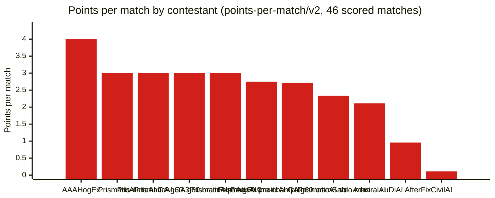
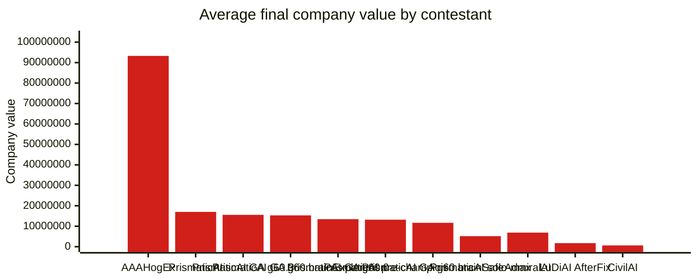
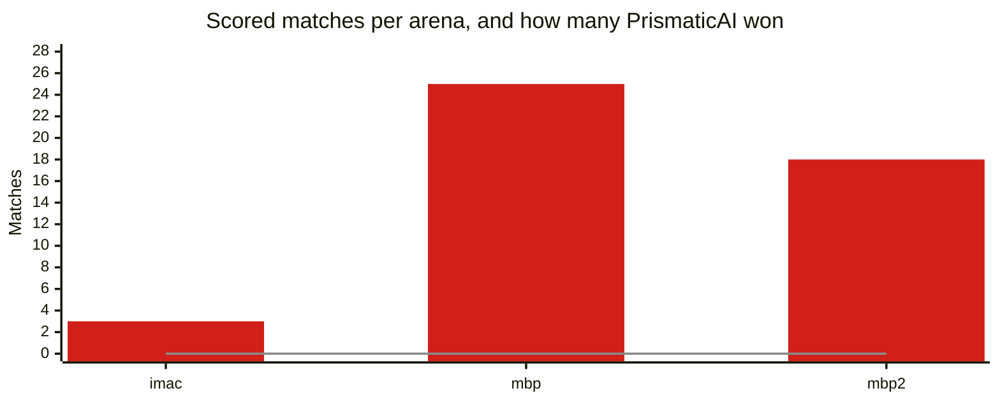

# battle-20261119T211417-fa217aac

Derived from `battle-20261119T211417-fa217aac.json` by `tools/research/ai-battle/battle.py report`; do not edit.

- Edition `fa217aac495bfafe`: PrismaticAI and referee at `ebf7516b54d7130fa0908c68ff298075c517fb41`, base set `opengfx-8.0.tar`
- 20-year free-for-all from 1960, map 256x256 temperate, breakdowns 1
- 46 scored match(es) on `imac` (20261119-master-gdf1e05e7d8), `mbp` (20261119-master-m356d6e49c0), `mbp2` (20261119-master-gdf1e05e7d8)
- Replays: 1 of 2 identical to their original on another arena

| # | Contestant | Played | Wins | Points | Points/match | Avg rank | Avg final value | Squirrel errors | Matches with anomalies |
|---|---|---|---|---|---|---|---|---|---|
| 1 | AAAHogEx | 46 | 46 | 184 | 4.0 | 1.0 | 93.3 M | 0 | 0 |
| 2 | PrismaticAI | 6 | 0 | 18 | 3.0 | 2.0 | 17.0 M | 0 | 0 |
| 3 | PrismaticAI GA g60.3 | 6 | 0 | 18 | 3.0 | 2.0 | 15.6 M | 0 | 3 |
| 4 | PrismaticAI GA g60.brainExplore | 7 | 0 | 21 | 3.0 | 2.0 | 15.3 M | 0 | 3 |
| 5 | PrismaticAI GA g60.0 | 6 | 0 | 18 | 3.0 | 2.0 | 13.5 M | 0 | 0 |
| 6 | PrismaticAI pre-champion | 8 | 0 | 22 | 2.75 | 2.25 | 13.2 M | 0 | 0 |
| 7 | PrismaticAI GA g60.brainSafe | 7 | 0 | 19 | 2.714 | 2.29 | 11.7 M | 0 | 0 |
| 8 | PrismaticAI solo-max | 6 | 0 | 14 | 2.333 | 2.67 | 5.2 M | 0 | 6 |
| 9 | AdmiralAI | 46 | 0 | 97 | 2.109 | 2.89 | 6.9 M | 0 | 1 |
| 10 | LuDiAI AfterFix | 46 | 0 | 44 | 0.957 | 4.04 | 1.7 M | 0 | 0 |
| 11 | CivilAI | 46 | 0 | 5 | 0.109 | 4.89 | 615.3 k | 0 | 4 |

```mermaid
---
config:
  xyChart:
    width: 900
    height: 360
  themeVariables:
    xyChart:
      plotColorPalette: "#d11f1a, #8a8a8a, #0b0b0b, #ece4d6"
---
xychart-beta
    title "Final company value per scored match: winner vs best PrismaticAI"
    x-axis ["m-0001", "m-0002", "m-0003", "m-0004", "m-0005", "m-0006", "m-0007", "m-0008", "m-0009", "m-0010", "m-0011", "m-0012", "m-0013", "m-0014", "m-0015", "m-0016", "m-0017", "m-0018", "m-0019", "m-0020", "m-0021", "m-0022", "m-0023", "m-0024", "m-0025", "m-0026", "m-0027", "m-0028", "m-0036", "m-0037", "m-0038", "m-0039", "m-0040", "m-0041", "m-0042", "m-0043", "m-0044", "m-0047", "m-0051", "m-0060", "m-0061", "m-0062", "m-0063", "m-0065", "m-0066", "m-0067"]
    %% series: Winner | Best PrismaticAI
    %% links: battle-20261119T211417-fa217aac.md?col=Match&filter=m-0001 | battle-20261119T211417-fa217aac.md?col=Match&filter=m-0002 | battle-20261119T211417-fa217aac.md?col=Match&filter=m-0003 | battle-20261119T211417-fa217aac.md?col=Match&filter=m-0004 | battle-20261119T211417-fa217aac.md?col=Match&filter=m-0005 | battle-20261119T211417-fa217aac.md?col=Match&filter=m-0006 | battle-20261119T211417-fa217aac.md?col=Match&filter=m-0007 | battle-20261119T211417-fa217aac.md?col=Match&filter=m-0008 | battle-20261119T211417-fa217aac.md?col=Match&filter=m-0009 | battle-20261119T211417-fa217aac.md?col=Match&filter=m-0010 | battle-20261119T211417-fa217aac.md?col=Match&filter=m-0011 | battle-20261119T211417-fa217aac.md?col=Match&filter=m-0012 | battle-20261119T211417-fa217aac.md?col=Match&filter=m-0013 | battle-20261119T211417-fa217aac.md?col=Match&filter=m-0014 | battle-20261119T211417-fa217aac.md?col=Match&filter=m-0015 | battle-20261119T211417-fa217aac.md?col=Match&filter=m-0016 | battle-20261119T211417-fa217aac.md?col=Match&filter=m-0017 | battle-20261119T211417-fa217aac.md?col=Match&filter=m-0018 | battle-20261119T211417-fa217aac.md?col=Match&filter=m-0019 | battle-20261119T211417-fa217aac.md?col=Match&filter=m-0020 | battle-20261119T211417-fa217aac.md?col=Match&filter=m-0021 | battle-20261119T211417-fa217aac.md?col=Match&filter=m-0022 | battle-20261119T211417-fa217aac.md?col=Match&filter=m-0023 | battle-20261119T211417-fa217aac.md?col=Match&filter=m-0024 | battle-20261119T211417-fa217aac.md?col=Match&filter=m-0025 | battle-20261119T211417-fa217aac.md?col=Match&filter=m-0026 | battle-20261119T211417-fa217aac.md?col=Match&filter=m-0027 | battle-20261119T211417-fa217aac.md?col=Match&filter=m-0028 | battle-20261119T211417-fa217aac.md?col=Match&filter=m-0036 | battle-20261119T211417-fa217aac.md?col=Match&filter=m-0037 | battle-20261119T211417-fa217aac.md?col=Match&filter=m-0038 | battle-20261119T211417-fa217aac.md?col=Match&filter=m-0039 | battle-20261119T211417-fa217aac.md?col=Match&filter=m-0040 | battle-20261119T211417-fa217aac.md?col=Match&filter=m-0041 | battle-20261119T211417-fa217aac.md?col=Match&filter=m-0042 | battle-20261119T211417-fa217aac.md?col=Match&filter=m-0043 | battle-20261119T211417-fa217aac.md?col=Match&filter=m-0044 | battle-20261119T211417-fa217aac.md?col=Match&filter=m-0047 | battle-20261119T211417-fa217aac.md?col=Match&filter=m-0051 | battle-20261119T211417-fa217aac.md?col=Match&filter=m-0060 | battle-20261119T211417-fa217aac.md?col=Match&filter=m-0061 | battle-20261119T211417-fa217aac.md?col=Match&filter=m-0062 | battle-20261119T211417-fa217aac.md?col=Match&filter=m-0063 | battle-20261119T211417-fa217aac.md?col=Match&filter=m-0065 | battle-20261119T211417-fa217aac.md?col=Match&filter=m-0066 | battle-20261119T211417-fa217aac.md?col=Match&filter=m-0067
    y-axis "Company value" 0 --> 144000000
    bar [78501034, 73498546, 80828634, 61834634, 83703073, 80525118, 78762718, 123415861, 105008163, 106858058, 104956358, 101014752, 87105073, 111212930, 109210878, 93499316, 94456005, 92209118, 99777316, 111805433, 83210650, 89505785, 73442304, 81952133, 73877952, 89992728, 64748810, 100173996, 113828170, 104638049, 102869566, 130699968, 81111115, 91482887, 92263994, 111220828, 90923243, 83861550, 102428241, 98752665, 89630686, 106879531, 89577692, 97603566, 76066247, 91604686]
    line [6315511, 13893907, 10555195, 10119201, 10996179, 17472066, 13534903, 5057153, 15063258, 11809058, 12792124, 18405233, 13716860, 18071777, 4002050, 12285216, 14151206, 13503866, 11915300, 20375937, 18224949, 5578876, 18969382, 14992081, 15425377, 19914870, 13320555, 20391897, 6701663, 15182189, 13661062, 12389964, 15743065, 17340941, 17067309, 3254152, 14689615, 16486824, 7994278, 7966995, 13694335, 11120347, 14783566, 7530863, 15541713, 9492496]
```

<!-- battle-charts:begin -->
<!-- derived from battle-20261119T211417-fa217aac.json by `battle.py render`; `battle.py check` fails when it is stale -->

<!-- battle-charts:end -->

| Seed | Original | Replay | Arenas | Identical |
|---|---|---|---|---|
| 251370886 | m-0001 | m-0048 | mbp / mbp2 | yes |
| 83160067 | m-0011 | m-0064 | imac / mbp | NO |

| Match | Arena | Seed | Winner | Value | Last | Anomalies |
|---|---|---|---|---|---|---|
| m-0001 | mbp | 251370886 | AAAHogEx | 78.5 M | CivilAI | PrismaticAI solo-max: fleet_drop:40->16 |
| m-0002 | mbp | 251370886 | AAAHogEx | 73.5 M | CivilAI | - |
| m-0003 | mbp | 251370886 | AAAHogEx | 80.8 M | CivilAI | - |
| m-0004 | mbp | 251370886 | AAAHogEx | 61.8 M | CivilAI | - |
| m-0005 | mbp | 251370886 | AAAHogEx | 83.7 M | CivilAI | PrismaticAI GA g60.brainExplore: fleet_drop:125->70 |
| m-0006 | mbp | 251370886 | AAAHogEx | 80.5 M | LuDiAI AfterFix | PrismaticAI GA g60.3: fleet_drop:102->69 |
| m-0007 | mbp | 83160067 | AAAHogEx | 78.8 M | CivilAI | - |
| m-0008 | mbp | 83160067 | AAAHogEx | 123.4 M | CivilAI | PrismaticAI solo-max: fleet_drop:43->15 |
| m-0009 | mbp | 83160067 | AAAHogEx | 105.0 M | CivilAI | - |
| m-0010 | imac | 83160067 | AAAHogEx | 106.9 M | CivilAI | - |
| m-0011 | imac | 83160067 | AAAHogEx | 105.0 M | CivilAI | - |
| m-0012 | imac | 83160067 | AAAHogEx | 101.0 M | CivilAI | PrismaticAI GA g60.brainExplore: fleet_drop:138->73; CivilAI: fleet_drop:119->67 |
| m-0013 | mbp2 | 83160067 | AAAHogEx | 87.1 M | CivilAI | - |
| m-0014 | mbp2 | 1276230856 | AAAHogEx | 111.2 M | CivilAI | - |
| m-0015 | mbp2 | 1276230856 | AAAHogEx | 109.2 M | CivilAI | PrismaticAI solo-max: fleet_drop:46->21 |
| m-0016 | mbp2 | 1276230856 | AAAHogEx | 93.5 M | CivilAI | AdmiralAI: fleet_drop:198->100 |
| m-0017 | mbp2 | 1276230856 | AAAHogEx | 94.5 M | LuDiAI AfterFix | - |
| m-0018 | mbp2 | 1276230856 | AAAHogEx | 92.2 M | CivilAI | - |
| m-0019 | mbp2 | 1276230856 | AAAHogEx | 99.8 M | CivilAI | - |
| m-0020 | mbp2 | 1276230856 | AAAHogEx | 111.8 M | CivilAI | PrismaticAI GA g60.3: fleet_drop:118->57 |
| m-0021 | mbp2 | 1008508693 | AAAHogEx | 83.2 M | CivilAI | - |
| m-0022 | mbp2 | 1008508693 | AAAHogEx | 89.5 M | CivilAI | PrismaticAI solo-max: fleet_drop:34->18 |
| m-0023 | mbp2 | 1008508693 | AAAHogEx | 73.4 M | CivilAI | - |
| m-0024 | mbp2 | 1008508693 | AAAHogEx | 82.0 M | CivilAI | CivilAI: fleet_drop:32->14 |
| m-0025 | mbp2 | 1008508693 | AAAHogEx | 73.9 M | CivilAI | - |
| m-0026 | mbp2 | 1008508693 | AAAHogEx | 90.0 M | CivilAI | - |
| m-0027 | mbp2 | 1008508693 | AAAHogEx | 64.7 M | CivilAI | - |
| m-0028 | mbp2 | 1756007393 | AAAHogEx | 100.2 M | LuDiAI AfterFix | - |
| m-0036 | mbp | 1889640358 | AAAHogEx | 113.8 M | CivilAI | PrismaticAI solo-max: fleet_drop:42->17 |
| m-0037 | mbp | 1889640358 | AAAHogEx | 104.6 M | LuDiAI AfterFix | - |
| m-0038 | mbp | 1889640358 | AAAHogEx | 102.9 M | CivilAI | - |
| m-0039 | mbp | 1889640358 | AAAHogEx | 130.7 M | CivilAI | - |
| m-0040 | mbp | 1889640358 | AAAHogEx | 81.1 M | CivilAI | - |
| m-0041 | mbp | 1889640358 | AAAHogEx | 91.5 M | CivilAI | PrismaticAI GA g60.3: fleet_drop:105->40 |
| m-0042 | mbp | 1624037137 | AAAHogEx | 92.3 M | CivilAI | - |
| m-0043 | mbp | 1624037137 | AAAHogEx | 111.2 M | CivilAI | PrismaticAI solo-max: fleet_drop:34->10 |
| m-0044 | mbp | 1624037137 | AAAHogEx | 90.9 M | CivilAI | - |
| m-0047 | mbp2 | 1624037137 | AAAHogEx | 83.9 M | CivilAI | PrismaticAI GA g60.brainExplore: fleet_drop:125->47 |
| m-0048 (replay) | mbp2 | 251370886 | AAAHogEx | 78.5 M | CivilAI | PrismaticAI solo-max: fleet_drop:40->16 |
| m-0051 | mbp2 | 439113695 | AAAHogEx | 102.4 M | CivilAI | - |
| m-0060 | mbp | 1456072702 | AAAHogEx | 98.8 M | CivilAI | CivilAI: fleet_drop:37->18 |
| m-0061 | mbp | 1456072702 | AAAHogEx | 89.6 M | CivilAI | CivilAI: fleet_drop:79->43 |
| m-0062 | mbp | 1456072702 | AAAHogEx | 106.9 M | LuDiAI AfterFix | - |
| m-0063 | mbp | 1814395656 | AAAHogEx | 89.6 M | CivilAI | - |
| m-0064 (replay) | mbp | 83160067 | AAAHogEx | 101.6 M | CivilAI | - |
| m-0065 | mbp | 1814395656 | AAAHogEx | 97.6 M | CivilAI | - |
| m-0066 | mbp | 1814395656 | AAAHogEx | 76.1 M | CivilAI | - |
| m-0067 | mbp | 1814395656 | AAAHogEx | 91.6 M | CivilAI | - |
