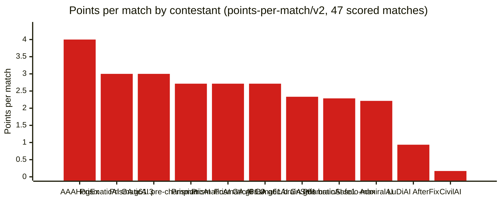
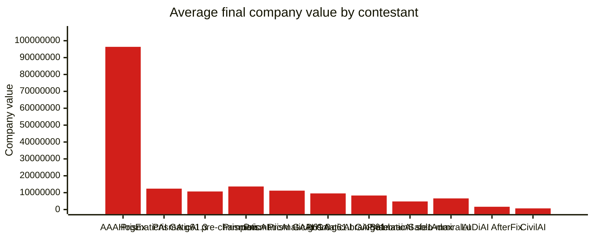
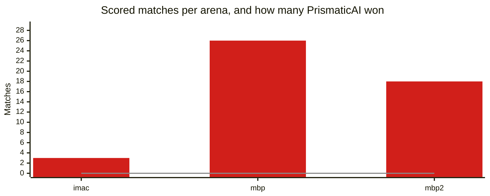

# battle-20261119T212508-ec2910f0

Derived from `battle-20261119T212508-ec2910f0.json` by `tools/research/ai-battle/battle.py report`; do not edit.

- Edition `ec2910f001d47871`: PrismaticAI and referee at `ebf7516b54d7130fa0908c68ff298075c517fb41`, base set `opengfx-8.0.tar`
- 20-year free-for-all from 1960, map 256x256 temperate, breakdowns 1
- 47 scored match(es) on `imac` (20261119-master-gdf1e05e7d8), `mbp` (20261119-master-m356d6e49c0), `mbp2` (20261119-master-gdf1e05e7d8)
- Replays: 2 of 2 identical to their original on another arena

| # | Contestant | Played | Wins | Points | Points/match | Avg rank | Avg final value | Squirrel errors | Matches with anomalies |
|---|---|---|---|---|---|---|---|---|---|
| 1 | AAAHogEx | 47 | 47 | 188 | 4.0 | 1.0 | 96.4 M | 0 | 0 |
| 2 | PrismaticAI GA g61.3 | 6 | 0 | 18 | 3.0 | 2.0 | 12.4 M | 0 | 0 |
| 3 | PrismaticAI pre-champion | 7 | 0 | 21 | 3.0 | 2.0 | 10.7 M | 0 | 0 |
| 4 | PrismaticAI | 7 | 0 | 19 | 2.714 | 2.29 | 13.7 M | 0 | 1 |
| 5 | PrismaticAI GA g61.0 | 7 | 0 | 19 | 2.714 | 2.29 | 11.2 M | 0 | 5 |
| 6 | PrismaticAI GA g61.brainSafe | 7 | 0 | 19 | 2.714 | 2.29 | 9.6 M | 0 | 2 |
| 7 | PrismaticAI GA g61.brainSafe1 | 6 | 0 | 14 | 2.333 | 2.67 | 8.3 M | 0 | 4 |
| 8 | PrismaticAI solo-max | 7 | 0 | 16 | 2.286 | 2.71 | 4.8 M | 0 | 7 |
| 9 | AdmiralAI | 47 | 0 | 104 | 2.213 | 2.79 | 6.6 M | 0 | 1 |
| 10 | LuDiAI AfterFix | 47 | 0 | 44 | 0.936 | 4.06 | 1.7 M | 0 | 0 |
| 11 | CivilAI | 47 | 0 | 8 | 0.17 | 4.83 | 686.5 k | 0 | 9 |

```mermaid
---
config:
  xyChart:
    width: 900
    height: 360
  themeVariables:
    xyChart:
      plotColorPalette: "#d11f1a, #8a8a8a, #0b0b0b, #ece4d6"
---
xychart-beta
    title "Final company value per scored match: winner vs best PrismaticAI"
    x-axis ["m-0001", "m-0002", "m-0003", "m-0004", "m-0005", "m-0006", "m-0007", "m-0008", "m-0009", "m-0010", "m-0011", "m-0012", "m-0013", "m-0014", "m-0015", "m-0016", "m-0017", "m-0018", "m-0019", "m-0020", "m-0021", "m-0022", "m-0023", "m-0024", "m-0025", "m-0026", "m-0027", "m-0028", "m-0036", "m-0037", "m-0038", "m-0039", "m-0040", "m-0041", "m-0042", "m-0043", "m-0044", "m-0045", "m-0046", "m-0047", "m-0049", "m-0050", "m-0051", "m-0052", "m-0053", "m-0062", "m-0063"]
    %% series: Winner | Best PrismaticAI
    %% links: battle-20261119T212508-ec2910f0.md?col=Match&filter=m-0001 | battle-20261119T212508-ec2910f0.md?col=Match&filter=m-0002 | battle-20261119T212508-ec2910f0.md?col=Match&filter=m-0003 | battle-20261119T212508-ec2910f0.md?col=Match&filter=m-0004 | battle-20261119T212508-ec2910f0.md?col=Match&filter=m-0005 | battle-20261119T212508-ec2910f0.md?col=Match&filter=m-0006 | battle-20261119T212508-ec2910f0.md?col=Match&filter=m-0007 | battle-20261119T212508-ec2910f0.md?col=Match&filter=m-0008 | battle-20261119T212508-ec2910f0.md?col=Match&filter=m-0009 | battle-20261119T212508-ec2910f0.md?col=Match&filter=m-0010 | battle-20261119T212508-ec2910f0.md?col=Match&filter=m-0011 | battle-20261119T212508-ec2910f0.md?col=Match&filter=m-0012 | battle-20261119T212508-ec2910f0.md?col=Match&filter=m-0013 | battle-20261119T212508-ec2910f0.md?col=Match&filter=m-0014 | battle-20261119T212508-ec2910f0.md?col=Match&filter=m-0015 | battle-20261119T212508-ec2910f0.md?col=Match&filter=m-0016 | battle-20261119T212508-ec2910f0.md?col=Match&filter=m-0017 | battle-20261119T212508-ec2910f0.md?col=Match&filter=m-0018 | battle-20261119T212508-ec2910f0.md?col=Match&filter=m-0019 | battle-20261119T212508-ec2910f0.md?col=Match&filter=m-0020 | battle-20261119T212508-ec2910f0.md?col=Match&filter=m-0021 | battle-20261119T212508-ec2910f0.md?col=Match&filter=m-0022 | battle-20261119T212508-ec2910f0.md?col=Match&filter=m-0023 | battle-20261119T212508-ec2910f0.md?col=Match&filter=m-0024 | battle-20261119T212508-ec2910f0.md?col=Match&filter=m-0025 | battle-20261119T212508-ec2910f0.md?col=Match&filter=m-0026 | battle-20261119T212508-ec2910f0.md?col=Match&filter=m-0027 | battle-20261119T212508-ec2910f0.md?col=Match&filter=m-0028 | battle-20261119T212508-ec2910f0.md?col=Match&filter=m-0036 | battle-20261119T212508-ec2910f0.md?col=Match&filter=m-0037 | battle-20261119T212508-ec2910f0.md?col=Match&filter=m-0038 | battle-20261119T212508-ec2910f0.md?col=Match&filter=m-0039 | battle-20261119T212508-ec2910f0.md?col=Match&filter=m-0040 | battle-20261119T212508-ec2910f0.md?col=Match&filter=m-0041 | battle-20261119T212508-ec2910f0.md?col=Match&filter=m-0042 | battle-20261119T212508-ec2910f0.md?col=Match&filter=m-0043 | battle-20261119T212508-ec2910f0.md?col=Match&filter=m-0044 | battle-20261119T212508-ec2910f0.md?col=Match&filter=m-0045 | battle-20261119T212508-ec2910f0.md?col=Match&filter=m-0046 | battle-20261119T212508-ec2910f0.md?col=Match&filter=m-0047 | battle-20261119T212508-ec2910f0.md?col=Match&filter=m-0049 | battle-20261119T212508-ec2910f0.md?col=Match&filter=m-0050 | battle-20261119T212508-ec2910f0.md?col=Match&filter=m-0051 | battle-20261119T212508-ec2910f0.md?col=Match&filter=m-0052 | battle-20261119T212508-ec2910f0.md?col=Match&filter=m-0053 | battle-20261119T212508-ec2910f0.md?col=Match&filter=m-0062 | battle-20261119T212508-ec2910f0.md?col=Match&filter=m-0063
    y-axis "Company value" 0 --> 163000000
    bar [86268969, 89814199, 97553003, 69198125, 84250021, 80862064, 103679551, 108333179, 77394730, 105187007, 77791600, 99153965, 85560324, 97397417, 113070719, 103090211, 104573415, 95499208, 90098367, 98255896, 102160314, 110242605, 108265221, 76864693, 100014113, 111012205, 103090002, 119757687, 100355879, 103913953, 99112598, 100103418, 90729333, 74634897, 69803002, 67130976, 66274160, 82030299, 61527644, 65554964, 107911761, 130058231, 129352724, 109453871, 122332086, 148326323, 102382074]
    line [3814260, 9644359, 11048382, 10470543, 11728892, 7808394, 13950833, 5063774, 13194367, 15209714, 11045046, 7554349, 12579691, 23165267, 7207156, 15430556, 13642796, 13741812, 13775099, 17068363, 14559687, 6155145, 11955709, 10930970, 15182975, 13937984, 8561312, 11694296, 3895038, 7357560, 8336308, 6145447, 2223979, 8850460, 4097939, 2979301, 6403857, 4566079, 2887051, 647373, 9215572, 4489157, 10942495, 14626670, 7442479, 19420929, 18904979]
```

<!-- battle-charts:begin -->
<!-- derived from battle-20261119T212508-ec2910f0.json by `battle.py render`; `battle.py check` fails when it is stale -->

<!-- battle-charts:end -->

| Seed | Original | Replay | Arenas | Identical |
|---|---|---|---|---|
| 710814129 | m-0001 | m-0048 | mbp / mbp2 | yes |
| 1913387931 | m-0013 | m-0064 | mbp2 / mbp | yes |

| Match | Arena | Seed | Winner | Value | Last | Anomalies |
|---|---|---|---|---|---|---|
| m-0001 | mbp | 710814129 | AAAHogEx | 86.3 M | LuDiAI AfterFix | PrismaticAI solo-max: fleet_drop:26->15 |
| m-0002 | mbp | 710814129 | AAAHogEx | 89.8 M | CivilAI | - |
| m-0003 | mbp | 710814129 | AAAHogEx | 97.6 M | LuDiAI AfterFix | - |
| m-0004 | mbp | 710814129 | AAAHogEx | 69.2 M | LuDiAI AfterFix | CivilAI: fleet_drop:43->29 |
| m-0005 | mbp | 710814129 | AAAHogEx | 84.3 M | CivilAI | - |
| m-0006 | mbp | 710814129 | AAAHogEx | 80.9 M | CivilAI | - |
| m-0007 | mbp | 1913387931 | AAAHogEx | 103.7 M | CivilAI | CivilAI: fleet_drop:58->30 |
| m-0008 | mbp | 1913387931 | AAAHogEx | 108.3 M | CivilAI | AdmiralAI: fleet_drop:143->60; PrismaticAI solo-max: fleet_drop:46->20 |
| m-0009 | mbp | 1913387931 | AAAHogEx | 77.4 M | CivilAI | - |
| m-0010 | imac | 1913387931 | AAAHogEx | 105.2 M | CivilAI | PrismaticAI GA g61.0: fleet_drop:134->61 |
| m-0011 | imac | 1913387931 | AAAHogEx | 77.8 M | CivilAI | PrismaticAI GA g61.brainSafe: fleet_drop:86->47; CivilAI: fleet_drop:89->50 |
| m-0012 | imac | 1913387931 | AAAHogEx | 99.2 M | CivilAI | PrismaticAI GA g61.brainSafe1: fleet_drop:101->57 |
| m-0013 | mbp2 | 1913387931 | AAAHogEx | 85.6 M | CivilAI | - |
| m-0014 | mbp2 | 703849109 | AAAHogEx | 97.4 M | CivilAI | - |
| m-0015 | mbp2 | 703849109 | AAAHogEx | 113.1 M | CivilAI | PrismaticAI solo-max: fleet_drop:46->26 |
| m-0016 | mbp2 | 703849109 | AAAHogEx | 103.1 M | CivilAI | - |
| m-0017 | mbp2 | 703849109 | AAAHogEx | 104.6 M | CivilAI | PrismaticAI GA g61.0: fleet_drop:123->79 |
| m-0018 | mbp2 | 703849109 | AAAHogEx | 95.5 M | CivilAI | - |
| m-0019 | mbp2 | 703849109 | AAAHogEx | 90.1 M | LuDiAI AfterFix | CivilAI: fleet_drop:53->33 |
| m-0020 | mbp2 | 703849109 | AAAHogEx | 98.3 M | CivilAI | - |
| m-0021 | mbp2 | 1133315463 | AAAHogEx | 102.2 M | LuDiAI AfterFix | - |
| m-0022 | mbp2 | 1133315463 | AAAHogEx | 110.2 M | CivilAI | PrismaticAI solo-max: fleet_drop:45->23 |
| m-0023 | mbp2 | 1133315463 | AAAHogEx | 108.3 M | CivilAI | - |
| m-0024 | mbp2 | 1133315463 | AAAHogEx | 76.9 M | CivilAI | PrismaticAI GA g61.0: fleet_drop:77->46 |
| m-0025 | mbp2 | 1133315463 | AAAHogEx | 100.0 M | CivilAI | - |
| m-0026 | mbp2 | 1133315463 | AAAHogEx | 111.0 M | CivilAI | PrismaticAI GA g61.brainSafe1: fleet_drop:107->52 |
| m-0027 | mbp2 | 1133315463 | AAAHogEx | 103.1 M | CivilAI | - |
| m-0028 | mbp2 | 630155936 | AAAHogEx | 119.8 M | CivilAI | - |
| m-0036 | mbp | 1501254949 | AAAHogEx | 100.4 M | LuDiAI AfterFix | PrismaticAI solo-max: fleet_drop:37->22 |
| m-0037 | mbp | 1501254949 | AAAHogEx | 103.9 M | LuDiAI AfterFix | - |
| m-0038 | mbp | 1501254949 | AAAHogEx | 99.1 M | CivilAI | PrismaticAI GA g61.0: fleet_drop:56->29; CivilAI: fleet_drop:22->12 |
| m-0039 | mbp | 1501254949 | AAAHogEx | 100.1 M | CivilAI | - |
| m-0040 | mbp | 1501254949 | AAAHogEx | 90.7 M | CivilAI | PrismaticAI GA g61.brainSafe1: fleet_drop:57->22 |
| m-0041 | mbp | 1501254949 | AAAHogEx | 74.6 M | CivilAI | CivilAI: fleet_drop:13->9 |
| m-0042 | mbp | 65285208 | AAAHogEx | 69.8 M | CivilAI | PrismaticAI: fleet_drop:45->29; CivilAI: fleet_drop:44->28 |
| m-0043 | mbp | 65285208 | AAAHogEx | 67.1 M | CivilAI | PrismaticAI solo-max: fleet_drop:26->12 |
| m-0044 | mbp | 65285208 | AAAHogEx | 66.3 M | CivilAI | CivilAI: fleet_drop:67->32 |
| m-0045 | mbp | 65285208 | AAAHogEx | 82.0 M | CivilAI | PrismaticAI GA g61.0: fleet_drop:57->26; CivilAI: fleet_drop:80->50 |
| m-0046 | mbp2 | 65285208 | AAAHogEx | 61.5 M | CivilAI | PrismaticAI GA g61.brainSafe: fleet_drop:65->34 |
| m-0047 | mbp2 | 65285208 | AAAHogEx | 65.6 M | CivilAI | PrismaticAI GA g61.brainSafe1: fleet_drop:79->22 |
| m-0048 (replay) | mbp2 | 710814129 | AAAHogEx | 86.3 M | LuDiAI AfterFix | PrismaticAI solo-max: fleet_drop:26->15 |
| m-0049 | mbp | 1112339226 | AAAHogEx | 107.9 M | CivilAI | - |
| m-0050 | mbp | 1112339226 | AAAHogEx | 130.1 M | CivilAI | PrismaticAI solo-max: fleet_drop:42->23 |
| m-0051 | mbp | 1112339226 | AAAHogEx | 129.4 M | CivilAI | - |
| m-0052 | mbp | 1112339226 | AAAHogEx | 109.5 M | CivilAI | - |
| m-0053 | mbp | 1112339226 | AAAHogEx | 122.3 M | CivilAI | - |
| m-0062 | mbp | 676840578 | AAAHogEx | 148.3 M | CivilAI | - |
| m-0063 | mbp | 1226047177 | AAAHogEx | 102.4 M | LuDiAI AfterFix | - |
| m-0064 (replay) | mbp | 1913387931 | AAAHogEx | 85.6 M | CivilAI | - |
