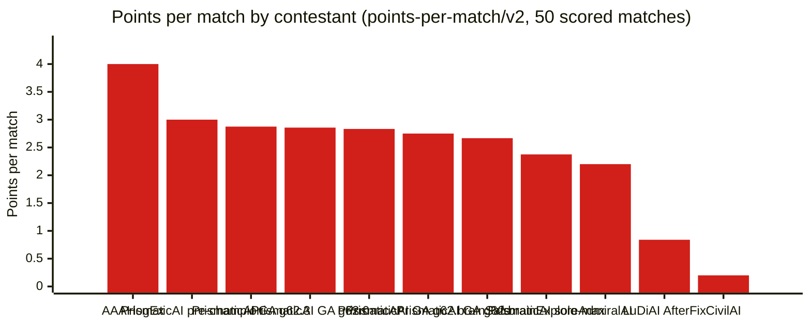
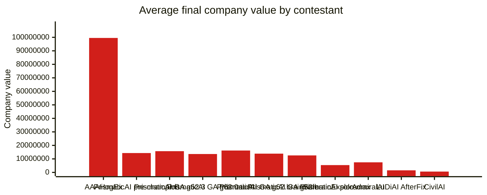
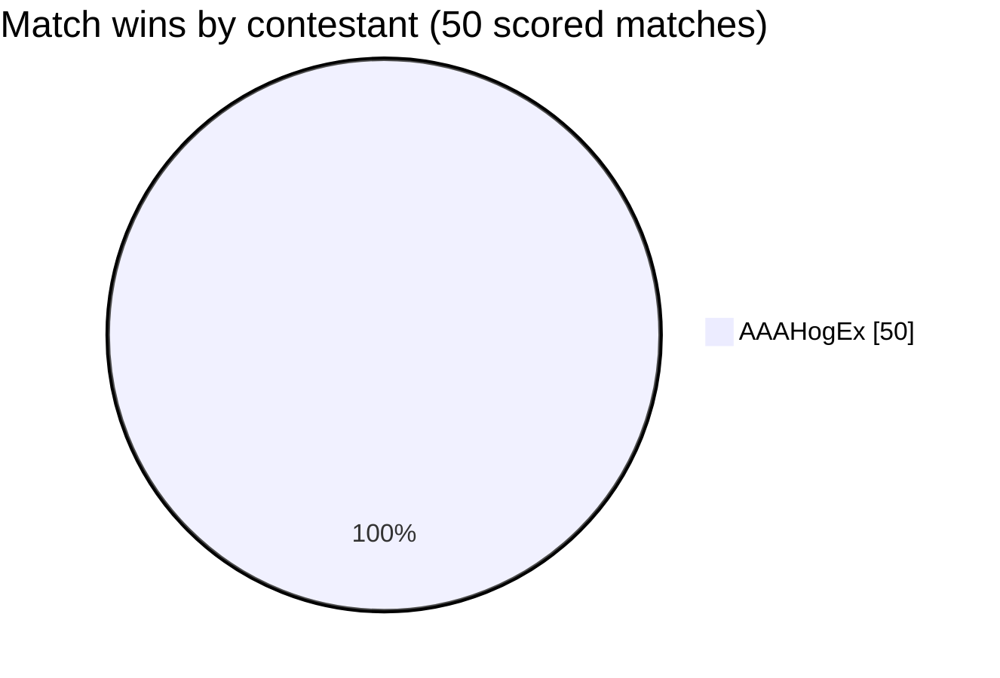
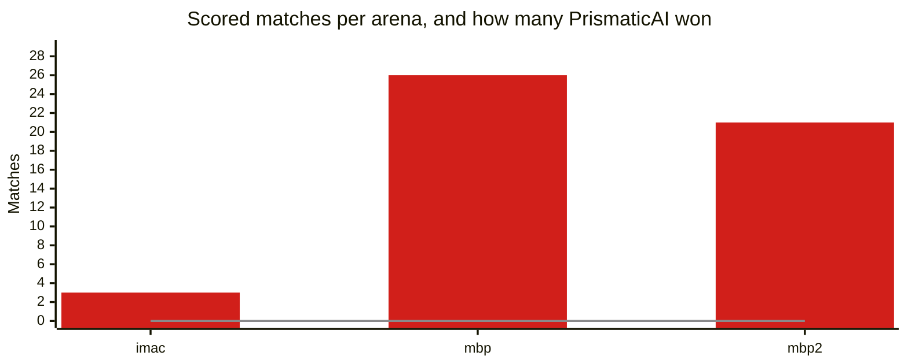

# battle-20261119T213716-5d6ca5fe

Derived from `battle-20261119T213716-5d6ca5fe.json` by `tools/research/ai-battle/battle.py report`; do not edit.

- Edition `5d6ca5fe824abca9`: PrismaticAI and referee at `ebf7516b54d7130fa0908c68ff298075c517fb41`, base set `opengfx-8.0.tar`
- 20-year free-for-all from 1960, map 256x256 temperate, breakdowns 1
- 50 scored match(es) on `imac` (20261119-master-gdf1e05e7d8), `mbp` (20261119-master-m356d6e49c0), `mbp2` (20261119-master-gdf1e05e7d8)
- Replays: 2 of 3 identical to their original on another arena

| # | Contestant | Played | Wins | Points | Points/match | Avg rank | Avg final value | Squirrel errors | Matches with anomalies |
|---|---|---|---|---|---|---|---|---|---|
| 1 | AAAHogEx | 50 | 50 | 200 | 4.0 | 1.0 | 99.5 M | 0 | 0 |
| 2 | PrismaticAI pre-champion | 7 | 0 | 21 | 3.0 | 2.0 | 14.3 M | 0 | 0 |
| 3 | PrismaticAI GA g62.3 | 8 | 0 | 23 | 2.875 | 2.12 | 15.7 M | 0 | 1 |
| 4 | PrismaticAI GA g62.0 | 7 | 0 | 20 | 2.857 | 2.14 | 13.6 M | 0 | 0 |
| 5 | PrismaticAI | 6 | 0 | 17 | 2.833 | 2.17 | 16.2 M | 0 | 0 |
| 6 | PrismaticAI GA g62.brainSafe | 8 | 0 | 22 | 2.75 | 2.25 | 13.9 M | 0 | 4 |
| 7 | PrismaticAI GA g62.brainExplore | 6 | 0 | 16 | 2.667 | 2.33 | 12.6 M | 0 | 0 |
| 8 | PrismaticAI solo-max | 8 | 0 | 19 | 2.375 | 2.62 | 5.4 M | 0 | 8 |
| 9 | AdmiralAI | 50 | 0 | 110 | 2.2 | 2.8 | 7.5 M | 0 | 1 |
| 10 | LuDiAI AfterFix | 50 | 0 | 42 | 0.84 | 4.16 | 1.5 M | 0 | 2 |
| 11 | CivilAI | 50 | 0 | 10 | 0.2 | 4.8 | 616.0 k | 0 | 13 |

```mermaid
---
config:
  xyChart:
    width: 900
    height: 360
  themeVariables:
    xyChart:
      plotColorPalette: "#d11f1a, #8a8a8a, #0b0b0b, #ece4d6"
---
xychart-beta
    title "Final company value per scored match: winner vs best PrismaticAI"
    x-axis ["m-0001", "m-0002", "m-0003", "m-0004", "m-0005", "m-0006", "m-0007", "m-0008", "m-0009", "m-0010", "m-0011", "m-0012", "m-0013", "m-0014", "m-0015", "m-0016", "m-0017", "m-0018", "m-0019", "m-0020", "m-0021", "m-0022", "m-0023", "m-0024", "m-0025", "m-0026", "m-0027", "m-0028", "m-0036", "m-0037", "m-0038", "m-0039", "m-0040", "m-0041", "m-0042", "m-0043", "m-0044", "m-0045", "m-0046", "m-0049", "m-0050", "m-0053", "m-0054", "m-0055", "m-0057", "m-0058", "m-0059", "m-0060", "m-0062", "m-0069"]
    %% series: Winner | Best PrismaticAI
    %% links: battle-20261119T213716-5d6ca5fe.md?col=Match&filter=m-0001 | battle-20261119T213716-5d6ca5fe.md?col=Match&filter=m-0002 | battle-20261119T213716-5d6ca5fe.md?col=Match&filter=m-0003 | battle-20261119T213716-5d6ca5fe.md?col=Match&filter=m-0004 | battle-20261119T213716-5d6ca5fe.md?col=Match&filter=m-0005 | battle-20261119T213716-5d6ca5fe.md?col=Match&filter=m-0006 | battle-20261119T213716-5d6ca5fe.md?col=Match&filter=m-0007 | battle-20261119T213716-5d6ca5fe.md?col=Match&filter=m-0008 | battle-20261119T213716-5d6ca5fe.md?col=Match&filter=m-0009 | battle-20261119T213716-5d6ca5fe.md?col=Match&filter=m-0010 | battle-20261119T213716-5d6ca5fe.md?col=Match&filter=m-0011 | battle-20261119T213716-5d6ca5fe.md?col=Match&filter=m-0012 | battle-20261119T213716-5d6ca5fe.md?col=Match&filter=m-0013 | battle-20261119T213716-5d6ca5fe.md?col=Match&filter=m-0014 | battle-20261119T213716-5d6ca5fe.md?col=Match&filter=m-0015 | battle-20261119T213716-5d6ca5fe.md?col=Match&filter=m-0016 | battle-20261119T213716-5d6ca5fe.md?col=Match&filter=m-0017 | battle-20261119T213716-5d6ca5fe.md?col=Match&filter=m-0018 | battle-20261119T213716-5d6ca5fe.md?col=Match&filter=m-0019 | battle-20261119T213716-5d6ca5fe.md?col=Match&filter=m-0020 | battle-20261119T213716-5d6ca5fe.md?col=Match&filter=m-0021 | battle-20261119T213716-5d6ca5fe.md?col=Match&filter=m-0022 | battle-20261119T213716-5d6ca5fe.md?col=Match&filter=m-0023 | battle-20261119T213716-5d6ca5fe.md?col=Match&filter=m-0024 | battle-20261119T213716-5d6ca5fe.md?col=Match&filter=m-0025 | battle-20261119T213716-5d6ca5fe.md?col=Match&filter=m-0026 | battle-20261119T213716-5d6ca5fe.md?col=Match&filter=m-0027 | battle-20261119T213716-5d6ca5fe.md?col=Match&filter=m-0028 | battle-20261119T213716-5d6ca5fe.md?col=Match&filter=m-0036 | battle-20261119T213716-5d6ca5fe.md?col=Match&filter=m-0037 | battle-20261119T213716-5d6ca5fe.md?col=Match&filter=m-0038 | battle-20261119T213716-5d6ca5fe.md?col=Match&filter=m-0039 | battle-20261119T213716-5d6ca5fe.md?col=Match&filter=m-0040 | battle-20261119T213716-5d6ca5fe.md?col=Match&filter=m-0041 | battle-20261119T213716-5d6ca5fe.md?col=Match&filter=m-0042 | battle-20261119T213716-5d6ca5fe.md?col=Match&filter=m-0043 | battle-20261119T213716-5d6ca5fe.md?col=Match&filter=m-0044 | battle-20261119T213716-5d6ca5fe.md?col=Match&filter=m-0045 | battle-20261119T213716-5d6ca5fe.md?col=Match&filter=m-0046 | battle-20261119T213716-5d6ca5fe.md?col=Match&filter=m-0049 | battle-20261119T213716-5d6ca5fe.md?col=Match&filter=m-0050 | battle-20261119T213716-5d6ca5fe.md?col=Match&filter=m-0053 | battle-20261119T213716-5d6ca5fe.md?col=Match&filter=m-0054 | battle-20261119T213716-5d6ca5fe.md?col=Match&filter=m-0055 | battle-20261119T213716-5d6ca5fe.md?col=Match&filter=m-0057 | battle-20261119T213716-5d6ca5fe.md?col=Match&filter=m-0058 | battle-20261119T213716-5d6ca5fe.md?col=Match&filter=m-0059 | battle-20261119T213716-5d6ca5fe.md?col=Match&filter=m-0060 | battle-20261119T213716-5d6ca5fe.md?col=Match&filter=m-0062 | battle-20261119T213716-5d6ca5fe.md?col=Match&filter=m-0069
    y-axis "Company value" 0 --> 156000000
    bar [94720276, 103994679, 109835648, 94809769, 99362566, 101058155, 101076988, 114169006, 116367469, 105257161, 83944388, 103850210, 100699050, 125364097, 141870459, 104374596, 119588660, 109902646, 101958139, 116665496, 102389571, 103738950, 111651930, 84226645, 93486583, 112362821, 72211563, 79036408, 95062386, 98270172, 102251943, 101360565, 82235797, 110572402, 77295489, 118727371, 89318650, 83899707, 76917846, 72602000, 135044843, 71255470, 98777914, 75998032, 93409532, 89509335, 83497991, 97335819, 84007315, 131509882]
    line [5153131, 12432276, 16863945, 18276314, 10828038, 11841424, 14257952, 2876079, 16282380, 14900158, 19905738, 14048223, 23220304, 24379800, 8009127, 19734001, 26129348, 22375163, 22334643, 24337381, 6089209, 7476676, 11795972, 12899770, 6052537, 4091940, 8136519, 19347353, 4022174, 15449265, 5536264, 5187106, 5528130, 6938820, 10753337, 5018691, 9068745, 8159209, 9102758, 22377780, 4383683, 11729673, 18658733, 16600319, 6410734, 15582658, 10821628, 18505076, 15821862, 18868566]
```

<!-- battle-charts:begin -->
<!-- derived from battle-20261119T213716-5d6ca5fe.json by `battle.py render`; `battle.py check` fails when it is stale -->

<!-- battle-charts:end -->

| Seed | Original | Replay | Arenas | Identical |
|---|---|---|---|---|
| 798448214 | m-0001 | m-0048 | mbp / mbp2 | yes |
| 88528948 | m-0010 | m-0056 | imac / mbp | NO |
| 798448214 | m-0002 | m-0064 | mbp / mbp2 | yes |

| Match | Arena | Seed | Winner | Value | Last | Anomalies |
|---|---|---|---|---|---|---|
| m-0001 | mbp | 798448214 | AAAHogEx | 94.7 M | CivilAI | PrismaticAI solo-max: fleet_drop:41->18 |
| m-0002 | mbp | 798448214 | AAAHogEx | 104.0 M | LuDiAI AfterFix | - |
| m-0003 | mbp | 798448214 | AAAHogEx | 109.8 M | CivilAI | - |
| m-0004 | mbp | 798448214 | AAAHogEx | 94.8 M | CivilAI | CivilAI: fleet_drop:61->34 |
| m-0005 | mbp | 798448214 | AAAHogEx | 99.4 M | CivilAI | LuDiAI AfterFix: fleet_drop:54->31 |
| m-0006 | mbp | 798448214 | AAAHogEx | 101.1 M | LuDiAI AfterFix | CivilAI: fleet_drop:81->55 |
| m-0007 | mbp | 88528948 | AAAHogEx | 101.1 M | CivilAI | AdmiralAI: fleet_drop:127->74; CivilAI: fleet_drop:32->20 |
| m-0008 | mbp | 88528948 | AAAHogEx | 114.2 M | CivilAI | PrismaticAI solo-max: fleet_drop:32->12 |
| m-0009 | mbp | 88528948 | AAAHogEx | 116.4 M | CivilAI | - |
| m-0010 | imac | 88528948 | AAAHogEx | 105.3 M | LuDiAI AfterFix | CivilAI: fleet_drop:50->34 |
| m-0011 | imac | 88528948 | AAAHogEx | 83.9 M | LuDiAI AfterFix | PrismaticAI GA g62.brainSafe: fleet_drop:101->68 |
| m-0012 | imac | 88528948 | AAAHogEx | 103.9 M | LuDiAI AfterFix | - |
| m-0013 | mbp2 | 88528948 | AAAHogEx | 100.7 M | CivilAI | - |
| m-0014 | mbp2 | 722093581 | AAAHogEx | 125.4 M | CivilAI | - |
| m-0015 | mbp2 | 722093581 | AAAHogEx | 141.9 M | LuDiAI AfterFix | PrismaticAI solo-max: fleet_drop:57->31 |
| m-0016 | mbp2 | 722093581 | AAAHogEx | 104.4 M | CivilAI | - |
| m-0017 | mbp2 | 722093581 | AAAHogEx | 119.6 M | LuDiAI AfterFix | CivilAI: fleet_drop:61->31 |
| m-0018 | mbp2 | 722093581 | AAAHogEx | 109.9 M | CivilAI | CivilAI: fleet_drop:44->18 |
| m-0019 | mbp2 | 722093581 | AAAHogEx | 102.0 M | CivilAI | - |
| m-0020 | mbp2 | 722093581 | AAAHogEx | 116.7 M | CivilAI | PrismaticAI GA g62.3: fleet_drop:193->126 |
| m-0021 | mbp2 | 1944270517 | AAAHogEx | 102.4 M | CivilAI | - |
| m-0022 | mbp2 | 1944270517 | AAAHogEx | 103.7 M | CivilAI | PrismaticAI solo-max: fleet_drop:38->23 |
| m-0023 | mbp2 | 1944270517 | AAAHogEx | 111.7 M | CivilAI | - |
| m-0024 | mbp2 | 1944270517 | AAAHogEx | 84.2 M | CivilAI | - |
| m-0025 | mbp2 | 1944270517 | AAAHogEx | 93.5 M | CivilAI | PrismaticAI GA g62.brainSafe: fleet_drop:70->43 |
| m-0026 | mbp2 | 1944270517 | AAAHogEx | 112.4 M | LuDiAI AfterFix | - |
| m-0027 | mbp2 | 1944270517 | AAAHogEx | 72.2 M | CivilAI | CivilAI: fleet_drop:16->8 |
| m-0028 | mbp2 | 593195488 | AAAHogEx | 79.0 M | CivilAI | CivilAI: fleet_drop:79->50 |
| m-0036 | mbp | 209466730 | AAAHogEx | 95.1 M | CivilAI | PrismaticAI solo-max: fleet_drop:46->32 |
| m-0037 | mbp | 209466730 | AAAHogEx | 98.3 M | CivilAI | CivilAI: fleet_drop:23->13 |
| m-0038 | mbp | 209466730 | AAAHogEx | 102.3 M | CivilAI | - |
| m-0039 | mbp | 209466730 | AAAHogEx | 101.4 M | CivilAI | - |
| m-0040 | mbp | 209466730 | AAAHogEx | 82.2 M | CivilAI | CivilAI: fleet_drop:71->47 |
| m-0041 | mbp | 209466730 | AAAHogEx | 110.6 M | CivilAI | - |
| m-0042 | mbp | 248033966 | AAAHogEx | 77.3 M | CivilAI | - |
| m-0043 | mbp | 248033966 | AAAHogEx | 118.7 M | CivilAI | PrismaticAI solo-max: fleet_drop:37->15 |
| m-0044 | mbp | 248033966 | AAAHogEx | 89.3 M | CivilAI | CivilAI: no_vehicles |
| m-0045 | mbp2 | 248033966 | AAAHogEx | 83.9 M | CivilAI | - |
| m-0046 | mbp | 248033966 | AAAHogEx | 76.9 M | LuDiAI AfterFix | - |
| m-0048 (replay) | mbp2 | 798448214 | AAAHogEx | 94.7 M | CivilAI | PrismaticAI solo-max: fleet_drop:41->18 |
| m-0049 | mbp2 | 91652600 | AAAHogEx | 72.6 M | CivilAI | CivilAI: fleet_drop:44->28 |
| m-0050 | mbp | 91652600 | AAAHogEx | 135.0 M | CivilAI | PrismaticAI solo-max: fleet_drop:39->22 |
| m-0053 | mbp2 | 91652600 | AAAHogEx | 71.3 M | CivilAI | PrismaticAI GA g62.brainSafe: fleet_drop:74->47; CivilAI: fleet_drop:45->9 |
| m-0054 | mbp2 | 91652600 | AAAHogEx | 98.8 M | CivilAI | LuDiAI AfterFix: fleet_drop:44->28 |
| m-0055 | mbp | 91652600 | AAAHogEx | 76.0 M | CivilAI | - |
| m-0056 (replay) | mbp | 88528948 | AAAHogEx | 108.3 M | CivilAI | CivilAI: fleet_drop:42->20 |
| m-0057 | mbp | 1053653930 | AAAHogEx | 93.4 M | CivilAI | PrismaticAI solo-max: fleet_drop:50->21 |
| m-0058 | mbp | 1053653930 | AAAHogEx | 89.5 M | CivilAI | - |
| m-0059 | mbp | 1053653930 | AAAHogEx | 83.5 M | CivilAI | - |
| m-0060 | mbp | 1053653930 | AAAHogEx | 97.3 M | CivilAI | PrismaticAI GA g62.brainSafe: fleet_drop:82->57 |
| m-0062 | mbp2 | 1053653930 | AAAHogEx | 84.0 M | LuDiAI AfterFix | - |
| m-0064 (replay) | mbp2 | 798448214 | AAAHogEx | 104.0 M | LuDiAI AfterFix | - |
| m-0069 | mbp | 1092041500 | AAAHogEx | 131.5 M | CivilAI | - |
