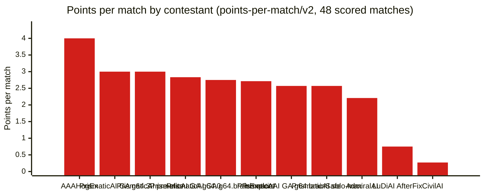
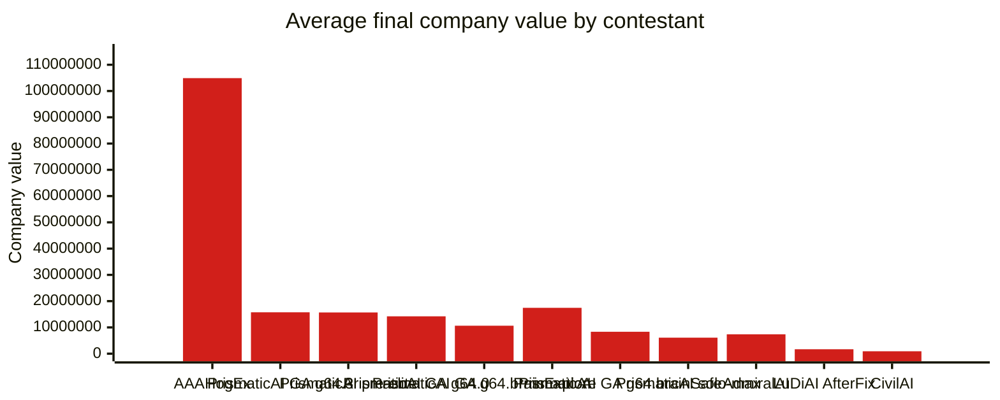
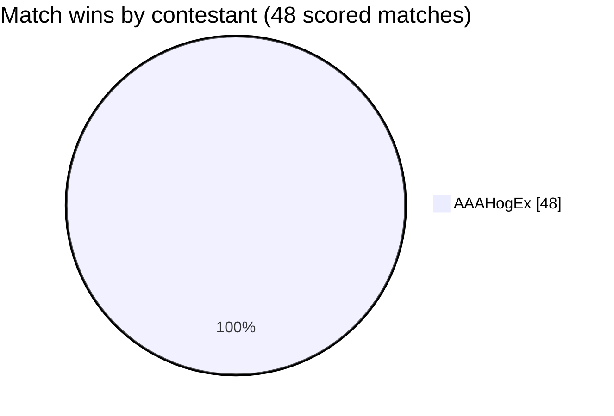
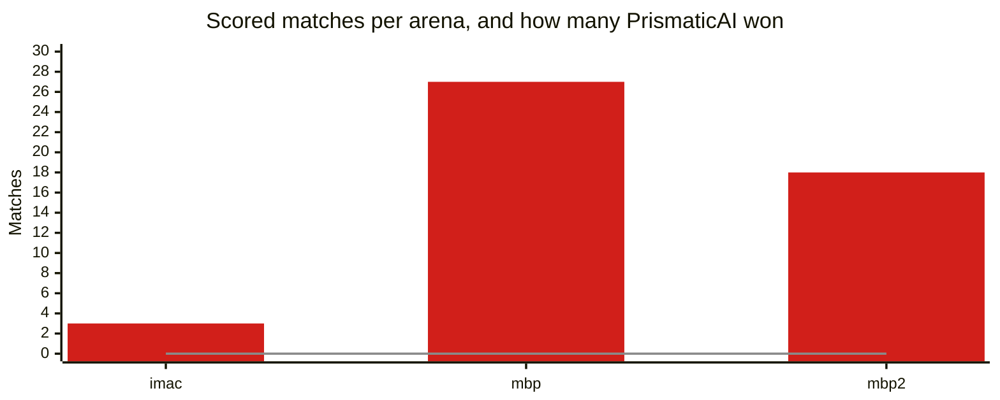

# battle-20261119T220801-e6e5886f

Derived from `battle-20261119T220801-e6e5886f.json` by `tools/research/ai-battle/battle.py report`; do not edit.

- Edition `e6e5886f2c0f36ef`: PrismaticAI and referee at `17cf96039a050eb21f3afa13dc00b0901d7a2afa`, base set `opengfx-8.0.tar`
- 20-year free-for-all from 1960, map 256x256 temperate, breakdowns 1
- 48 scored match(es) on `imac` (20261119-master-gdf1e05e7d8), `mbp` (20261119-master-ma6b147b162), `mbp2` (20261119-master-gdf1e05e7d8)
- Replays: 0 of 1 identical to their original on another arena

| # | Contestant | Played | Wins | Points | Points/match | Avg rank | Avg final value | Squirrel errors | Matches with anomalies |
|---|---|---|---|---|---|---|---|---|---|
| 1 | AAAHogEx | 48 | 48 | 192 | 4.0 | 1.0 | 104.9 M | 0 | 0 |
| 2 | PrismaticAI GA g64.3 | 7 | 0 | 21 | 3.0 | 2.0 | 15.8 M | 0 | 0 |
| 3 | PrismaticAI pre-elite | 6 | 0 | 18 | 3.0 | 2.0 | 15.7 M | 0 | 1 |
| 4 | PrismaticAI GA g64.0 | 6 | 0 | 17 | 2.833 | 2.17 | 14.2 M | 0 | 0 |
| 5 | PrismaticAI GA g64.brainExplore | 8 | 0 | 22 | 2.75 | 2.25 | 10.6 M | 0 | 0 |
| 6 | PrismaticAI | 7 | 0 | 19 | 2.714 | 2.29 | 17.4 M | 0 | 0 |
| 7 | PrismaticAI GA g64.brainSafe | 7 | 0 | 18 | 2.571 | 2.43 | 8.3 M | 0 | 0 |
| 8 | PrismaticAI solo-max | 7 | 0 | 18 | 2.571 | 2.43 | 6.1 M | 0 | 5 |
| 9 | AdmiralAI | 48 | 0 | 106 | 2.208 | 2.79 | 7.4 M | 47 | 3 |
| 10 | LuDiAI AfterFix | 48 | 0 | 36 | 0.75 | 4.25 | 1.7 M | 0 | 4 |
| 11 | CivilAI | 48 | 0 | 13 | 0.271 | 4.73 | 912.1 k | 0 | 9 |

```mermaid
---
config:
  xyChart:
    width: 900
    height: 360
  themeVariables:
    xyChart:
      plotColorPalette: "#d11f1a, #8a8a8a, #0b0b0b, #ece4d6"
---
xychart-beta
    title "Final company value per scored match: winner vs best PrismaticAI"
    x-axis ["m-0001", "m-0002", "m-0003", "m-0004", "m-0005", "m-0006", "m-0007", "m-0008", "m-0009", "m-0010", "m-0011", "m-0012", "m-0013", "m-0014", "m-0015", "m-0016", "m-0017", "m-0018", "m-0019", "m-0020", "m-0021", "m-0022", "m-0023", "m-0024", "m-0025", "m-0026", "m-0027", "m-0028", "m-0036", "m-0037", "m-0038", "m-0039", "m-0040", "m-0041", "m-0042", "m-0043", "m-0044", "m-0047", "m-0049", "m-0050", "m-0053", "m-0054", "m-0055", "m-0060", "m-0061", "m-0062", "m-0063", "m-0073"]
    %% series: Winner | Best PrismaticAI
    %% links: battle-20261119T220801-e6e5886f.md?col=Match&filter=m-0001 | battle-20261119T220801-e6e5886f.md?col=Match&filter=m-0002 | battle-20261119T220801-e6e5886f.md?col=Match&filter=m-0003 | battle-20261119T220801-e6e5886f.md?col=Match&filter=m-0004 | battle-20261119T220801-e6e5886f.md?col=Match&filter=m-0005 | battle-20261119T220801-e6e5886f.md?col=Match&filter=m-0006 | battle-20261119T220801-e6e5886f.md?col=Match&filter=m-0007 | battle-20261119T220801-e6e5886f.md?col=Match&filter=m-0008 | battle-20261119T220801-e6e5886f.md?col=Match&filter=m-0009 | battle-20261119T220801-e6e5886f.md?col=Match&filter=m-0010 | battle-20261119T220801-e6e5886f.md?col=Match&filter=m-0011 | battle-20261119T220801-e6e5886f.md?col=Match&filter=m-0012 | battle-20261119T220801-e6e5886f.md?col=Match&filter=m-0013 | battle-20261119T220801-e6e5886f.md?col=Match&filter=m-0014 | battle-20261119T220801-e6e5886f.md?col=Match&filter=m-0015 | battle-20261119T220801-e6e5886f.md?col=Match&filter=m-0016 | battle-20261119T220801-e6e5886f.md?col=Match&filter=m-0017 | battle-20261119T220801-e6e5886f.md?col=Match&filter=m-0018 | battle-20261119T220801-e6e5886f.md?col=Match&filter=m-0019 | battle-20261119T220801-e6e5886f.md?col=Match&filter=m-0020 | battle-20261119T220801-e6e5886f.md?col=Match&filter=m-0021 | battle-20261119T220801-e6e5886f.md?col=Match&filter=m-0022 | battle-20261119T220801-e6e5886f.md?col=Match&filter=m-0023 | battle-20261119T220801-e6e5886f.md?col=Match&filter=m-0024 | battle-20261119T220801-e6e5886f.md?col=Match&filter=m-0025 | battle-20261119T220801-e6e5886f.md?col=Match&filter=m-0026 | battle-20261119T220801-e6e5886f.md?col=Match&filter=m-0027 | battle-20261119T220801-e6e5886f.md?col=Match&filter=m-0028 | battle-20261119T220801-e6e5886f.md?col=Match&filter=m-0036 | battle-20261119T220801-e6e5886f.md?col=Match&filter=m-0037 | battle-20261119T220801-e6e5886f.md?col=Match&filter=m-0038 | battle-20261119T220801-e6e5886f.md?col=Match&filter=m-0039 | battle-20261119T220801-e6e5886f.md?col=Match&filter=m-0040 | battle-20261119T220801-e6e5886f.md?col=Match&filter=m-0041 | battle-20261119T220801-e6e5886f.md?col=Match&filter=m-0042 | battle-20261119T220801-e6e5886f.md?col=Match&filter=m-0043 | battle-20261119T220801-e6e5886f.md?col=Match&filter=m-0044 | battle-20261119T220801-e6e5886f.md?col=Match&filter=m-0047 | battle-20261119T220801-e6e5886f.md?col=Match&filter=m-0049 | battle-20261119T220801-e6e5886f.md?col=Match&filter=m-0050 | battle-20261119T220801-e6e5886f.md?col=Match&filter=m-0053 | battle-20261119T220801-e6e5886f.md?col=Match&filter=m-0054 | battle-20261119T220801-e6e5886f.md?col=Match&filter=m-0055 | battle-20261119T220801-e6e5886f.md?col=Match&filter=m-0060 | battle-20261119T220801-e6e5886f.md?col=Match&filter=m-0061 | battle-20261119T220801-e6e5886f.md?col=Match&filter=m-0062 | battle-20261119T220801-e6e5886f.md?col=Match&filter=m-0063 | battle-20261119T220801-e6e5886f.md?col=Match&filter=m-0073
    y-axis "Company value" 0 --> 170000000
    bar [100737583, 101420812, 82104723, 84618366, 103164995, 84505663, 111199700, 115813770, 98903604, 114723524, 113953002, 129270209, 107599999, 100610293, 100311171, 115008561, 114755868, 90772651, 78210090, 105923604, 139439839, 121259397, 154158788, 103089912, 134746185, 149707465, 131664916, 91087803, 126637061, 103000923, 94551561, 118482126, 99409148, 87768494, 117930405, 113878438, 118489377, 89903267, 79812192, 97924388, 71635275, 97607149, 69389642, 97568363, 88133229, 80187959, 105017965, 99496941]
    line [4775040, 11641460, 12090358, 7965400, 5067822, 19772125, 14672508, 5175380, 17616099, 13241981, 7933546, 5300141, 18363613, 11770520, 6425589, 9162653, 12692890, 7013582, 18550058, 10133537, 28537733, 7535514, 23661419, 22076937, 15597381, 25245555, 22817758, 10842858, 4196595, 12437500, 13449433, 5265946, 11191697, 10557124, 14334685, 6659688, 19618973, 8235706, 25360095, 7855272, 9365838, 7969416, 19346628, 5219350, 3577112, 9285579, 16630927, 11754005]
```

<!-- battle-charts:begin -->
<!-- derived from battle-20261119T220801-e6e5886f.json by `battle.py render`; `battle.py check` fails when it is stale -->

<!-- battle-charts:end -->

| Seed | Original | Replay | Arenas | Identical |
|---|---|---|---|---|
| 200617603 | m-0010 | m-0056 | imac / mbp | NO |

| Match | Arena | Seed | Winner | Value | Last | Anomalies |
|---|---|---|---|---|---|---|
| m-0001 | mbp | 943579899 | AAAHogEx | 100.7 M | CivilAI | PrismaticAI solo-max: fleet_drop:70->44 |
| m-0002 | mbp | 943579899 | AAAHogEx | 101.4 M | CivilAI | - |
| m-0003 | mbp | 943579899 | AAAHogEx | 82.1 M | LuDiAI AfterFix | CivilAI: fleet_drop:60->25 |
| m-0004 | mbp | 943579899 | AAAHogEx | 84.6 M | CivilAI | - |
| m-0005 | mbp | 943579899 | AAAHogEx | 103.2 M | CivilAI | - |
| m-0006 | mbp | 943579899 | AAAHogEx | 84.5 M | CivilAI | - |
| m-0007 | mbp | 200617603 | AAAHogEx | 111.2 M | LuDiAI AfterFix | LuDiAI AfterFix: fleet_drop:19->0, no_vehicles |
| m-0008 | mbp | 200617603 | AAAHogEx | 115.8 M | CivilAI | - |
| m-0009 | mbp | 200617603 | AAAHogEx | 98.9 M | CivilAI | - |
| m-0010 | imac | 200617603 | AAAHogEx | 114.7 M | LuDiAI AfterFix | AdmiralAI: squirrel_errors:47 |
| m-0011 | imac | 200617603 | AAAHogEx | 114.0 M | CivilAI | LuDiAI AfterFix: fleet_drop:79->52 |
| m-0012 | imac | 200617603 | AAAHogEx | 129.3 M | LuDiAI AfterFix | - |
| m-0013 | mbp2 | 200617603 | AAAHogEx | 107.6 M | CivilAI | - |
| m-0014 | mbp2 | 1285836706 | AAAHogEx | 100.6 M | CivilAI | CivilAI: fleet_drop:73->40 |
| m-0015 | mbp2 | 1285836706 | AAAHogEx | 100.3 M | CivilAI | PrismaticAI solo-max: fleet_drop:80->39; CivilAI: fleet_drop:43->20 |
| m-0016 | mbp2 | 1285836706 | AAAHogEx | 115.0 M | CivilAI | PrismaticAI pre-elite: fleet_drop:49->30; CivilAI: fleet_drop:21->14 |
| m-0017 | mbp2 | 1285836706 | AAAHogEx | 114.8 M | LuDiAI AfterFix | CivilAI: fleet_drop:63->43 |
| m-0018 | mbp2 | 1285836706 | AAAHogEx | 90.8 M | LuDiAI AfterFix | - |
| m-0019 | mbp2 | 1285836706 | AAAHogEx | 78.2 M | CivilAI | CivilAI: fleet_drop:50->31 |
| m-0020 | mbp2 | 1285836706 | AAAHogEx | 105.9 M | CivilAI | - |
| m-0021 | mbp2 | 1261161097 | AAAHogEx | 139.4 M | LuDiAI AfterFix | CivilAI: fleet_drop:63->29 |
| m-0022 | mbp2 | 1261161097 | AAAHogEx | 121.3 M | CivilAI | PrismaticAI solo-max: fleet_drop:122->81 |
| m-0023 | mbp2 | 1261161097 | AAAHogEx | 154.2 M | CivilAI | - |
| m-0024 | mbp2 | 1261161097 | AAAHogEx | 103.1 M | CivilAI | - |
| m-0025 | mbp2 | 1261161097 | AAAHogEx | 134.7 M | CivilAI | - |
| m-0026 | mbp2 | 1261161097 | AAAHogEx | 149.7 M | CivilAI | - |
| m-0027 | mbp2 | 1261161097 | AAAHogEx | 131.7 M | CivilAI | AdmiralAI: fleet_drop:517->351 |
| m-0028 | mbp2 | 1245835515 | AAAHogEx | 91.1 M | CivilAI | - |
| m-0036 | mbp | 1883761223 | AAAHogEx | 126.6 M | LuDiAI AfterFix | PrismaticAI solo-max: fleet_drop:87->59 |
| m-0037 | mbp | 1883761223 | AAAHogEx | 103.0 M | LuDiAI AfterFix | - |
| m-0038 | mbp | 1883761223 | AAAHogEx | 94.6 M | CivilAI | - |
| m-0039 | mbp | 1883761223 | AAAHogEx | 118.5 M | CivilAI | - |
| m-0040 | mbp | 1883761223 | AAAHogEx | 99.4 M | CivilAI | - |
| m-0041 | mbp | 1883761223 | AAAHogEx | 87.8 M | CivilAI | - |
| m-0042 | mbp | 1580136013 | AAAHogEx | 117.9 M | CivilAI | AdmiralAI: fleet_drop:320->154 |
| m-0043 | mbp | 1580136013 | AAAHogEx | 113.9 M | LuDiAI AfterFix | LuDiAI AfterFix: fleet_drop:43->27 |
| m-0044 | mbp | 1580136013 | AAAHogEx | 118.5 M | CivilAI | - |
| m-0047 | mbp | 1580136013 | AAAHogEx | 89.9 M | LuDiAI AfterFix | - |
| m-0049 | mbp2 | 565311606 | AAAHogEx | 79.8 M | CivilAI | CivilAI: fleet_drop:35->17 |
| m-0050 | mbp2 | 565311606 | AAAHogEx | 97.9 M | CivilAI | PrismaticAI solo-max: fleet_drop:60->40 |
| m-0053 | mbp | 565311606 | AAAHogEx | 71.6 M | LuDiAI AfterFix | LuDiAI AfterFix: fleet_drop:163->114 |
| m-0054 | mbp | 565311606 | AAAHogEx | 97.6 M | CivilAI | - |
| m-0055 | mbp | 565311606 | AAAHogEx | 69.4 M | CivilAI | CivilAI: fleet_drop:34->19 |
| m-0056 (replay) | mbp | 200617603 | AAAHogEx | 110.3 M | CivilAI | - |
| m-0060 | mbp | 114768491 | AAAHogEx | 97.6 M | LuDiAI AfterFix | - |
| m-0061 | mbp | 114768491 | AAAHogEx | 88.1 M | CivilAI | - |
| m-0062 | mbp | 114768491 | AAAHogEx | 80.2 M | CivilAI | - |
| m-0063 | mbp | 1155611590 | AAAHogEx | 105.0 M | CivilAI | - |
| m-0073 | mbp | 1066467758 | AAAHogEx | 99.5 M | CivilAI | - |
