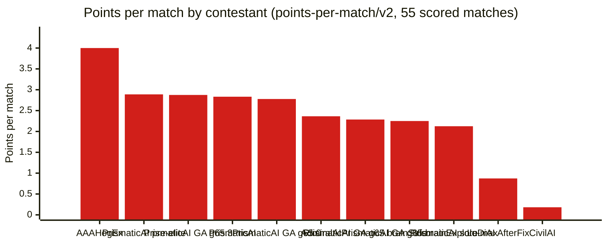
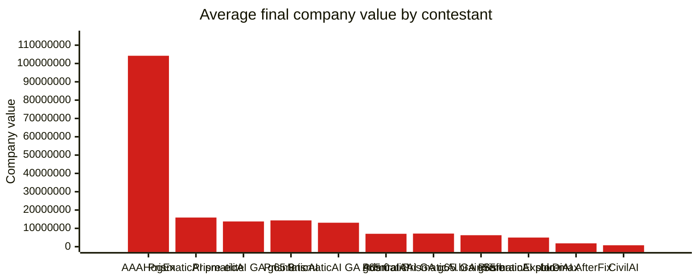
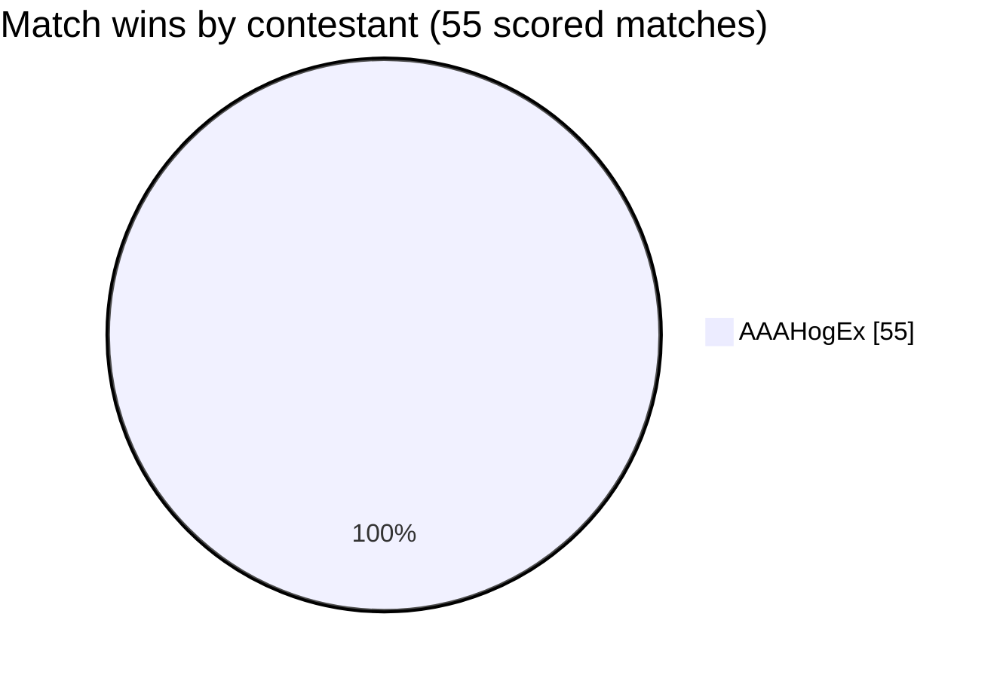
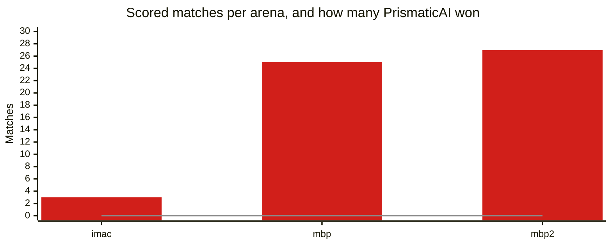

# battle-20261119T222110-58276b47

Derived from `battle-20261119T222110-58276b47.json` by `tools/research/ai-battle/battle.py report`; do not edit.

- Edition `58276b4788690804`: PrismaticAI and referee at `17cf96039a050eb21f3afa13dc00b0901d7a2afa`, base set `opengfx-8.0.tar`
- 20-year free-for-all from 1960, map 256x256 temperate, breakdowns 1
- 55 scored match(es) on `imac` (20261119-master-gdf1e05e7d8), `mbp` (20261119-master-ma6b147b162), `mbp2` (20261119-master-gdf1e05e7d8)
- Replays: 2 of 2 identical to their original on another arena

| # | Contestant | Played | Wins | Points | Points/match | Avg rank | Avg final value | Squirrel errors | Matches with anomalies |
|---|---|---|---|---|---|---|---|---|---|
| 1 | AAAHogEx | 55 | 55 | 220 | 4.0 | 1.0 | 104.2 M | 0 | 0 |
| 2 | PrismaticAI pre-elite | 9 | 0 | 26 | 2.889 | 2.11 | 15.9 M | 0 | 0 |
| 3 | PrismaticAI GA g65.3 | 8 | 0 | 23 | 2.875 | 2.12 | 13.8 M | 0 | 0 |
| 4 | PrismaticAI | 6 | 0 | 17 | 2.833 | 2.17 | 14.3 M | 0 | 1 |
| 5 | PrismaticAI GA g65.0 | 9 | 0 | 25 | 2.778 | 2.22 | 13.1 M | 0 | 0 |
| 6 | AdmiralAI | 55 | 0 | 130 | 2.364 | 2.64 | 7.0 M | 57 | 4 |
| 7 | PrismaticAI GA g65.brainSafe | 7 | 0 | 16 | 2.286 | 2.71 | 7.2 M | 0 | 1 |
| 8 | PrismaticAI GA g65.brainExplore | 8 | 0 | 18 | 2.25 | 2.75 | 6.3 M | 0 | 0 |
| 9 | PrismaticAI solo-max | 8 | 0 | 17 | 2.125 | 2.88 | 5.0 M | 0 | 3 |
| 10 | LuDiAI AfterFix | 55 | 0 | 48 | 0.873 | 4.13 | 1.8 M | 0 | 0 |
| 11 | CivilAI | 55 | 0 | 10 | 0.182 | 4.82 | 765.3 k | 0 | 8 |

```mermaid
---
config:
  xyChart:
    width: 900
    height: 360
  themeVariables:
    xyChart:
      plotColorPalette: "#d11f1a, #8a8a8a, #0b0b0b, #ece4d6"
---
xychart-beta
    title "Final company value per scored match: winner vs best PrismaticAI"
    x-axis ["m-0001", "m-0002", "m-0003", "m-0004", "m-0005", "m-0006", "m-0007", "m-0008", "m-0009", "m-0010", "m-0011", "m-0012", "m-0013", "m-0014", "m-0015", "m-0016", "m-0017", "m-0018", "m-0019", "m-0020", "m-0021", "m-0022", "m-0023", "m-0024", "m-0025", "m-0026", "m-0027", "m-0028", "m-0036", "m-0037", "m-0038", "m-0039", "m-0040", "m-0041", "m-0042", "m-0043", "m-0044", "m-0045", "m-0046", "m-0047", "m-0050", "m-0051", "m-0052", "m-0054", "m-0055", "m-0057", "m-0058", "m-0059", "m-0060", "m-0062", "m-0063", "m-0065", "m-0066", "m-0068", "m-0069"]
    %% series: Winner | Best PrismaticAI
    %% links: battle-20261119T222110-58276b47.md?col=Match&filter=m-0001 | battle-20261119T222110-58276b47.md?col=Match&filter=m-0002 | battle-20261119T222110-58276b47.md?col=Match&filter=m-0003 | battle-20261119T222110-58276b47.md?col=Match&filter=m-0004 | battle-20261119T222110-58276b47.md?col=Match&filter=m-0005 | battle-20261119T222110-58276b47.md?col=Match&filter=m-0006 | battle-20261119T222110-58276b47.md?col=Match&filter=m-0007 | battle-20261119T222110-58276b47.md?col=Match&filter=m-0008 | battle-20261119T222110-58276b47.md?col=Match&filter=m-0009 | battle-20261119T222110-58276b47.md?col=Match&filter=m-0010 | battle-20261119T222110-58276b47.md?col=Match&filter=m-0011 | battle-20261119T222110-58276b47.md?col=Match&filter=m-0012 | battle-20261119T222110-58276b47.md?col=Match&filter=m-0013 | battle-20261119T222110-58276b47.md?col=Match&filter=m-0014 | battle-20261119T222110-58276b47.md?col=Match&filter=m-0015 | battle-20261119T222110-58276b47.md?col=Match&filter=m-0016 | battle-20261119T222110-58276b47.md?col=Match&filter=m-0017 | battle-20261119T222110-58276b47.md?col=Match&filter=m-0018 | battle-20261119T222110-58276b47.md?col=Match&filter=m-0019 | battle-20261119T222110-58276b47.md?col=Match&filter=m-0020 | battle-20261119T222110-58276b47.md?col=Match&filter=m-0021 | battle-20261119T222110-58276b47.md?col=Match&filter=m-0022 | battle-20261119T222110-58276b47.md?col=Match&filter=m-0023 | battle-20261119T222110-58276b47.md?col=Match&filter=m-0024 | battle-20261119T222110-58276b47.md?col=Match&filter=m-0025 | battle-20261119T222110-58276b47.md?col=Match&filter=m-0026 | battle-20261119T222110-58276b47.md?col=Match&filter=m-0027 | battle-20261119T222110-58276b47.md?col=Match&filter=m-0028 | battle-20261119T222110-58276b47.md?col=Match&filter=m-0036 | battle-20261119T222110-58276b47.md?col=Match&filter=m-0037 | battle-20261119T222110-58276b47.md?col=Match&filter=m-0038 | battle-20261119T222110-58276b47.md?col=Match&filter=m-0039 | battle-20261119T222110-58276b47.md?col=Match&filter=m-0040 | battle-20261119T222110-58276b47.md?col=Match&filter=m-0041 | battle-20261119T222110-58276b47.md?col=Match&filter=m-0042 | battle-20261119T222110-58276b47.md?col=Match&filter=m-0043 | battle-20261119T222110-58276b47.md?col=Match&filter=m-0044 | battle-20261119T222110-58276b47.md?col=Match&filter=m-0045 | battle-20261119T222110-58276b47.md?col=Match&filter=m-0046 | battle-20261119T222110-58276b47.md?col=Match&filter=m-0047 | battle-20261119T222110-58276b47.md?col=Match&filter=m-0050 | battle-20261119T222110-58276b47.md?col=Match&filter=m-0051 | battle-20261119T222110-58276b47.md?col=Match&filter=m-0052 | battle-20261119T222110-58276b47.md?col=Match&filter=m-0054 | battle-20261119T222110-58276b47.md?col=Match&filter=m-0055 | battle-20261119T222110-58276b47.md?col=Match&filter=m-0057 | battle-20261119T222110-58276b47.md?col=Match&filter=m-0058 | battle-20261119T222110-58276b47.md?col=Match&filter=m-0059 | battle-20261119T222110-58276b47.md?col=Match&filter=m-0060 | battle-20261119T222110-58276b47.md?col=Match&filter=m-0062 | battle-20261119T222110-58276b47.md?col=Match&filter=m-0063 | battle-20261119T222110-58276b47.md?col=Match&filter=m-0065 | battle-20261119T222110-58276b47.md?col=Match&filter=m-0066 | battle-20261119T222110-58276b47.md?col=Match&filter=m-0068 | battle-20261119T222110-58276b47.md?col=Match&filter=m-0069
    y-axis "Company value" 0 --> 186000000
    bar [118408930, 93556966, 107133607, 121823505, 93330116, 126802008, 102904839, 96903380, 100005161, 124438732, 94497907, 100313195, 128564871, 76388257, 109790452, 97709830, 104490018, 83335037, 95351433, 95425522, 118962190, 101837365, 94696471, 98414268, 119973411, 110255233, 96054429, 61486545, 90203704, 49261867, 63650298, 74086670, 74376036, 73981296, 144667175, 169068320, 139700710, 156015941, 163634249, 135396781, 144000255, 124308389, 154846553, 116075916, 126870171, 97061250, 103624658, 79395008, 106188855, 82004042, 76951628, 81871704, 77590950, 79514467, 74678204]
    line [5605457, 20047196, 18089299, 6877181, 9348186, 17332399, 7306711, 4463226, 9574854, 10661744, 11214190, 5878981, 14712153, 15344266, 4703663, 12146440, 12181138, 11912540, 4686914, 10290155, 17194757, 622551, 18895193, 21171426, 3595405, 10808832, 10753106, 19913558, 5605830, 22383895, 14997933, 3232509, 3619958, 10196744, 14573921, 8042163, 11114977, 6149539, 5303637, 1296185, 5278186, 17810065, 12892675, 10574080, 16483977, 5547017, 19582258, 9127459, 8002318, 17546512, 11721662, 11624574, 12422917, 3870058, 12812827]
```

<!-- battle-charts:begin -->
<!-- derived from battle-20261119T222110-58276b47.json by `battle.py render`; `battle.py check` fails when it is stale -->

<!-- battle-charts:end -->

| Seed | Original | Replay | Arenas | Identical |
|---|---|---|---|---|
| 416796032 | m-0001 | m-0048 | mbp / mbp2 | yes |
| 416796032 | m-0002 | m-0056 | mbp / mbp2 | yes |

| Match | Arena | Seed | Winner | Value | Last | Anomalies |
|---|---|---|---|---|---|---|
| m-0001 | mbp | 416796032 | AAAHogEx | 118.4 M | CivilAI | - |
| m-0002 | mbp | 416796032 | AAAHogEx | 93.6 M | CivilAI | - |
| m-0003 | mbp | 416796032 | AAAHogEx | 107.1 M | CivilAI | - |
| m-0004 | mbp | 416796032 | AAAHogEx | 121.8 M | CivilAI | - |
| m-0005 | mbp | 416796032 | AAAHogEx | 93.3 M | CivilAI | CivilAI: fleet_drop:38->11 |
| m-0006 | mbp | 416796032 | AAAHogEx | 126.8 M | CivilAI | - |
| m-0007 | mbp | 1012145367 | AAAHogEx | 102.9 M | CivilAI | - |
| m-0008 | mbp | 1012145367 | AAAHogEx | 96.9 M | LuDiAI AfterFix | CivilAI: fleet_drop:86->46 |
| m-0009 | mbp | 1012145367 | AAAHogEx | 100.0 M | LuDiAI AfterFix | - |
| m-0010 | imac | 1012145367 | AAAHogEx | 124.4 M | CivilAI | - |
| m-0011 | imac | 1012145367 | AAAHogEx | 94.5 M | CivilAI | AdmiralAI: fleet_drop:368->244 |
| m-0012 | imac | 1012145367 | AAAHogEx | 100.3 M | CivilAI | - |
| m-0013 | mbp2 | 1012145367 | AAAHogEx | 128.6 M | CivilAI | - |
| m-0014 | mbp2 | 77204482 | AAAHogEx | 76.4 M | CivilAI | - |
| m-0015 | mbp2 | 77204482 | AAAHogEx | 109.8 M | LuDiAI AfterFix | CivilAI: fleet_drop:10->6 |
| m-0016 | mbp2 | 77204482 | AAAHogEx | 97.7 M | CivilAI | - |
| m-0017 | mbp2 | 77204482 | AAAHogEx | 104.5 M | LuDiAI AfterFix | - |
| m-0018 | mbp2 | 77204482 | AAAHogEx | 83.3 M | CivilAI | - |
| m-0019 | mbp2 | 77204482 | AAAHogEx | 95.4 M | CivilAI | - |
| m-0020 | mbp2 | 77204482 | AAAHogEx | 95.4 M | CivilAI | - |
| m-0021 | mbp2 | 72513359 | AAAHogEx | 119.0 M | CivilAI | - |
| m-0022 | mbp2 | 72513359 | AAAHogEx | 101.8 M | PrismaticAI solo-max | PrismaticAI solo-max: fleet_drop:52->30 |
| m-0023 | mbp2 | 72513359 | AAAHogEx | 94.7 M | CivilAI | - |
| m-0024 | mbp2 | 72513359 | AAAHogEx | 98.4 M | LuDiAI AfterFix | - |
| m-0025 | mbp2 | 72513359 | AAAHogEx | 120.0 M | CivilAI | - |
| m-0026 | mbp2 | 72513359 | AAAHogEx | 110.3 M | CivilAI | - |
| m-0027 | mbp2 | 72513359 | AAAHogEx | 96.1 M | LuDiAI AfterFix | - |
| m-0028 | mbp2 | 204220808 | AAAHogEx | 61.5 M | CivilAI | - |
| m-0036 | mbp | 85535484 | AAAHogEx | 90.2 M | CivilAI | - |
| m-0037 | mbp | 85535484 | AAAHogEx | 49.3 M | CivilAI | - |
| m-0038 | mbp | 85535484 | AAAHogEx | 63.7 M | CivilAI | - |
| m-0039 | mbp | 85535484 | AAAHogEx | 74.1 M | CivilAI | PrismaticAI GA g65.brainSafe: fleet_drop:113->78 |
| m-0040 | mbp | 85535484 | AAAHogEx | 74.4 M | CivilAI | - |
| m-0041 | mbp | 85535484 | AAAHogEx | 74.0 M | CivilAI | AdmiralAI: fleet_drop:116->76 |
| m-0042 | mbp | 637632299 | AAAHogEx | 144.7 M | CivilAI | PrismaticAI: fleet_drop:138->74 |
| m-0043 | mbp | 637632299 | AAAHogEx | 169.1 M | CivilAI | PrismaticAI solo-max: fleet_drop:109->63 |
| m-0044 | mbp | 637632299 | AAAHogEx | 139.7 M | CivilAI | CivilAI: fleet_drop:32->15 |
| m-0045 | mbp2 | 637632299 | AAAHogEx | 156.0 M | CivilAI | - |
| m-0046 | mbp2 | 637632299 | AAAHogEx | 163.6 M | CivilAI | - |
| m-0047 | mbp2 | 637632299 | AAAHogEx | 135.4 M | CivilAI | - |
| m-0048 (replay) | mbp2 | 416796032 | AAAHogEx | 118.4 M | CivilAI | - |
| m-0050 | mbp2 | 1222472732 | AAAHogEx | 144.0 M | CivilAI | - |
| m-0051 | mbp2 | 1222472732 | AAAHogEx | 124.3 M | CivilAI | - |
| m-0052 | mbp2 | 1222472732 | AAAHogEx | 154.8 M | CivilAI | - |
| m-0054 | mbp2 | 1222472732 | AAAHogEx | 116.1 M | CivilAI | - |
| m-0055 | mbp2 | 1222472732 | AAAHogEx | 126.9 M | CivilAI | - |
| m-0056 (replay) | mbp2 | 416796032 | AAAHogEx | 93.6 M | CivilAI | - |
| m-0057 | mbp2 | 119233741 | AAAHogEx | 97.1 M | LuDiAI AfterFix | PrismaticAI solo-max: fleet_drop:60->37 |
| m-0058 | mbp2 | 119233741 | AAAHogEx | 103.6 M | CivilAI | CivilAI: fleet_drop:69->37 |
| m-0059 | mbp2 | 119233741 | AAAHogEx | 79.4 M | LuDiAI AfterFix | - |
| m-0060 | mbp | 119233741 | AAAHogEx | 106.2 M | CivilAI | - |
| m-0062 | mbp | 119233741 | AAAHogEx | 82.0 M | CivilAI | AdmiralAI: fleet_drop:201->122 |
| m-0063 | mbp | 1467762596 | AAAHogEx | 77.0 M | CivilAI | CivilAI: fleet_drop:12->6 |
| m-0065 | mbp | 1467762596 | AAAHogEx | 81.9 M | CivilAI | CivilAI: fleet_drop:52->34 |
| m-0066 | mbp | 1467762596 | AAAHogEx | 77.6 M | CivilAI | CivilAI: fleet_drop:78->43 |
| m-0068 | mbp | 1467762596 | AAAHogEx | 79.5 M | CivilAI | AdmiralAI: squirrel_errors:57 |
| m-0069 | mbp | 1467762596 | AAAHogEx | 74.7 M | LuDiAI AfterFix | - |
