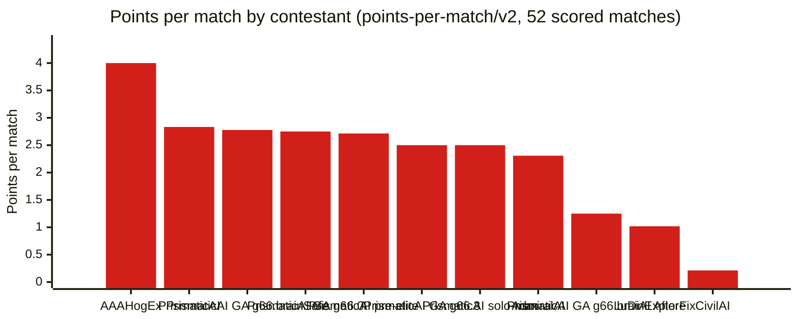
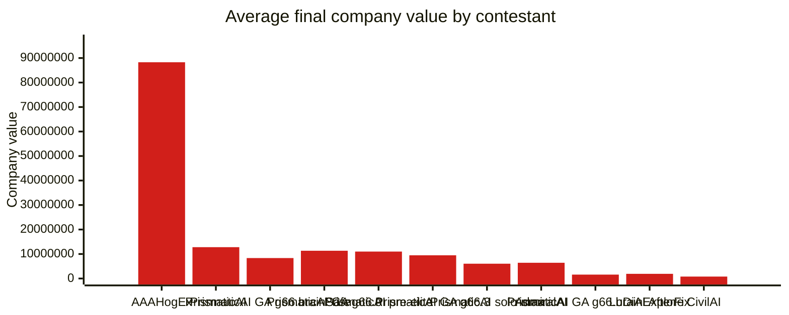
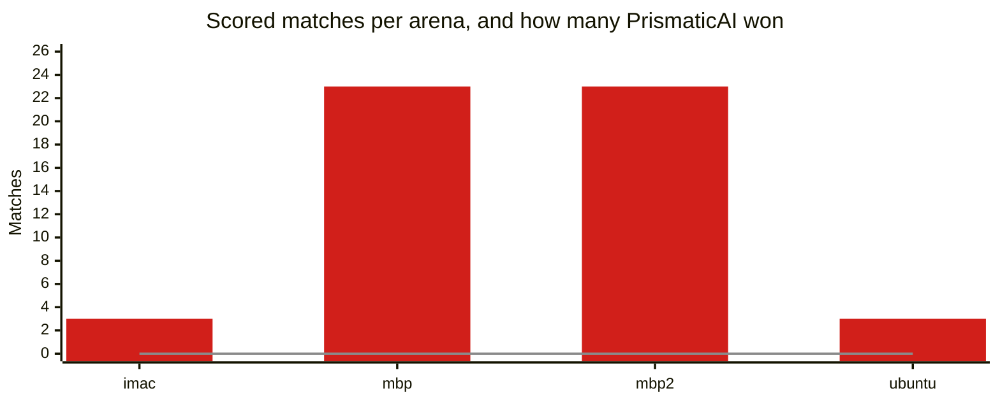

# battle-20261119T223359-69577ebe

Derived from `battle-20261119T223359-69577ebe.json` by `tools/research/ai-battle/battle.py report`; do not edit.

- Edition `69577ebe1ffa1274`: PrismaticAI and referee at `17cf96039a050eb21f3afa13dc00b0901d7a2afa`, base set `opengfx-8.0.tar`
- 20-year free-for-all from 1960, map 256x256 temperate, breakdowns 1
- 52 scored match(es) on `imac` (20261119-master-gdf1e05e7d8), `mbp` (20261119-master-ma6b147b162), `mbp2` (20261119-master-gdf1e05e7d8), `ubuntu` (20261119-master-gdf1e05e7d8)
- Replays: 1 of 1 identical to their original on another arena

| # | Contestant | Played | Wins | Points | Points/match | Avg rank | Avg final value | Squirrel errors | Matches with anomalies |
|---|---|---|---|---|---|---|---|---|---|
| 1 | AAAHogEx | 52 | 52 | 208 | 4.0 | 1.0 | 88.3 M | 0 | 0 |
| 2 | PrismaticAI | 6 | 0 | 17 | 2.833 | 2.17 | 12.8 M | 0 | 1 |
| 3 | PrismaticAI GA g66.brainSafe | 9 | 0 | 25 | 2.778 | 2.22 | 8.3 M | 0 | 0 |
| 4 | PrismaticAI GA g66.0 | 8 | 0 | 22 | 2.75 | 2.25 | 11.3 M | 0 | 0 |
| 5 | PrismaticAI pre-elite | 7 | 0 | 19 | 2.714 | 2.29 | 11.0 M | 0 | 2 |
| 6 | PrismaticAI GA g66.3 | 6 | 0 | 15 | 2.5 | 2.5 | 9.5 M | 0 | 1 |
| 7 | PrismaticAI solo-max | 8 | 0 | 20 | 2.5 | 2.5 | 6.0 M | 0 | 6 |
| 8 | AdmiralAI | 52 | 0 | 120 | 2.308 | 2.69 | 6.4 M | 0 | 5 |
| 9 | PrismaticAI GA g66.brainExplore | 8 | 0 | 10 | 1.25 | 3.75 | 1.6 M | 0 | 5 |
| 10 | LuDiAI AfterFix | 52 | 0 | 53 | 1.019 | 3.98 | 1.9 M | 0 | 3 |
| 11 | CivilAI | 52 | 0 | 11 | 0.212 | 4.79 | 791.1 k | 0 | 8 |

```mermaid
---
config:
  xyChart:
    width: 900
    height: 360
  themeVariables:
    xyChart:
      plotColorPalette: "#d11f1a, #8a8a8a, #0b0b0b, #ece4d6"
---
xychart-beta
    title "Final company value per scored match: winner vs best PrismaticAI"
    x-axis ["m-0001", "m-0002", "m-0003", "m-0004", "m-0005", "m-0006", "m-0007", "m-0008", "m-0009", "m-0010", "m-0011", "m-0012", "m-0013", "m-0014", "m-0015", "m-0016", "m-0017", "m-0018", "m-0019", "m-0020", "m-0021", "m-0022", "m-0023", "m-0024", "m-0025", "m-0026", "m-0027", "m-0028", "m-0029", "m-0030", "m-0034", "m-0036", "m-0037", "m-0038", "m-0039", "m-0040", "m-0041", "m-0042", "m-0043", "m-0044", "m-0045", "m-0046", "m-0047", "m-0050", "m-0052", "m-0053", "m-0054", "m-0060", "m-0061", "m-0063", "m-0066", "m-0067"]
    %% series: Winner | Best PrismaticAI
    %% links: battle-20261119T223359-69577ebe.md?col=Match&filter=m-0001 | battle-20261119T223359-69577ebe.md?col=Match&filter=m-0002 | battle-20261119T223359-69577ebe.md?col=Match&filter=m-0003 | battle-20261119T223359-69577ebe.md?col=Match&filter=m-0004 | battle-20261119T223359-69577ebe.md?col=Match&filter=m-0005 | battle-20261119T223359-69577ebe.md?col=Match&filter=m-0006 | battle-20261119T223359-69577ebe.md?col=Match&filter=m-0007 | battle-20261119T223359-69577ebe.md?col=Match&filter=m-0008 | battle-20261119T223359-69577ebe.md?col=Match&filter=m-0009 | battle-20261119T223359-69577ebe.md?col=Match&filter=m-0010 | battle-20261119T223359-69577ebe.md?col=Match&filter=m-0011 | battle-20261119T223359-69577ebe.md?col=Match&filter=m-0012 | battle-20261119T223359-69577ebe.md?col=Match&filter=m-0013 | battle-20261119T223359-69577ebe.md?col=Match&filter=m-0014 | battle-20261119T223359-69577ebe.md?col=Match&filter=m-0015 | battle-20261119T223359-69577ebe.md?col=Match&filter=m-0016 | battle-20261119T223359-69577ebe.md?col=Match&filter=m-0017 | battle-20261119T223359-69577ebe.md?col=Match&filter=m-0018 | battle-20261119T223359-69577ebe.md?col=Match&filter=m-0019 | battle-20261119T223359-69577ebe.md?col=Match&filter=m-0020 | battle-20261119T223359-69577ebe.md?col=Match&filter=m-0021 | battle-20261119T223359-69577ebe.md?col=Match&filter=m-0022 | battle-20261119T223359-69577ebe.md?col=Match&filter=m-0023 | battle-20261119T223359-69577ebe.md?col=Match&filter=m-0024 | battle-20261119T223359-69577ebe.md?col=Match&filter=m-0025 | battle-20261119T223359-69577ebe.md?col=Match&filter=m-0026 | battle-20261119T223359-69577ebe.md?col=Match&filter=m-0027 | battle-20261119T223359-69577ebe.md?col=Match&filter=m-0028 | battle-20261119T223359-69577ebe.md?col=Match&filter=m-0029 | battle-20261119T223359-69577ebe.md?col=Match&filter=m-0030 | battle-20261119T223359-69577ebe.md?col=Match&filter=m-0034 | battle-20261119T223359-69577ebe.md?col=Match&filter=m-0036 | battle-20261119T223359-69577ebe.md?col=Match&filter=m-0037 | battle-20261119T223359-69577ebe.md?col=Match&filter=m-0038 | battle-20261119T223359-69577ebe.md?col=Match&filter=m-0039 | battle-20261119T223359-69577ebe.md?col=Match&filter=m-0040 | battle-20261119T223359-69577ebe.md?col=Match&filter=m-0041 | battle-20261119T223359-69577ebe.md?col=Match&filter=m-0042 | battle-20261119T223359-69577ebe.md?col=Match&filter=m-0043 | battle-20261119T223359-69577ebe.md?col=Match&filter=m-0044 | battle-20261119T223359-69577ebe.md?col=Match&filter=m-0045 | battle-20261119T223359-69577ebe.md?col=Match&filter=m-0046 | battle-20261119T223359-69577ebe.md?col=Match&filter=m-0047 | battle-20261119T223359-69577ebe.md?col=Match&filter=m-0050 | battle-20261119T223359-69577ebe.md?col=Match&filter=m-0052 | battle-20261119T223359-69577ebe.md?col=Match&filter=m-0053 | battle-20261119T223359-69577ebe.md?col=Match&filter=m-0054 | battle-20261119T223359-69577ebe.md?col=Match&filter=m-0060 | battle-20261119T223359-69577ebe.md?col=Match&filter=m-0061 | battle-20261119T223359-69577ebe.md?col=Match&filter=m-0063 | battle-20261119T223359-69577ebe.md?col=Match&filter=m-0066 | battle-20261119T223359-69577ebe.md?col=Match&filter=m-0067
    y-axis "Company value" 0 --> 144000000
    bar [98122588, 128142991, 108847041, 128974775, 112261751, 122963013, 72549754, 91155342, 79811920, 90151818, 73798549, 80406604, 77662825, 80067535, 104720579, 87290167, 88230443, 60197131, 86434528, 94467123, 95690002, 92205673, 83389202, 79837668, 98435808, 80362930, 83896720, 130945604, 76100681, 89798923, 95445600, 67728618, 59967069, 58225911, 66533152, 87843674, 64045566, 62048824, 78761866, 88301289, 69537071, 74752199, 88431488, 118461587, 123743631, 127373633, 107422837, 90985177, 88286622, 69617092, 46875941, 79231922]
    line [6004226, 17814898, 10915384, 7001394, 4438899, 11427769, 14521910, 5431522, 20850747, 11831541, 9096331, 1929918, 10677563, 5023757, 6173772, 3122301, 8340579, 7128484, 643267, 7058957, 14181852, 7182056, 5189463, 10757834, 7333762, 1741418, 8370335, 12796151, 11219652, 13861127, 15212065, 2527064, 10566405, 9767941, 9192223, 796595, 4124932, 15012086, 4610874, 5585674, 12809631, 11484161, 35301, 5191398, 14147135, 5712062, 2340634, 10442856, 821797, 15229160, 12098309, 7745457]
```

<!-- battle-charts:begin -->
<!-- derived from battle-20261119T223359-69577ebe.json by `battle.py render`; `battle.py check` fails when it is stale -->

<!-- battle-charts:end -->

| Seed | Original | Replay | Arenas | Identical |
|---|---|---|---|---|
| 89555301 | m-0002 | m-0056 | mbp / mbp2 | yes |

| Match | Arena | Seed | Winner | Value | Last | Anomalies |
|---|---|---|---|---|---|---|
| m-0001 | mbp | 89555301 | AAAHogEx | 98.1 M | LuDiAI AfterFix | AdmiralAI: fleet_drop:192->124; PrismaticAI solo-max: fleet_drop:80->32; LuDiAI AfterFix: fleet_drop:117->74 |
| m-0002 | mbp | 89555301 | AAAHogEx | 128.1 M | CivilAI | AdmiralAI: fleet_drop:256->162 |
| m-0003 | mbp | 89555301 | AAAHogEx | 108.8 M | CivilAI | - |
| m-0004 | mbp | 89555301 | AAAHogEx | 129.0 M | CivilAI | CivilAI: fleet_drop:48->26 |
| m-0005 | mbp | 89555301 | AAAHogEx | 112.3 M | LuDiAI AfterFix | PrismaticAI GA g66.brainExplore: fleet_drop:79->37 |
| m-0006 | mbp | 89555301 | AAAHogEx | 123.0 M | LuDiAI AfterFix | CivilAI: fleet_drop:100->60 |
| m-0007 | mbp | 79984622 | AAAHogEx | 72.5 M | CivilAI | - |
| m-0008 | mbp | 79984622 | AAAHogEx | 91.2 M | CivilAI | - |
| m-0009 | mbp | 79984622 | AAAHogEx | 79.8 M | CivilAI | CivilAI: fleet_drop:23->15 |
| m-0010 | imac | 79984622 | AAAHogEx | 90.2 M | CivilAI | AdmiralAI: fleet_drop:165->100 |
| m-0011 | imac | 79984622 | AAAHogEx | 73.8 M | CivilAI | - |
| m-0012 | imac | 79984622 | AAAHogEx | 80.4 M | CivilAI | PrismaticAI GA g66.brainExplore: fleet_drop:57->29 |
| m-0013 | mbp2 | 79984622 | AAAHogEx | 77.7 M | CivilAI | - |
| m-0014 | mbp2 | 7831951 | AAAHogEx | 80.1 M | CivilAI | - |
| m-0015 | mbp2 | 7831951 | AAAHogEx | 104.7 M | CivilAI | PrismaticAI solo-max: fleet_drop:77->34 |
| m-0016 | mbp2 | 7831951 | AAAHogEx | 87.3 M | CivilAI | PrismaticAI pre-elite: fleet_drop:37->18 |
| m-0017 | mbp2 | 7831951 | AAAHogEx | 88.2 M | CivilAI | - |
| m-0018 | mbp2 | 7831951 | AAAHogEx | 60.2 M | CivilAI | - |
| m-0019 | mbp2 | 7831951 | AAAHogEx | 86.4 M | CivilAI | PrismaticAI GA g66.brainExplore: fleet_drop:37->25; CivilAI: fleet_drop:24->9 |
| m-0020 | mbp2 | 7831951 | AAAHogEx | 94.5 M | LuDiAI AfterFix | - |
| m-0021 | mbp2 | 1194666711 | AAAHogEx | 95.7 M | CivilAI | - |
| m-0022 | mbp2 | 1194666711 | AAAHogEx | 92.2 M | CivilAI | PrismaticAI solo-max: fleet_drop:73->50 |
| m-0023 | mbp2 | 1194666711 | AAAHogEx | 83.4 M | CivilAI | - |
| m-0024 | mbp2 | 1194666711 | AAAHogEx | 79.8 M | CivilAI | - |
| m-0025 | mbp2 | 1194666711 | AAAHogEx | 98.4 M | CivilAI | - |
| m-0026 | mbp2 | 1194666711 | AAAHogEx | 80.4 M | CivilAI | - |
| m-0027 | mbp2 | 1194666711 | AAAHogEx | 83.9 M | CivilAI | PrismaticAI GA g66.3: fleet_drop:37->25; CivilAI: fleet_drop:24->3 |
| m-0028 | mbp2 | 1525972959 | AAAHogEx | 130.9 M | CivilAI | - |
| m-0029 | ubuntu | 1525972959 | AAAHogEx | 76.1 M | LuDiAI AfterFix | PrismaticAI solo-max: fleet_drop:96->63; AdmiralAI: fleet_drop:121->76 |
| m-0030 | ubuntu | 1525972959 | AAAHogEx | 89.8 M | LuDiAI AfterFix | - |
| m-0034 | ubuntu | 1525972959 | AAAHogEx | 95.4 M | LuDiAI AfterFix | - |
| m-0036 | mbp | 620318334 | AAAHogEx | 67.7 M | AdmiralAI | PrismaticAI solo-max: fleet_drop:64->33 |
| m-0037 | mbp | 620318334 | AAAHogEx | 60.0 M | CivilAI | PrismaticAI pre-elite: fleet_drop:58->39 |
| m-0038 | mbp | 620318334 | AAAHogEx | 58.2 M | CivilAI | - |
| m-0039 | mbp | 620318334 | AAAHogEx | 66.5 M | CivilAI | - |
| m-0040 | mbp | 620318334 | AAAHogEx | 87.8 M | CivilAI | PrismaticAI GA g66.brainExplore: fleet_drop:38->26 |
| m-0041 | mbp | 620318334 | AAAHogEx | 64.0 M | CivilAI | - |
| m-0042 | mbp | 199039404 | AAAHogEx | 62.0 M | CivilAI | CivilAI: fleet_drop:60->32 |
| m-0043 | mbp | 199039404 | AAAHogEx | 78.8 M | CivilAI | PrismaticAI solo-max: fleet_drop:50->27 |
| m-0044 | mbp2 | 199039404 | AAAHogEx | 88.3 M | CivilAI | - |
| m-0045 | mbp | 199039404 | AAAHogEx | 69.5 M | AdmiralAI | CivilAI: fleet_drop:25->9 |
| m-0046 | mbp2 | 199039404 | AAAHogEx | 74.8 M | CivilAI | AdmiralAI: fleet_drop:166->108 |
| m-0047 | mbp2 | 199039404 | AAAHogEx | 88.4 M | PrismaticAI GA g66.brainExplore | - |
| m-0050 | mbp2 | 35730996 | AAAHogEx | 118.5 M | CivilAI | LuDiAI AfterFix: fleet_drop:202->141 |
| m-0052 | mbp2 | 35730996 | AAAHogEx | 123.7 M | CivilAI | - |
| m-0053 | mbp2 | 35730996 | AAAHogEx | 127.4 M | CivilAI | LuDiAI AfterFix: fleet_drop:172->116; CivilAI: fleet_drop:24->13 |
| m-0054 | mbp2 | 35730996 | AAAHogEx | 107.4 M | CivilAI | - |
| m-0056 (replay) | mbp2 | 89555301 | AAAHogEx | 128.1 M | CivilAI | AdmiralAI: fleet_drop:256->162 |
| m-0060 | mbp | 1234050756 | AAAHogEx | 91.0 M | CivilAI | - |
| m-0061 | mbp | 1234050756 | AAAHogEx | 88.3 M | CivilAI | PrismaticAI GA g66.brainExplore: fleet_drop:71->47 |
| m-0063 | mbp | 1018117607 | AAAHogEx | 69.6 M | CivilAI | PrismaticAI: fleet_drop:119->80 |
| m-0066 | mbp | 1018117607 | AAAHogEx | 46.9 M | CivilAI | - |
| m-0067 | mbp | 1018117607 | AAAHogEx | 79.2 M | CivilAI | - |
