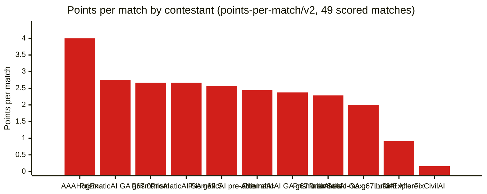
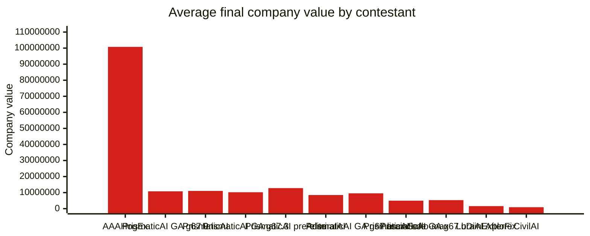
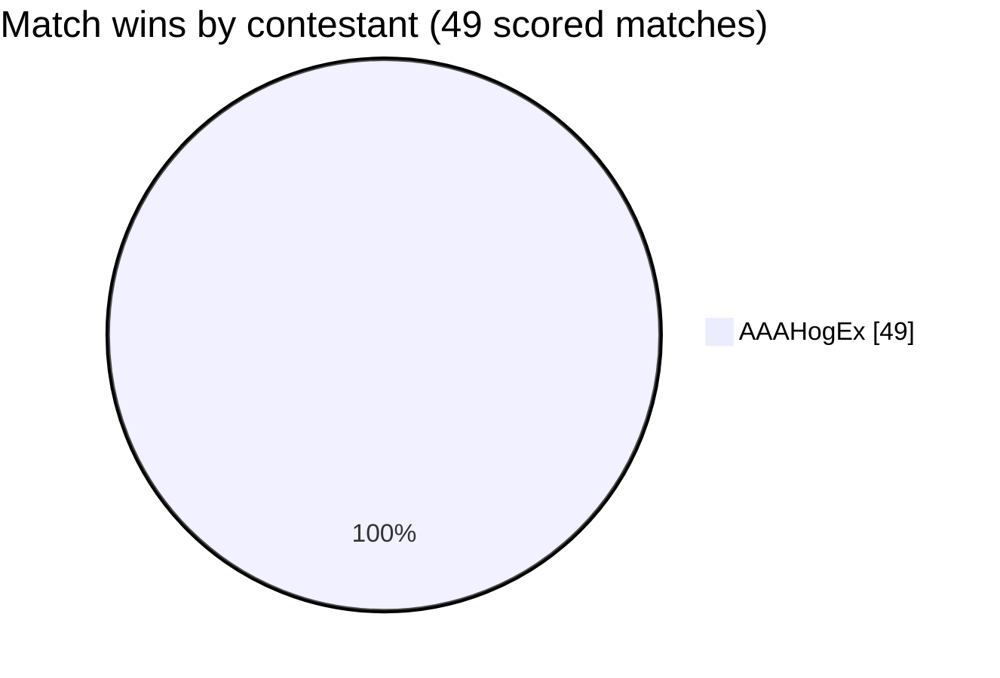
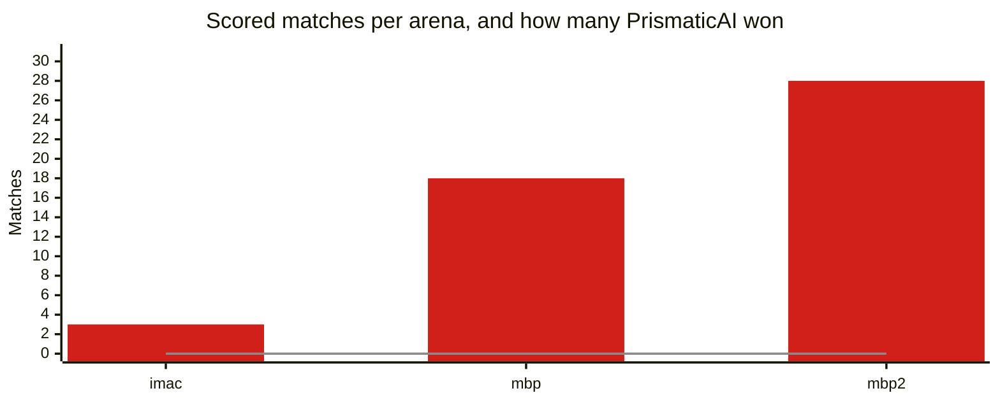

# battle-20261119T224544-1cff10c1

Derived from `battle-20261119T224544-1cff10c1.json` by `tools/research/ai-battle/battle.py report`; do not edit.

- Edition `1cff10c1f4459d35`: PrismaticAI and referee at `17cf96039a050eb21f3afa13dc00b0901d7a2afa`, base set `opengfx-8.0.tar`
- 20-year free-for-all from 1960, map 256x256 temperate, breakdowns 1
- 49 scored match(es) on `imac` (20261119-master-gdf1e05e7d8), `mbp` (20261119-master-ma6b147b162), `mbp2` (20261119-master-gdf1e05e7d8)
- Replays: 2 of 2 identical to their original on another arena

| # | Contestant | Played | Wins | Points | Points/match | Avg rank | Avg final value | Squirrel errors | Matches with anomalies |
|---|---|---|---|---|---|---|---|---|---|
| 1 | AAAHogEx | 49 | 49 | 196 | 4.0 | 1.0 | 100.8 M | 0 | 0 |
| 2 | PrismaticAI GA g67.0 | 8 | 0 | 22 | 2.75 | 2.25 | 10.8 M | 0 | 0 |
| 3 | PrismaticAI | 6 | 0 | 16 | 2.667 | 2.33 | 11.0 M | 0 | 0 |
| 4 | PrismaticAI GA g67.3 | 6 | 0 | 16 | 2.667 | 2.33 | 10.2 M | 0 | 0 |
| 5 | PrismaticAI pre-elite | 7 | 0 | 18 | 2.571 | 2.43 | 12.8 M | 0 | 1 |
| 6 | AdmiralAI | 49 | 0 | 120 | 2.449 | 2.55 | 8.5 M | 0 | 2 |
| 7 | PrismaticAI GA g67.brainSafe | 8 | 0 | 19 | 2.375 | 2.62 | 9.6 M | 0 | 0 |
| 8 | PrismaticAI solo-max | 7 | 0 | 16 | 2.286 | 2.71 | 5.0 M | 0 | 3 |
| 9 | PrismaticAI GA g67.brainExplore | 7 | 0 | 14 | 2.0 | 3.0 | 5.3 M | 0 | 0 |
| 10 | LuDiAI AfterFix | 49 | 0 | 45 | 0.918 | 4.08 | 1.6 M | 0 | 3 |
| 11 | CivilAI | 49 | 0 | 8 | 0.163 | 4.84 | 905.3 k | 0 | 8 |

```mermaid
---
config:
  xyChart:
    width: 900
    height: 360
  themeVariables:
    xyChart:
      plotColorPalette: "#d11f1a, #8a8a8a, #0b0b0b, #ece4d6"
---
xychart-beta
    title "Final company value per scored match: winner vs best PrismaticAI"
    x-axis ["m-0001", "m-0002", "m-0003", "m-0004", "m-0005", "m-0006", "m-0007", "m-0008", "m-0009", "m-0010", "m-0011", "m-0012", "m-0013", "m-0014", "m-0015", "m-0016", "m-0017", "m-0018", "m-0019", "m-0020", "m-0021", "m-0022", "m-0023", "m-0024", "m-0025", "m-0026", "m-0027", "m-0028", "m-0036", "m-0037", "m-0038", "m-0039", "m-0041", "m-0042", "m-0043", "m-0044", "m-0045", "m-0046", "m-0047", "m-0049", "m-0050", "m-0051", "m-0052", "m-0053", "m-0054", "m-0055", "m-0059", "m-0060", "m-0061"]
    %% series: Winner | Best PrismaticAI
    %% links: battle-20261119T224544-1cff10c1.md?col=Match&filter=m-0001 | battle-20261119T224544-1cff10c1.md?col=Match&filter=m-0002 | battle-20261119T224544-1cff10c1.md?col=Match&filter=m-0003 | battle-20261119T224544-1cff10c1.md?col=Match&filter=m-0004 | battle-20261119T224544-1cff10c1.md?col=Match&filter=m-0005 | battle-20261119T224544-1cff10c1.md?col=Match&filter=m-0006 | battle-20261119T224544-1cff10c1.md?col=Match&filter=m-0007 | battle-20261119T224544-1cff10c1.md?col=Match&filter=m-0008 | battle-20261119T224544-1cff10c1.md?col=Match&filter=m-0009 | battle-20261119T224544-1cff10c1.md?col=Match&filter=m-0010 | battle-20261119T224544-1cff10c1.md?col=Match&filter=m-0011 | battle-20261119T224544-1cff10c1.md?col=Match&filter=m-0012 | battle-20261119T224544-1cff10c1.md?col=Match&filter=m-0013 | battle-20261119T224544-1cff10c1.md?col=Match&filter=m-0014 | battle-20261119T224544-1cff10c1.md?col=Match&filter=m-0015 | battle-20261119T224544-1cff10c1.md?col=Match&filter=m-0016 | battle-20261119T224544-1cff10c1.md?col=Match&filter=m-0017 | battle-20261119T224544-1cff10c1.md?col=Match&filter=m-0018 | battle-20261119T224544-1cff10c1.md?col=Match&filter=m-0019 | battle-20261119T224544-1cff10c1.md?col=Match&filter=m-0020 | battle-20261119T224544-1cff10c1.md?col=Match&filter=m-0021 | battle-20261119T224544-1cff10c1.md?col=Match&filter=m-0022 | battle-20261119T224544-1cff10c1.md?col=Match&filter=m-0023 | battle-20261119T224544-1cff10c1.md?col=Match&filter=m-0024 | battle-20261119T224544-1cff10c1.md?col=Match&filter=m-0025 | battle-20261119T224544-1cff10c1.md?col=Match&filter=m-0026 | battle-20261119T224544-1cff10c1.md?col=Match&filter=m-0027 | battle-20261119T224544-1cff10c1.md?col=Match&filter=m-0028 | battle-20261119T224544-1cff10c1.md?col=Match&filter=m-0036 | battle-20261119T224544-1cff10c1.md?col=Match&filter=m-0037 | battle-20261119T224544-1cff10c1.md?col=Match&filter=m-0038 | battle-20261119T224544-1cff10c1.md?col=Match&filter=m-0039 | battle-20261119T224544-1cff10c1.md?col=Match&filter=m-0041 | battle-20261119T224544-1cff10c1.md?col=Match&filter=m-0042 | battle-20261119T224544-1cff10c1.md?col=Match&filter=m-0043 | battle-20261119T224544-1cff10c1.md?col=Match&filter=m-0044 | battle-20261119T224544-1cff10c1.md?col=Match&filter=m-0045 | battle-20261119T224544-1cff10c1.md?col=Match&filter=m-0046 | battle-20261119T224544-1cff10c1.md?col=Match&filter=m-0047 | battle-20261119T224544-1cff10c1.md?col=Match&filter=m-0049 | battle-20261119T224544-1cff10c1.md?col=Match&filter=m-0050 | battle-20261119T224544-1cff10c1.md?col=Match&filter=m-0051 | battle-20261119T224544-1cff10c1.md?col=Match&filter=m-0052 | battle-20261119T224544-1cff10c1.md?col=Match&filter=m-0053 | battle-20261119T224544-1cff10c1.md?col=Match&filter=m-0054 | battle-20261119T224544-1cff10c1.md?col=Match&filter=m-0055 | battle-20261119T224544-1cff10c1.md?col=Match&filter=m-0059 | battle-20261119T224544-1cff10c1.md?col=Match&filter=m-0060 | battle-20261119T224544-1cff10c1.md?col=Match&filter=m-0061
    y-axis "Company value" 0 --> 217000000
    bar [106392615, 116810860, 118496492, 93364724, 105307783, 130772054, 131079222, 154622253, 131730504, 144611006, 160616541, 197408432, 110328282, 96409489, 81745997, 137914685, 70503650, 88144482, 77164832, 92211214, 83231577, 109055628, 74092177, 91999836, 77624273, 86551104, 91180847, 94838357, 86295213, 124269519, 105113088, 108638925, 106230339, 69560725, 59817318, 55751702, 63447009, 79342248, 75285450, 121630806, 95109175, 88666809, 103276576, 96291202, 104035446, 79680671, 82914696, 82092190, 96664167]
    line [5164121, 12154442, 10368653, 13525245, 5197813, 12339966, 17790035, 4728624, 22327601, 18884667, 19822107, 4289719, 14823617, 3576061, 5183289, 2687171, 5545709, 899565, 3023088, 3730734, 13499283, 2949953, 11533240, 15086940, 8188122, 5588910, 12677075, 9511031, 5490419, 16861564, 6457485, 4493774, 4093058, 7310915, 6235055, 10731917, 7045587, 5721437, 4660665, 14599936, 5007585, 13281183, 11822890, 12286599, 6988906, 13738806, 11133740, 11467253, 7434986]
```

<!-- battle-charts:begin -->
<!-- derived from battle-20261119T224544-1cff10c1.json by `battle.py render`; `battle.py check` fails when it is stale -->

<!-- battle-charts:end -->

| Seed | Original | Replay | Arenas | Identical |
|---|---|---|---|---|
| 490140749 | m-0025 | m-0040 | mbp2 / mbp | yes |
| 665336382 | m-0001 | m-0048 | mbp / mbp2 | yes |

| Match | Arena | Seed | Winner | Value | Last | Anomalies |
|---|---|---|---|---|---|---|
| m-0001 | mbp | 665336382 | AAAHogEx | 106.4 M | CivilAI | CivilAI: fleet_drop:137->75 |
| m-0002 | mbp | 665336382 | AAAHogEx | 116.8 M | CivilAI | - |
| m-0003 | mbp | 665336382 | AAAHogEx | 118.5 M | CivilAI | CivilAI: fleet_drop:40->24 |
| m-0004 | mbp | 665336382 | AAAHogEx | 93.4 M | CivilAI | - |
| m-0005 | mbp | 665336382 | AAAHogEx | 105.3 M | CivilAI | - |
| m-0006 | mbp | 665336382 | AAAHogEx | 130.8 M | CivilAI | CivilAI: fleet_drop:59->41 |
| m-0007 | mbp | 1666317522 | AAAHogEx | 131.1 M | CivilAI | - |
| m-0008 | mbp | 1666317522 | AAAHogEx | 154.6 M | CivilAI | - |
| m-0009 | mbp | 1666317522 | AAAHogEx | 131.7 M | CivilAI | - |
| m-0010 | imac | 1666317522 | AAAHogEx | 144.6 M | CivilAI | - |
| m-0011 | imac | 1666317522 | AAAHogEx | 160.6 M | CivilAI | - |
| m-0012 | imac | 1666317522 | AAAHogEx | 197.4 M | CivilAI | - |
| m-0013 | mbp2 | 1666317522 | AAAHogEx | 110.3 M | CivilAI | CivilAI: fleet_drop:95->54 |
| m-0014 | mbp2 | 22389213 | AAAHogEx | 96.4 M | CivilAI | CivilAI: fleet_drop:85->56 |
| m-0015 | mbp2 | 22389213 | AAAHogEx | 81.7 M | CivilAI | AdmiralAI: fleet_drop:395->198 |
| m-0016 | mbp2 | 22389213 | AAAHogEx | 137.9 M | CivilAI | LuDiAI AfterFix: fleet_drop:63->44 |
| m-0017 | mbp2 | 22389213 | AAAHogEx | 70.5 M | LuDiAI AfterFix | - |
| m-0018 | mbp2 | 22389213 | AAAHogEx | 88.1 M | PrismaticAI GA g67.brainSafe | - |
| m-0019 | mbp2 | 22389213 | AAAHogEx | 77.2 M | CivilAI | LuDiAI AfterFix: fleet_drop:124->83 |
| m-0020 | mbp2 | 22389213 | AAAHogEx | 92.2 M | CivilAI | - |
| m-0021 | mbp2 | 490140749 | AAAHogEx | 83.2 M | LuDiAI AfterFix | - |
| m-0022 | mbp2 | 490140749 | AAAHogEx | 109.1 M | LuDiAI AfterFix | - |
| m-0023 | mbp2 | 490140749 | AAAHogEx | 74.1 M | CivilAI | CivilAI: fleet_drop:74->37 |
| m-0024 | mbp2 | 490140749 | AAAHogEx | 92.0 M | CivilAI | - |
| m-0025 | mbp2 | 490140749 | AAAHogEx | 77.6 M | LuDiAI AfterFix | - |
| m-0026 | mbp2 | 490140749 | AAAHogEx | 86.6 M | CivilAI | CivilAI: fleet_drop:26->8 |
| m-0027 | mbp2 | 490140749 | AAAHogEx | 91.2 M | LuDiAI AfterFix | - |
| m-0028 | mbp2 | 478590907 | AAAHogEx | 94.8 M | CivilAI | - |
| m-0036 | mbp | 1905016380 | AAAHogEx | 86.3 M | CivilAI | PrismaticAI solo-max: fleet_drop:75->39 |
| m-0037 | mbp | 1905016380 | AAAHogEx | 124.3 M | CivilAI | AdmiralAI: fleet_drop:170->91 |
| m-0038 | mbp | 1905016380 | AAAHogEx | 105.1 M | CivilAI | - |
| m-0039 | mbp | 1905016380 | AAAHogEx | 108.6 M | CivilAI | - |
| m-0040 (replay) | mbp | 490140749 | AAAHogEx | 77.6 M | LuDiAI AfterFix | - |
| m-0041 | mbp2 | 1905016380 | AAAHogEx | 106.2 M | CivilAI | - |
| m-0042 | mbp | 1283146202 | AAAHogEx | 69.6 M | CivilAI | LuDiAI AfterFix: fleet_drop:94->64 |
| m-0043 | mbp | 1283146202 | AAAHogEx | 59.8 M | CivilAI | PrismaticAI solo-max: fleet_drop:60->27; CivilAI: fleet_drop:55->28 |
| m-0044 | mbp | 1283146202 | AAAHogEx | 55.8 M | CivilAI | PrismaticAI pre-elite: fleet_drop:92->50 |
| m-0045 | mbp | 1283146202 | AAAHogEx | 63.4 M | CivilAI | - |
| m-0046 | mbp2 | 1283146202 | AAAHogEx | 79.3 M | CivilAI | - |
| m-0047 | mbp2 | 1283146202 | AAAHogEx | 75.3 M | CivilAI | - |
| m-0048 (replay) | mbp2 | 665336382 | AAAHogEx | 106.4 M | CivilAI | CivilAI: fleet_drop:137->75 |
| m-0049 | mbp2 | 96281933 | AAAHogEx | 121.6 M | CivilAI | - |
| m-0050 | mbp2 | 96281933 | AAAHogEx | 95.1 M | CivilAI | PrismaticAI solo-max: fleet_drop:77->51 |
| m-0051 | mbp2 | 96281933 | AAAHogEx | 88.7 M | CivilAI | - |
| m-0052 | mbp2 | 96281933 | AAAHogEx | 103.3 M | CivilAI | - |
| m-0053 | mbp2 | 96281933 | AAAHogEx | 96.3 M | CivilAI | - |
| m-0054 | mbp2 | 96281933 | AAAHogEx | 104.0 M | CivilAI | - |
| m-0055 | mbp2 | 96281933 | AAAHogEx | 79.7 M | CivilAI | - |
| m-0059 | mbp2 | 871076960 | AAAHogEx | 82.9 M | CivilAI | - |
| m-0060 | mbp2 | 871076960 | AAAHogEx | 82.1 M | LuDiAI AfterFix | - |
| m-0061 | mbp | 871076960 | AAAHogEx | 96.7 M | CivilAI | - |
