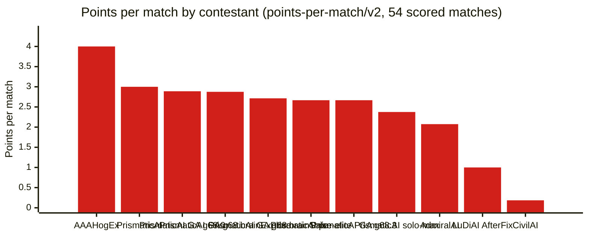
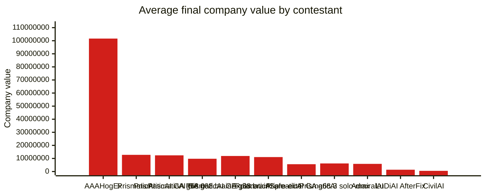
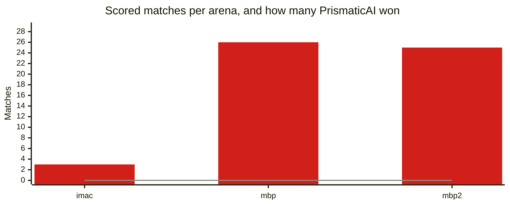

# battle-20261119T230131-1524d960

Derived from `battle-20261119T230131-1524d960.json` by `tools/research/ai-battle/battle.py report`; do not edit.

- Edition `1524d9602ca9e98b`: PrismaticAI and referee at `ca624b034c8655a9dca3353ca1fbc4b703339daf`, base set `opengfx-8.0.tar`
- 20-year free-for-all from 1960, map 256x256 temperate, breakdowns 1
- 54 scored match(es) on `imac` (20261119-master-gdf1e05e7d8), `mbp` (20261119-master-m2d3aa28066), `mbp2` (20261119-master-gdf1e05e7d8)
- Replays: 3 of 4 identical to their original on another arena

| # | Contestant | Played | Wins | Points | Points/match | Avg rank | Avg final value | Squirrel errors | Matches with anomalies |
|---|---|---|---|---|---|---|---|---|---|
| 1 | AAAHogEx | 54 | 54 | 216 | 4.0 | 1.0 | 101.6 M | 0 | 0 |
| 2 | PrismaticAI | 7 | 0 | 21 | 3.0 | 2.0 | 12.8 M | 0 | 1 |
| 3 | PrismaticAI GA g68.0 | 9 | 0 | 26 | 2.889 | 2.11 | 12.4 M | 0 | 0 |
| 4 | PrismaticAI GA g68.brainExplore | 8 | 0 | 23 | 2.875 | 2.12 | 9.8 M | 0 | 1 |
| 5 | PrismaticAI GA g68.brainSafe | 7 | 0 | 19 | 2.714 | 2.29 | 11.9 M | 0 | 1 |
| 6 | PrismaticAI pre-elite | 9 | 0 | 24 | 2.667 | 2.33 | 11.1 M | 0 | 0 |
| 7 | PrismaticAI GA g68.3 | 6 | 0 | 16 | 2.667 | 2.33 | 5.6 M | 0 | 0 |
| 8 | PrismaticAI solo-max | 8 | 0 | 19 | 2.375 | 2.62 | 6.2 M | 0 | 6 |
| 9 | AdmiralAI | 54 | 0 | 112 | 2.074 | 2.93 | 5.9 M | 0 | 4 |
| 10 | LuDiAI AfterFix | 54 | 0 | 54 | 1.0 | 4.0 | 1.4 M | 0 | 3 |
| 11 | CivilAI | 54 | 0 | 10 | 0.185 | 4.81 | 518.3 k | 3655 | 11 |

```mermaid
---
config:
  xyChart:
    width: 900
    height: 360
  themeVariables:
    xyChart:
      plotColorPalette: "#d11f1a, #8a8a8a, #0b0b0b, #ece4d6"
---
xychart-beta
    title "Final company value per scored match: winner vs best PrismaticAI"
    x-axis ["m-0001", "m-0002", "m-0003", "m-0004", "m-0005", "m-0006", "m-0007", "m-0008", "m-0009", "m-0010", "m-0011", "m-0012", "m-0013", "m-0014", "m-0015", "m-0016", "m-0017", "m-0018", "m-0019", "m-0020", "m-0021", "m-0022", "m-0023", "m-0024", "m-0025", "m-0026", "m-0027", "m-0028", "m-0036", "m-0037", "m-0038", "m-0039", "m-0040", "m-0041", "m-0042", "m-0043", "m-0044", "m-0045", "m-0047", "m-0049", "m-0051", "m-0052", "m-0053", "m-0054", "m-0055", "m-0057", "m-0058", "m-0059", "m-0065", "m-0066", "m-0067", "m-0068", "m-0070", "m-0071"]
    %% series: Winner | Best PrismaticAI
    %% links: battle-20261119T230131-1524d960.md?col=Match&filter=m-0001 | battle-20261119T230131-1524d960.md?col=Match&filter=m-0002 | battle-20261119T230131-1524d960.md?col=Match&filter=m-0003 | battle-20261119T230131-1524d960.md?col=Match&filter=m-0004 | battle-20261119T230131-1524d960.md?col=Match&filter=m-0005 | battle-20261119T230131-1524d960.md?col=Match&filter=m-0006 | battle-20261119T230131-1524d960.md?col=Match&filter=m-0007 | battle-20261119T230131-1524d960.md?col=Match&filter=m-0008 | battle-20261119T230131-1524d960.md?col=Match&filter=m-0009 | battle-20261119T230131-1524d960.md?col=Match&filter=m-0010 | battle-20261119T230131-1524d960.md?col=Match&filter=m-0011 | battle-20261119T230131-1524d960.md?col=Match&filter=m-0012 | battle-20261119T230131-1524d960.md?col=Match&filter=m-0013 | battle-20261119T230131-1524d960.md?col=Match&filter=m-0014 | battle-20261119T230131-1524d960.md?col=Match&filter=m-0015 | battle-20261119T230131-1524d960.md?col=Match&filter=m-0016 | battle-20261119T230131-1524d960.md?col=Match&filter=m-0017 | battle-20261119T230131-1524d960.md?col=Match&filter=m-0018 | battle-20261119T230131-1524d960.md?col=Match&filter=m-0019 | battle-20261119T230131-1524d960.md?col=Match&filter=m-0020 | battle-20261119T230131-1524d960.md?col=Match&filter=m-0021 | battle-20261119T230131-1524d960.md?col=Match&filter=m-0022 | battle-20261119T230131-1524d960.md?col=Match&filter=m-0023 | battle-20261119T230131-1524d960.md?col=Match&filter=m-0024 | battle-20261119T230131-1524d960.md?col=Match&filter=m-0025 | battle-20261119T230131-1524d960.md?col=Match&filter=m-0026 | battle-20261119T230131-1524d960.md?col=Match&filter=m-0027 | battle-20261119T230131-1524d960.md?col=Match&filter=m-0028 | battle-20261119T230131-1524d960.md?col=Match&filter=m-0036 | battle-20261119T230131-1524d960.md?col=Match&filter=m-0037 | battle-20261119T230131-1524d960.md?col=Match&filter=m-0038 | battle-20261119T230131-1524d960.md?col=Match&filter=m-0039 | battle-20261119T230131-1524d960.md?col=Match&filter=m-0040 | battle-20261119T230131-1524d960.md?col=Match&filter=m-0041 | battle-20261119T230131-1524d960.md?col=Match&filter=m-0042 | battle-20261119T230131-1524d960.md?col=Match&filter=m-0043 | battle-20261119T230131-1524d960.md?col=Match&filter=m-0044 | battle-20261119T230131-1524d960.md?col=Match&filter=m-0045 | battle-20261119T230131-1524d960.md?col=Match&filter=m-0047 | battle-20261119T230131-1524d960.md?col=Match&filter=m-0049 | battle-20261119T230131-1524d960.md?col=Match&filter=m-0051 | battle-20261119T230131-1524d960.md?col=Match&filter=m-0052 | battle-20261119T230131-1524d960.md?col=Match&filter=m-0053 | battle-20261119T230131-1524d960.md?col=Match&filter=m-0054 | battle-20261119T230131-1524d960.md?col=Match&filter=m-0055 | battle-20261119T230131-1524d960.md?col=Match&filter=m-0057 | battle-20261119T230131-1524d960.md?col=Match&filter=m-0058 | battle-20261119T230131-1524d960.md?col=Match&filter=m-0059 | battle-20261119T230131-1524d960.md?col=Match&filter=m-0065 | battle-20261119T230131-1524d960.md?col=Match&filter=m-0066 | battle-20261119T230131-1524d960.md?col=Match&filter=m-0067 | battle-20261119T230131-1524d960.md?col=Match&filter=m-0068 | battle-20261119T230131-1524d960.md?col=Match&filter=m-0070 | battle-20261119T230131-1524d960.md?col=Match&filter=m-0071
    y-axis "Company value" 0 --> 159000000
    bar [133603016, 123536052, 82056455, 95486443, 115536026, 100048754, 94683134, 112095229, 64749159, 71291149, 69146822, 96493711, 92333156, 133525475, 121567294, 131229430, 131199752, 114020606, 126022374, 140866830, 69178185, 86030000, 61184029, 50457901, 64157267, 75796024, 59773081, 128965391, 98869892, 139976596, 92844331, 109111709, 120655116, 122573971, 127205486, 108776801, 85558823, 106967066, 110053433, 123681850, 105369534, 128060444, 125553415, 101883301, 133007697, 81409929, 83206472, 76600483, 76955881, 77908260, 68793101, 69874493, 144359651, 124676589]
    line [10455825, 6739558, 10616885, 7809920, 5144683, 8310644, 14630965, 1106026, 11118949, 12968849, 10095738, 9361381, 4498018, 9998455, 7439896, 10052836, 15830400, 11518890, 15733538, 5379680, 14052644, 4157639, 16268543, 16955676, 10864472, 1436251, 6130129, 9659794, 4680165, 19045127, 17131161, 22552658, 13166547, 2804687, 15549268, 7000475, 10320956, 11804978, 8746417, 16110035, 18044440, 11809131, 13902303, 14623570, 6477948, 6391777, 4155414, 4961781, 3748099, 9284788, 6462736, 9947873, 9268941, 8167968]
```

<!-- battle-charts:begin -->
<!-- derived from battle-20261119T230131-1524d960.json by `battle.py render`; `battle.py check` fails when it is stale -->

<!-- battle-charts:end -->

| Seed | Original | Replay | Arenas | Identical |
|---|---|---|---|---|
| 1978645068 | m-0001 | m-0048 | mbp / mbp2 | yes |
| 1978645068 | m-0002 | m-0056 | mbp / mbp2 | yes |
| 1978645068 | m-0003 | m-0064 | mbp / mbp2 | yes |
| 1870545683 | m-0010 | m-0072 | imac / mbp | NO |

| Match | Arena | Seed | Winner | Value | Last | Anomalies |
|---|---|---|---|---|---|---|
| m-0001 | mbp | 1978645068 | AAAHogEx | 133.6 M | AdmiralAI | - |
| m-0002 | mbp | 1978645068 | AAAHogEx | 123.5 M | CivilAI | CivilAI: fleet_drop:83->48 |
| m-0003 | mbp | 1978645068 | AAAHogEx | 82.1 M | CivilAI | CivilAI: squirrel_errors:3655 |
| m-0004 | mbp | 1978645068 | AAAHogEx | 95.5 M | CivilAI | CivilAI: fleet_drop:66->42 |
| m-0005 | mbp | 1978645068 | AAAHogEx | 115.5 M | AdmiralAI | - |
| m-0006 | mbp | 1978645068 | AAAHogEx | 100.0 M | CivilAI | AdmiralAI: fleet_drop:208->123 |
| m-0007 | mbp | 1870545683 | AAAHogEx | 94.7 M | CivilAI | - |
| m-0008 | mbp | 1870545683 | AAAHogEx | 112.1 M | CivilAI | AdmiralAI: fleet_drop:176->121; CivilAI: fleet_drop:19->11 |
| m-0009 | mbp | 1870545683 | AAAHogEx | 64.7 M | CivilAI | - |
| m-0010 | imac | 1870545683 | AAAHogEx | 71.3 M | CivilAI | - |
| m-0011 | imac | 1870545683 | AAAHogEx | 69.1 M | CivilAI | CivilAI: fleet_drop:21->12 |
| m-0012 | imac | 1870545683 | AAAHogEx | 96.5 M | LuDiAI AfterFix | CivilAI: fleet_drop:57->34 |
| m-0013 | mbp2 | 1870545683 | AAAHogEx | 92.3 M | CivilAI | CivilAI: fleet_drop:28->10 |
| m-0014 | mbp2 | 1765269485 | AAAHogEx | 133.5 M | CivilAI | LuDiAI AfterFix: fleet_drop:51->32; CivilAI: fleet_drop:27->18 |
| m-0015 | mbp2 | 1765269485 | AAAHogEx | 121.6 M | CivilAI | PrismaticAI solo-max: fleet_drop:88->51 |
| m-0016 | mbp2 | 1765269485 | AAAHogEx | 131.2 M | LuDiAI AfterFix | - |
| m-0017 | mbp2 | 1765269485 | AAAHogEx | 131.2 M | CivilAI | - |
| m-0018 | mbp2 | 1765269485 | AAAHogEx | 114.0 M | CivilAI | - |
| m-0019 | mbp2 | 1765269485 | AAAHogEx | 126.0 M | CivilAI | - |
| m-0020 | mbp2 | 1765269485 | AAAHogEx | 140.9 M | LuDiAI AfterFix | - |
| m-0021 | mbp2 | 528535284 | AAAHogEx | 69.2 M | LuDiAI AfterFix | - |
| m-0022 | mbp2 | 528535284 | AAAHogEx | 86.0 M | CivilAI | PrismaticAI solo-max: fleet_drop:47->19 |
| m-0023 | mbp2 | 528535284 | AAAHogEx | 61.2 M | CivilAI | - |
| m-0024 | mbp2 | 528535284 | AAAHogEx | 50.5 M | CivilAI | - |
| m-0025 | mbp2 | 528535284 | AAAHogEx | 64.2 M | LuDiAI AfterFix | - |
| m-0026 | mbp2 | 528535284 | AAAHogEx | 75.8 M | CivilAI | PrismaticAI GA g68.brainExplore: fleet_drop:18->12 |
| m-0027 | mbp2 | 528535284 | AAAHogEx | 59.8 M | LuDiAI AfterFix | - |
| m-0028 | mbp2 | 77991906 | AAAHogEx | 129.0 M | CivilAI | - |
| m-0036 | mbp | 410832572 | AAAHogEx | 98.9 M | CivilAI | PrismaticAI solo-max: fleet_drop:92->59; LuDiAI AfterFix: fleet_drop:68->33 |
| m-0037 | mbp | 410832572 | AAAHogEx | 140.0 M | CivilAI | - |
| m-0038 | mbp | 410832572 | AAAHogEx | 92.8 M | LuDiAI AfterFix | - |
| m-0039 | mbp | 410832572 | AAAHogEx | 109.1 M | CivilAI | AdmiralAI: fleet_drop:409->255 |
| m-0040 | mbp | 410832572 | AAAHogEx | 120.7 M | CivilAI | - |
| m-0041 | mbp | 410832572 | AAAHogEx | 122.6 M | CivilAI | - |
| m-0042 | mbp | 1730660478 | AAAHogEx | 127.2 M | CivilAI | - |
| m-0043 | mbp | 1730660478 | AAAHogEx | 108.8 M | CivilAI | PrismaticAI solo-max: fleet_drop:98->50 |
| m-0044 | mbp | 1730660478 | AAAHogEx | 85.6 M | CivilAI | - |
| m-0045 | mbp2 | 1730660478 | AAAHogEx | 107.0 M | CivilAI | - |
| m-0047 | mbp2 | 1730660478 | AAAHogEx | 110.1 M | CivilAI | CivilAI: fleet_drop:52->29 |
| m-0048 (replay) | mbp2 | 1978645068 | AAAHogEx | 133.6 M | AdmiralAI | - |
| m-0049 | mbp2 | 649651818 | AAAHogEx | 123.7 M | CivilAI | CivilAI: fleet_drop:36->18 |
| m-0051 | mbp2 | 649651818 | AAAHogEx | 105.4 M | CivilAI | - |
| m-0052 | mbp2 | 649651818 | AAAHogEx | 128.1 M | CivilAI | - |
| m-0053 | mbp2 | 649651818 | AAAHogEx | 125.6 M | CivilAI | - |
| m-0054 | mbp2 | 649651818 | AAAHogEx | 101.9 M | CivilAI | AdmiralAI: fleet_drop:353->167 |
| m-0055 | mbp2 | 649651818 | AAAHogEx | 133.0 M | CivilAI | - |
| m-0056 (replay) | mbp2 | 1978645068 | AAAHogEx | 123.5 M | CivilAI | CivilAI: fleet_drop:83->48 |
| m-0057 | mbp2 | 1406994706 | AAAHogEx | 81.4 M | CivilAI | PrismaticAI solo-max: fleet_drop:55->34 |
| m-0058 | mbp | 1406994706 | AAAHogEx | 83.2 M | CivilAI | LuDiAI AfterFix: fleet_drop:55->30 |
| m-0059 | mbp | 1406994706 | AAAHogEx | 76.6 M | CivilAI | - |
| m-0064 (replay) | mbp2 | 1978645068 | AAAHogEx | 82.1 M | CivilAI | CivilAI: squirrel_errors:3655 |
| m-0065 | mbp | 1423511454 | AAAHogEx | 77.0 M | CivilAI | - |
| m-0066 | mbp | 1423511454 | AAAHogEx | 77.9 M | AdmiralAI | - |
| m-0067 | mbp | 1423511454 | AAAHogEx | 68.8 M | CivilAI | PrismaticAI GA g68.brainSafe: fleet_drop:36->20 |
| m-0068 | mbp | 1423511454 | AAAHogEx | 69.9 M | CivilAI | CivilAI: no_vehicles |
| m-0070 | mbp | 1639763559 | AAAHogEx | 144.4 M | CivilAI | PrismaticAI: fleet_drop:89->52 |
| m-0071 | mbp | 1639763559 | AAAHogEx | 124.7 M | CivilAI | PrismaticAI solo-max: fleet_drop:137->92 |
| m-0072 (replay) | mbp | 1870545683 | AAAHogEx | 72.8 M | CivilAI | - |
