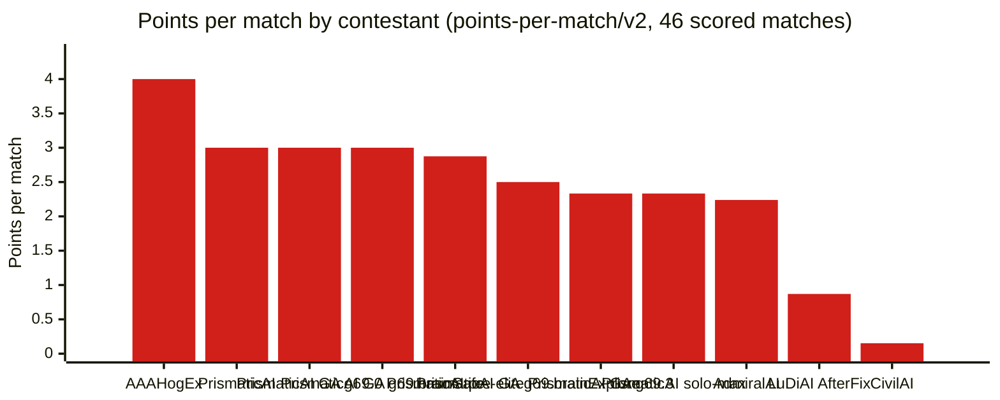
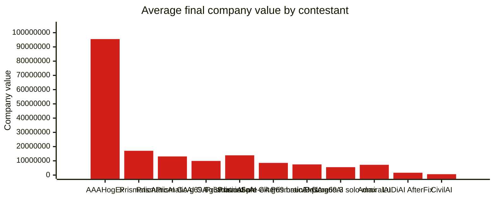
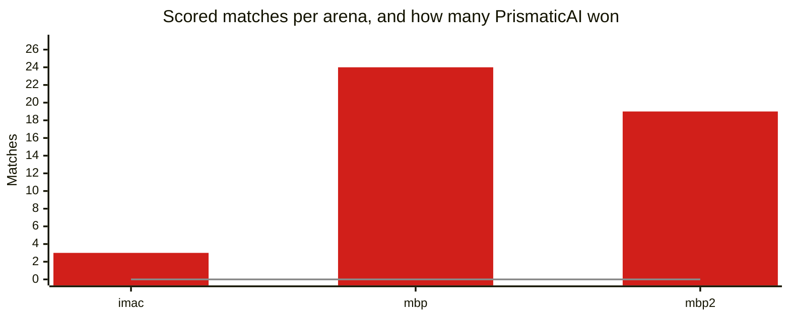

# battle-20261119T231126-7414f868

Derived from `battle-20261119T231126-7414f868.json` by `tools/research/ai-battle/battle.py report`; do not edit.

- Edition `7414f868144c446a`: PrismaticAI and referee at `ca624b034c8655a9dca3353ca1fbc4b703339daf`, base set `opengfx-8.0.tar`
- 20-year free-for-all from 1960, map 256x256 temperate, breakdowns 1
- 46 scored match(es) on `imac` (20261119-master-gdf1e05e7d8), `mbp` (20261119-master-m2d3aa28066), `mbp2` (20261119-master-gdf1e05e7d8)
- Replays: 0 of 1 identical to their original on another arena

| # | Contestant | Played | Wins | Points | Points/match | Avg rank | Avg final value | Squirrel errors | Matches with anomalies |
|---|---|---|---|---|---|---|---|---|---|
| 1 | AAAHogEx | 46 | 46 | 184 | 4.0 | 1.0 | 95.5 M | 0 | 0 |
| 2 | PrismaticAI | 6 | 0 | 18 | 3.0 | 2.0 | 17.0 M | 0 | 2 |
| 3 | PrismaticAI GA g69.0 | 6 | 0 | 18 | 3.0 | 2.0 | 13.1 M | 0 | 0 |
| 4 | PrismaticAI GA g69.brainSafe | 8 | 0 | 24 | 3.0 | 2.0 | 9.9 M | 0 | 0 |
| 5 | PrismaticAI pre-elite | 8 | 0 | 23 | 2.875 | 2.12 | 13.9 M | 0 | 0 |
| 6 | PrismaticAI GA g69.brainExplore | 6 | 0 | 15 | 2.5 | 2.5 | 8.5 M | 0 | 1 |
| 7 | PrismaticAI GA g69.3 | 6 | 0 | 14 | 2.333 | 2.67 | 7.5 M | 0 | 0 |
| 8 | PrismaticAI solo-max | 6 | 0 | 14 | 2.333 | 2.67 | 5.5 M | 0 | 1 |
| 9 | AdmiralAI | 46 | 0 | 103 | 2.239 | 2.76 | 7.2 M | 0 | 1 |
| 10 | LuDiAI AfterFix | 46 | 0 | 40 | 0.87 | 4.13 | 1.6 M | 0 | 0 |
| 11 | CivilAI | 46 | 0 | 7 | 0.152 | 4.85 | 610.1 k | 0 | 7 |

```mermaid
---
config:
  xyChart:
    width: 900
    height: 360
  themeVariables:
    xyChart:
      plotColorPalette: "#d11f1a, #8a8a8a, #0b0b0b, #ece4d6"
---
xychart-beta
    title "Final company value per scored match: winner vs best PrismaticAI"
    x-axis ["m-0001", "m-0002", "m-0003", "m-0004", "m-0005", "m-0006", "m-0007", "m-0008", "m-0009", "m-0010", "m-0011", "m-0012", "m-0013", "m-0014", "m-0015", "m-0016", "m-0017", "m-0018", "m-0019", "m-0020", "m-0021", "m-0022", "m-0023", "m-0024", "m-0025", "m-0026", "m-0027", "m-0028", "m-0036", "m-0037", "m-0038", "m-0039", "m-0040", "m-0041", "m-0042", "m-0043", "m-0044", "m-0046", "m-0051", "m-0053", "m-0061", "m-0062", "m-0063", "m-0065", "m-0066", "m-0067"]
    %% series: Winner | Best PrismaticAI
    %% links: battle-20261119T231126-7414f868.md?col=Match&filter=m-0001 | battle-20261119T231126-7414f868.md?col=Match&filter=m-0002 | battle-20261119T231126-7414f868.md?col=Match&filter=m-0003 | battle-20261119T231126-7414f868.md?col=Match&filter=m-0004 | battle-20261119T231126-7414f868.md?col=Match&filter=m-0005 | battle-20261119T231126-7414f868.md?col=Match&filter=m-0006 | battle-20261119T231126-7414f868.md?col=Match&filter=m-0007 | battle-20261119T231126-7414f868.md?col=Match&filter=m-0008 | battle-20261119T231126-7414f868.md?col=Match&filter=m-0009 | battle-20261119T231126-7414f868.md?col=Match&filter=m-0010 | battle-20261119T231126-7414f868.md?col=Match&filter=m-0011 | battle-20261119T231126-7414f868.md?col=Match&filter=m-0012 | battle-20261119T231126-7414f868.md?col=Match&filter=m-0013 | battle-20261119T231126-7414f868.md?col=Match&filter=m-0014 | battle-20261119T231126-7414f868.md?col=Match&filter=m-0015 | battle-20261119T231126-7414f868.md?col=Match&filter=m-0016 | battle-20261119T231126-7414f868.md?col=Match&filter=m-0017 | battle-20261119T231126-7414f868.md?col=Match&filter=m-0018 | battle-20261119T231126-7414f868.md?col=Match&filter=m-0019 | battle-20261119T231126-7414f868.md?col=Match&filter=m-0020 | battle-20261119T231126-7414f868.md?col=Match&filter=m-0021 | battle-20261119T231126-7414f868.md?col=Match&filter=m-0022 | battle-20261119T231126-7414f868.md?col=Match&filter=m-0023 | battle-20261119T231126-7414f868.md?col=Match&filter=m-0024 | battle-20261119T231126-7414f868.md?col=Match&filter=m-0025 | battle-20261119T231126-7414f868.md?col=Match&filter=m-0026 | battle-20261119T231126-7414f868.md?col=Match&filter=m-0027 | battle-20261119T231126-7414f868.md?col=Match&filter=m-0028 | battle-20261119T231126-7414f868.md?col=Match&filter=m-0036 | battle-20261119T231126-7414f868.md?col=Match&filter=m-0037 | battle-20261119T231126-7414f868.md?col=Match&filter=m-0038 | battle-20261119T231126-7414f868.md?col=Match&filter=m-0039 | battle-20261119T231126-7414f868.md?col=Match&filter=m-0040 | battle-20261119T231126-7414f868.md?col=Match&filter=m-0041 | battle-20261119T231126-7414f868.md?col=Match&filter=m-0042 | battle-20261119T231126-7414f868.md?col=Match&filter=m-0043 | battle-20261119T231126-7414f868.md?col=Match&filter=m-0044 | battle-20261119T231126-7414f868.md?col=Match&filter=m-0046 | battle-20261119T231126-7414f868.md?col=Match&filter=m-0051 | battle-20261119T231126-7414f868.md?col=Match&filter=m-0053 | battle-20261119T231126-7414f868.md?col=Match&filter=m-0061 | battle-20261119T231126-7414f868.md?col=Match&filter=m-0062 | battle-20261119T231126-7414f868.md?col=Match&filter=m-0063 | battle-20261119T231126-7414f868.md?col=Match&filter=m-0065 | battle-20261119T231126-7414f868.md?col=Match&filter=m-0066 | battle-20261119T231126-7414f868.md?col=Match&filter=m-0067
    y-axis "Company value" 0 --> 152000000
    bar [124307346, 124834605, 97692933, 111199682, 111645359, 137868239, 92971403, 89251394, 99445732, 111830500, 85383146, 110048358, 128812557, 65062208, 119413540, 110497064, 92113391, 85708384, 87651234, 104415162, 89112981, 104548948, 66427833, 91334513, 65357127, 51799963, 71730316, 79755451, 89397310, 88678087, 115848634, 115975915, 92430263, 92462929, 112505405, 107208096, 87392098, 95177750, 104375509, 80637822, 87409221, 86667158, 82918052, 71056362, 88579955, 84500639]
    line [6865091, 20382836, 18670033, 11477450, 9660123, 6273255, 16292853, 4861706, 11627384, 8945871, 11125084, 6953154, 2055565, 21921710, 6219571, 10516330, 15560404, 9249429, 13196341, 9212880, 19639373, 2310614, 10996913, 9420010, 4813861, 6723840, 5710898, 17377705, 6883144, 18028841, 11080686, 6048157, 6642524, 11928690, 11899412, 6087973, 8379303, 8538947, 16264236, 11595477, 8048508, 9722506, 15128667, 14805746, 14759114, 16545619]
```

<!-- battle-charts:begin -->
<!-- derived from battle-20261119T231126-7414f868.json by `battle.py render`; `battle.py check` fails when it is stale -->

<!-- battle-charts:end -->

| Seed | Original | Replay | Arenas | Identical |
|---|---|---|---|---|
| 1718326140 | m-0010 | m-0064 | imac / mbp | NO |

| Match | Arena | Seed | Winner | Value | Last | Anomalies |
|---|---|---|---|---|---|---|
| m-0001 | mbp | 474260684 | AAAHogEx | 124.3 M | CivilAI | PrismaticAI solo-max: fleet_drop:73->34 |
| m-0002 | mbp | 474260684 | AAAHogEx | 124.8 M | CivilAI | - |
| m-0003 | mbp | 474260684 | AAAHogEx | 97.7 M | CivilAI | - |
| m-0004 | mbp | 474260684 | AAAHogEx | 111.2 M | CivilAI | - |
| m-0005 | mbp | 474260684 | AAAHogEx | 111.6 M | CivilAI | - |
| m-0006 | mbp | 474260684 | AAAHogEx | 137.9 M | CivilAI | - |
| m-0007 | mbp | 1718326140 | AAAHogEx | 93.0 M | CivilAI | PrismaticAI: fleet_drop:76->37 |
| m-0008 | mbp | 1718326140 | AAAHogEx | 89.3 M | CivilAI | - |
| m-0009 | mbp | 1718326140 | AAAHogEx | 99.4 M | CivilAI | - |
| m-0010 | imac | 1718326140 | AAAHogEx | 111.8 M | CivilAI | - |
| m-0011 | imac | 1718326140 | AAAHogEx | 85.4 M | CivilAI | - |
| m-0012 | imac | 1718326140 | AAAHogEx | 110.0 M | CivilAI | - |
| m-0013 | mbp2 | 1718326140 | AAAHogEx | 128.8 M | CivilAI | - |
| m-0014 | mbp2 | 286934578 | AAAHogEx | 65.1 M | CivilAI | - |
| m-0015 | mbp2 | 286934578 | AAAHogEx | 119.4 M | CivilAI | - |
| m-0016 | mbp2 | 286934578 | AAAHogEx | 110.5 M | CivilAI | - |
| m-0017 | mbp2 | 286934578 | AAAHogEx | 92.1 M | CivilAI | CivilAI: no_vehicles |
| m-0018 | mbp2 | 286934578 | AAAHogEx | 85.7 M | CivilAI | AdmiralAI: fleet_drop:369->195 |
| m-0019 | mbp2 | 286934578 | AAAHogEx | 87.7 M | LuDiAI AfterFix | - |
| m-0020 | mbp2 | 286934578 | AAAHogEx | 104.4 M | CivilAI | - |
| m-0021 | mbp2 | 675448928 | AAAHogEx | 89.1 M | CivilAI | - |
| m-0022 | mbp2 | 675448928 | AAAHogEx | 104.5 M | CivilAI | - |
| m-0023 | mbp2 | 675448928 | AAAHogEx | 66.4 M | LuDiAI AfterFix | CivilAI: fleet_drop:32->20 |
| m-0024 | mbp2 | 675448928 | AAAHogEx | 91.3 M | CivilAI | - |
| m-0025 | mbp2 | 675448928 | AAAHogEx | 65.4 M | CivilAI | - |
| m-0026 | mbp2 | 675448928 | AAAHogEx | 51.8 M | CivilAI | PrismaticAI GA g69.brainExplore: fleet_drop:31->21; CivilAI: fleet_drop:48->23 |
| m-0027 | mbp2 | 675448928 | AAAHogEx | 71.7 M | LuDiAI AfterFix | CivilAI: fleet_drop:37->15 |
| m-0028 | mbp2 | 1105331544 | AAAHogEx | 79.8 M | CivilAI | PrismaticAI: fleet_drop:100->48 |
| m-0036 | mbp | 1567937417 | AAAHogEx | 89.4 M | LuDiAI AfterFix | - |
| m-0037 | mbp | 1567937417 | AAAHogEx | 88.7 M | CivilAI | - |
| m-0038 | mbp | 1567937417 | AAAHogEx | 115.8 M | CivilAI | - |
| m-0039 | mbp | 1567937417 | AAAHogEx | 116.0 M | CivilAI | - |
| m-0040 | mbp | 1567937417 | AAAHogEx | 92.4 M | CivilAI | CivilAI: fleet_drop:32->11 |
| m-0041 | mbp | 1567937417 | AAAHogEx | 92.5 M | CivilAI | - |
| m-0042 | mbp | 1094615547 | AAAHogEx | 112.5 M | LuDiAI AfterFix | - |
| m-0043 | mbp | 1094615547 | AAAHogEx | 107.2 M | LuDiAI AfterFix | - |
| m-0044 | mbp | 1094615547 | AAAHogEx | 87.4 M | CivilAI | CivilAI: fleet_drop:43->29 |
| m-0046 | mbp2 | 1094615547 | AAAHogEx | 95.2 M | CivilAI | - |
| m-0051 | mbp2 | 377143415 | AAAHogEx | 104.4 M | LuDiAI AfterFix | - |
| m-0053 | mbp2 | 377143415 | AAAHogEx | 80.6 M | CivilAI | CivilAI: fleet_drop:45->17 |
| m-0061 | mbp | 901426541 | AAAHogEx | 87.4 M | CivilAI | - |
| m-0062 | mbp | 901426541 | AAAHogEx | 86.7 M | CivilAI | - |
| m-0063 | mbp | 42391527 | AAAHogEx | 82.9 M | CivilAI | - |
| m-0064 (replay) | mbp | 1718326140 | AAAHogEx | 113.0 M | CivilAI | - |
| m-0065 | mbp | 42391527 | AAAHogEx | 71.1 M | CivilAI | - |
| m-0066 | mbp | 42391527 | AAAHogEx | 88.6 M | CivilAI | - |
| m-0067 | mbp | 42391527 | AAAHogEx | 84.5 M | CivilAI | - |
