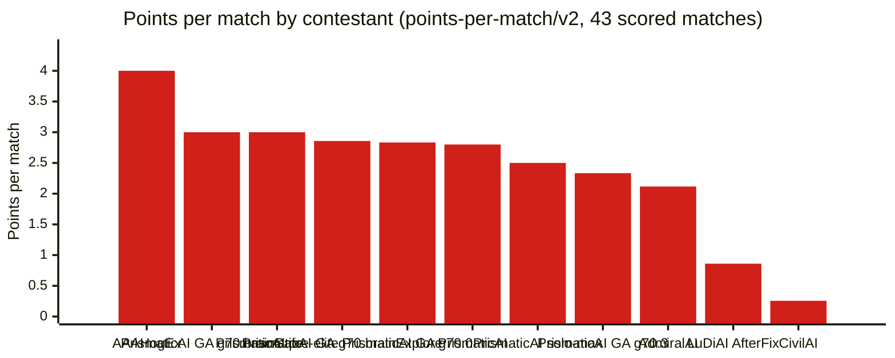
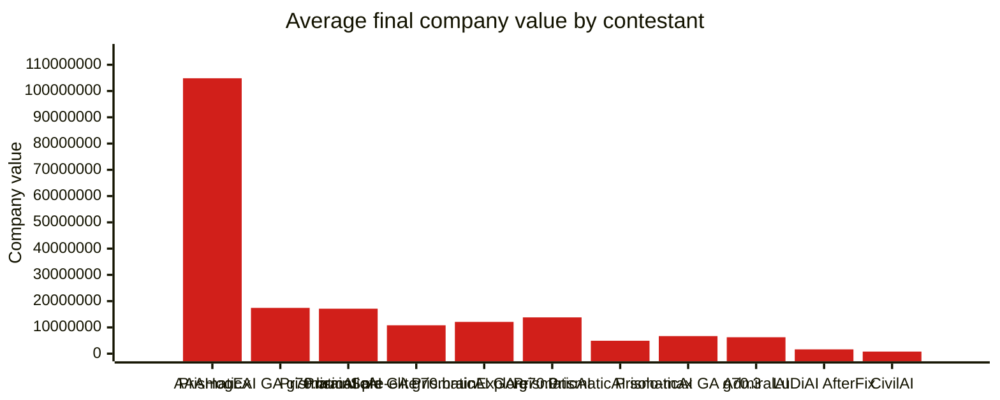
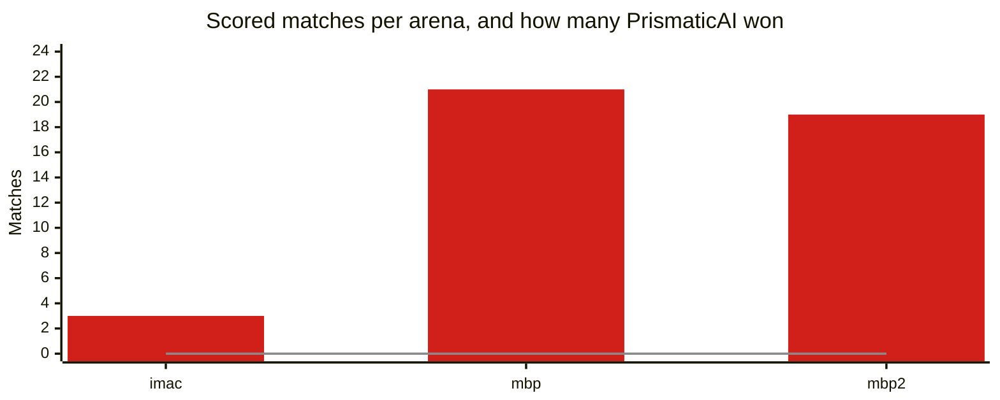

# battle-20261119T232203-686a46df

Derived from `battle-20261119T232203-686a46df.json` by `tools/research/ai-battle/battle.py report`; do not edit.

- Edition `686a46dff1af1434`: PrismaticAI and referee at `ca624b034c8655a9dca3353ca1fbc4b703339daf`, base set `opengfx-8.0.tar`
- 20-year free-for-all from 1960, map 256x256 temperate, breakdowns 1
- 43 scored match(es) on `imac` (20261119-master-gdf1e05e7d8), `mbp` (20261119-master-m2d3aa28066), `mbp2` (20261119-master-gdf1e05e7d8)
- Replays: 0 of 0 identical to their original on another arena

| # | Contestant | Played | Wins | Points | Points/match | Avg rank | Avg final value | Squirrel errors | Matches with anomalies |
|---|---|---|---|---|---|---|---|---|---|
| 1 | AAAHogEx | 43 | 43 | 172 | 4.0 | 1.0 | 104.9 M | 0 | 0 |
| 2 | PrismaticAI GA g70.brainSafe | 7 | 0 | 21 | 3.0 | 2.0 | 17.4 M | 0 | 2 |
| 3 | PrismaticAI pre-elite | 6 | 0 | 18 | 3.0 | 2.0 | 17.1 M | 0 | 1 |
| 4 | PrismaticAI GA g70.brainExplore | 7 | 0 | 20 | 2.857 | 2.14 | 10.8 M | 0 | 2 |
| 5 | PrismaticAI GA g70.0 | 6 | 0 | 17 | 2.833 | 2.17 | 12.1 M | 0 | 1 |
| 6 | PrismaticAI | 5 | 0 | 14 | 2.8 | 2.2 | 13.8 M | 0 | 2 |
| 7 | PrismaticAI solo-max | 6 | 0 | 15 | 2.5 | 2.5 | 4.9 M | 0 | 4 |
| 8 | PrismaticAI GA g70.3 | 6 | 0 | 14 | 2.333 | 2.67 | 6.7 M | 0 | 0 |
| 9 | AdmiralAI | 43 | 0 | 91 | 2.116 | 2.88 | 6.3 M | 0 | 3 |
| 10 | LuDiAI AfterFix | 43 | 0 | 37 | 0.86 | 4.14 | 1.6 M | 0 | 1 |
| 11 | CivilAI | 43 | 0 | 11 | 0.256 | 4.74 | 798.5 k | 0 | 3 |

```mermaid
---
config:
  xyChart:
    width: 900
    height: 360
  themeVariables:
    xyChart:
      plotColorPalette: "#d11f1a, #8a8a8a, #0b0b0b, #ece4d6"
---
xychart-beta
    title "Final company value per scored match: winner vs best PrismaticAI"
    x-axis ["m-0001", "m-0002", "m-0003", "m-0004", "m-0005", "m-0006", "m-0007", "m-0008", "m-0009", "m-0010", "m-0011", "m-0012", "m-0013", "m-0014", "m-0015", "m-0016", "m-0017", "m-0018", "m-0019", "m-0020", "m-0021", "m-0022", "m-0023", "m-0024", "m-0025", "m-0026", "m-0027", "m-0028", "m-0036", "m-0037", "m-0038", "m-0039", "m-0040", "m-0041", "m-0042", "m-0043", "m-0044", "m-0045", "m-0046", "m-0047", "m-0062", "m-0067", "m-0068"]
    %% series: Winner | Best PrismaticAI
    %% links: battle-20261119T232203-686a46df.md?col=Match&filter=m-0001 | battle-20261119T232203-686a46df.md?col=Match&filter=m-0002 | battle-20261119T232203-686a46df.md?col=Match&filter=m-0003 | battle-20261119T232203-686a46df.md?col=Match&filter=m-0004 | battle-20261119T232203-686a46df.md?col=Match&filter=m-0005 | battle-20261119T232203-686a46df.md?col=Match&filter=m-0006 | battle-20261119T232203-686a46df.md?col=Match&filter=m-0007 | battle-20261119T232203-686a46df.md?col=Match&filter=m-0008 | battle-20261119T232203-686a46df.md?col=Match&filter=m-0009 | battle-20261119T232203-686a46df.md?col=Match&filter=m-0010 | battle-20261119T232203-686a46df.md?col=Match&filter=m-0011 | battle-20261119T232203-686a46df.md?col=Match&filter=m-0012 | battle-20261119T232203-686a46df.md?col=Match&filter=m-0013 | battle-20261119T232203-686a46df.md?col=Match&filter=m-0014 | battle-20261119T232203-686a46df.md?col=Match&filter=m-0015 | battle-20261119T232203-686a46df.md?col=Match&filter=m-0016 | battle-20261119T232203-686a46df.md?col=Match&filter=m-0017 | battle-20261119T232203-686a46df.md?col=Match&filter=m-0018 | battle-20261119T232203-686a46df.md?col=Match&filter=m-0019 | battle-20261119T232203-686a46df.md?col=Match&filter=m-0020 | battle-20261119T232203-686a46df.md?col=Match&filter=m-0021 | battle-20261119T232203-686a46df.md?col=Match&filter=m-0022 | battle-20261119T232203-686a46df.md?col=Match&filter=m-0023 | battle-20261119T232203-686a46df.md?col=Match&filter=m-0024 | battle-20261119T232203-686a46df.md?col=Match&filter=m-0025 | battle-20261119T232203-686a46df.md?col=Match&filter=m-0026 | battle-20261119T232203-686a46df.md?col=Match&filter=m-0027 | battle-20261119T232203-686a46df.md?col=Match&filter=m-0028 | battle-20261119T232203-686a46df.md?col=Match&filter=m-0036 | battle-20261119T232203-686a46df.md?col=Match&filter=m-0037 | battle-20261119T232203-686a46df.md?col=Match&filter=m-0038 | battle-20261119T232203-686a46df.md?col=Match&filter=m-0039 | battle-20261119T232203-686a46df.md?col=Match&filter=m-0040 | battle-20261119T232203-686a46df.md?col=Match&filter=m-0041 | battle-20261119T232203-686a46df.md?col=Match&filter=m-0042 | battle-20261119T232203-686a46df.md?col=Match&filter=m-0043 | battle-20261119T232203-686a46df.md?col=Match&filter=m-0044 | battle-20261119T232203-686a46df.md?col=Match&filter=m-0045 | battle-20261119T232203-686a46df.md?col=Match&filter=m-0046 | battle-20261119T232203-686a46df.md?col=Match&filter=m-0047 | battle-20261119T232203-686a46df.md?col=Match&filter=m-0062 | battle-20261119T232203-686a46df.md?col=Match&filter=m-0067 | battle-20261119T232203-686a46df.md?col=Match&filter=m-0068
    y-axis "Company value" 0 --> 217000000
    bar [117910981, 95276406, 98453241, 96266292, 89319870, 86188719, 59925889, 80043636, 60493254, 65189189, 67901051, 85594853, 64925372, 71364146, 83445296, 91387608, 71015019, 68849330, 82018075, 82894593, 138365471, 117985691, 114123971, 76726776, 117655885, 97515773, 96349060, 52750582, 197562132, 171782802, 196329488, 124920491, 167995405, 155816773, 132441471, 155877999, 125260082, 102346997, 121659414, 87871685, 117767557, 111038333, 110011356]
    line [3116949, 12277176, 6538712, 22317242, 17991242, 5993712, 18671310, 3987405, 12976557, 8530229, 21415286, 4633256, 7124264, 10921944, 4275278, 13888241, 7963497, 13070267, 8786594, 4448240, 9746082, 4540105, 16649108, 17993970, 8543207, 9491661, 5890334, 7773195, 9052081, 26104933, 19185892, 20829849, 16813044, 10364079, 21989142, 4543902, 20833245, 12382875, 22121757, 10139546, 6293903, 13723100, 7752902]
```

<!-- battle-charts:begin -->
<!-- derived from battle-20261119T232203-686a46df.json by `battle.py render`; `battle.py check` fails when it is stale -->

<!-- battle-charts:end -->

| Match | Arena | Seed | Winner | Value | Last | Anomalies |
|---|---|---|---|---|---|---|
| m-0001 | mbp | 1232761640 | AAAHogEx | 117.9 M | CivilAI | PrismaticAI solo-max: fleet_drop:88->44 |
| m-0002 | mbp | 1232761640 | AAAHogEx | 95.3 M | CivilAI | - |
| m-0003 | mbp | 1232761640 | AAAHogEx | 98.5 M | CivilAI | AdmiralAI: fleet_drop:367->245 |
| m-0004 | mbp | 1232761640 | AAAHogEx | 96.3 M | CivilAI | - |
| m-0005 | mbp | 1232761640 | AAAHogEx | 89.3 M | CivilAI | LuDiAI AfterFix: fleet_drop:77->52 |
| m-0006 | mbp | 1232761640 | AAAHogEx | 86.2 M | CivilAI | - |
| m-0007 | mbp | 280316019 | AAAHogEx | 59.9 M | AdmiralAI | - |
| m-0008 | mbp | 280316019 | AAAHogEx | 80.0 M | CivilAI | PrismaticAI solo-max: fleet_drop:71->24 |
| m-0009 | mbp | 280316019 | AAAHogEx | 60.5 M | CivilAI | PrismaticAI pre-elite: fleet_drop:73->51; CivilAI: fleet_drop:49->29 |
| m-0010 | imac | 280316019 | AAAHogEx | 65.2 M | CivilAI | - |
| m-0011 | imac | 280316019 | AAAHogEx | 67.9 M | AdmiralAI | - |
| m-0012 | imac | 280316019 | AAAHogEx | 85.6 M | LuDiAI AfterFix | PrismaticAI GA g70.brainExplore: fleet_drop:71->46 |
| m-0013 | mbp2 | 280316019 | AAAHogEx | 64.9 M | CivilAI | - |
| m-0014 | mbp2 | 7766309 | AAAHogEx | 71.4 M | LuDiAI AfterFix | - |
| m-0015 | mbp2 | 7766309 | AAAHogEx | 83.4 M | CivilAI | - |
| m-0016 | mbp2 | 7766309 | AAAHogEx | 91.4 M | LuDiAI AfterFix | - |
| m-0017 | mbp2 | 7766309 | AAAHogEx | 71.0 M | CivilAI | PrismaticAI GA g70.0: fleet_drop:36->20 |
| m-0018 | mbp2 | 7766309 | AAAHogEx | 68.8 M | CivilAI | - |
| m-0019 | mbp2 | 7766309 | AAAHogEx | 82.0 M | CivilAI | AdmiralAI: fleet_drop:313->195 |
| m-0020 | mbp2 | 7766309 | AAAHogEx | 82.9 M | CivilAI | - |
| m-0021 | mbp2 | 613974569 | AAAHogEx | 138.4 M | LuDiAI AfterFix | - |
| m-0022 | mbp2 | 613974569 | AAAHogEx | 118.0 M | LuDiAI AfterFix | PrismaticAI solo-max: fleet_drop:60->29 |
| m-0023 | mbp2 | 613974569 | AAAHogEx | 114.1 M | CivilAI | CivilAI: fleet_drop:61->42 |
| m-0024 | mbp2 | 613974569 | AAAHogEx | 76.7 M | LuDiAI AfterFix | - |
| m-0025 | mbp2 | 613974569 | AAAHogEx | 117.7 M | CivilAI | - |
| m-0026 | mbp2 | 613974569 | AAAHogEx | 97.5 M | LuDiAI AfterFix | PrismaticAI GA g70.brainExplore: fleet_drop:76->43 |
| m-0027 | mbp2 | 613974569 | AAAHogEx | 96.3 M | CivilAI | - |
| m-0028 | mbp2 | 253884409 | AAAHogEx | 52.8 M | CivilAI | PrismaticAI: fleet_drop:70->46 |
| m-0036 | mbp | 1246075069 | AAAHogEx | 197.6 M | CivilAI | - |
| m-0037 | mbp | 1246075069 | AAAHogEx | 171.8 M | CivilAI | - |
| m-0038 | mbp | 1246075069 | AAAHogEx | 196.3 M | CivilAI | - |
| m-0039 | mbp | 1246075069 | AAAHogEx | 124.9 M | CivilAI | PrismaticAI GA g70.brainSafe: fleet_drop:118->81 |
| m-0040 | mbp | 1246075069 | AAAHogEx | 168.0 M | CivilAI | - |
| m-0041 | mbp | 1246075069 | AAAHogEx | 155.8 M | CivilAI | - |
| m-0042 | mbp | 417989639 | AAAHogEx | 132.4 M | CivilAI | PrismaticAI: fleet_drop:111->49 |
| m-0043 | mbp | 417989639 | AAAHogEx | 155.9 M | CivilAI | PrismaticAI solo-max: fleet_drop:45->21 |
| m-0044 | mbp | 417989639 | AAAHogEx | 125.3 M | CivilAI | - |
| m-0045 | mbp2 | 417989639 | AAAHogEx | 102.3 M | CivilAI | - |
| m-0046 | mbp2 | 417989639 | AAAHogEx | 121.7 M | CivilAI | PrismaticAI GA g70.brainSafe: fleet_drop:89->54; CivilAI: fleet_drop:13->8 |
| m-0047 | mbp2 | 417989639 | AAAHogEx | 87.9 M | CivilAI | - |
| m-0062 | mbp | 340599043 | AAAHogEx | 117.8 M | CivilAI | AdmiralAI: fleet_drop:370->192 |
| m-0067 | mbp | 1803437905 | AAAHogEx | 111.0 M | CivilAI | - |
| m-0068 | mbp | 1803437905 | AAAHogEx | 110.0 M | CivilAI | - |
