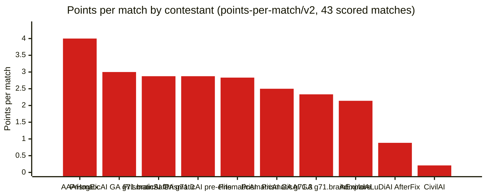
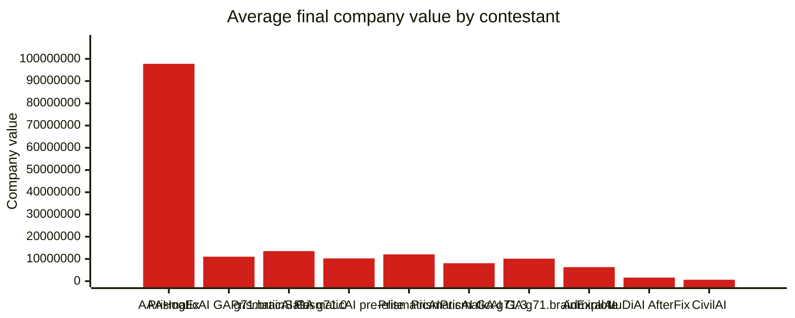
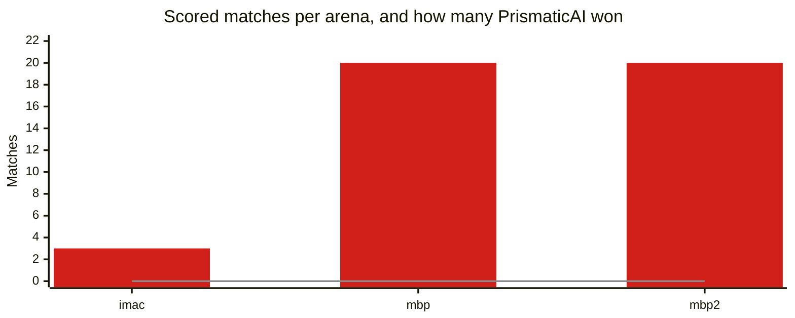

# battle-20261119T233253-c99c7d61

Derived from `battle-20261119T233253-c99c7d61.json` by `tools/research/ai-battle/battle.py report`; do not edit.

- Edition `c99c7d61049f2af6`: PrismaticAI and referee at `ca624b034c8655a9dca3353ca1fbc4b703339daf`, base set `opengfx-8.0.tar`
- 20-year free-for-all from 1960, map 256x256 temperate, breakdowns 1
- 43 scored match(es) on `imac` (20261119-master-gdf1e05e7d8), `mbp` (20261119-master-mca624b034c), `mbp2` (20261119-master-gdf1e05e7d8)
- Replays: 0 of 1 identical to their original on another arena

| # | Contestant | Played | Wins | Points | Points/match | Avg rank | Avg final value | Squirrel errors | Matches with anomalies |
|---|---|---|---|---|---|---|---|---|---|
| 1 | AAAHogEx | 43 | 43 | 172 | 4.0 | 1.0 | 97.8 M | 0 | 0 |
| 2 | PrismaticAI GA g71.brainSafe | 9 | 0 | 27 | 3.0 | 2.0 | 11.0 M | 0 | 1 |
| 3 | PrismaticAI GA g71.0 | 8 | 0 | 23 | 2.875 | 2.12 | 13.5 M | 0 | 2 |
| 4 | PrismaticAI pre-elite | 8 | 0 | 23 | 2.875 | 2.12 | 10.2 M | 0 | 0 |
| 5 | PrismaticAI | 6 | 0 | 17 | 2.833 | 2.17 | 12.1 M | 0 | 1 |
| 6 | PrismaticAI GA g71.3 | 6 | 0 | 15 | 2.5 | 2.5 | 8.1 M | 0 | 1 |
| 7 | PrismaticAI GA g71.brainExplore | 6 | 0 | 14 | 2.333 | 2.67 | 10.1 M | 0 | 0 |
| 8 | AdmiralAI | 43 | 0 | 92 | 2.14 | 2.86 | 6.3 M | 0 | 2 |
| 9 | LuDiAI AfterFix | 43 | 0 | 38 | 0.884 | 4.12 | 1.6 M | 0 | 3 |
| 10 | CivilAI | 43 | 0 | 9 | 0.209 | 4.79 | 638.3 k | 0 | 6 |

```mermaid
---
config:
  xyChart:
    width: 900
    height: 360
  themeVariables:
    xyChart:
      plotColorPalette: "#d11f1a, #8a8a8a, #0b0b0b, #ece4d6"
---
xychart-beta
    title "Final company value per scored match: winner vs best PrismaticAI"
    x-axis ["m-0001", "m-0002", "m-0003", "m-0004", "m-0005", "m-0006", "m-0007", "m-0008", "m-0009", "m-0010", "m-0011", "m-0012", "m-0013", "m-0014", "m-0015", "m-0016", "m-0017", "m-0018", "m-0019", "m-0020", "m-0021", "m-0022", "m-0023", "m-0024", "m-0025", "m-0026", "m-0027", "m-0028", "m-0036", "m-0037", "m-0038", "m-0039", "m-0040", "m-0041", "m-0042", "m-0043", "m-0044", "m-0045", "m-0047", "m-0055", "m-0057", "m-0062", "m-0063"]
    %% series: Winner | Best PrismaticAI
    %% links: battle-20261119T233253-c99c7d61.md?col=Match&filter=m-0001 | battle-20261119T233253-c99c7d61.md?col=Match&filter=m-0002 | battle-20261119T233253-c99c7d61.md?col=Match&filter=m-0003 | battle-20261119T233253-c99c7d61.md?col=Match&filter=m-0004 | battle-20261119T233253-c99c7d61.md?col=Match&filter=m-0005 | battle-20261119T233253-c99c7d61.md?col=Match&filter=m-0006 | battle-20261119T233253-c99c7d61.md?col=Match&filter=m-0007 | battle-20261119T233253-c99c7d61.md?col=Match&filter=m-0008 | battle-20261119T233253-c99c7d61.md?col=Match&filter=m-0009 | battle-20261119T233253-c99c7d61.md?col=Match&filter=m-0010 | battle-20261119T233253-c99c7d61.md?col=Match&filter=m-0011 | battle-20261119T233253-c99c7d61.md?col=Match&filter=m-0012 | battle-20261119T233253-c99c7d61.md?col=Match&filter=m-0013 | battle-20261119T233253-c99c7d61.md?col=Match&filter=m-0014 | battle-20261119T233253-c99c7d61.md?col=Match&filter=m-0015 | battle-20261119T233253-c99c7d61.md?col=Match&filter=m-0016 | battle-20261119T233253-c99c7d61.md?col=Match&filter=m-0017 | battle-20261119T233253-c99c7d61.md?col=Match&filter=m-0018 | battle-20261119T233253-c99c7d61.md?col=Match&filter=m-0019 | battle-20261119T233253-c99c7d61.md?col=Match&filter=m-0020 | battle-20261119T233253-c99c7d61.md?col=Match&filter=m-0021 | battle-20261119T233253-c99c7d61.md?col=Match&filter=m-0022 | battle-20261119T233253-c99c7d61.md?col=Match&filter=m-0023 | battle-20261119T233253-c99c7d61.md?col=Match&filter=m-0024 | battle-20261119T233253-c99c7d61.md?col=Match&filter=m-0025 | battle-20261119T233253-c99c7d61.md?col=Match&filter=m-0026 | battle-20261119T233253-c99c7d61.md?col=Match&filter=m-0027 | battle-20261119T233253-c99c7d61.md?col=Match&filter=m-0028 | battle-20261119T233253-c99c7d61.md?col=Match&filter=m-0036 | battle-20261119T233253-c99c7d61.md?col=Match&filter=m-0037 | battle-20261119T233253-c99c7d61.md?col=Match&filter=m-0038 | battle-20261119T233253-c99c7d61.md?col=Match&filter=m-0039 | battle-20261119T233253-c99c7d61.md?col=Match&filter=m-0040 | battle-20261119T233253-c99c7d61.md?col=Match&filter=m-0041 | battle-20261119T233253-c99c7d61.md?col=Match&filter=m-0042 | battle-20261119T233253-c99c7d61.md?col=Match&filter=m-0043 | battle-20261119T233253-c99c7d61.md?col=Match&filter=m-0044 | battle-20261119T233253-c99c7d61.md?col=Match&filter=m-0045 | battle-20261119T233253-c99c7d61.md?col=Match&filter=m-0047 | battle-20261119T233253-c99c7d61.md?col=Match&filter=m-0055 | battle-20261119T233253-c99c7d61.md?col=Match&filter=m-0057 | battle-20261119T233253-c99c7d61.md?col=Match&filter=m-0062 | battle-20261119T233253-c99c7d61.md?col=Match&filter=m-0063
    y-axis "Company value" 0 --> 148000000
    bar [80370263, 78622294, 76833663, 73489099, 92698369, 98838181, 75410634, 108286511, 105134711, 88784499, 67664186, 100256992, 84887428, 99716147, 101751947, 88323588, 101954871, 126581993, 117611662, 103635466, 109205622, 134583418, 112260210, 102880648, 126634201, 76004428, 90488217, 100778534, 121395763, 104766014, 114225231, 124485734, 126857709, 122044671, 92732842, 91691651, 74438563, 96998202, 98094724, 82295423, 75640168, 63510102, 91347761]
    line [7606338, 9049358, 7017434, 13798985, 2506672, 16501698, 18835966, 24527053, 16375658, 15846698, 17255437, 7131979, 10141609, 13004727, 13533147, 7449904, 9020903, 4684905, 4130302, 2399873, 4562059, 1, 2113710, 18532542, 6563432, 18019776, 16240271, 15661121, 10186089, 11728026, 11789335, 8131478, 7969241, 6653117, 15291173, 15512999, 19380358, 12573702, 10921499, 7325880, 9089797, 10009036, 11592425]
```

<!-- battle-charts:begin -->
<!-- derived from battle-20261119T233253-c99c7d61.json by `battle.py render`; `battle.py check` fails when it is stale -->

<!-- battle-charts:end -->

| Seed | Original | Replay | Arenas | Identical |
|---|---|---|---|---|
| 811560788 | m-0010 | m-0064 | imac / mbp | NO |

| Match | Arena | Seed | Winner | Value | Last | Anomalies |
|---|---|---|---|---|---|---|
| m-0001 | mbp | 1015797798 | AAAHogEx | 80.4 M | LuDiAI AfterFix | - |
| m-0002 | mbp | 1015797798 | AAAHogEx | 78.6 M | CivilAI | - |
| m-0003 | mbp | 1015797798 | AAAHogEx | 76.8 M | CivilAI | - |
| m-0004 | mbp | 1015797798 | AAAHogEx | 73.5 M | CivilAI | - |
| m-0005 | mbp | 1015797798 | AAAHogEx | 92.7 M | CivilAI | - |
| m-0006 | mbp | 811560788 | AAAHogEx | 98.8 M | CivilAI | PrismaticAI: fleet_drop:115->67 |
| m-0007 | mbp | 811560788 | AAAHogEx | 75.4 M | CivilAI | - |
| m-0008 | mbp | 811560788 | AAAHogEx | 108.3 M | CivilAI | - |
| m-0009 | mbp | 811560788 | AAAHogEx | 105.1 M | LuDiAI AfterFix | - |
| m-0010 | imac | 811560788 | AAAHogEx | 88.8 M | CivilAI | LuDiAI AfterFix: fleet_drop:16->5 |
| m-0011 | imac | 811560788 | AAAHogEx | 67.7 M | CivilAI | CivilAI: no_vehicles |
| m-0012 | imac | 1556376807 | AAAHogEx | 100.3 M | CivilAI | - |
| m-0013 | mbp2 | 1556376807 | AAAHogEx | 84.9 M | CivilAI | - |
| m-0014 | mbp2 | 1556376807 | AAAHogEx | 99.7 M | CivilAI | PrismaticAI GA g71.0: fleet_drop:90->58; CivilAI: fleet_drop:11->6 |
| m-0015 | mbp2 | 1556376807 | AAAHogEx | 101.8 M | CivilAI | - |
| m-0016 | mbp2 | 1556376807 | AAAHogEx | 88.3 M | LuDiAI AfterFix | - |
| m-0017 | mbp2 | 1556376807 | AAAHogEx | 102.0 M | CivilAI | - |
| m-0018 | mbp2 | 113258830 | AAAHogEx | 126.6 M | CivilAI | - |
| m-0019 | mbp2 | 113258830 | AAAHogEx | 117.6 M | CivilAI | LuDiAI AfterFix: fleet_drop:127->75 |
| m-0020 | mbp2 | 113258830 | AAAHogEx | 103.6 M | CivilAI | PrismaticAI GA g71.0: fleet_drop:19->11 |
| m-0021 | mbp2 | 113258830 | AAAHogEx | 109.2 M | CivilAI | PrismaticAI GA g71.brainSafe: fleet_drop:41->28 |
| m-0022 | mbp2 | 113258830 | AAAHogEx | 134.6 M | PrismaticAI GA g71.brainExplore | - |
| m-0023 | mbp2 | 113258830 | AAAHogEx | 112.3 M | CivilAI | PrismaticAI GA g71.3: fleet_drop:73->37 |
| m-0024 | mbp2 | 1708517888 | AAAHogEx | 102.9 M | CivilAI | AdmiralAI: fleet_drop:410->260 |
| m-0025 | mbp2 | 1708517888 | AAAHogEx | 126.6 M | CivilAI | - |
| m-0026 | mbp2 | 1708517888 | AAAHogEx | 76.0 M | LuDiAI AfterFix | - |
| m-0027 | mbp2 | 1708517888 | AAAHogEx | 90.5 M | CivilAI | - |
| m-0028 | mbp2 | 1708517888 | AAAHogEx | 100.8 M | CivilAI | CivilAI: fleet_drop:74->47 |
| m-0036 | mbp | 893458371 | AAAHogEx | 121.4 M | CivilAI | - |
| m-0037 | mbp | 893458371 | AAAHogEx | 104.8 M | LuDiAI AfterFix | LuDiAI AfterFix: fleet_drop:39->25 |
| m-0038 | mbp | 893458371 | AAAHogEx | 114.2 M | CivilAI | - |
| m-0039 | mbp | 893458371 | AAAHogEx | 124.5 M | CivilAI | - |
| m-0040 | mbp | 893458371 | AAAHogEx | 126.9 M | CivilAI | CivilAI: fleet_drop:17->1 |
| m-0041 | mbp | 893458371 | AAAHogEx | 122.0 M | LuDiAI AfterFix | CivilAI: fleet_drop:64->37 |
| m-0042 | mbp | 1756731863 | AAAHogEx | 92.7 M | CivilAI | - |
| m-0043 | mbp | 1756731863 | AAAHogEx | 91.7 M | LuDiAI AfterFix | - |
| m-0044 | mbp | 1756731863 | AAAHogEx | 74.4 M | CivilAI | - |
| m-0045 | mbp2 | 1756731863 | AAAHogEx | 97.0 M | CivilAI | - |
| m-0047 | mbp2 | 1756731863 | AAAHogEx | 98.1 M | LuDiAI AfterFix | - |
| m-0055 | mbp2 | 523615545 | AAAHogEx | 82.3 M | CivilAI | AdmiralAI: fleet_drop:129->81; CivilAI: fleet_drop:35->3 |
| m-0057 | mbp2 | 523615545 | AAAHogEx | 75.6 M | CivilAI | - |
| m-0062 | mbp | 1253657975 | AAAHogEx | 63.5 M | CivilAI | - |
| m-0063 | mbp | 1253657975 | AAAHogEx | 91.3 M | CivilAI | - |
| m-0064 (replay) | mbp | 811560788 | AAAHogEx | 98.3 M | CivilAI | - |
