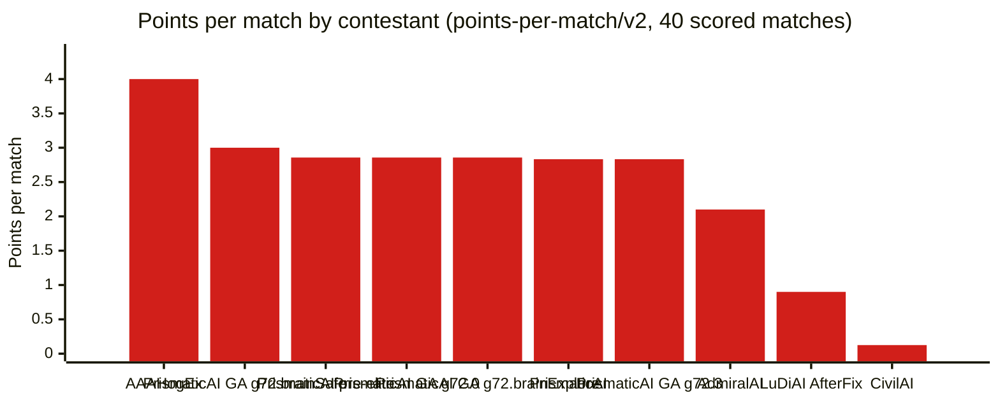
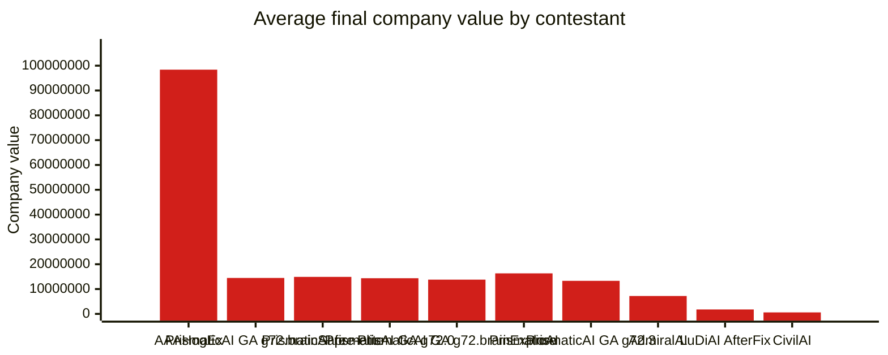
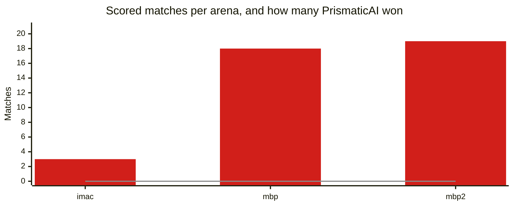

# battle-20261119T234425-b7216173

Derived from `battle-20261119T234425-b7216173.json` by `tools/research/ai-battle/battle.py report`; do not edit.

- Edition `b72161739bbc1677`: PrismaticAI and referee at `ca624b034c8655a9dca3353ca1fbc4b703339daf`, base set `opengfx-8.0.tar`
- 20-year free-for-all from 1960, map 256x256 temperate, breakdowns 1
- 40 scored match(es) on `imac` (20261119-master-gdf1e05e7d8), `mbp` (20261119-master-mca624b034c), `mbp2` (20261119-master-gdf1e05e7d8)
- Replays: 2 of 2 identical to their original on another arena

| # | Contestant | Played | Wins | Points | Points/match | Avg rank | Avg final value | Squirrel errors | Matches with anomalies |
|---|---|---|---|---|---|---|---|---|---|
| 1 | AAAHogEx | 40 | 40 | 160 | 4.0 | 1.0 | 98.4 M | 0 | 0 |
| 2 | PrismaticAI GA g72.brainSafe | 7 | 0 | 21 | 3.0 | 2.0 | 14.5 M | 0 | 0 |
| 3 | PrismaticAI pre-elite | 7 | 0 | 20 | 2.857 | 2.14 | 14.9 M | 0 | 0 |
| 4 | PrismaticAI GA g72.0 | 7 | 0 | 20 | 2.857 | 2.14 | 14.4 M | 0 | 1 |
| 5 | PrismaticAI GA g72.brainExplore | 7 | 0 | 20 | 2.857 | 2.14 | 13.8 M | 0 | 0 |
| 6 | PrismaticAI | 6 | 0 | 17 | 2.833 | 2.17 | 16.3 M | 0 | 1 |
| 7 | PrismaticAI GA g72.3 | 6 | 0 | 17 | 2.833 | 2.17 | 13.3 M | 0 | 1 |
| 8 | AdmiralAI | 40 | 0 | 84 | 2.1 | 2.9 | 7.2 M | 0 | 4 |
| 9 | LuDiAI AfterFix | 40 | 0 | 36 | 0.9 | 4.1 | 1.8 M | 0 | 0 |
| 10 | CivilAI | 40 | 0 | 5 | 0.125 | 4.88 | 593.6 k | 0 | 6 |

```mermaid
---
config:
  xyChart:
    width: 900
    height: 360
  themeVariables:
    xyChart:
      plotColorPalette: "#d11f1a, #8a8a8a, #0b0b0b, #ece4d6"
---
xychart-beta
    title "Final company value per scored match: winner vs best PrismaticAI"
    x-axis ["m-0001", "m-0002", "m-0003", "m-0004", "m-0005", "m-0006", "m-0007", "m-0008", "m-0009", "m-0010", "m-0011", "m-0012", "m-0013", "m-0014", "m-0015", "m-0016", "m-0017", "m-0018", "m-0019", "m-0020", "m-0021", "m-0022", "m-0023", "m-0024", "m-0025", "m-0026", "m-0027", "m-0028", "m-0036", "m-0037", "m-0038", "m-0039", "m-0040", "m-0041", "m-0042", "m-0043", "m-0044", "m-0045", "m-0046", "m-0047"]
    %% series: Winner | Best PrismaticAI
    %% links: battle-20261119T234425-b7216173.md?col=Match&filter=m-0001 | battle-20261119T234425-b7216173.md?col=Match&filter=m-0002 | battle-20261119T234425-b7216173.md?col=Match&filter=m-0003 | battle-20261119T234425-b7216173.md?col=Match&filter=m-0004 | battle-20261119T234425-b7216173.md?col=Match&filter=m-0005 | battle-20261119T234425-b7216173.md?col=Match&filter=m-0006 | battle-20261119T234425-b7216173.md?col=Match&filter=m-0007 | battle-20261119T234425-b7216173.md?col=Match&filter=m-0008 | battle-20261119T234425-b7216173.md?col=Match&filter=m-0009 | battle-20261119T234425-b7216173.md?col=Match&filter=m-0010 | battle-20261119T234425-b7216173.md?col=Match&filter=m-0011 | battle-20261119T234425-b7216173.md?col=Match&filter=m-0012 | battle-20261119T234425-b7216173.md?col=Match&filter=m-0013 | battle-20261119T234425-b7216173.md?col=Match&filter=m-0014 | battle-20261119T234425-b7216173.md?col=Match&filter=m-0015 | battle-20261119T234425-b7216173.md?col=Match&filter=m-0016 | battle-20261119T234425-b7216173.md?col=Match&filter=m-0017 | battle-20261119T234425-b7216173.md?col=Match&filter=m-0018 | battle-20261119T234425-b7216173.md?col=Match&filter=m-0019 | battle-20261119T234425-b7216173.md?col=Match&filter=m-0020 | battle-20261119T234425-b7216173.md?col=Match&filter=m-0021 | battle-20261119T234425-b7216173.md?col=Match&filter=m-0022 | battle-20261119T234425-b7216173.md?col=Match&filter=m-0023 | battle-20261119T234425-b7216173.md?col=Match&filter=m-0024 | battle-20261119T234425-b7216173.md?col=Match&filter=m-0025 | battle-20261119T234425-b7216173.md?col=Match&filter=m-0026 | battle-20261119T234425-b7216173.md?col=Match&filter=m-0027 | battle-20261119T234425-b7216173.md?col=Match&filter=m-0028 | battle-20261119T234425-b7216173.md?col=Match&filter=m-0036 | battle-20261119T234425-b7216173.md?col=Match&filter=m-0037 | battle-20261119T234425-b7216173.md?col=Match&filter=m-0038 | battle-20261119T234425-b7216173.md?col=Match&filter=m-0039 | battle-20261119T234425-b7216173.md?col=Match&filter=m-0040 | battle-20261119T234425-b7216173.md?col=Match&filter=m-0041 | battle-20261119T234425-b7216173.md?col=Match&filter=m-0042 | battle-20261119T234425-b7216173.md?col=Match&filter=m-0043 | battle-20261119T234425-b7216173.md?col=Match&filter=m-0044 | battle-20261119T234425-b7216173.md?col=Match&filter=m-0045 | battle-20261119T234425-b7216173.md?col=Match&filter=m-0046 | battle-20261119T234425-b7216173.md?col=Match&filter=m-0047
    y-axis "Company value" 0 --> 149000000
    bar [91635934, 86205486, 97354147, 79127096, 93948265, 90652339, 82262300, 97821556, 103317528, 83936831, 93179298, 92655064, 111307561, 120051769, 102824346, 113234712, 102216132, 89901552, 114567998, 106041077, 135097689, 113561802, 135153600, 84621950, 74390219, 79225040, 75646773, 64159744, 89475282, 80565192, 109556797, 70580077, 99638215, 74847415, 117524414, 107835861, 127945486, 118568260, 97805370, 127210307]
    line [5877768, 9319248, 8447354, 9669807, 5921102, 10372689, 17728058, 14542020, 10025871, 10403487, 15523385, 15496066, 17873176, 21078816, 18512305, 15407194, 10888474, 23272154, 23796297, 23454550, 21622891, 21905395, 19894537, 16891358, 9655479, 9966811, 10992577, 11250575, 18800097, 11959897, 3484498, 13335319, 9614029, 12345136, 13111981, 17425278, 18719421, 18384294, 18325899, 15286543]
```

<!-- battle-charts:begin -->
<!-- derived from battle-20261119T234425-b7216173.json by `battle.py render`; `battle.py check` fails when it is stale -->

<!-- battle-charts:end -->

| Seed | Original | Replay | Arenas | Identical |
|---|---|---|---|---|
| 1668286863 | m-0001 | m-0048 | mbp / mbp2 | yes |
| 1668286863 | m-0002 | m-0056 | mbp / mbp2 | yes |

| Match | Arena | Seed | Winner | Value | Last | Anomalies |
|---|---|---|---|---|---|---|
| m-0001 | mbp | 1668286863 | AAAHogEx | 91.6 M | CivilAI | - |
| m-0002 | mbp | 1668286863 | AAAHogEx | 86.2 M | CivilAI | PrismaticAI GA g72.0: fleet_drop:56->38; CivilAI: fleet_drop:11->7 |
| m-0003 | mbp | 1668286863 | AAAHogEx | 97.4 M | LuDiAI AfterFix | - |
| m-0004 | mbp | 1668286863 | AAAHogEx | 79.1 M | LuDiAI AfterFix | - |
| m-0005 | mbp | 1668286863 | AAAHogEx | 93.9 M | CivilAI | PrismaticAI GA g72.3: fleet_drop:65->38 |
| m-0006 | mbp | 811451495 | AAAHogEx | 90.7 M | CivilAI | - |
| m-0007 | mbp | 811451495 | AAAHogEx | 82.3 M | CivilAI | - |
| m-0008 | mbp | 811451495 | AAAHogEx | 97.8 M | CivilAI | - |
| m-0009 | mbp | 811451495 | AAAHogEx | 103.3 M | CivilAI | - |
| m-0010 | imac | 811451495 | AAAHogEx | 83.9 M | CivilAI | - |
| m-0011 | imac | 811451495 | AAAHogEx | 93.2 M | CivilAI | - |
| m-0012 | imac | 378743941 | AAAHogEx | 92.7 M | CivilAI | CivilAI: fleet_drop:26->9 |
| m-0013 | mbp2 | 378743941 | AAAHogEx | 111.3 M | CivilAI | AdmiralAI: fleet_drop:279->160 |
| m-0014 | mbp2 | 378743941 | AAAHogEx | 120.1 M | LuDiAI AfterFix | - |
| m-0015 | mbp2 | 378743941 | AAAHogEx | 102.8 M | CivilAI | AdmiralAI: fleet_drop:28->17 |
| m-0016 | mbp2 | 378743941 | AAAHogEx | 113.2 M | CivilAI | CivilAI: fleet_drop:67->36 |
| m-0017 | mbp2 | 378743941 | AAAHogEx | 102.2 M | CivilAI | AdmiralAI: fleet_drop:372->251 |
| m-0018 | mbp2 | 332437021 | AAAHogEx | 89.9 M | CivilAI | PrismaticAI: fleet_drop:89->52 |
| m-0019 | mbp2 | 332437021 | AAAHogEx | 114.6 M | CivilAI | - |
| m-0020 | mbp2 | 332437021 | AAAHogEx | 106.0 M | CivilAI | AdmiralAI: fleet_drop:324->202 |
| m-0021 | mbp2 | 332437021 | AAAHogEx | 135.1 M | LuDiAI AfterFix | - |
| m-0022 | mbp2 | 332437021 | AAAHogEx | 113.6 M | CivilAI | - |
| m-0023 | mbp2 | 332437021 | AAAHogEx | 135.2 M | CivilAI | CivilAI: no_vehicles |
| m-0024 | mbp2 | 760950333 | AAAHogEx | 84.6 M | CivilAI | - |
| m-0025 | mbp2 | 760950333 | AAAHogEx | 74.4 M | CivilAI | - |
| m-0026 | mbp2 | 760950333 | AAAHogEx | 79.2 M | CivilAI | CivilAI: fleet_drop:42->29 |
| m-0027 | mbp2 | 760950333 | AAAHogEx | 75.6 M | CivilAI | - |
| m-0028 | mbp2 | 760950333 | AAAHogEx | 64.2 M | CivilAI | - |
| m-0036 | mbp | 721591053 | AAAHogEx | 89.5 M | CivilAI | CivilAI: no_vehicles |
| m-0037 | mbp | 721591053 | AAAHogEx | 80.6 M | LuDiAI AfterFix | - |
| m-0038 | mbp | 721591053 | AAAHogEx | 109.6 M | CivilAI | - |
| m-0039 | mbp | 721591053 | AAAHogEx | 70.6 M | CivilAI | - |
| m-0040 | mbp | 721591053 | AAAHogEx | 99.6 M | CivilAI | - |
| m-0041 | mbp | 721591053 | AAAHogEx | 74.8 M | CivilAI | - |
| m-0042 | mbp | 1381964020 | AAAHogEx | 117.5 M | CivilAI | - |
| m-0043 | mbp | 1381964020 | AAAHogEx | 107.8 M | CivilAI | - |
| m-0044 | mbp | 1381964020 | AAAHogEx | 127.9 M | CivilAI | - |
| m-0045 | mbp2 | 1381964020 | AAAHogEx | 118.6 M | CivilAI | - |
| m-0046 | mbp2 | 1381964020 | AAAHogEx | 97.8 M | CivilAI | - |
| m-0047 | mbp2 | 1381964020 | AAAHogEx | 127.2 M | CivilAI | - |
| m-0048 (replay) | mbp2 | 1668286863 | AAAHogEx | 91.6 M | CivilAI | - |
| m-0056 (replay) | mbp2 | 1668286863 | AAAHogEx | 86.2 M | CivilAI | PrismaticAI GA g72.0: fleet_drop:56->38; CivilAI: fleet_drop:11->7 |
