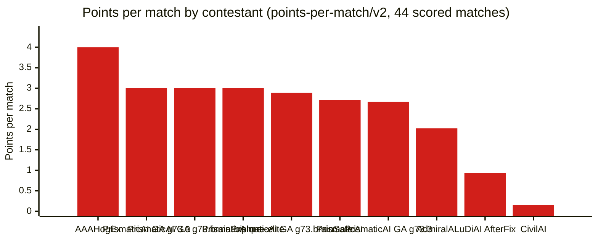
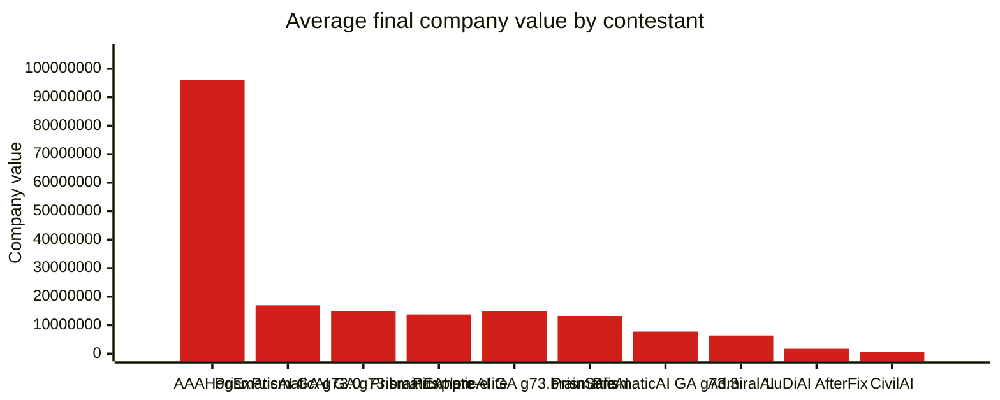
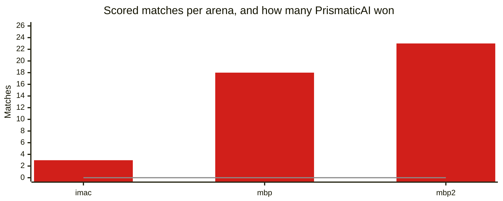

# battle-20261119T235555-48c3b343

Derived from `battle-20261119T235555-48c3b343.json` by `tools/research/ai-battle/battle.py report`; do not edit.

- Edition `48c3b343c876f528`: PrismaticAI and referee at `ca624b034c8655a9dca3353ca1fbc4b703339daf`, base set `opengfx-8.0.tar`
- 20-year free-for-all from 1960, map 256x256 temperate, breakdowns 1
- 44 scored match(es) on `imac` (20261119-master-gdf1e05e7d8), `mbp` (20261119-master-mca624b034c), `mbp2` (20261119-master-gdf1e05e7d8)
- Replays: 2 of 2 identical to their original on another arena

| # | Contestant | Played | Wins | Points | Points/match | Avg rank | Avg final value | Squirrel errors | Matches with anomalies |
|---|---|---|---|---|---|---|---|---|---|
| 1 | AAAHogEx | 44 | 44 | 176 | 4.0 | 1.0 | 96.1 M | 0 | 0 |
| 2 | PrismaticAI GA g73.0 | 7 | 0 | 21 | 3.0 | 2.0 | 17.0 M | 0 | 1 |
| 3 | PrismaticAI GA g73.brainExplore | 7 | 0 | 21 | 3.0 | 2.0 | 14.8 M | 0 | 2 |
| 4 | PrismaticAI pre-elite | 8 | 0 | 24 | 3.0 | 2.0 | 13.8 M | 0 | 0 |
| 5 | PrismaticAI GA g73.brainSafe | 9 | 0 | 26 | 2.889 | 2.11 | 15.0 M | 0 | 2 |
| 6 | PrismaticAI | 7 | 0 | 19 | 2.714 | 2.29 | 13.3 M | 0 | 4 |
| 7 | PrismaticAI GA g73.3 | 6 | 0 | 16 | 2.667 | 2.33 | 7.8 M | 0 | 1 |
| 8 | AdmiralAI | 44 | 0 | 89 | 2.023 | 2.98 | 6.4 M | 0 | 1 |
| 9 | LuDiAI AfterFix | 44 | 0 | 41 | 0.932 | 4.07 | 1.7 M | 0 | 0 |
| 10 | CivilAI | 44 | 0 | 7 | 0.159 | 4.84 | 623.2 k | 3655 | 8 |

```mermaid
---
config:
  xyChart:
    width: 900
    height: 360
  themeVariables:
    xyChart:
      plotColorPalette: "#d11f1a, #8a8a8a, #0b0b0b, #ece4d6"
---
xychart-beta
    title "Final company value per scored match: winner vs best PrismaticAI"
    x-axis ["m-0001", "m-0002", "m-0003", "m-0004", "m-0005", "m-0006", "m-0007", "m-0008", "m-0009", "m-0010", "m-0011", "m-0012", "m-0013", "m-0014", "m-0015", "m-0016", "m-0017", "m-0018", "m-0019", "m-0020", "m-0021", "m-0022", "m-0023", "m-0024", "m-0025", "m-0026", "m-0027", "m-0028", "m-0036", "m-0037", "m-0038", "m-0039", "m-0040", "m-0041", "m-0042", "m-0043", "m-0044", "m-0045", "m-0046", "m-0047", "m-0049", "m-0051", "m-0054", "m-0057"]
    %% series: Winner | Best PrismaticAI
    %% links: battle-20261119T235555-48c3b343.md?col=Match&filter=m-0001 | battle-20261119T235555-48c3b343.md?col=Match&filter=m-0002 | battle-20261119T235555-48c3b343.md?col=Match&filter=m-0003 | battle-20261119T235555-48c3b343.md?col=Match&filter=m-0004 | battle-20261119T235555-48c3b343.md?col=Match&filter=m-0005 | battle-20261119T235555-48c3b343.md?col=Match&filter=m-0006 | battle-20261119T235555-48c3b343.md?col=Match&filter=m-0007 | battle-20261119T235555-48c3b343.md?col=Match&filter=m-0008 | battle-20261119T235555-48c3b343.md?col=Match&filter=m-0009 | battle-20261119T235555-48c3b343.md?col=Match&filter=m-0010 | battle-20261119T235555-48c3b343.md?col=Match&filter=m-0011 | battle-20261119T235555-48c3b343.md?col=Match&filter=m-0012 | battle-20261119T235555-48c3b343.md?col=Match&filter=m-0013 | battle-20261119T235555-48c3b343.md?col=Match&filter=m-0014 | battle-20261119T235555-48c3b343.md?col=Match&filter=m-0015 | battle-20261119T235555-48c3b343.md?col=Match&filter=m-0016 | battle-20261119T235555-48c3b343.md?col=Match&filter=m-0017 | battle-20261119T235555-48c3b343.md?col=Match&filter=m-0018 | battle-20261119T235555-48c3b343.md?col=Match&filter=m-0019 | battle-20261119T235555-48c3b343.md?col=Match&filter=m-0020 | battle-20261119T235555-48c3b343.md?col=Match&filter=m-0021 | battle-20261119T235555-48c3b343.md?col=Match&filter=m-0022 | battle-20261119T235555-48c3b343.md?col=Match&filter=m-0023 | battle-20261119T235555-48c3b343.md?col=Match&filter=m-0024 | battle-20261119T235555-48c3b343.md?col=Match&filter=m-0025 | battle-20261119T235555-48c3b343.md?col=Match&filter=m-0026 | battle-20261119T235555-48c3b343.md?col=Match&filter=m-0027 | battle-20261119T235555-48c3b343.md?col=Match&filter=m-0028 | battle-20261119T235555-48c3b343.md?col=Match&filter=m-0036 | battle-20261119T235555-48c3b343.md?col=Match&filter=m-0037 | battle-20261119T235555-48c3b343.md?col=Match&filter=m-0038 | battle-20261119T235555-48c3b343.md?col=Match&filter=m-0039 | battle-20261119T235555-48c3b343.md?col=Match&filter=m-0040 | battle-20261119T235555-48c3b343.md?col=Match&filter=m-0041 | battle-20261119T235555-48c3b343.md?col=Match&filter=m-0042 | battle-20261119T235555-48c3b343.md?col=Match&filter=m-0043 | battle-20261119T235555-48c3b343.md?col=Match&filter=m-0044 | battle-20261119T235555-48c3b343.md?col=Match&filter=m-0045 | battle-20261119T235555-48c3b343.md?col=Match&filter=m-0046 | battle-20261119T235555-48c3b343.md?col=Match&filter=m-0047 | battle-20261119T235555-48c3b343.md?col=Match&filter=m-0049 | battle-20261119T235555-48c3b343.md?col=Match&filter=m-0051 | battle-20261119T235555-48c3b343.md?col=Match&filter=m-0054 | battle-20261119T235555-48c3b343.md?col=Match&filter=m-0057
    y-axis "Company value" 0 --> 159000000
    bar [109133599, 108183664, 92129433, 85853542, 122421726, 74500437, 84562658, 73545582, 94565267, 72529260, 89193151, 113039513, 144436133, 139864574, 98481973, 105516069, 119413099, 84319003, 92456006, 117910374, 82691347, 76892995, 95061047, 101453341, 97156534, 91543051, 111279442, 100945604, 99847890, 87222679, 102058294, 88932929, 91416319, 83835802, 88667349, 79884683, 79786801, 93760455, 91502351, 79322407, 97874645, 108910173, 81600272, 95396133]
    line [11511259, 12671464, 19933614, 14209857, 4298089, 11868148, 12596058, 14381222, 10765660, 10549473, 4932819, 20390641, 18738934, 30363729, 25372230, 16282965, 15726792, 10279775, 15583210, 14534186, 18833449, 14400680, 5781728, 5759926, 12541991, 15488725, 17153998, 17335236, 20151139, 16043478, 13247295, 14426880, 16098851, 7373214, 15799097, 11081755, 18086475, 12838682, 15006956, 8437123, 12120886, 12341769, 8509147, 3299243]
```

<!-- battle-charts:begin -->
<!-- derived from battle-20261119T235555-48c3b343.json by `battle.py render`; `battle.py check` fails when it is stale -->

<!-- battle-charts:end -->

| Seed | Original | Replay | Arenas | Identical |
|---|---|---|---|---|
| 487788693 | m-0001 | m-0048 | mbp / mbp2 | yes |
| 487788693 | m-0002 | m-0056 | mbp / mbp2 | yes |

| Match | Arena | Seed | Winner | Value | Last | Anomalies |
|---|---|---|---|---|---|---|
| m-0001 | mbp | 487788693 | AAAHogEx | 109.1 M | CivilAI | CivilAI: fleet_drop:43->23 |
| m-0002 | mbp | 487788693 | AAAHogEx | 108.2 M | CivilAI | PrismaticAI GA g73.0: fleet_drop:52->35 |
| m-0003 | mbp | 487788693 | AAAHogEx | 92.1 M | CivilAI | - |
| m-0004 | mbp | 487788693 | AAAHogEx | 85.9 M | CivilAI | - |
| m-0005 | mbp | 487788693 | AAAHogEx | 122.4 M | CivilAI | - |
| m-0006 | mbp | 1962068211 | AAAHogEx | 74.5 M | LuDiAI AfterFix | PrismaticAI: fleet_drop:120->60 |
| m-0007 | mbp | 1962068211 | AAAHogEx | 84.6 M | LuDiAI AfterFix | - |
| m-0008 | mbp | 1962068211 | AAAHogEx | 73.5 M | CivilAI | CivilAI: squirrel_errors:3655 |
| m-0009 | mbp | 1962068211 | AAAHogEx | 94.6 M | CivilAI | PrismaticAI GA g73.brainSafe: fleet_drop:99->45; CivilAI: no_vehicles |
| m-0010 | imac | 1962068211 | AAAHogEx | 72.5 M | LuDiAI AfterFix | - |
| m-0011 | imac | 1962068211 | AAAHogEx | 89.2 M | LuDiAI AfterFix | - |
| m-0012 | imac | 334862376 | AAAHogEx | 113.0 M | CivilAI | PrismaticAI: fleet_drop:133->88 |
| m-0013 | mbp2 | 334862376 | AAAHogEx | 144.4 M | CivilAI | - |
| m-0014 | mbp2 | 334862376 | AAAHogEx | 139.9 M | AdmiralAI | - |
| m-0015 | mbp2 | 334862376 | AAAHogEx | 98.5 M | CivilAI | CivilAI: fleet_drop:32->21 |
| m-0016 | mbp2 | 334862376 | AAAHogEx | 105.5 M | CivilAI | AdmiralAI: fleet_drop:122->81 |
| m-0017 | mbp2 | 334862376 | AAAHogEx | 119.4 M | CivilAI | - |
| m-0018 | mbp2 | 459099705 | AAAHogEx | 84.3 M | LuDiAI AfterFix | PrismaticAI: fleet_drop:88->52 |
| m-0019 | mbp2 | 459099705 | AAAHogEx | 92.5 M | CivilAI | CivilAI: fleet_drop:41->21 |
| m-0020 | mbp2 | 459099705 | AAAHogEx | 117.9 M | CivilAI | CivilAI: fleet_drop:25->8 |
| m-0021 | mbp2 | 459099705 | AAAHogEx | 82.7 M | CivilAI | - |
| m-0022 | mbp2 | 459099705 | AAAHogEx | 76.9 M | CivilAI | - |
| m-0023 | mbp2 | 459099705 | AAAHogEx | 95.1 M | LuDiAI AfterFix | PrismaticAI GA g73.3: fleet_drop:62->35; CivilAI: fleet_drop:26->13 |
| m-0024 | mbp2 | 749900731 | AAAHogEx | 101.5 M | CivilAI | PrismaticAI: fleet_drop:62->38 |
| m-0025 | mbp2 | 749900731 | AAAHogEx | 97.2 M | CivilAI | - |
| m-0026 | mbp2 | 749900731 | AAAHogEx | 91.5 M | CivilAI | - |
| m-0027 | mbp2 | 749900731 | AAAHogEx | 111.3 M | CivilAI | - |
| m-0028 | mbp2 | 749900731 | AAAHogEx | 100.9 M | CivilAI | PrismaticAI GA g73.brainExplore: fleet_drop:83->54 |
| m-0036 | mbp | 11658180 | AAAHogEx | 99.8 M | CivilAI | - |
| m-0037 | mbp | 11658180 | AAAHogEx | 87.2 M | CivilAI | - |
| m-0038 | mbp | 11658180 | AAAHogEx | 102.1 M | CivilAI | - |
| m-0039 | mbp | 11658180 | AAAHogEx | 88.9 M | CivilAI | - |
| m-0040 | mbp | 11658180 | AAAHogEx | 91.4 M | CivilAI | - |
| m-0041 | mbp | 11658180 | AAAHogEx | 83.8 M | CivilAI | - |
| m-0042 | mbp | 1458742797 | AAAHogEx | 88.7 M | CivilAI | - |
| m-0043 | mbp | 1458742797 | AAAHogEx | 79.9 M | CivilAI | - |
| m-0044 | mbp | 1458742797 | AAAHogEx | 79.8 M | CivilAI | - |
| m-0045 | mbp2 | 1458742797 | AAAHogEx | 93.8 M | CivilAI | - |
| m-0046 | mbp2 | 1458742797 | AAAHogEx | 91.5 M | CivilAI | PrismaticAI GA g73.brainExplore: fleet_drop:131->81 |
| m-0047 | mbp2 | 1458742797 | AAAHogEx | 79.3 M | CivilAI | - |
| m-0048 (replay) | mbp2 | 487788693 | AAAHogEx | 109.1 M | CivilAI | CivilAI: fleet_drop:43->23 |
| m-0049 | mbp2 | 1016871945 | AAAHogEx | 97.9 M | CivilAI | - |
| m-0051 | mbp2 | 1016871945 | AAAHogEx | 108.9 M | CivilAI | PrismaticAI GA g73.brainSafe: fleet_drop:43->28 |
| m-0054 | mbp2 | 118268969 | AAAHogEx | 81.6 M | CivilAI | CivilAI: fleet_drop:49->26 |
| m-0056 (replay) | mbp2 | 487788693 | AAAHogEx | 108.2 M | CivilAI | PrismaticAI GA g73.0: fleet_drop:52->35 |
| m-0057 | mbp2 | 118268969 | AAAHogEx | 95.4 M | CivilAI | - |
