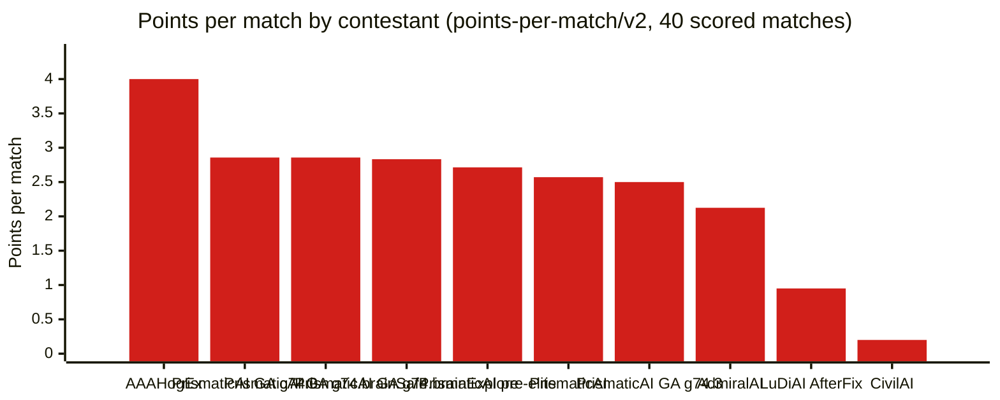
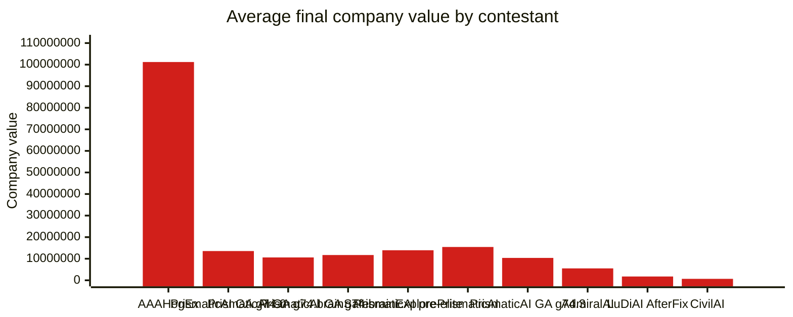
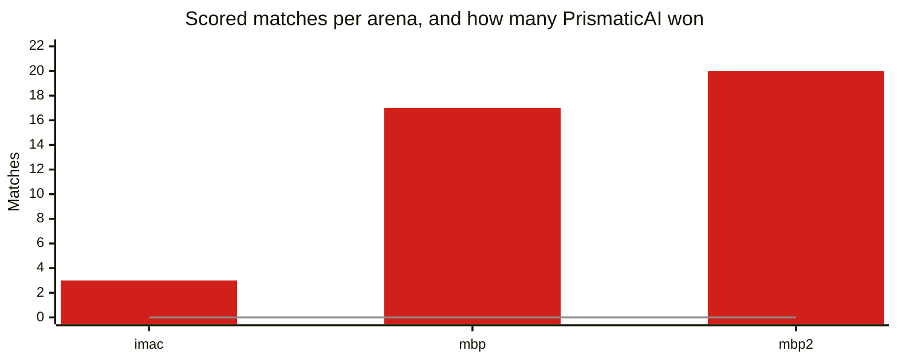

# battle-20261120T000653-976c02b2

Derived from `battle-20261120T000653-976c02b2.json` by `tools/research/ai-battle/battle.py report`; do not edit.

- Edition `976c02b2579dbfab`: PrismaticAI and referee at `ca624b034c8655a9dca3353ca1fbc4b703339daf`, base set `opengfx-8.0.tar`
- 20-year free-for-all from 1960, map 256x256 temperate, breakdowns 1
- 40 scored match(es) on `imac` (20261119-master-gdf1e05e7d8), `mbp` (20261119-master-mca624b034c), `mbp2` (20261119-master-gdf1e05e7d8)
- Replays: 2 of 2 identical to their original on another arena

| # | Contestant | Played | Wins | Points | Points/match | Avg rank | Avg final value | Squirrel errors | Matches with anomalies |
|---|---|---|---|---|---|---|---|---|---|
| 1 | AAAHogEx | 40 | 40 | 160 | 4.0 | 1.0 | 101.2 M | 0 | 0 |
| 2 | PrismaticAI GA g74.0 | 7 | 0 | 20 | 2.857 | 2.14 | 13.6 M | 0 | 2 |
| 3 | PrismaticAI GA g74.brainSafe | 7 | 0 | 20 | 2.857 | 2.14 | 10.6 M | 0 | 1 |
| 4 | PrismaticAI GA g74.brainExplore | 6 | 0 | 17 | 2.833 | 2.17 | 11.7 M | 0 | 0 |
| 5 | PrismaticAI pre-elite | 7 | 0 | 19 | 2.714 | 2.29 | 13.9 M | 0 | 0 |
| 6 | PrismaticAI | 7 | 0 | 18 | 2.571 | 2.43 | 15.4 M | 0 | 4 |
| 7 | PrismaticAI GA g74.3 | 6 | 0 | 15 | 2.5 | 2.5 | 10.4 M | 0 | 1 |
| 8 | AdmiralAI | 40 | 0 | 85 | 2.125 | 2.88 | 5.5 M | 0 | 2 |
| 9 | LuDiAI AfterFix | 40 | 0 | 38 | 0.95 | 4.05 | 1.8 M | 0 | 1 |
| 10 | CivilAI | 40 | 0 | 8 | 0.2 | 4.8 | 664.0 k | 3625 | 12 |

```mermaid
---
config:
  xyChart:
    width: 900
    height: 360
  themeVariables:
    xyChart:
      plotColorPalette: "#d11f1a, #8a8a8a, #0b0b0b, #ece4d6"
---
xychart-beta
    title "Final company value per scored match: winner vs best PrismaticAI"
    x-axis ["m-0001", "m-0002", "m-0003", "m-0004", "m-0005", "m-0006", "m-0007", "m-0008", "m-0009", "m-0010", "m-0011", "m-0012", "m-0013", "m-0014", "m-0015", "m-0016", "m-0017", "m-0018", "m-0019", "m-0020", "m-0021", "m-0022", "m-0023", "m-0024", "m-0025", "m-0026", "m-0027", "m-0028", "m-0036", "m-0037", "m-0038", "m-0039", "m-0041", "m-0042", "m-0044", "m-0045", "m-0046", "m-0049", "m-0053", "m-0054"]
    %% series: Winner | Best PrismaticAI
    %% links: battle-20261120T000653-976c02b2.md?col=Match&filter=m-0001 | battle-20261120T000653-976c02b2.md?col=Match&filter=m-0002 | battle-20261120T000653-976c02b2.md?col=Match&filter=m-0003 | battle-20261120T000653-976c02b2.md?col=Match&filter=m-0004 | battle-20261120T000653-976c02b2.md?col=Match&filter=m-0005 | battle-20261120T000653-976c02b2.md?col=Match&filter=m-0006 | battle-20261120T000653-976c02b2.md?col=Match&filter=m-0007 | battle-20261120T000653-976c02b2.md?col=Match&filter=m-0008 | battle-20261120T000653-976c02b2.md?col=Match&filter=m-0009 | battle-20261120T000653-976c02b2.md?col=Match&filter=m-0010 | battle-20261120T000653-976c02b2.md?col=Match&filter=m-0011 | battle-20261120T000653-976c02b2.md?col=Match&filter=m-0012 | battle-20261120T000653-976c02b2.md?col=Match&filter=m-0013 | battle-20261120T000653-976c02b2.md?col=Match&filter=m-0014 | battle-20261120T000653-976c02b2.md?col=Match&filter=m-0015 | battle-20261120T000653-976c02b2.md?col=Match&filter=m-0016 | battle-20261120T000653-976c02b2.md?col=Match&filter=m-0017 | battle-20261120T000653-976c02b2.md?col=Match&filter=m-0018 | battle-20261120T000653-976c02b2.md?col=Match&filter=m-0019 | battle-20261120T000653-976c02b2.md?col=Match&filter=m-0020 | battle-20261120T000653-976c02b2.md?col=Match&filter=m-0021 | battle-20261120T000653-976c02b2.md?col=Match&filter=m-0022 | battle-20261120T000653-976c02b2.md?col=Match&filter=m-0023 | battle-20261120T000653-976c02b2.md?col=Match&filter=m-0024 | battle-20261120T000653-976c02b2.md?col=Match&filter=m-0025 | battle-20261120T000653-976c02b2.md?col=Match&filter=m-0026 | battle-20261120T000653-976c02b2.md?col=Match&filter=m-0027 | battle-20261120T000653-976c02b2.md?col=Match&filter=m-0028 | battle-20261120T000653-976c02b2.md?col=Match&filter=m-0036 | battle-20261120T000653-976c02b2.md?col=Match&filter=m-0037 | battle-20261120T000653-976c02b2.md?col=Match&filter=m-0038 | battle-20261120T000653-976c02b2.md?col=Match&filter=m-0039 | battle-20261120T000653-976c02b2.md?col=Match&filter=m-0041 | battle-20261120T000653-976c02b2.md?col=Match&filter=m-0042 | battle-20261120T000653-976c02b2.md?col=Match&filter=m-0044 | battle-20261120T000653-976c02b2.md?col=Match&filter=m-0045 | battle-20261120T000653-976c02b2.md?col=Match&filter=m-0046 | battle-20261120T000653-976c02b2.md?col=Match&filter=m-0049 | battle-20261120T000653-976c02b2.md?col=Match&filter=m-0053 | battle-20261120T000653-976c02b2.md?col=Match&filter=m-0054
    y-axis "Company value" 0 --> 155000000
    bar [54220323, 85918393, 78735174, 67513397, 52658796, 111605400, 90512470, 84210515, 114230704, 126374470, 99566116, 63837600, 74778259, 81803123, 79536832, 74430301, 76610277, 120673280, 126233759, 126671848, 118018468, 121777059, 124978852, 127252701, 122448521, 125537236, 128536812, 116013535, 81132236, 100189153, 87391858, 88969265, 81565566, 109328163, 140610119, 120262934, 100346951, 108915561, 133331901, 121733585]
    line [10769188, 3188997, 5604128, 6615432, 8408836, 5521556, 17576939, 20297611, 3744406, 11080898, 10756788, 18499129, 11259259, 12170402, 11058443, 15711644, 9331533, 3248620, 1821697, 13735466, 9446947, 4793088, 368264, 14286790, 19188752, 17078866, 8746911, 16257734, 24758266, 17655618, 19668503, 20640170, 19415003, 18747428, 8730983, 14880947, 15788243, 19222214, 13955700, 23005715]
```

<!-- battle-charts:begin -->
<!-- derived from battle-20261120T000653-976c02b2.json by `battle.py render`; `battle.py check` fails when it is stale -->

<!-- battle-charts:end -->

| Seed | Original | Replay | Arenas | Identical |
|---|---|---|---|---|
| 1136890800 | m-0013 | m-0040 | mbp2 / mbp | yes |
| 1044744405 | m-0001 | m-0048 | mbp / mbp2 | yes |

| Match | Arena | Seed | Winner | Value | Last | Anomalies |
|---|---|---|---|---|---|---|
| m-0001 | mbp | 1044744405 | AAAHogEx | 54.2 M | CivilAI | - |
| m-0002 | mbp | 1044744405 | AAAHogEx | 85.9 M | CivilAI | - |
| m-0003 | mbp | 1044744405 | AAAHogEx | 78.7 M | CivilAI | PrismaticAI GA g74.brainSafe: fleet_drop:33->15 |
| m-0004 | mbp | 1044744405 | AAAHogEx | 67.5 M | CivilAI | - |
| m-0005 | mbp | 1044744405 | AAAHogEx | 52.7 M | CivilAI | PrismaticAI GA g74.3: fleet_drop:83->57 |
| m-0006 | mbp | 1193874261 | AAAHogEx | 111.6 M | CivilAI | - |
| m-0007 | mbp | 1193874261 | AAAHogEx | 90.5 M | CivilAI | CivilAI: fleet_drop:37->24 |
| m-0008 | mbp | 1193874261 | AAAHogEx | 84.2 M | LuDiAI AfterFix | - |
| m-0009 | mbp | 1193874261 | AAAHogEx | 114.2 M | CivilAI | CivilAI: no_vehicles |
| m-0010 | imac | 1193874261 | AAAHogEx | 126.4 M | CivilAI | - |
| m-0011 | imac | 1193874261 | AAAHogEx | 99.6 M | CivilAI | - |
| m-0012 | imac | 1136890800 | AAAHogEx | 63.8 M | CivilAI | PrismaticAI: fleet_drop:119->80 |
| m-0013 | mbp2 | 1136890800 | AAAHogEx | 74.8 M | CivilAI | - |
| m-0014 | mbp2 | 1136890800 | AAAHogEx | 81.8 M | CivilAI | AdmiralAI: fleet_drop:315->177 |
| m-0015 | mbp2 | 1136890800 | AAAHogEx | 79.5 M | CivilAI | - |
| m-0016 | mbp2 | 1136890800 | AAAHogEx | 74.4 M | LuDiAI AfterFix | CivilAI: fleet_drop:69->43 |
| m-0017 | mbp2 | 1136890800 | AAAHogEx | 76.6 M | CivilAI | - |
| m-0018 | mbp2 | 756662687 | AAAHogEx | 120.7 M | CivilAI | CivilAI: fleet_drop:29->11 |
| m-0019 | mbp2 | 756662687 | AAAHogEx | 126.2 M | CivilAI | - |
| m-0020 | mbp2 | 756662687 | AAAHogEx | 126.7 M | CivilAI | - |
| m-0021 | mbp2 | 756662687 | AAAHogEx | 118.0 M | CivilAI | CivilAI: squirrel_errors:3625 |
| m-0022 | mbp2 | 756662687 | AAAHogEx | 121.8 M | CivilAI | - |
| m-0023 | mbp2 | 756662687 | AAAHogEx | 125.0 M | PrismaticAI GA g74.3 | - |
| m-0024 | mbp2 | 702084771 | AAAHogEx | 127.3 M | LuDiAI AfterFix | CivilAI: fleet_drop:58->26 |
| m-0025 | mbp2 | 702084771 | AAAHogEx | 122.4 M | LuDiAI AfterFix | - |
| m-0026 | mbp2 | 702084771 | AAAHogEx | 125.5 M | CivilAI | PrismaticAI GA g74.0: fleet_drop:83->44 |
| m-0027 | mbp2 | 702084771 | AAAHogEx | 128.5 M | CivilAI | - |
| m-0028 | mbp2 | 702084771 | AAAHogEx | 116.0 M | LuDiAI AfterFix | CivilAI: fleet_drop:54->34 |
| m-0036 | mbp | 1420988503 | AAAHogEx | 81.1 M | CivilAI | PrismaticAI: fleet_drop:107->71 |
| m-0037 | mbp | 1420988503 | AAAHogEx | 100.2 M | CivilAI | - |
| m-0038 | mbp | 1420988503 | AAAHogEx | 87.4 M | CivilAI | PrismaticAI GA g74.0: fleet_drop:110->66 |
| m-0039 | mbp | 1420988503 | AAAHogEx | 89.0 M | CivilAI | AdmiralAI: fleet_drop:58->35 |
| m-0040 (replay) | mbp | 1136890800 | AAAHogEx | 74.8 M | CivilAI | - |
| m-0041 | mbp | 1420988503 | AAAHogEx | 81.6 M | CivilAI | CivilAI: fleet_drop:10->4 |
| m-0042 | mbp | 1336508293 | AAAHogEx | 109.3 M | CivilAI | PrismaticAI: fleet_drop:91->60; CivilAI: fleet_drop:45->29 |
| m-0044 | mbp2 | 1336508293 | AAAHogEx | 140.6 M | CivilAI | - |
| m-0045 | mbp | 1336508293 | AAAHogEx | 120.3 M | CivilAI | - |
| m-0046 | mbp | 1336508293 | AAAHogEx | 100.3 M | CivilAI | CivilAI: fleet_drop:62->26 |
| m-0048 (replay) | mbp2 | 1044744405 | AAAHogEx | 54.2 M | CivilAI | - |
| m-0049 | mbp2 | 952773200 | AAAHogEx | 108.9 M | CivilAI | - |
| m-0053 | mbp2 | 952773200 | AAAHogEx | 133.3 M | LuDiAI AfterFix | CivilAI: fleet_drop:14->7; LuDiAI AfterFix: fleet_drop:19->0, no_vehicles |
| m-0054 | mbp2 | 1067599816 | AAAHogEx | 121.7 M | LuDiAI AfterFix | PrismaticAI: fleet_drop:106->69; CivilAI: fleet_drop:20->12 |
