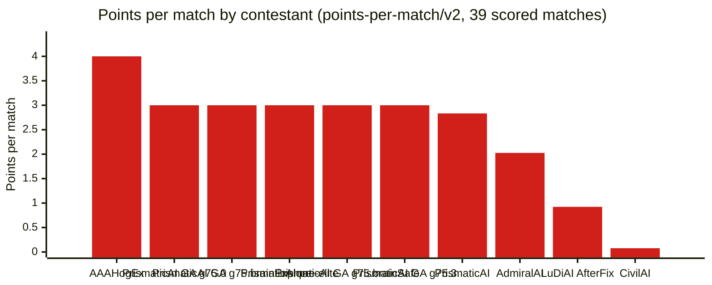
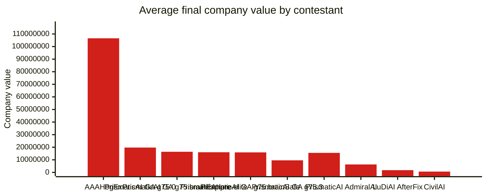
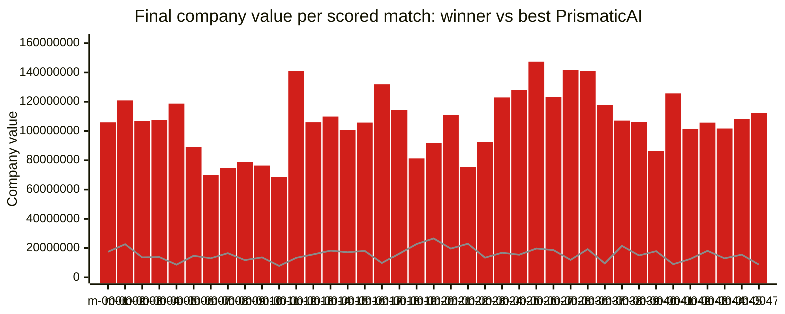
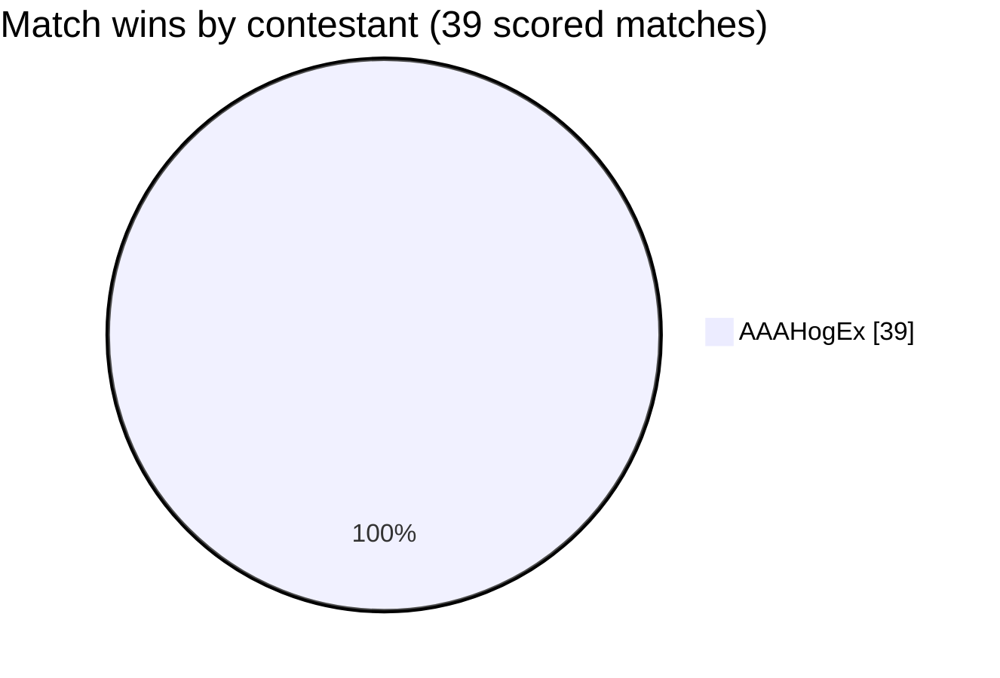
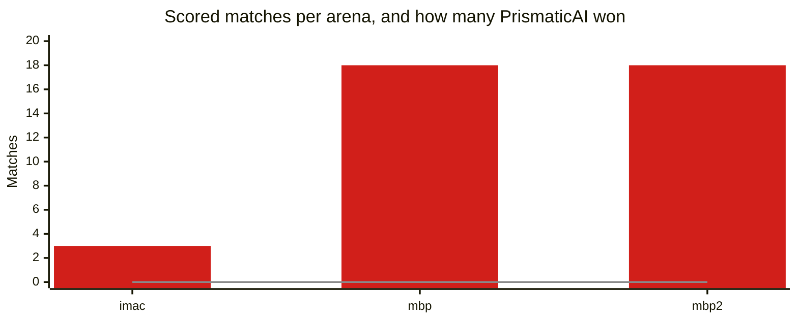

# battle-20261120T001747-23ea5841

Derived from `battle-20261120T001747-23ea5841.json` by `tools/research/ai-battle/battle.py report`; do not edit.

- Edition `23ea5841773f0344`: PrismaticAI and referee at `ca624b034c8655a9dca3353ca1fbc4b703339daf`, base set `opengfx-8.0.tar`
- 20-year free-for-all from 1960, map 256x256 temperate, breakdowns 1
- 39 scored match(es) on `imac` (20261119-master-gdf1e05e7d8), `mbp` (20261119-master-mca624b034c), `mbp2` (20261119-master-gdf1e05e7d8)
- Replays: 0 of 0 identical to their original on another arena

| # | Contestant | Played | Wins | Points | Points/match | Avg rank | Avg final value | Squirrel errors | Matches with anomalies |
|---|---|---|---|---|---|---|---|---|---|
| 1 | AAAHogEx | 39 | 39 | 156 | 4.0 | 1.0 | 106.6 M | 0 | 0 |
| 2 | PrismaticAI GA g75.0 | 7 | 0 | 21 | 3.0 | 2.0 | 19.7 M | 0 | 1 |
| 3 | PrismaticAI GA g75.brainExplore | 6 | 0 | 18 | 3.0 | 2.0 | 16.4 M | 0 | 0 |
| 4 | PrismaticAI pre-elite | 7 | 0 | 21 | 3.0 | 2.0 | 16.0 M | 0 | 0 |
| 5 | PrismaticAI GA g75.brainSafe | 7 | 0 | 21 | 3.0 | 2.0 | 15.9 M | 0 | 0 |
| 6 | PrismaticAI GA g75.3 | 6 | 0 | 18 | 3.0 | 2.0 | 9.6 M | 0 | 1 |
| 7 | PrismaticAI | 6 | 0 | 17 | 2.833 | 2.17 | 15.5 M | 0 | 0 |
| 8 | AdmiralAI | 39 | 0 | 79 | 2.026 | 2.97 | 6.3 M | 0 | 4 |
| 9 | LuDiAI AfterFix | 39 | 0 | 36 | 0.923 | 4.08 | 1.8 M | 0 | 2 |
| 10 | CivilAI | 39 | 0 | 3 | 0.077 | 4.92 | 651.5 k | 0 | 3 |

<!-- battle-charts:begin -->
<!-- derived from battle-20261120T001747-23ea5841.json by `battle.py render`; `battle.py check` fails when it is stale -->

<!-- battle-charts:end -->

| Match | Arena | Seed | Winner | Value | Last | Anomalies |
|---|---|---|---|---|---|---|
| m-0001 | mbp | 127059609 | AAAHogEx | 105.9 M | CivilAI | - |
| m-0002 | mbp | 127059609 | AAAHogEx | 120.9 M | LuDiAI AfterFix | - |
| m-0003 | mbp | 127059609 | AAAHogEx | 107.0 M | CivilAI | AdmiralAI: fleet_drop:197->131 |
| m-0004 | mbp | 127059609 | AAAHogEx | 107.6 M | CivilAI | - |
| m-0005 | mbp | 127059609 | AAAHogEx | 118.7 M | CivilAI | AdmiralAI: fleet_drop:186->90 |
| m-0006 | mbp | 1994030288 | AAAHogEx | 88.9 M | CivilAI | AdmiralAI: fleet_drop:296->193 |
| m-0007 | mbp | 1994030288 | AAAHogEx | 69.9 M | CivilAI | - |
| m-0008 | mbp | 1994030288 | AAAHogEx | 74.6 M | CivilAI | - |
| m-0009 | mbp | 1994030288 | AAAHogEx | 78.9 M | CivilAI | - |
| m-0010 | imac | 1994030288 | AAAHogEx | 76.4 M | CivilAI | CivilAI: fleet_drop:49->28 |
| m-0011 | imac | 1994030288 | AAAHogEx | 68.4 M | CivilAI | CivilAI: fleet_drop:43->29 |
| m-0012 | imac | 1747508901 | AAAHogEx | 141.1 M | CivilAI | - |
| m-0013 | mbp2 | 1747508901 | AAAHogEx | 106.0 M | CivilAI | - |
| m-0014 | mbp2 | 1747508901 | AAAHogEx | 109.9 M | CivilAI | - |
| m-0015 | mbp2 | 1747508901 | AAAHogEx | 100.6 M | CivilAI | CivilAI: fleet_drop:50->29 |
| m-0016 | mbp2 | 1747508901 | AAAHogEx | 105.8 M | CivilAI | - |
| m-0017 | mbp2 | 1747508901 | AAAHogEx | 131.9 M | CivilAI | - |
| m-0018 | mbp2 | 1959413748 | AAAHogEx | 114.3 M | CivilAI | - |
| m-0019 | mbp2 | 1959413748 | AAAHogEx | 81.3 M | CivilAI | - |
| m-0020 | mbp2 | 1959413748 | AAAHogEx | 91.8 M | CivilAI | - |
| m-0021 | mbp2 | 1959413748 | AAAHogEx | 111.1 M | CivilAI | AdmiralAI: fleet_drop:300->194 |
| m-0022 | mbp2 | 1959413748 | AAAHogEx | 75.4 M | CivilAI | - |
| m-0023 | mbp2 | 1959413748 | AAAHogEx | 92.5 M | CivilAI | - |
| m-0024 | mbp2 | 257778618 | AAAHogEx | 122.9 M | CivilAI | - |
| m-0025 | mbp2 | 257778618 | AAAHogEx | 127.9 M | LuDiAI AfterFix | - |
| m-0026 | mbp2 | 257778618 | AAAHogEx | 147.4 M | CivilAI | PrismaticAI GA g75.0: fleet_drop:127->70 |
| m-0027 | mbp2 | 257778618 | AAAHogEx | 123.2 M | CivilAI | - |
| m-0028 | mbp2 | 257778618 | AAAHogEx | 141.5 M | CivilAI | - |
| m-0036 | mbp | 282511549 | AAAHogEx | 141.1 M | CivilAI | - |
| m-0037 | mbp | 282511549 | AAAHogEx | 117.7 M | CivilAI | LuDiAI AfterFix: fleet_drop:234->163 |
| m-0038 | mbp | 282511549 | AAAHogEx | 107.1 M | CivilAI | - |
| m-0039 | mbp | 282511549 | AAAHogEx | 106.2 M | CivilAI | - |
| m-0040 | mbp | 282511549 | AAAHogEx | 86.4 M | CivilAI | - |
| m-0041 | mbp | 282511549 | AAAHogEx | 125.7 M | CivilAI | - |
| m-0042 | mbp | 1587780115 | AAAHogEx | 101.6 M | CivilAI | - |
| m-0043 | mbp | 1587780115 | AAAHogEx | 105.8 M | CivilAI | - |
| m-0044 | mbp | 1587780115 | AAAHogEx | 101.7 M | CivilAI | - |
| m-0045 | mbp2 | 1587780115 | AAAHogEx | 108.3 M | LuDiAI AfterFix | LuDiAI AfterFix: fleet_drop:31->7 |
| m-0047 | mbp2 | 1587780115 | AAAHogEx | 112.2 M | CivilAI | PrismaticAI GA g75.3: fleet_drop:115->69 |
