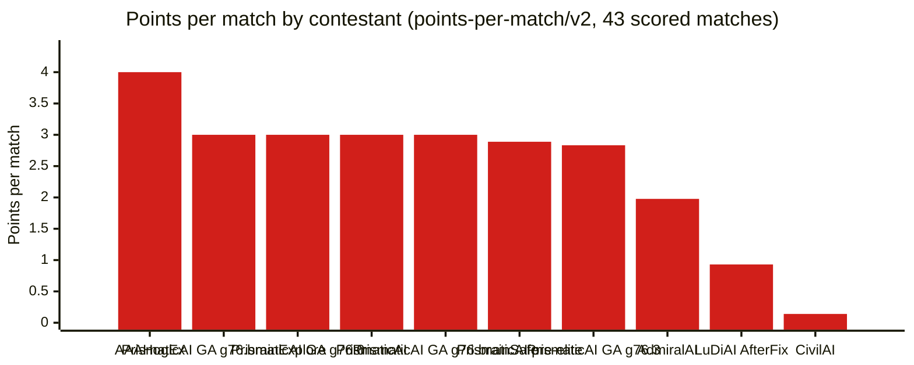
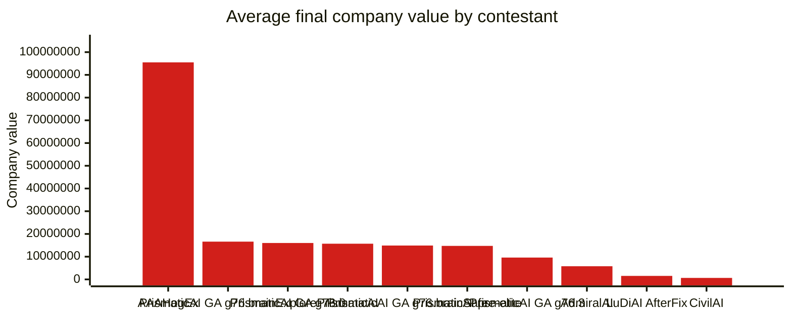
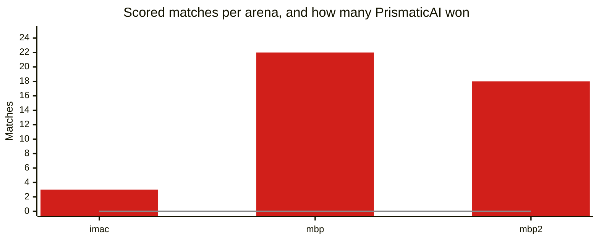

# battle-20261120T003040-2d4e0173

Derived from `battle-20261120T003040-2d4e0173.json` by `tools/research/ai-battle/battle.py report`; do not edit.

- Edition `2d4e0173c260b1f0`: PrismaticAI and referee at `da1073eaf4257ed29ec21ae6896be7d8d833868a`, base set `opengfx-8.0.tar`
- 20-year free-for-all from 1960, map 256x256 temperate, breakdowns 1
- 43 scored match(es) on `imac` (20261119-master-gdf1e05e7d8), `mbp` (20261119-master-m5ef3530d38, 20261120-master-mb031f71365), `mbp2` (20261119-master-gdf1e05e7d8)
- Replays: 2 of 2 identical to their original on another arena

| # | Contestant | Played | Wins | Points | Points/match | Avg rank | Avg final value | Squirrel errors | Matches with anomalies |
|---|---|---|---|---|---|---|---|---|---|
| 1 | AAAHogEx | 43 | 43 | 172 | 4.0 | 1.0 | 95.5 M | 0 | 0 |
| 2 | PrismaticAI GA g76.brainExplore | 6 | 0 | 18 | 3.0 | 2.0 | 16.6 M | 0 | 0 |
| 3 | PrismaticAI GA g76.0 | 7 | 0 | 21 | 3.0 | 2.0 | 16.0 M | 0 | 1 |
| 4 | PrismaticAI | 7 | 0 | 21 | 3.0 | 2.0 | 15.7 M | 0 | 4 |
| 5 | PrismaticAI GA g76.brainSafe | 8 | 0 | 24 | 3.0 | 2.0 | 14.9 M | 0 | 0 |
| 6 | PrismaticAI pre-elite | 9 | 0 | 26 | 2.889 | 2.11 | 14.7 M | 0 | 1 |
| 7 | PrismaticAI GA g76.3 | 6 | 0 | 17 | 2.833 | 2.17 | 9.6 M | 0 | 0 |
| 8 | AdmiralAI | 43 | 0 | 85 | 1.977 | 3.02 | 5.8 M | 0 | 1 |
| 9 | LuDiAI AfterFix | 43 | 0 | 40 | 0.93 | 4.07 | 1.5 M | 0 | 1 |
| 10 | CivilAI | 43 | 0 | 6 | 0.14 | 4.86 | 648.5 k | 11040 | 7 |

```mermaid
---
config:
  xyChart:
    width: 900
    height: 360
  themeVariables:
    xyChart:
      plotColorPalette: "#d11f1a, #8a8a8a, #0b0b0b, #ece4d6"
---
xychart-beta
    title "Final company value per scored match: winner vs best PrismaticAI"
    x-axis ["m-0001", "m-0002", "m-0003", "m-0004", "m-0005", "m-0006", "m-0007", "m-0008", "m-0009", "m-0010", "m-0011", "m-0012", "m-0013", "m-0014", "m-0015", "m-0016", "m-0017", "m-0018", "m-0019", "m-0020", "m-0021", "m-0022", "m-0023", "m-0024", "m-0025", "m-0026", "m-0027", "m-0028", "m-0036", "m-0037", "m-0038", "m-0039", "m-0040", "m-0041", "m-0042", "m-0043", "m-0044", "m-0045", "m-0049", "m-0060", "m-0061", "m-0063", "m-0065"]
    %% series: Winner | Best PrismaticAI
    %% links: battle-20261120T003040-2d4e0173.md?col=Match&filter=m-0001 | battle-20261120T003040-2d4e0173.md?col=Match&filter=m-0002 | battle-20261120T003040-2d4e0173.md?col=Match&filter=m-0003 | battle-20261120T003040-2d4e0173.md?col=Match&filter=m-0004 | battle-20261120T003040-2d4e0173.md?col=Match&filter=m-0005 | battle-20261120T003040-2d4e0173.md?col=Match&filter=m-0006 | battle-20261120T003040-2d4e0173.md?col=Match&filter=m-0007 | battle-20261120T003040-2d4e0173.md?col=Match&filter=m-0008 | battle-20261120T003040-2d4e0173.md?col=Match&filter=m-0009 | battle-20261120T003040-2d4e0173.md?col=Match&filter=m-0010 | battle-20261120T003040-2d4e0173.md?col=Match&filter=m-0011 | battle-20261120T003040-2d4e0173.md?col=Match&filter=m-0012 | battle-20261120T003040-2d4e0173.md?col=Match&filter=m-0013 | battle-20261120T003040-2d4e0173.md?col=Match&filter=m-0014 | battle-20261120T003040-2d4e0173.md?col=Match&filter=m-0015 | battle-20261120T003040-2d4e0173.md?col=Match&filter=m-0016 | battle-20261120T003040-2d4e0173.md?col=Match&filter=m-0017 | battle-20261120T003040-2d4e0173.md?col=Match&filter=m-0018 | battle-20261120T003040-2d4e0173.md?col=Match&filter=m-0019 | battle-20261120T003040-2d4e0173.md?col=Match&filter=m-0020 | battle-20261120T003040-2d4e0173.md?col=Match&filter=m-0021 | battle-20261120T003040-2d4e0173.md?col=Match&filter=m-0022 | battle-20261120T003040-2d4e0173.md?col=Match&filter=m-0023 | battle-20261120T003040-2d4e0173.md?col=Match&filter=m-0024 | battle-20261120T003040-2d4e0173.md?col=Match&filter=m-0025 | battle-20261120T003040-2d4e0173.md?col=Match&filter=m-0026 | battle-20261120T003040-2d4e0173.md?col=Match&filter=m-0027 | battle-20261120T003040-2d4e0173.md?col=Match&filter=m-0028 | battle-20261120T003040-2d4e0173.md?col=Match&filter=m-0036 | battle-20261120T003040-2d4e0173.md?col=Match&filter=m-0037 | battle-20261120T003040-2d4e0173.md?col=Match&filter=m-0038 | battle-20261120T003040-2d4e0173.md?col=Match&filter=m-0039 | battle-20261120T003040-2d4e0173.md?col=Match&filter=m-0040 | battle-20261120T003040-2d4e0173.md?col=Match&filter=m-0041 | battle-20261120T003040-2d4e0173.md?col=Match&filter=m-0042 | battle-20261120T003040-2d4e0173.md?col=Match&filter=m-0043 | battle-20261120T003040-2d4e0173.md?col=Match&filter=m-0044 | battle-20261120T003040-2d4e0173.md?col=Match&filter=m-0045 | battle-20261120T003040-2d4e0173.md?col=Match&filter=m-0049 | battle-20261120T003040-2d4e0173.md?col=Match&filter=m-0060 | battle-20261120T003040-2d4e0173.md?col=Match&filter=m-0061 | battle-20261120T003040-2d4e0173.md?col=Match&filter=m-0063 | battle-20261120T003040-2d4e0173.md?col=Match&filter=m-0065
    y-axis "Company value" 0 --> 157000000
    bar [64074047, 79711657, 81362341, 68583527, 72407932, 85656131, 82291163, 107039895, 85825933, 78591253, 69050236, 109233246, 132590909, 131763751, 114872730, 142914595, 112735379, 52270501, 72367701, 75600571, 76638537, 75394031, 54891010, 105307653, 94009343, 103955531, 94211954, 107127718, 86405046, 102792935, 93474214, 109542871, 99573608, 124797070, 87366877, 114383652, 126350192, 129114278, 125712991, 112682371, 85522318, 91121193, 87116016]
    line [22601060, 18949895, 15950318, 16761850, 14222278, 15246939, 15073586, 6830159, 11276746, 15540142, 11813911, 15959273, 14689064, 21054767, 16628695, 18893483, 12361410, 12502231, 8188568, 9827402, 11594173, 11479146, 3225433, 15424797, 15118204, 15008039, 18872602, 19859949, 17228561, 14347787, 20177331, 19193383, 17158091, 3232308, 21434687, 18353230, 20291276, 17692426, 7429084, 12112357, 16868617, 7985399, 12786046]
```

<!-- battle-charts:begin -->
<!-- derived from battle-20261120T003040-2d4e0173.json by `battle.py render`; `battle.py check` fails when it is stale -->

<!-- battle-charts:end -->

| Seed | Original | Replay | Arenas | Identical |
|---|---|---|---|---|
| 1294371662 | m-0001 | m-0048 | mbp / mbp2 | yes |
| 217738319 | m-0013 | m-0064 | mbp2 / mbp | yes |

| Match | Arena | Seed | Winner | Value | Last | Anomalies |
|---|---|---|---|---|---|---|
| m-0001 | mbp | 1294371662 | AAAHogEx | 64.1 M | CivilAI | AdmiralAI: fleet_drop:86->50 |
| m-0002 | mbp | 1294371662 | AAAHogEx | 79.7 M | CivilAI | - |
| m-0003 | mbp | 1294371662 | AAAHogEx | 81.4 M | CivilAI | - |
| m-0004 | mbp | 1294371662 | AAAHogEx | 68.6 M | CivilAI | - |
| m-0005 | mbp | 1294371662 | AAAHogEx | 72.4 M | CivilAI | - |
| m-0006 | mbp | 936748289 | AAAHogEx | 85.7 M | CivilAI | - |
| m-0007 | mbp | 936748289 | AAAHogEx | 82.3 M | CivilAI | CivilAI: fleet_drop:101->63 |
| m-0008 | mbp | 936748289 | AAAHogEx | 107.0 M | CivilAI | - |
| m-0009 | mbp | 936748289 | AAAHogEx | 85.8 M | CivilAI | - |
| m-0010 | imac | 936748289 | AAAHogEx | 78.6 M | CivilAI | CivilAI: squirrel_errors:3655 |
| m-0011 | imac | 936748289 | AAAHogEx | 69.1 M | CivilAI | - |
| m-0012 | imac | 217738319 | AAAHogEx | 109.2 M | CivilAI | PrismaticAI: fleet_drop:101->64 |
| m-0013 | mbp2 | 217738319 | AAAHogEx | 132.6 M | LuDiAI AfterFix | - |
| m-0014 | mbp2 | 217738319 | AAAHogEx | 131.8 M | CivilAI | - |
| m-0015 | mbp2 | 217738319 | AAAHogEx | 114.9 M | CivilAI | - |
| m-0016 | mbp2 | 217738319 | AAAHogEx | 142.9 M | CivilAI | - |
| m-0017 | mbp2 | 217738319 | AAAHogEx | 112.7 M | CivilAI | CivilAI: fleet_drop:51->19 |
| m-0018 | mbp2 | 521654884 | AAAHogEx | 52.3 M | CivilAI | PrismaticAI: fleet_drop:93->35; LuDiAI AfterFix: fleet_drop:241->167 |
| m-0019 | mbp2 | 521654884 | AAAHogEx | 72.4 M | CivilAI | - |
| m-0020 | mbp2 | 521654884 | AAAHogEx | 75.6 M | CivilAI | - |
| m-0021 | mbp2 | 521654884 | AAAHogEx | 76.6 M | LuDiAI AfterFix | - |
| m-0022 | mbp2 | 521654884 | AAAHogEx | 75.4 M | CivilAI | - |
| m-0023 | mbp2 | 521654884 | AAAHogEx | 54.9 M | CivilAI | - |
| m-0024 | mbp2 | 65925761 | AAAHogEx | 105.3 M | CivilAI | - |
| m-0025 | mbp2 | 65925761 | AAAHogEx | 94.0 M | CivilAI | - |
| m-0026 | mbp2 | 65925761 | AAAHogEx | 104.0 M | CivilAI | - |
| m-0027 | mbp2 | 65925761 | AAAHogEx | 94.2 M | CivilAI | - |
| m-0028 | mbp2 | 65925761 | AAAHogEx | 107.1 M | CivilAI | - |
| m-0036 | mbp | 76173408 | AAAHogEx | 86.4 M | LuDiAI AfterFix | PrismaticAI: fleet_drop:120->42; CivilAI: squirrel_errors:3730 |
| m-0037 | mbp | 76173408 | AAAHogEx | 102.8 M | LuDiAI AfterFix | - |
| m-0038 | mbp | 76173408 | AAAHogEx | 93.5 M | CivilAI | PrismaticAI GA g76.0: fleet_drop:88->58; CivilAI: fleet_drop:34->11 |
| m-0039 | mbp | 76173408 | AAAHogEx | 109.5 M | CivilAI | - |
| m-0040 | mbp | 76173408 | AAAHogEx | 99.6 M | CivilAI | - |
| m-0041 | mbp | 76173408 | AAAHogEx | 124.8 M | CivilAI | - |
| m-0042 | mbp | 203185566 | AAAHogEx | 87.4 M | CivilAI | PrismaticAI: fleet_drop:124->58 |
| m-0043 | mbp | 203185566 | AAAHogEx | 114.4 M | CivilAI | - |
| m-0044 | mbp | 203185566 | AAAHogEx | 126.4 M | AdmiralAI | - |
| m-0045 | mbp2 | 203185566 | AAAHogEx | 129.1 M | CivilAI | - |
| m-0048 (replay) | mbp2 | 1294371662 | AAAHogEx | 64.1 M | CivilAI | AdmiralAI: fleet_drop:86->50 |
| m-0049 | mbp2 | 321366977 | AAAHogEx | 125.7 M | CivilAI | PrismaticAI pre-elite: fleet_drop:72->50 |
| m-0060 | mbp | 407750854 | AAAHogEx | 112.7 M | CivilAI | CivilAI: squirrel_errors:3655 |
| m-0061 | mbp | 407750854 | AAAHogEx | 85.5 M | CivilAI | - |
| m-0063 | mbp | 407750854 | AAAHogEx | 91.1 M | CivilAI | - |
| m-0064 (replay) | mbp | 217738319 | AAAHogEx | 132.6 M | LuDiAI AfterFix | - |
| m-0065 | mbp | 407750854 | AAAHogEx | 87.1 M | LuDiAI AfterFix | CivilAI: fleet_drop:54->31 |
