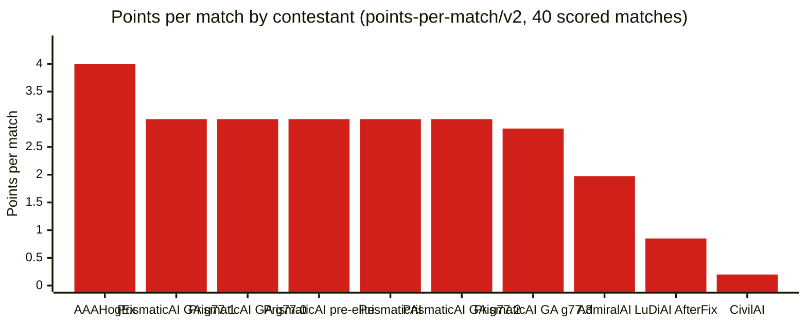
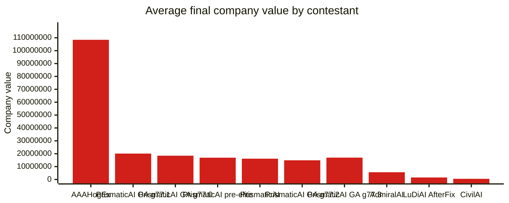
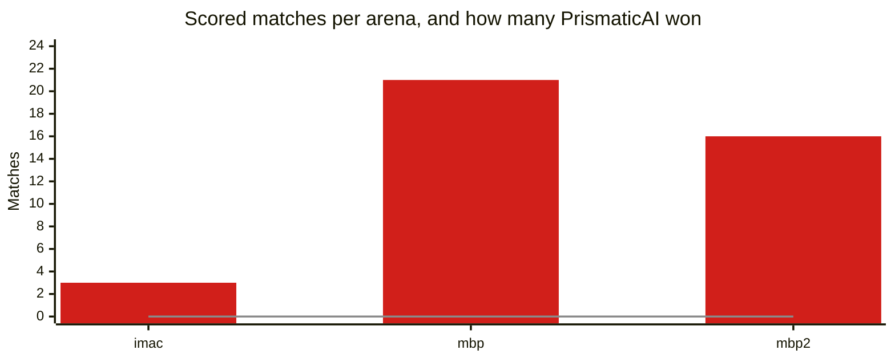

# battle-20261120T004052-b6036853

Derived from `battle-20261120T004052-b6036853.json` by `tools/research/ai-battle/battle.py report`; do not edit.

- Edition `b6036853cbcb98b1`: PrismaticAI and referee at `da1073eaf4257ed29ec21ae6896be7d8d833868a`, base set `opengfx-8.0.tar`
- 20-year free-for-all from 1960, map 256x256 temperate, breakdowns 1
- 40 scored match(es) on `imac` (20261119-master-gdf1e05e7d8), `mbp` (20261120-master-mb031f71365), `mbp2` (20261119-master-gdf1e05e7d8)
- Replays: 0 of 0 identical to their original on another arena

| # | Contestant | Played | Wins | Points | Points/match | Avg rank | Avg final value | Squirrel errors | Matches with anomalies |
|---|---|---|---|---|---|---|---|---|---|
| 1 | AAAHogEx | 40 | 40 | 160 | 4.0 | 1.0 | 108.4 M | 0 | 0 |
| 2 | PrismaticAI GA g77.1 | 7 | 0 | 21 | 3.0 | 2.0 | 20.1 M | 0 | 3 |
| 3 | PrismaticAI GA g77.0 | 7 | 0 | 21 | 3.0 | 2.0 | 18.5 M | 0 | 0 |
| 4 | PrismaticAI pre-elite | 7 | 0 | 21 | 3.0 | 2.0 | 16.9 M | 0 | 0 |
| 5 | PrismaticAI | 6 | 0 | 18 | 3.0 | 2.0 | 16.1 M | 0 | 3 |
| 6 | PrismaticAI GA g77.2 | 7 | 0 | 21 | 3.0 | 2.0 | 14.9 M | 0 | 0 |
| 7 | PrismaticAI GA g77.3 | 6 | 0 | 17 | 2.833 | 2.17 | 17.0 M | 0 | 0 |
| 8 | AdmiralAI | 40 | 0 | 79 | 1.975 | 3.02 | 5.6 M | 0 | 0 |
| 9 | LuDiAI AfterFix | 40 | 0 | 34 | 0.85 | 4.15 | 1.6 M | 0 | 1 |
| 10 | CivilAI | 40 | 0 | 8 | 0.2 | 4.8 | 524.9 k | 0 | 8 |

```mermaid
---
config:
  xyChart:
    width: 900
    height: 360
  themeVariables:
    xyChart:
      plotColorPalette: "#d11f1a, #8a8a8a, #0b0b0b, #ece4d6"
---
xychart-beta
    title "Final company value per scored match: winner vs best PrismaticAI"
    x-axis ["m-0001", "m-0002", "m-0003", "m-0004", "m-0005", "m-0006", "m-0007", "m-0008", "m-0009", "m-0010", "m-0011", "m-0012", "m-0013", "m-0014", "m-0015", "m-0016", "m-0017", "m-0018", "m-0019", "m-0020", "m-0021", "m-0022", "m-0023", "m-0024", "m-0025", "m-0026", "m-0027", "m-0028", "m-0036", "m-0037", "m-0038", "m-0039", "m-0040", "m-0041", "m-0042", "m-0043", "m-0044", "m-0051", "m-0052", "m-0053"]
    %% series: Winner | Best PrismaticAI
    %% links: battle-20261120T004052-b6036853.md?col=Match&filter=m-0001 | battle-20261120T004052-b6036853.md?col=Match&filter=m-0002 | battle-20261120T004052-b6036853.md?col=Match&filter=m-0003 | battle-20261120T004052-b6036853.md?col=Match&filter=m-0004 | battle-20261120T004052-b6036853.md?col=Match&filter=m-0005 | battle-20261120T004052-b6036853.md?col=Match&filter=m-0006 | battle-20261120T004052-b6036853.md?col=Match&filter=m-0007 | battle-20261120T004052-b6036853.md?col=Match&filter=m-0008 | battle-20261120T004052-b6036853.md?col=Match&filter=m-0009 | battle-20261120T004052-b6036853.md?col=Match&filter=m-0010 | battle-20261120T004052-b6036853.md?col=Match&filter=m-0011 | battle-20261120T004052-b6036853.md?col=Match&filter=m-0012 | battle-20261120T004052-b6036853.md?col=Match&filter=m-0013 | battle-20261120T004052-b6036853.md?col=Match&filter=m-0014 | battle-20261120T004052-b6036853.md?col=Match&filter=m-0015 | battle-20261120T004052-b6036853.md?col=Match&filter=m-0016 | battle-20261120T004052-b6036853.md?col=Match&filter=m-0017 | battle-20261120T004052-b6036853.md?col=Match&filter=m-0018 | battle-20261120T004052-b6036853.md?col=Match&filter=m-0019 | battle-20261120T004052-b6036853.md?col=Match&filter=m-0020 | battle-20261120T004052-b6036853.md?col=Match&filter=m-0021 | battle-20261120T004052-b6036853.md?col=Match&filter=m-0022 | battle-20261120T004052-b6036853.md?col=Match&filter=m-0023 | battle-20261120T004052-b6036853.md?col=Match&filter=m-0024 | battle-20261120T004052-b6036853.md?col=Match&filter=m-0025 | battle-20261120T004052-b6036853.md?col=Match&filter=m-0026 | battle-20261120T004052-b6036853.md?col=Match&filter=m-0027 | battle-20261120T004052-b6036853.md?col=Match&filter=m-0028 | battle-20261120T004052-b6036853.md?col=Match&filter=m-0036 | battle-20261120T004052-b6036853.md?col=Match&filter=m-0037 | battle-20261120T004052-b6036853.md?col=Match&filter=m-0038 | battle-20261120T004052-b6036853.md?col=Match&filter=m-0039 | battle-20261120T004052-b6036853.md?col=Match&filter=m-0040 | battle-20261120T004052-b6036853.md?col=Match&filter=m-0041 | battle-20261120T004052-b6036853.md?col=Match&filter=m-0042 | battle-20261120T004052-b6036853.md?col=Match&filter=m-0043 | battle-20261120T004052-b6036853.md?col=Match&filter=m-0044 | battle-20261120T004052-b6036853.md?col=Match&filter=m-0051 | battle-20261120T004052-b6036853.md?col=Match&filter=m-0052 | battle-20261120T004052-b6036853.md?col=Match&filter=m-0053
    y-axis "Company value" 0 --> 188000000
    bar [93439321, 146922634, 98964113, 93265994, 106747844, 140174007, 125333648, 139569504, 116079475, 134374227, 115250264, 79627441, 69260079, 57746680, 77606063, 81756458, 85124430, 165780006, 143996443, 146231340, 170499300, 126429728, 158444008, 90722811, 89241973, 137182200, 89182710, 98563645, 147554301, 112038866, 117693543, 110284556, 94070798, 80451784, 51650353, 46918017, 58030495, 116305846, 103929215, 121054193]
    line [8707178, 8415227, 9340656, 4585195, 8551811, 11212354, 13169593, 17907599, 14503723, 9897618, 17800550, 12326532, 13065650, 12708317, 17215743, 8210774, 13359980, 24924629, 27474670, 33482708, 35356840, 21296649, 28847252, 25829195, 24904010, 23609873, 25868201, 27752820, 13016608, 17021421, 17107273, 17635965, 16825316, 17046549, 9588027, 14051089, 16049427, 20823609, 15713036, 16206460]
```

<!-- battle-charts:begin -->
<!-- derived from battle-20261120T004052-b6036853.json by `battle.py render`; `battle.py check` fails when it is stale -->

<!-- battle-charts:end -->

| Match | Arena | Seed | Winner | Value | Last | Anomalies |
|---|---|---|---|---|---|---|
| m-0001 | mbp | 1145758311 | AAAHogEx | 93.4 M | CivilAI | - |
| m-0002 | mbp | 1145758311 | AAAHogEx | 146.9 M | CivilAI | - |
| m-0003 | mbp | 1145758311 | AAAHogEx | 99.0 M | CivilAI | PrismaticAI GA g77.1: fleet_drop:79->52 |
| m-0004 | mbp | 1145758311 | AAAHogEx | 93.3 M | CivilAI | CivilAI: no_vehicles |
| m-0005 | mbp | 1145758311 | AAAHogEx | 106.7 M | CivilAI | - |
| m-0006 | mbp | 1104958996 | AAAHogEx | 140.2 M | LuDiAI AfterFix | LuDiAI AfterFix: no_vehicles |
| m-0007 | mbp | 1104958996 | AAAHogEx | 125.3 M | CivilAI | - |
| m-0008 | mbp | 1104958996 | AAAHogEx | 139.6 M | LuDiAI AfterFix | - |
| m-0009 | mbp | 1104958996 | AAAHogEx | 116.1 M | CivilAI | CivilAI: fleet_drop:19->10 |
| m-0010 | imac | 1104958996 | AAAHogEx | 134.4 M | LuDiAI AfterFix | - |
| m-0011 | imac | 1104958996 | AAAHogEx | 115.3 M | LuDiAI AfterFix | - |
| m-0012 | imac | 140851697 | AAAHogEx | 79.6 M | CivilAI | PrismaticAI: fleet_drop:92->57 |
| m-0013 | mbp2 | 140851697 | AAAHogEx | 69.3 M | CivilAI | - |
| m-0014 | mbp2 | 140851697 | AAAHogEx | 57.7 M | CivilAI | CivilAI: fleet_drop:32->8 |
| m-0015 | mbp2 | 140851697 | AAAHogEx | 77.6 M | CivilAI | - |
| m-0016 | mbp2 | 140851697 | AAAHogEx | 81.8 M | CivilAI | - |
| m-0017 | mbp2 | 140851697 | AAAHogEx | 85.1 M | CivilAI | - |
| m-0018 | mbp2 | 136309580 | AAAHogEx | 165.8 M | CivilAI | PrismaticAI: fleet_drop:99->54 |
| m-0019 | mbp2 | 136309580 | AAAHogEx | 144.0 M | LuDiAI AfterFix | CivilAI: fleet_drop:127->87 |
| m-0020 | mbp2 | 136309580 | AAAHogEx | 146.2 M | CivilAI | - |
| m-0021 | mbp2 | 136309580 | AAAHogEx | 170.5 M | CivilAI | PrismaticAI GA g77.1: fleet_drop:165->98 |
| m-0022 | mbp2 | 136309580 | AAAHogEx | 126.4 M | CivilAI | CivilAI: fleet_drop:74->46 |
| m-0023 | mbp2 | 136309580 | AAAHogEx | 158.4 M | CivilAI | CivilAI: fleet_drop:73->42 |
| m-0024 | mbp2 | 31945475 | AAAHogEx | 90.7 M | CivilAI | PrismaticAI: fleet_drop:128->65 |
| m-0025 | mbp2 | 31945475 | AAAHogEx | 89.2 M | CivilAI | - |
| m-0026 | mbp2 | 31945475 | AAAHogEx | 137.2 M | CivilAI | - |
| m-0027 | mbp2 | 31945475 | AAAHogEx | 89.2 M | CivilAI | CivilAI: fleet_drop:23->15 |
| m-0028 | mbp2 | 31945475 | AAAHogEx | 98.6 M | CivilAI | - |
| m-0036 | mbp | 657848403 | AAAHogEx | 147.6 M | CivilAI | - |
| m-0037 | mbp | 657848403 | AAAHogEx | 112.0 M | CivilAI | - |
| m-0038 | mbp | 657848403 | AAAHogEx | 117.7 M | CivilAI | CivilAI: fleet_drop:65->45 |
| m-0039 | mbp | 657848403 | AAAHogEx | 110.3 M | CivilAI | - |
| m-0040 | mbp | 657848403 | AAAHogEx | 94.1 M | CivilAI | - |
| m-0041 | mbp | 657848403 | AAAHogEx | 80.5 M | CivilAI | - |
| m-0042 | mbp | 1934245016 | AAAHogEx | 51.7 M | LuDiAI AfterFix | - |
| m-0043 | mbp | 1934245016 | AAAHogEx | 46.9 M | LuDiAI AfterFix | - |
| m-0044 | mbp | 1934245016 | AAAHogEx | 58.0 M | CivilAI | - |
| m-0051 | mbp | 513931624 | AAAHogEx | 116.3 M | CivilAI | PrismaticAI GA g77.1: fleet_drop:96->57 |
| m-0052 | mbp | 513931624 | AAAHogEx | 103.9 M | CivilAI | - |
| m-0053 | mbp | 513931624 | AAAHogEx | 121.1 M | LuDiAI AfterFix | - |
