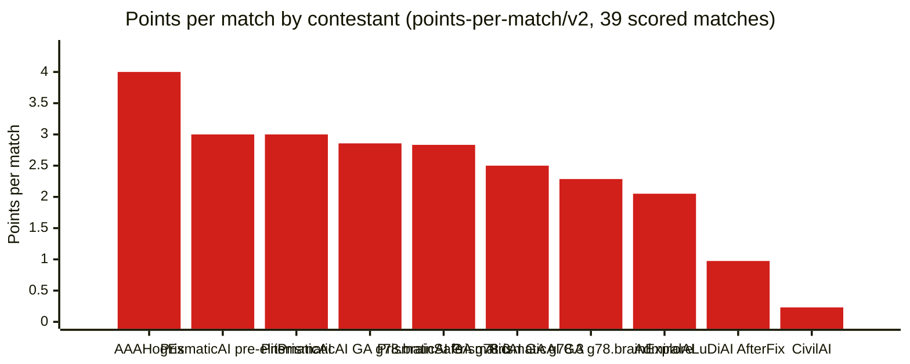
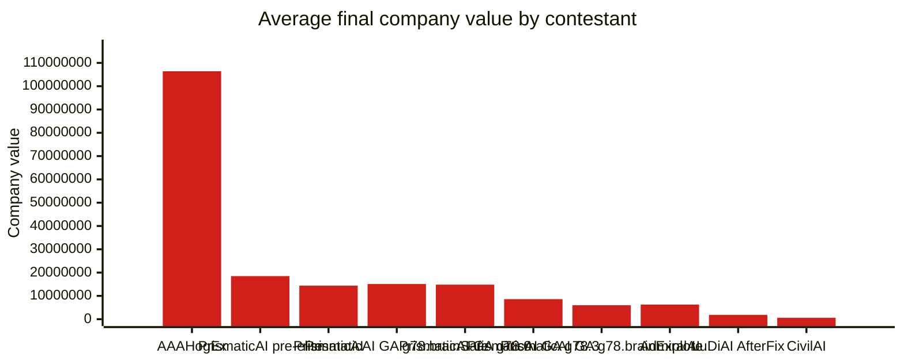
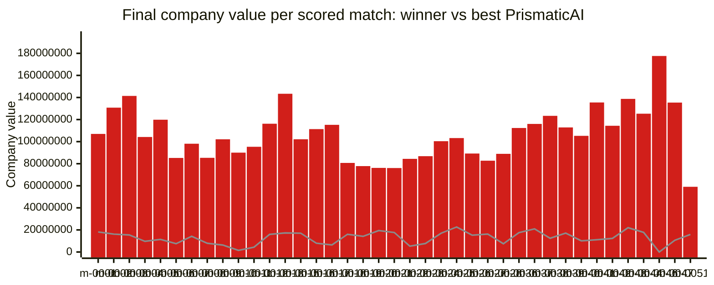
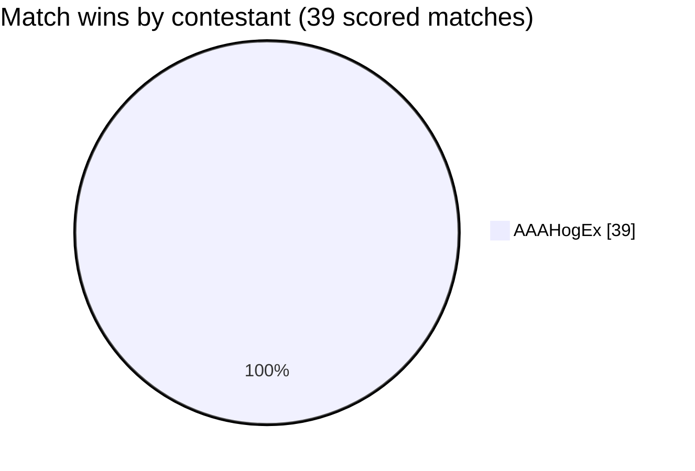
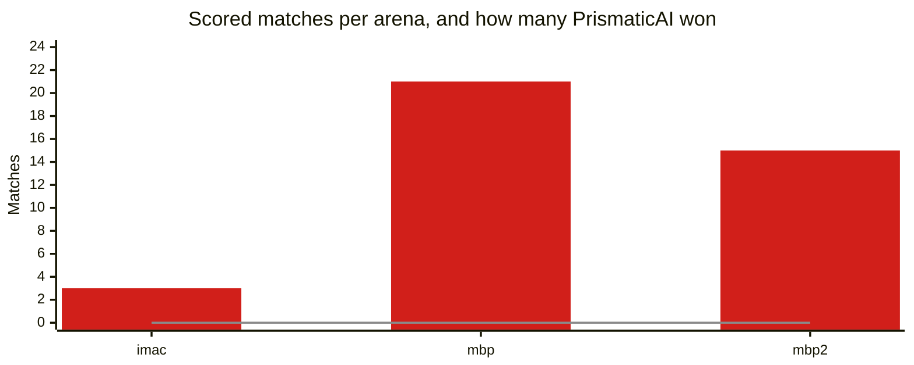

# battle-20261120T005006-2573c8c1

Derived from `battle-20261120T005006-2573c8c1.json` by `tools/research/ai-battle/battle.py report`; do not edit.

- Edition `2573c8c1dca0a178`: PrismaticAI and referee at `da1073eaf4257ed29ec21ae6896be7d8d833868a`, base set `opengfx-8.0.tar`
- 20-year free-for-all from 1960, map 256x256 temperate, breakdowns 1
- 39 scored match(es) on `imac` (20261119-master-gdf1e05e7d8), `mbp` (20261120-master-mb031f71365), `mbp2` (20261119-master-gdf1e05e7d8)
- Replays: 0 of 0 identical to their original on another arena

| # | Contestant | Played | Wins | Points | Points/match | Avg rank | Avg final value | Squirrel errors | Matches with anomalies |
|---|---|---|---|---|---|---|---|---|---|
| 1 | AAAHogEx | 39 | 39 | 156 | 4.0 | 1.0 | 106.4 M | 0 | 0 |
| 2 | PrismaticAI pre-elite | 7 | 0 | 21 | 3.0 | 2.0 | 18.5 M | 0 | 0 |
| 3 | PrismaticAI | 6 | 0 | 18 | 3.0 | 2.0 | 14.4 M | 0 | 2 |
| 4 | PrismaticAI GA g78.brainSafe | 7 | 0 | 20 | 2.857 | 2.14 | 15.1 M | 0 | 0 |
| 5 | PrismaticAI GA g78.0 | 6 | 0 | 17 | 2.833 | 2.17 | 14.8 M | 0 | 4 |
| 6 | PrismaticAI GA g78.3 | 6 | 0 | 15 | 2.5 | 2.5 | 8.6 M | 0 | 4 |
| 7 | PrismaticAI GA g78.brainExplore | 7 | 0 | 16 | 2.286 | 2.71 | 6.0 M | 0 | 1 |
| 8 | AdmiralAI | 39 | 0 | 80 | 2.051 | 2.95 | 6.3 M | 0 | 1 |
| 9 | LuDiAI AfterFix | 39 | 0 | 38 | 0.974 | 4.03 | 1.9 M | 0 | 0 |
| 10 | CivilAI | 39 | 0 | 9 | 0.231 | 4.77 | 606.5 k | 0 | 10 |

<!-- battle-charts:begin -->
<!-- derived from battle-20261120T005006-2573c8c1.json by `battle.py render`; `battle.py check` fails when it is stale -->

<!-- battle-charts:end -->

| Match | Arena | Seed | Winner | Value | Last | Anomalies |
|---|---|---|---|---|---|---|
| m-0001 | mbp | 1960067903 | AAAHogEx | 107.0 M | CivilAI | - |
| m-0002 | mbp | 1960067903 | AAAHogEx | 130.8 M | CivilAI | - |
| m-0003 | mbp | 1960067903 | AAAHogEx | 141.4 M | CivilAI | - |
| m-0004 | mbp | 1960067903 | AAAHogEx | 104.2 M | CivilAI | - |
| m-0005 | mbp | 1960067903 | AAAHogEx | 119.9 M | CivilAI | PrismaticAI GA g78.3: fleet_drop:153->87 |
| m-0006 | mbp | 346291025 | AAAHogEx | 85.2 M | CivilAI | - |
| m-0007 | mbp | 346291025 | AAAHogEx | 98.1 M | LuDiAI AfterFix | - |
| m-0008 | mbp | 346291025 | AAAHogEx | 85.3 M | CivilAI | PrismaticAI GA g78.0: fleet_drop:96->60 |
| m-0009 | mbp | 346291025 | AAAHogEx | 102.1 M | CivilAI | CivilAI: fleet_drop:39->22 |
| m-0010 | imac | 346291025 | AAAHogEx | 90.0 M | CivilAI | - |
| m-0011 | imac | 346291025 | AAAHogEx | 95.3 M | CivilAI | PrismaticAI GA g78.3: fleet_drop:64->44 |
| m-0012 | imac | 49792353 | AAAHogEx | 116.2 M | CivilAI | - |
| m-0013 | mbp2 | 49792353 | AAAHogEx | 143.4 M | CivilAI | - |
| m-0015 | mbp2 | 49792353 | AAAHogEx | 102.1 M | LuDiAI AfterFix | - |
| m-0016 | mbp2 | 49792353 | AAAHogEx | 111.3 M | LuDiAI AfterFix | - |
| m-0017 | mbp2 | 49792353 | AAAHogEx | 115.2 M | CivilAI | - |
| m-0018 | mbp2 | 1329050501 | AAAHogEx | 80.7 M | CivilAI | PrismaticAI: fleet_drop:78->52 |
| m-0019 | mbp2 | 1329050501 | AAAHogEx | 77.8 M | LuDiAI AfterFix | CivilAI: fleet_drop:44->14 |
| m-0020 | mbp2 | 1329050501 | AAAHogEx | 76.2 M | LuDiAI AfterFix | PrismaticAI GA g78.0: fleet_drop:107->65; CivilAI: fleet_drop:100->65 |
| m-0021 | mbp2 | 1329050501 | AAAHogEx | 76.1 M | CivilAI | - |
| m-0022 | mbp2 | 1329050501 | AAAHogEx | 84.4 M | CivilAI | CivilAI: no_vehicles |
| m-0023 | mbp2 | 1329050501 | AAAHogEx | 86.8 M | CivilAI | - |
| m-0024 | mbp2 | 454370774 | AAAHogEx | 100.4 M | AdmiralAI | PrismaticAI: fleet_drop:118->69 |
| m-0025 | mbp2 | 454370774 | AAAHogEx | 103.2 M | CivilAI | - |
| m-0026 | mbp2 | 454370774 | AAAHogEx | 89.2 M | LuDiAI AfterFix | - |
| m-0027 | mbp2 | 454370774 | AAAHogEx | 82.7 M | CivilAI | - |
| m-0028 | mbp2 | 454370774 | AAAHogEx | 88.9 M | CivilAI | CivilAI: fleet_drop:61->40 |
| m-0036 | mbp | 52971512 | AAAHogEx | 112.4 M | CivilAI | - |
| m-0037 | mbp | 52971512 | AAAHogEx | 116.0 M | CivilAI | - |
| m-0038 | mbp | 52971512 | AAAHogEx | 123.4 M | CivilAI | PrismaticAI GA g78.0: fleet_drop:123->59 |
| m-0039 | mbp | 52971512 | AAAHogEx | 112.9 M | CivilAI | CivilAI: fleet_drop:42->25 |
| m-0040 | mbp | 52971512 | AAAHogEx | 105.2 M | CivilAI | PrismaticAI GA g78.brainExplore: fleet_drop:127->67 |
| m-0041 | mbp | 52971512 | AAAHogEx | 135.5 M | CivilAI | PrismaticAI GA g78.3: fleet_drop:94->45; AdmiralAI: fleet_drop:41->26 |
| m-0042 | mbp | 988774025 | AAAHogEx | 114.4 M | CivilAI | - |
| m-0043 | mbp | 988774025 | AAAHogEx | 138.7 M | CivilAI | CivilAI: fleet_drop:38->25 |
| m-0044 | mbp | 988774025 | AAAHogEx | 125.3 M | CivilAI | PrismaticAI GA g78.0: fleet_drop:97->57; CivilAI: fleet_drop:54->34 |
| m-0046 | mbp | 988774025 | AAAHogEx | 177.6 M | PrismaticAI GA g78.brainExplore | - |
| m-0047 | mbp | 988774025 | AAAHogEx | 135.4 M | CivilAI | PrismaticAI GA g78.3: fleet_drop:101->70; CivilAI: fleet_drop:36->24 |
| m-0051 | mbp | 1143142712 | AAAHogEx | 59.1 M | AdmiralAI | CivilAI: fleet_drop:49->29 |
