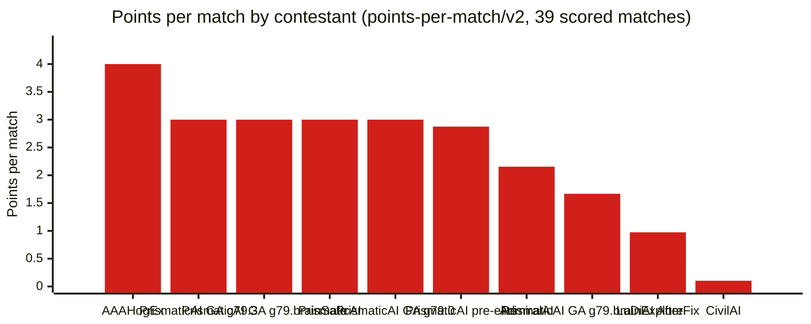
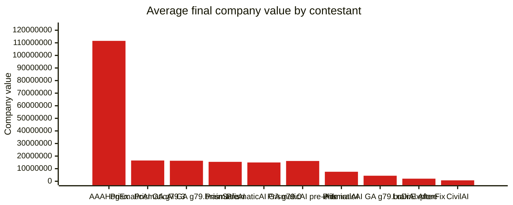
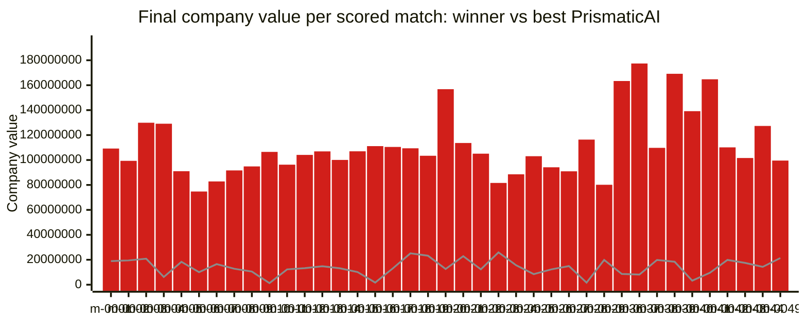
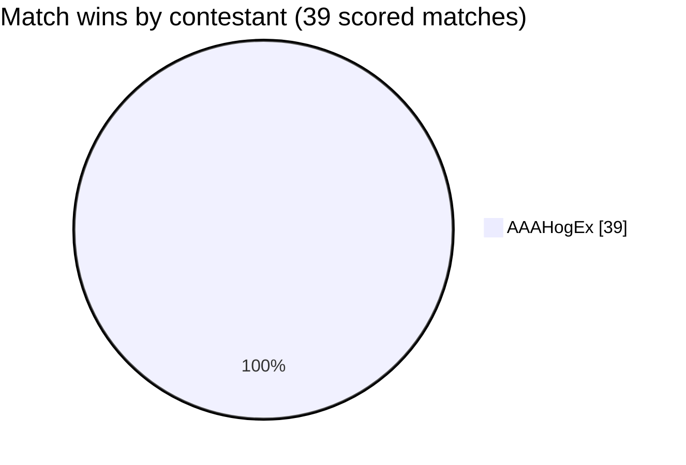
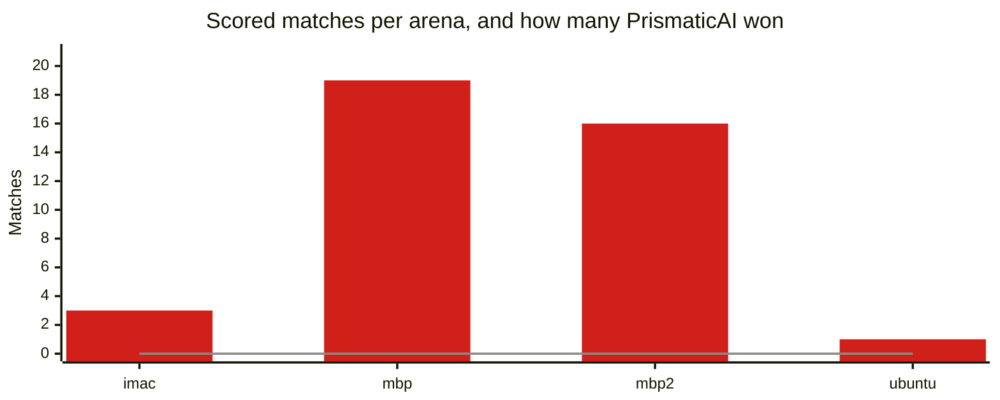

# battle-20261120T010316-164e14f6

Derived from `battle-20261120T010316-164e14f6.json` by `tools/research/ai-battle/battle.py report`; do not edit.

- Edition `164e14f631b820c4`: PrismaticAI and referee at `da1073eaf4257ed29ec21ae6896be7d8d833868a`, base set `opengfx-8.0.tar`
- 20-year free-for-all from 1960, map 256x256 temperate, breakdowns 1
- 39 scored match(es) on `imac` (20261119-master-gdf1e05e7d8), `mbp` (20261120-master-mb031f71365), `mbp2` (20261119-master-gdf1e05e7d8), `ubuntu` (20261119-master-gdf1e05e7d8)
- Replays: 0 of 0 identical to their original on another arena

| # | Contestant | Played | Wins | Points | Points/match | Avg rank | Avg final value | Squirrel errors | Matches with anomalies |
|---|---|---|---|---|---|---|---|---|---|
| 1 | AAAHogEx | 39 | 39 | 156 | 4.0 | 1.0 | 111.5 M | 0 | 0 |
| 2 | PrismaticAI GA g79.3 | 6 | 0 | 18 | 3.0 | 2.0 | 16.5 M | 0 | 0 |
| 3 | PrismaticAI GA g79.brainSafe | 6 | 0 | 18 | 3.0 | 2.0 | 16.3 M | 0 | 0 |
| 4 | PrismaticAI | 6 | 0 | 18 | 3.0 | 2.0 | 15.4 M | 0 | 5 |
| 5 | PrismaticAI GA g79.0 | 7 | 0 | 21 | 3.0 | 2.0 | 14.9 M | 0 | 0 |
| 6 | PrismaticAI pre-elite | 8 | 0 | 23 | 2.875 | 2.12 | 16.1 M | 0 | 0 |
| 7 | AdmiralAI | 39 | 0 | 84 | 2.154 | 2.85 | 7.6 M | 0 | 1 |
| 8 | PrismaticAI GA g79.brainExplore | 6 | 0 | 10 | 1.667 | 3.33 | 4.4 M | 0 | 2 |
| 9 | LuDiAI AfterFix | 39 | 0 | 38 | 0.974 | 4.03 | 2.1 M | 0 | 0 |
| 10 | CivilAI | 39 | 0 | 4 | 0.103 | 4.9 | 726.8 k | 0 | 4 |

<!-- battle-charts:begin -->
<!-- derived from battle-20261120T010316-164e14f6.json by `battle.py render`; `battle.py check` fails when it is stale -->

<!-- battle-charts:end -->

| Match | Arena | Seed | Winner | Value | Last | Anomalies |
|---|---|---|---|---|---|---|
| m-0001 | mbp | 520410857 | AAAHogEx | 109.2 M | CivilAI | - |
| m-0002 | mbp | 520410857 | AAAHogEx | 99.3 M | CivilAI | - |
| m-0003 | mbp | 520410857 | AAAHogEx | 129.9 M | CivilAI | - |
| m-0004 | mbp | 520410857 | AAAHogEx | 129.1 M | CivilAI | PrismaticAI GA g79.brainExplore: fleet_drop:129->84 |
| m-0005 | mbp | 520410857 | AAAHogEx | 91.0 M | CivilAI | - |
| m-0006 | mbp | 550609940 | AAAHogEx | 74.7 M | CivilAI | PrismaticAI: fleet_drop:111->72; AdmiralAI: fleet_drop:356->198 |
| m-0007 | mbp | 550609940 | AAAHogEx | 82.8 M | LuDiAI AfterFix | - |
| m-0008 | mbp | 550609940 | AAAHogEx | 91.7 M | CivilAI | - |
| m-0009 | mbp | 550609940 | AAAHogEx | 94.9 M | CivilAI | - |
| m-0010 | imac | 550609940 | AAAHogEx | 106.5 M | CivilAI | - |
| m-0011 | imac | 550609940 | AAAHogEx | 96.3 M | CivilAI | - |
| m-0012 | imac | 1405856537 | AAAHogEx | 104.1 M | LuDiAI AfterFix | PrismaticAI: fleet_drop:89->47 |
| m-0013 | mbp2 | 1405856537 | AAAHogEx | 106.9 M | CivilAI | - |
| m-0014 | mbp2 | 1405856537 | AAAHogEx | 100.1 M | LuDiAI AfterFix | - |
| m-0015 | mbp2 | 1405856537 | AAAHogEx | 107.0 M | CivilAI | CivilAI: fleet_drop:13->9 |
| m-0016 | mbp2 | 1405856537 | AAAHogEx | 111.1 M | LuDiAI AfterFix | PrismaticAI GA g79.brainExplore: fleet_drop:82->49 |
| m-0017 | mbp2 | 1405856537 | AAAHogEx | 110.5 M | CivilAI | CivilAI: fleet_drop:25->16 |
| m-0018 | mbp2 | 242593155 | AAAHogEx | 109.4 M | CivilAI | PrismaticAI: fleet_drop:143->94 |
| m-0019 | mbp2 | 242593155 | AAAHogEx | 103.4 M | CivilAI | - |
| m-0020 | mbp2 | 242593155 | AAAHogEx | 156.8 M | CivilAI | - |
| m-0021 | mbp2 | 242593155 | AAAHogEx | 113.7 M | CivilAI | - |
| m-0022 | mbp2 | 242593155 | AAAHogEx | 105.1 M | CivilAI | - |
| m-0023 | mbp2 | 242593155 | AAAHogEx | 81.6 M | CivilAI | - |
| m-0024 | mbp2 | 662417322 | AAAHogEx | 88.5 M | CivilAI | PrismaticAI: fleet_drop:114->58 |
| m-0025 | mbp2 | 662417322 | AAAHogEx | 103.0 M | CivilAI | - |
| m-0026 | mbp2 | 662417322 | AAAHogEx | 94.2 M | CivilAI | - |
| m-0027 | mbp2 | 662417322 | AAAHogEx | 90.9 M | CivilAI | - |
| m-0028 | mbp2 | 662417322 | AAAHogEx | 116.4 M | CivilAI | - |
| m-0029 | ubuntu | 662417322 | AAAHogEx | 80.1 M | CivilAI | - |
| m-0036 | mbp | 777450250 | AAAHogEx | 163.4 M | CivilAI | PrismaticAI: fleet_drop:102->61 |
| m-0037 | mbp | 777450250 | AAAHogEx | 177.4 M | CivilAI | - |
| m-0038 | mbp | 777450250 | AAAHogEx | 109.8 M | CivilAI | - |
| m-0039 | mbp | 777450250 | AAAHogEx | 169.1 M | CivilAI | - |
| m-0040 | mbp | 777450250 | AAAHogEx | 139.2 M | CivilAI | - |
| m-0041 | mbp | 777450250 | AAAHogEx | 164.7 M | CivilAI | - |
| m-0042 | mbp | 1891382202 | AAAHogEx | 110.1 M | CivilAI | CivilAI: no_vehicles |
| m-0043 | mbp | 1891382202 | AAAHogEx | 101.6 M | CivilAI | CivilAI: fleet_drop:10->5 |
| m-0044 | mbp | 1891382202 | AAAHogEx | 127.3 M | CivilAI | - |
| m-0049 | mbp | 284559916 | AAAHogEx | 99.5 M | CivilAI | - |
