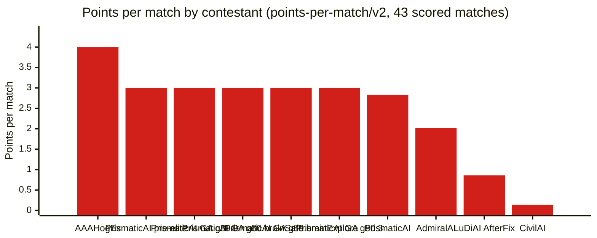
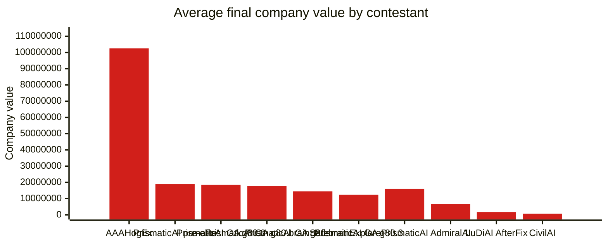
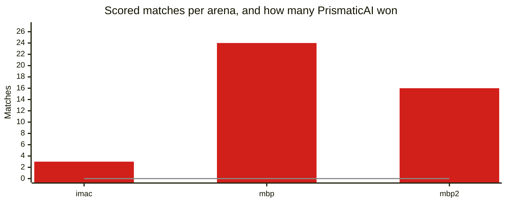

# battle-20261120T011701-6bcd082e

Derived from `battle-20261120T011701-6bcd082e.json` by `tools/research/ai-battle/battle.py report`; do not edit.

- Edition `6bcd082ef8800eaa`: PrismaticAI and referee at `23775ac070fd3fe12e281f826efbf16b2bb05172`, base set `opengfx-8.0.tar`
- 20-year free-for-all from 1960, map 256x256 temperate, breakdowns 1
- 43 scored match(es) on `imac` (20261119-master-gdf1e05e7d8), `mbp` (20261120-master-ma7416470de), `mbp2` (20261119-master-gdf1e05e7d8)
- Replays: 1 of 2 identical to their original on another arena

| # | Contestant | Played | Wins | Points | Points/match | Avg rank | Avg final value | Squirrel errors | Matches with anomalies |
|---|---|---|---|---|---|---|---|---|---|
| 1 | AAAHogEx | 43 | 43 | 172 | 4.0 | 1.0 | 102.5 M | 35 | 1 |
| 2 | PrismaticAI pre-elite | 8 | 0 | 24 | 3.0 | 2.0 | 18.9 M | 0 | 0 |
| 3 | PrismaticAI GA g80.0 | 8 | 0 | 24 | 3.0 | 2.0 | 18.5 M | 0 | 1 |
| 4 | PrismaticAI GA g80.brainSafe | 8 | 0 | 24 | 3.0 | 2.0 | 17.7 M | 0 | 0 |
| 5 | PrismaticAI GA g80.brainExplore | 7 | 0 | 21 | 3.0 | 2.0 | 14.5 M | 0 | 0 |
| 6 | PrismaticAI GA g80.3 | 6 | 0 | 18 | 3.0 | 2.0 | 12.4 M | 0 | 1 |
| 7 | PrismaticAI | 6 | 0 | 17 | 2.833 | 2.17 | 16.0 M | 0 | 2 |
| 8 | AdmiralAI | 43 | 0 | 87 | 2.023 | 2.98 | 6.6 M | 0 | 4 |
| 9 | LuDiAI AfterFix | 43 | 0 | 37 | 0.86 | 4.14 | 1.7 M | 0 | 1 |
| 10 | CivilAI | 43 | 0 | 6 | 0.14 | 4.86 | 685.7 k | 0 | 14 |

```mermaid
---
config:
  xyChart:
    width: 900
    height: 360
  themeVariables:
    xyChart:
      plotColorPalette: "#d11f1a, #8a8a8a, #0b0b0b, #ece4d6"
---
xychart-beta
    title "Final company value per scored match: winner vs best PrismaticAI"
    x-axis ["m-0001", "m-0002", "m-0003", "m-0004", "m-0005", "m-0006", "m-0007", "m-0008", "m-0009", "m-0010", "m-0011", "m-0012", "m-0013", "m-0014", "m-0015", "m-0016", "m-0017", "m-0018", "m-0019", "m-0020", "m-0021", "m-0022", "m-0023", "m-0024", "m-0025", "m-0026", "m-0027", "m-0028", "m-0036", "m-0037", "m-0038", "m-0039", "m-0040", "m-0041", "m-0042", "m-0043", "m-0044", "m-0045", "m-0047", "m-0049", "m-0050", "m-0051", "m-0052"]
    %% series: Winner | Best PrismaticAI
    %% links: battle-20261120T011701-6bcd082e.md?col=Match&filter=m-0001 | battle-20261120T011701-6bcd082e.md?col=Match&filter=m-0002 | battle-20261120T011701-6bcd082e.md?col=Match&filter=m-0003 | battle-20261120T011701-6bcd082e.md?col=Match&filter=m-0004 | battle-20261120T011701-6bcd082e.md?col=Match&filter=m-0005 | battle-20261120T011701-6bcd082e.md?col=Match&filter=m-0006 | battle-20261120T011701-6bcd082e.md?col=Match&filter=m-0007 | battle-20261120T011701-6bcd082e.md?col=Match&filter=m-0008 | battle-20261120T011701-6bcd082e.md?col=Match&filter=m-0009 | battle-20261120T011701-6bcd082e.md?col=Match&filter=m-0010 | battle-20261120T011701-6bcd082e.md?col=Match&filter=m-0011 | battle-20261120T011701-6bcd082e.md?col=Match&filter=m-0012 | battle-20261120T011701-6bcd082e.md?col=Match&filter=m-0013 | battle-20261120T011701-6bcd082e.md?col=Match&filter=m-0014 | battle-20261120T011701-6bcd082e.md?col=Match&filter=m-0015 | battle-20261120T011701-6bcd082e.md?col=Match&filter=m-0016 | battle-20261120T011701-6bcd082e.md?col=Match&filter=m-0017 | battle-20261120T011701-6bcd082e.md?col=Match&filter=m-0018 | battle-20261120T011701-6bcd082e.md?col=Match&filter=m-0019 | battle-20261120T011701-6bcd082e.md?col=Match&filter=m-0020 | battle-20261120T011701-6bcd082e.md?col=Match&filter=m-0021 | battle-20261120T011701-6bcd082e.md?col=Match&filter=m-0022 | battle-20261120T011701-6bcd082e.md?col=Match&filter=m-0023 | battle-20261120T011701-6bcd082e.md?col=Match&filter=m-0024 | battle-20261120T011701-6bcd082e.md?col=Match&filter=m-0025 | battle-20261120T011701-6bcd082e.md?col=Match&filter=m-0026 | battle-20261120T011701-6bcd082e.md?col=Match&filter=m-0027 | battle-20261120T011701-6bcd082e.md?col=Match&filter=m-0028 | battle-20261120T011701-6bcd082e.md?col=Match&filter=m-0036 | battle-20261120T011701-6bcd082e.md?col=Match&filter=m-0037 | battle-20261120T011701-6bcd082e.md?col=Match&filter=m-0038 | battle-20261120T011701-6bcd082e.md?col=Match&filter=m-0039 | battle-20261120T011701-6bcd082e.md?col=Match&filter=m-0040 | battle-20261120T011701-6bcd082e.md?col=Match&filter=m-0041 | battle-20261120T011701-6bcd082e.md?col=Match&filter=m-0042 | battle-20261120T011701-6bcd082e.md?col=Match&filter=m-0043 | battle-20261120T011701-6bcd082e.md?col=Match&filter=m-0044 | battle-20261120T011701-6bcd082e.md?col=Match&filter=m-0045 | battle-20261120T011701-6bcd082e.md?col=Match&filter=m-0047 | battle-20261120T011701-6bcd082e.md?col=Match&filter=m-0049 | battle-20261120T011701-6bcd082e.md?col=Match&filter=m-0050 | battle-20261120T011701-6bcd082e.md?col=Match&filter=m-0051 | battle-20261120T011701-6bcd082e.md?col=Match&filter=m-0052
    y-axis "Company value" 0 --> 139000000
    bar [110830499, 106649486, 110105192, 106510199, 119344208, 97615716, 88830923, 104235043, 92262410, 114485139, 107326244, 106934057, 87899248, 69821893, 82524956, 94036292, 88530511, 110945062, 97908621, 82400643, 101692794, 106697696, 112062495, 117775610, 125220173, 119875079, 86047211, 113287070, 110472364, 119659632, 114173774, 117774784, 111420527, 126382599, 88864164, 93886436, 121301033, 101298054, 71358648, 88726508, 85697703, 97726768, 96594727]
    line [13407292, 15638012, 20521501, 16677979, 9637188, 6672428, 23549532, 20302331, 18939398, 7715781, 14267767, 13008780, 13909992, 17226061, 9101988, 11436404, 13676623, 17417934, 15878648, 18134193, 21151682, 14189224, 10658006, 18914821, 24535144, 25638267, 20109382, 15797618, 22409837, 23816719, 16377785, 18555619, 20005850, 14950909, 17794244, 16238564, 15704686, 10913886, 11309782, 19705910, 18717004, 22544915, 15579717]
```

<!-- battle-charts:begin -->
<!-- derived from battle-20261120T011701-6bcd082e.json by `battle.py render`; `battle.py check` fails when it is stale -->

<!-- battle-charts:end -->

| Seed | Original | Replay | Arenas | Identical |
|---|---|---|---|---|
| 292178433 | m-0010 | m-0048 | imac / mbp | NO |
| 1699693196 | m-0013 | m-0056 | mbp2 / mbp | yes |

| Match | Arena | Seed | Winner | Value | Last | Anomalies |
|---|---|---|---|---|---|---|
| m-0001 | mbp | 1642930514 | AAAHogEx | 110.8 M | CivilAI | - |
| m-0002 | mbp | 1642930514 | AAAHogEx | 106.6 M | CivilAI | PrismaticAI GA g80.0: fleet_drop:85->58; AdmiralAI: fleet_drop:307->166; CivilAI: fleet_drop:43->23 |
| m-0003 | mbp | 1642930514 | AAAHogEx | 110.1 M | CivilAI | AdmiralAI: fleet_drop:237->152 |
| m-0004 | mbp | 1642930514 | AAAHogEx | 106.5 M | CivilAI | - |
| m-0005 | mbp | 1642930514 | AAAHogEx | 119.3 M | CivilAI | - |
| m-0006 | mbp | 292178433 | AAAHogEx | 97.6 M | CivilAI | - |
| m-0007 | mbp | 292178433 | AAAHogEx | 88.8 M | CivilAI | CivilAI: fleet_drop:31->14 |
| m-0008 | mbp | 292178433 | AAAHogEx | 104.2 M | CivilAI | - |
| m-0009 | mbp | 292178433 | AAAHogEx | 92.3 M | CivilAI | CivilAI: fleet_drop:20->12 |
| m-0010 | imac | 292178433 | AAAHogEx | 114.5 M | CivilAI | CivilAI: fleet_drop:29->15 |
| m-0011 | imac | 292178433 | AAAHogEx | 107.3 M | CivilAI | - |
| m-0012 | imac | 1699693196 | AAAHogEx | 106.9 M | LuDiAI AfterFix | - |
| m-0013 | mbp2 | 1699693196 | AAAHogEx | 87.9 M | CivilAI | - |
| m-0014 | mbp2 | 1699693196 | AAAHogEx | 69.8 M | LuDiAI AfterFix | AdmiralAI: fleet_drop:310->214 |
| m-0015 | mbp2 | 1699693196 | AAAHogEx | 82.5 M | CivilAI | - |
| m-0016 | mbp2 | 1699693196 | AAAHogEx | 94.0 M | CivilAI | CivilAI: fleet_drop:69->34 |
| m-0017 | mbp2 | 1699693196 | AAAHogEx | 88.5 M | CivilAI | AdmiralAI: fleet_drop:325->218; CivilAI: fleet_drop:11->7 |
| m-0018 | mbp2 | 1514026657 | AAAHogEx | 110.9 M | CivilAI | - |
| m-0019 | mbp2 | 1514026657 | AAAHogEx | 97.9 M | CivilAI | - |
| m-0020 | mbp2 | 1514026657 | AAAHogEx | 82.4 M | CivilAI | - |
| m-0021 | mbp2 | 1514026657 | AAAHogEx | 101.7 M | LuDiAI AfterFix | - |
| m-0022 | mbp2 | 1514026657 | AAAHogEx | 106.7 M | CivilAI | CivilAI: fleet_drop:37->21 |
| m-0023 | mbp2 | 1514026657 | AAAHogEx | 112.1 M | CivilAI | - |
| m-0024 | mbp2 | 1812167528 | AAAHogEx | 117.8 M | CivilAI | AAAHogEx: squirrel_errors:35 |
| m-0025 | mbp2 | 1812167528 | AAAHogEx | 125.2 M | CivilAI | CivilAI: fleet_drop:103->60 |
| m-0026 | mbp2 | 1812167528 | AAAHogEx | 119.9 M | LuDiAI AfterFix | - |
| m-0027 | mbp2 | 1812167528 | AAAHogEx | 86.0 M | CivilAI | - |
| m-0028 | mbp2 | 1812167528 | AAAHogEx | 113.3 M | LuDiAI AfterFix | - |
| m-0036 | mbp | 1329240766 | AAAHogEx | 110.5 M | CivilAI | PrismaticAI: fleet_drop:83->58; CivilAI: fleet_drop:64->40 |
| m-0037 | mbp | 1329240766 | AAAHogEx | 119.7 M | CivilAI | CivilAI: no_vehicles |
| m-0038 | mbp | 1329240766 | AAAHogEx | 114.2 M | CivilAI | CivilAI: fleet_drop:94->65 |
| m-0039 | mbp | 1329240766 | AAAHogEx | 117.8 M | CivilAI | LuDiAI AfterFix: fleet_drop:37->18 |
| m-0040 | mbp | 1329240766 | AAAHogEx | 111.4 M | CivilAI | CivilAI: fleet_drop:48->17 |
| m-0041 | mbp | 1329240766 | AAAHogEx | 126.4 M | CivilAI | PrismaticAI GA g80.3: fleet_drop:171->119; CivilAI: no_vehicles |
| m-0042 | mbp | 669198863 | AAAHogEx | 88.9 M | CivilAI | PrismaticAI: fleet_drop:78->46 |
| m-0043 | mbp | 669198863 | AAAHogEx | 93.9 M | CivilAI | - |
| m-0044 | mbp | 669198863 | AAAHogEx | 121.3 M | CivilAI | - |
| m-0045 | mbp | 669198863 | AAAHogEx | 101.3 M | CivilAI | - |
| m-0047 | mbp | 669198863 | AAAHogEx | 71.4 M | CivilAI | - |
| m-0048 (replay) | mbp | 292178433 | AAAHogEx | 118.8 M | CivilAI | CivilAI: fleet_drop:30->14 |
| m-0049 | mbp | 634310776 | AAAHogEx | 88.7 M | CivilAI | CivilAI: no_vehicles |
| m-0050 | mbp | 634310776 | AAAHogEx | 85.7 M | CivilAI | - |
| m-0051 | mbp | 634310776 | AAAHogEx | 97.7 M | CivilAI | - |
| m-0052 | mbp | 634310776 | AAAHogEx | 96.6 M | LuDiAI AfterFix | - |
| m-0056 (replay) | mbp | 1699693196 | AAAHogEx | 87.9 M | CivilAI | - |
