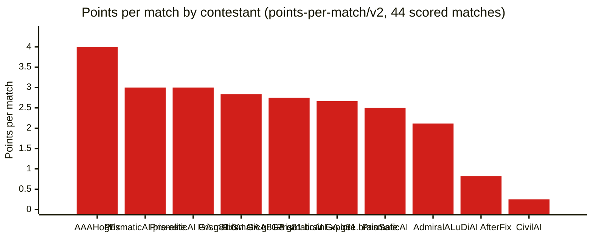
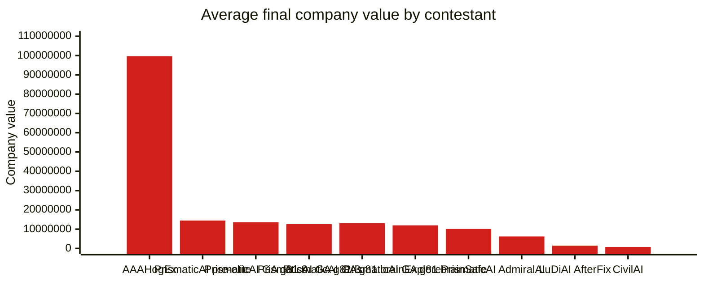
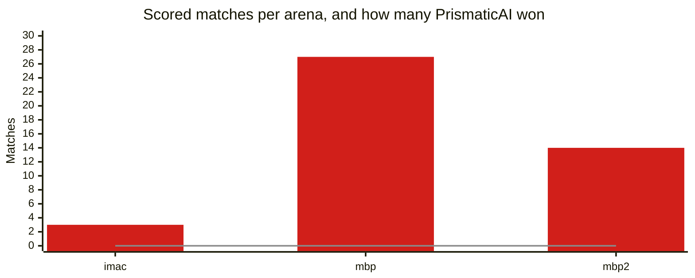

# battle-20261120T012956-c1448f27

Derived from `battle-20261120T012956-c1448f27.json` by `tools/research/ai-battle/battle.py report`; do not edit.

- Edition `c1448f27461cd9a2`: PrismaticAI and referee at `23775ac070fd3fe12e281f826efbf16b2bb05172`, base set `opengfx-8.0.tar`
- 20-year free-for-all from 1960, map 256x256 temperate, breakdowns 1
- 44 scored match(es) on `imac` (20261119-master-gdf1e05e7d8), `mbp` (20261120-master-ma7416470de), `mbp2` (20261119-master-gdf1e05e7d8)
- Replays: 0 of 1 identical to their original on another arena

| # | Contestant | Played | Wins | Points | Points/match | Avg rank | Avg final value | Squirrel errors | Matches with anomalies |
|---|---|---|---|---|---|---|---|---|---|
| 1 | AAAHogEx | 44 | 44 | 176 | 4.0 | 1.0 | 99.7 M | 0 | 0 |
| 2 | PrismaticAI pre-elite | 9 | 0 | 27 | 3.0 | 2.0 | 14.5 M | 0 | 0 |
| 3 | PrismaticAI GA g81.0 | 8 | 0 | 24 | 3.0 | 2.0 | 13.6 M | 0 | 1 |
| 4 | PrismaticAI GA g81.3 | 6 | 0 | 17 | 2.833 | 2.17 | 12.6 M | 0 | 1 |
| 5 | PrismaticAI GA g81.brainExplore | 8 | 0 | 22 | 2.75 | 2.25 | 13.1 M | 0 | 0 |
| 6 | PrismaticAI GA g81.brainSafe | 9 | 0 | 24 | 2.667 | 2.33 | 12.0 M | 0 | 0 |
| 7 | PrismaticAI | 4 | 0 | 10 | 2.5 | 2.5 | 10.1 M | 0 | 1 |
| 8 | AdmiralAI | 44 | 0 | 93 | 2.114 | 2.89 | 6.2 M | 0 | 1 |
| 9 | LuDiAI AfterFix | 44 | 0 | 36 | 0.818 | 4.18 | 1.5 M | 0 | 4 |
| 10 | CivilAI | 44 | 0 | 11 | 0.25 | 4.75 | 762.0 k | 3670 | 6 |

```mermaid
---
config:
  xyChart:
    width: 900
    height: 360
  themeVariables:
    xyChart:
      plotColorPalette: "#d11f1a, #8a8a8a, #0b0b0b, #ece4d6"
---
xychart-beta
    title "Final company value per scored match: winner vs best PrismaticAI"
    x-axis ["m-0001", "m-0002", "m-0003", "m-0004", "m-0005", "m-0006", "m-0007", "m-0008", "m-0009", "m-0010", "m-0011", "m-0012", "m-0013", "m-0014", "m-0015", "m-0016", "m-0017", "m-0019", "m-0020", "m-0021", "m-0022", "m-0023", "m-0025", "m-0026", "m-0027", "m-0028", "m-0036", "m-0037", "m-0038", "m-0039", "m-0040", "m-0041", "m-0042", "m-0043", "m-0044", "m-0045", "m-0046", "m-0047", "m-0049", "m-0050", "m-0051", "m-0052", "m-0055", "m-0057"]
    %% series: Winner | Best PrismaticAI
    %% links: battle-20261120T012956-c1448f27.md?col=Match&filter=m-0001 | battle-20261120T012956-c1448f27.md?col=Match&filter=m-0002 | battle-20261120T012956-c1448f27.md?col=Match&filter=m-0003 | battle-20261120T012956-c1448f27.md?col=Match&filter=m-0004 | battle-20261120T012956-c1448f27.md?col=Match&filter=m-0005 | battle-20261120T012956-c1448f27.md?col=Match&filter=m-0006 | battle-20261120T012956-c1448f27.md?col=Match&filter=m-0007 | battle-20261120T012956-c1448f27.md?col=Match&filter=m-0008 | battle-20261120T012956-c1448f27.md?col=Match&filter=m-0009 | battle-20261120T012956-c1448f27.md?col=Match&filter=m-0010 | battle-20261120T012956-c1448f27.md?col=Match&filter=m-0011 | battle-20261120T012956-c1448f27.md?col=Match&filter=m-0012 | battle-20261120T012956-c1448f27.md?col=Match&filter=m-0013 | battle-20261120T012956-c1448f27.md?col=Match&filter=m-0014 | battle-20261120T012956-c1448f27.md?col=Match&filter=m-0015 | battle-20261120T012956-c1448f27.md?col=Match&filter=m-0016 | battle-20261120T012956-c1448f27.md?col=Match&filter=m-0017 | battle-20261120T012956-c1448f27.md?col=Match&filter=m-0019 | battle-20261120T012956-c1448f27.md?col=Match&filter=m-0020 | battle-20261120T012956-c1448f27.md?col=Match&filter=m-0021 | battle-20261120T012956-c1448f27.md?col=Match&filter=m-0022 | battle-20261120T012956-c1448f27.md?col=Match&filter=m-0023 | battle-20261120T012956-c1448f27.md?col=Match&filter=m-0025 | battle-20261120T012956-c1448f27.md?col=Match&filter=m-0026 | battle-20261120T012956-c1448f27.md?col=Match&filter=m-0027 | battle-20261120T012956-c1448f27.md?col=Match&filter=m-0028 | battle-20261120T012956-c1448f27.md?col=Match&filter=m-0036 | battle-20261120T012956-c1448f27.md?col=Match&filter=m-0037 | battle-20261120T012956-c1448f27.md?col=Match&filter=m-0038 | battle-20261120T012956-c1448f27.md?col=Match&filter=m-0039 | battle-20261120T012956-c1448f27.md?col=Match&filter=m-0040 | battle-20261120T012956-c1448f27.md?col=Match&filter=m-0041 | battle-20261120T012956-c1448f27.md?col=Match&filter=m-0042 | battle-20261120T012956-c1448f27.md?col=Match&filter=m-0043 | battle-20261120T012956-c1448f27.md?col=Match&filter=m-0044 | battle-20261120T012956-c1448f27.md?col=Match&filter=m-0045 | battle-20261120T012956-c1448f27.md?col=Match&filter=m-0046 | battle-20261120T012956-c1448f27.md?col=Match&filter=m-0047 | battle-20261120T012956-c1448f27.md?col=Match&filter=m-0049 | battle-20261120T012956-c1448f27.md?col=Match&filter=m-0050 | battle-20261120T012956-c1448f27.md?col=Match&filter=m-0051 | battle-20261120T012956-c1448f27.md?col=Match&filter=m-0052 | battle-20261120T012956-c1448f27.md?col=Match&filter=m-0055 | battle-20261120T012956-c1448f27.md?col=Match&filter=m-0057
    y-axis "Company value" 0 --> 182000000
    bar [110398240, 93533067, 93588188, 82596987, 85581627, 84627796, 83018482, 125793351, 106294948, 104075417, 81933502, 124445251, 120810736, 144569862, 106834408, 119943913, 132511550, 105942466, 94396755, 97908571, 105112354, 100940609, 65278810, 71902014, 86100509, 52222242, 126613187, 110609720, 130196492, 165856605, 101421628, 119589479, 67641593, 98862317, 67655780, 86364672, 72196155, 72544290, 75246702, 104965173, 113996137, 90854667, 108652552, 91902176]
    line [18254621, 18692268, 22737794, 14889978, 10272814, 1101927, 14396979, 4728157, 1804860, 2117378, 13886636, 17982399, 15432287, 18530508, 23409687, 16723006, 15189730, 19618606, 12394621, 10614210, 11283189, 16975530, 11382116, 14004589, 8549099, 16641018, 3591698, 10115314, 11755921, 3418805, 9627715, 6648234, 17625262, 16985575, 17490755, 14490261, 17741237, 12812622, 13773834, 11404963, 10980787, 15792349, 10363774, 11820251]
```

<!-- battle-charts:begin -->
<!-- derived from battle-20261120T012956-c1448f27.json by `battle.py render`; `battle.py check` fails when it is stale -->

<!-- battle-charts:end -->

| Seed | Original | Replay | Arenas | Identical |
|---|---|---|---|---|
| 628444076 | m-0010 | m-0056 | imac / mbp | NO |

| Match | Arena | Seed | Winner | Value | Last | Anomalies |
|---|---|---|---|---|---|---|
| m-0001 | mbp | 1337532549 | AAAHogEx | 110.4 M | CivilAI | CivilAI: fleet_drop:57->37 |
| m-0002 | mbp | 1337532549 | AAAHogEx | 93.5 M | CivilAI | - |
| m-0003 | mbp | 1337532549 | AAAHogEx | 93.6 M | CivilAI | - |
| m-0004 | mbp | 1337532549 | AAAHogEx | 82.6 M | CivilAI | - |
| m-0005 | mbp | 1337532549 | AAAHogEx | 85.6 M | CivilAI | LuDiAI AfterFix: fleet_drop:120->41; CivilAI: fleet_drop:63->25 |
| m-0006 | mbp | 628444076 | AAAHogEx | 84.6 M | CivilAI | - |
| m-0007 | mbp | 628444076 | AAAHogEx | 83.0 M | LuDiAI AfterFix | - |
| m-0008 | mbp | 628444076 | AAAHogEx | 125.8 M | CivilAI | - |
| m-0009 | mbp | 628444076 | AAAHogEx | 106.3 M | CivilAI | - |
| m-0010 | imac | 628444076 | AAAHogEx | 104.1 M | CivilAI | - |
| m-0011 | imac | 628444076 | AAAHogEx | 81.9 M | LuDiAI AfterFix | PrismaticAI GA g81.3: fleet_drop:78->54 |
| m-0012 | imac | 104769037 | AAAHogEx | 124.4 M | LuDiAI AfterFix | PrismaticAI: fleet_drop:83->55 |
| m-0013 | mbp2 | 104769037 | AAAHogEx | 120.8 M | LuDiAI AfterFix | - |
| m-0014 | mbp2 | 104769037 | AAAHogEx | 144.6 M | CivilAI | - |
| m-0015 | mbp2 | 104769037 | AAAHogEx | 106.8 M | CivilAI | - |
| m-0016 | mbp2 | 104769037 | AAAHogEx | 119.9 M | CivilAI | - |
| m-0017 | mbp2 | 104769037 | AAAHogEx | 132.5 M | LuDiAI AfterFix | CivilAI: fleet_drop:33->19; LuDiAI AfterFix: fleet_drop:45->7 |
| m-0019 | mbp2 | 294812810 | AAAHogEx | 105.9 M | CivilAI | - |
| m-0020 | mbp2 | 294812810 | AAAHogEx | 94.4 M | CivilAI | - |
| m-0021 | mbp2 | 294812810 | AAAHogEx | 97.9 M | CivilAI | - |
| m-0022 | mbp2 | 294812810 | AAAHogEx | 105.1 M | LuDiAI AfterFix | - |
| m-0023 | mbp2 | 294812810 | AAAHogEx | 100.9 M | CivilAI | - |
| m-0025 | mbp2 | 1480137023 | AAAHogEx | 65.3 M | CivilAI | - |
| m-0026 | mbp2 | 1480137023 | AAAHogEx | 71.9 M | CivilAI | - |
| m-0027 | mbp2 | 1480137023 | AAAHogEx | 86.1 M | CivilAI | - |
| m-0028 | mbp2 | 1480137023 | AAAHogEx | 52.2 M | CivilAI | - |
| m-0036 | mbp | 94554530 | AAAHogEx | 126.6 M | CivilAI | - |
| m-0037 | mbp | 94554530 | AAAHogEx | 110.6 M | CivilAI | - |
| m-0038 | mbp | 94554530 | AAAHogEx | 130.2 M | LuDiAI AfterFix | - |
| m-0039 | mbp | 94554530 | AAAHogEx | 165.9 M | CivilAI | - |
| m-0040 | mbp | 94554530 | AAAHogEx | 101.4 M | CivilAI | - |
| m-0041 | mbp | 94554530 | AAAHogEx | 119.6 M | CivilAI | - |
| m-0042 | mbp | 1398491940 | AAAHogEx | 67.6 M | CivilAI | - |
| m-0043 | mbp | 1398491940 | AAAHogEx | 98.9 M | CivilAI | - |
| m-0044 | mbp | 1398491940 | AAAHogEx | 67.7 M | CivilAI | AdmiralAI: fleet_drop:192->130; CivilAI: fleet_drop:55->37 |
| m-0045 | mbp | 1398491940 | AAAHogEx | 86.4 M | CivilAI | - |
| m-0046 | mbp | 1398491940 | AAAHogEx | 72.2 M | CivilAI | - |
| m-0047 | mbp | 1398491940 | AAAHogEx | 72.5 M | AdmiralAI | - |
| m-0049 | mbp | 55285021 | AAAHogEx | 75.2 M | CivilAI | CivilAI: fleet_drop:38->20 |
| m-0050 | mbp | 55285021 | AAAHogEx | 105.0 M | CivilAI | PrismaticAI GA g81.0: fleet_drop:102->68 |
| m-0051 | mbp | 55285021 | AAAHogEx | 114.0 M | LuDiAI AfterFix | LuDiAI AfterFix: fleet_drop:56->36 |
| m-0052 | mbp | 55285021 | AAAHogEx | 90.9 M | CivilAI | CivilAI: squirrel_errors:3670 |
| m-0055 | mbp | 1856220830 | AAAHogEx | 108.7 M | LuDiAI AfterFix | LuDiAI AfterFix: no_vehicles |
| m-0056 (replay) | mbp | 628444076 | AAAHogEx | 89.8 M | CivilAI | - |
| m-0057 | mbp | 1856220830 | AAAHogEx | 91.9 M | LuDiAI AfterFix | - |
