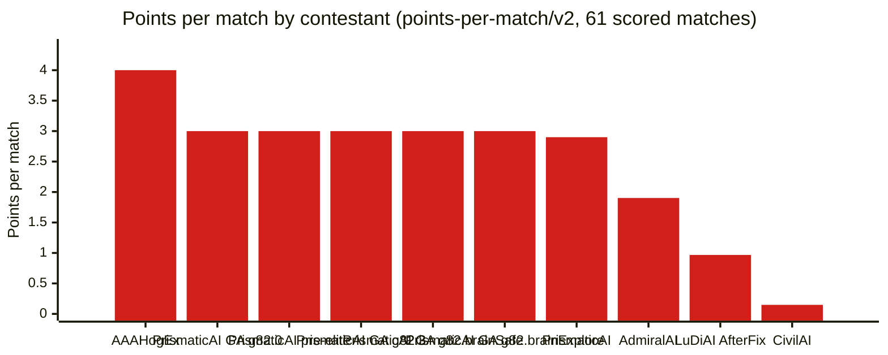
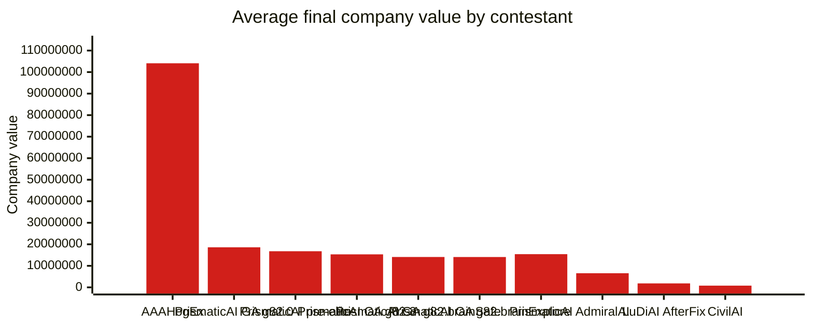
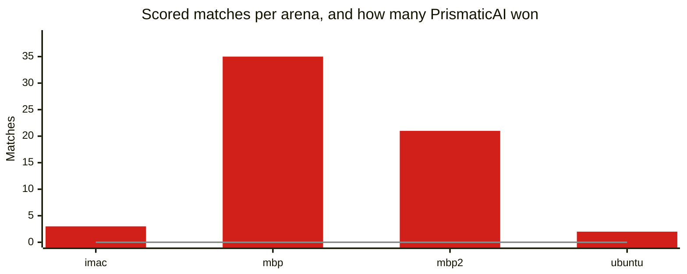

# battle-20261120T014727-3346cb28

Derived from `battle-20261120T014727-3346cb28.json` by `tools/research/ai-battle/battle.py report`; do not edit.

- Edition `3346cb28a45c3a56`: PrismaticAI and referee at `23775ac070fd3fe12e281f826efbf16b2bb05172`, base set `opengfx-8.0.tar`
- 20-year free-for-all from 1960, map 256x256 temperate, breakdowns 1
- 61 scored match(es) on `imac` (20261119-master-gdf1e05e7d8), `mbp` (20261120-master-ma7416470de), `mbp2` (20261119-master-gdf1e05e7d8), `ubuntu` (20261119-master-gdf1e05e7d8)
- Replays: 1 of 2 identical to their original on another arena

| # | Contestant | Played | Wins | Points | Points/match | Avg rank | Avg final value | Squirrel errors | Matches with anomalies |
|---|---|---|---|---|---|---|---|---|---|
| 1 | AAAHogEx | 61 | 61 | 244 | 4.0 | 1.0 | 104.1 M | 0 | 0 |
| 2 | PrismaticAI GA g82.0 | 10 | 0 | 30 | 3.0 | 2.0 | 18.6 M | 0 | 2 |
| 3 | PrismaticAI pre-elite | 12 | 0 | 36 | 3.0 | 2.0 | 16.8 M | 0 | 0 |
| 4 | PrismaticAI GA g82.3 | 9 | 0 | 27 | 3.0 | 2.0 | 15.3 M | 0 | 1 |
| 5 | PrismaticAI GA g82.brainSafe | 11 | 0 | 33 | 3.0 | 2.0 | 14.1 M | 0 | 2 |
| 6 | PrismaticAI GA g82.brainExplore | 9 | 0 | 27 | 3.0 | 2.0 | 14.1 M | 0 | 3 |
| 7 | PrismaticAI | 10 | 0 | 29 | 2.9 | 2.1 | 15.4 M | 0 | 3 |
| 8 | AdmiralAI | 61 | 0 | 116 | 1.902 | 3.1 | 6.6 M | 0 | 5 |
| 9 | LuDiAI AfterFix | 61 | 0 | 59 | 0.967 | 4.03 | 1.8 M | 0 | 1 |
| 10 | CivilAI | 61 | 0 | 9 | 0.148 | 4.85 | 797.5 k | 0 | 8 |

```mermaid
---
config:
  xyChart:
    width: 900
    height: 360
  themeVariables:
    xyChart:
      plotColorPalette: "#d11f1a, #8a8a8a, #0b0b0b, #ece4d6"
---
xychart-beta
    title "Final company value per scored match: winner vs best PrismaticAI"
    x-axis ["m-0001", "m-0002", "m-0003", "m-0004", "m-0005", "m-0006", "m-0007", "m-0008", "m-0009", "m-0010", "m-0011", "m-0012", "m-0013", "m-0014", "m-0015", "m-0016", "m-0017", "m-0018", "m-0019", "m-0020", "m-0021", "m-0022", "m-0023", "m-0024", "m-0025", "m-0026", "m-0027", "m-0028", "m-0029", "m-0030", "m-0036", "m-0037", "m-0038", "m-0039", "m-0040", "m-0041", "m-0042", "m-0043", "m-0044", "m-0046", "m-0049", "m-0050", "m-0051", "m-0054", "m-0055", "m-0057", "m-0058", "m-0065", "m-0066", "m-0067", "m-0068", "m-0069", "m-0071", "m-0073", "m-0074", "m-0075", "m-0076", "m-0077", "m-0078", "m-0079", "m-0081"]
    %% series: Winner | Best PrismaticAI
    %% links: battle-20261120T014727-3346cb28.md?col=Match&filter=m-0001 | battle-20261120T014727-3346cb28.md?col=Match&filter=m-0002 | battle-20261120T014727-3346cb28.md?col=Match&filter=m-0003 | battle-20261120T014727-3346cb28.md?col=Match&filter=m-0004 | battle-20261120T014727-3346cb28.md?col=Match&filter=m-0005 | battle-20261120T014727-3346cb28.md?col=Match&filter=m-0006 | battle-20261120T014727-3346cb28.md?col=Match&filter=m-0007 | battle-20261120T014727-3346cb28.md?col=Match&filter=m-0008 | battle-20261120T014727-3346cb28.md?col=Match&filter=m-0009 | battle-20261120T014727-3346cb28.md?col=Match&filter=m-0010 | battle-20261120T014727-3346cb28.md?col=Match&filter=m-0011 | battle-20261120T014727-3346cb28.md?col=Match&filter=m-0012 | battle-20261120T014727-3346cb28.md?col=Match&filter=m-0013 | battle-20261120T014727-3346cb28.md?col=Match&filter=m-0014 | battle-20261120T014727-3346cb28.md?col=Match&filter=m-0015 | battle-20261120T014727-3346cb28.md?col=Match&filter=m-0016 | battle-20261120T014727-3346cb28.md?col=Match&filter=m-0017 | battle-20261120T014727-3346cb28.md?col=Match&filter=m-0018 | battle-20261120T014727-3346cb28.md?col=Match&filter=m-0019 | battle-20261120T014727-3346cb28.md?col=Match&filter=m-0020 | battle-20261120T014727-3346cb28.md?col=Match&filter=m-0021 | battle-20261120T014727-3346cb28.md?col=Match&filter=m-0022 | battle-20261120T014727-3346cb28.md?col=Match&filter=m-0023 | battle-20261120T014727-3346cb28.md?col=Match&filter=m-0024 | battle-20261120T014727-3346cb28.md?col=Match&filter=m-0025 | battle-20261120T014727-3346cb28.md?col=Match&filter=m-0026 | battle-20261120T014727-3346cb28.md?col=Match&filter=m-0027 | battle-20261120T014727-3346cb28.md?col=Match&filter=m-0028 | battle-20261120T014727-3346cb28.md?col=Match&filter=m-0029 | battle-20261120T014727-3346cb28.md?col=Match&filter=m-0030 | battle-20261120T014727-3346cb28.md?col=Match&filter=m-0036 | battle-20261120T014727-3346cb28.md?col=Match&filter=m-0037 | battle-20261120T014727-3346cb28.md?col=Match&filter=m-0038 | battle-20261120T014727-3346cb28.md?col=Match&filter=m-0039 | battle-20261120T014727-3346cb28.md?col=Match&filter=m-0040 | battle-20261120T014727-3346cb28.md?col=Match&filter=m-0041 | battle-20261120T014727-3346cb28.md?col=Match&filter=m-0042 | battle-20261120T014727-3346cb28.md?col=Match&filter=m-0043 | battle-20261120T014727-3346cb28.md?col=Match&filter=m-0044 | battle-20261120T014727-3346cb28.md?col=Match&filter=m-0046 | battle-20261120T014727-3346cb28.md?col=Match&filter=m-0049 | battle-20261120T014727-3346cb28.md?col=Match&filter=m-0050 | battle-20261120T014727-3346cb28.md?col=Match&filter=m-0051 | battle-20261120T014727-3346cb28.md?col=Match&filter=m-0054 | battle-20261120T014727-3346cb28.md?col=Match&filter=m-0055 | battle-20261120T014727-3346cb28.md?col=Match&filter=m-0057 | battle-20261120T014727-3346cb28.md?col=Match&filter=m-0058 | battle-20261120T014727-3346cb28.md?col=Match&filter=m-0065 | battle-20261120T014727-3346cb28.md?col=Match&filter=m-0066 | battle-20261120T014727-3346cb28.md?col=Match&filter=m-0067 | battle-20261120T014727-3346cb28.md?col=Match&filter=m-0068 | battle-20261120T014727-3346cb28.md?col=Match&filter=m-0069 | battle-20261120T014727-3346cb28.md?col=Match&filter=m-0071 | battle-20261120T014727-3346cb28.md?col=Match&filter=m-0073 | battle-20261120T014727-3346cb28.md?col=Match&filter=m-0074 | battle-20261120T014727-3346cb28.md?col=Match&filter=m-0075 | battle-20261120T014727-3346cb28.md?col=Match&filter=m-0076 | battle-20261120T014727-3346cb28.md?col=Match&filter=m-0077 | battle-20261120T014727-3346cb28.md?col=Match&filter=m-0078 | battle-20261120T014727-3346cb28.md?col=Match&filter=m-0079 | battle-20261120T014727-3346cb28.md?col=Match&filter=m-0081
    y-axis "Company value" 0 --> 179000000
    bar [115027540, 105325273, 128805218, 145463379, 122437418, 98354383, 89585598, 145878257, 134745844, 123651808, 127571504, 75259466, 95254145, 48482876, 99553567, 85817125, 102860322, 93050157, 82318454, 74931353, 90480426, 98234435, 86878537, 117881962, 109485901, 94565276, 100468425, 125362589, 103965164, 77212409, 92047059, 67299686, 85628641, 74783026, 95467617, 90599475, 119135837, 99538663, 118526462, 105953728, 102036829, 103536204, 114154063, 148368870, 139161535, 120103546, 163160997, 73866882, 43332658, 51417062, 49372961, 42947442, 44677693, 122845544, 136292055, 156327563, 148175786, 141660889, 144736333, 129559128, 125629462]
    line [14532033, 11290004, 11040512, 10227410, 13297082, 14188473, 14423008, 18634663, 15440851, 17561414, 15866101, 15341301, 11209504, 18118337, 15070585, 16265009, 18548118, 15667140, 19027891, 14946942, 12718054, 9573678, 15965412, 15273104, 13764673, 23308636, 10679458, 15250074, 15013695, 18173091, 14481280, 21140265, 22482461, 14053144, 13600437, 13603535, 16363572, 18703822, 26493530, 12915199, 16664156, 13509720, 14225145, 12850111, 19333530, 17074320, 11730544, 8692895, 14194590, 17203310, 14131935, 14497019, 14201354, 15814645, 23169615, 16203292, 19683591, 22780956, 17622221, 19513699, 14164127]
```

<!-- battle-charts:begin -->
<!-- derived from battle-20261120T014727-3346cb28.json by `battle.py render`; `battle.py check` fails when it is stale -->

<!-- battle-charts:end -->

| Seed | Original | Replay | Arenas | Identical |
|---|---|---|---|---|
| 1879821845 | m-0001 | m-0048 | mbp / mbp2 | yes |
| 1371252441 | m-0010 | m-0080 | imac / mbp | NO |

| Match | Arena | Seed | Winner | Value | Last | Anomalies |
|---|---|---|---|---|---|---|
| m-0001 | mbp | 1879821845 | AAAHogEx | 115.0 M | CivilAI | - |
| m-0002 | mbp | 1879821845 | AAAHogEx | 105.3 M | CivilAI | - |
| m-0003 | mbp | 1879821845 | AAAHogEx | 128.8 M | CivilAI | PrismaticAI GA g82.brainSafe: fleet_drop:46->28; CivilAI: fleet_drop:31->9 |
| m-0004 | mbp | 1879821845 | AAAHogEx | 145.5 M | CivilAI | CivilAI: fleet_drop:42->23 |
| m-0005 | mbp | 1879821845 | AAAHogEx | 122.4 M | CivilAI | - |
| m-0006 | mbp | 1371252441 | AAAHogEx | 98.4 M | CivilAI | PrismaticAI: fleet_drop:89->56 |
| m-0007 | mbp | 1371252441 | AAAHogEx | 89.6 M | CivilAI | - |
| m-0008 | mbp | 1371252441 | AAAHogEx | 145.9 M | CivilAI | - |
| m-0009 | mbp | 1371252441 | AAAHogEx | 134.7 M | CivilAI | - |
| m-0010 | imac | 1371252441 | AAAHogEx | 123.7 M | CivilAI | CivilAI: fleet_drop:96->44 |
| m-0011 | imac | 1371252441 | AAAHogEx | 127.6 M | CivilAI | - |
| m-0012 | imac | 825242609 | AAAHogEx | 75.3 M | LuDiAI AfterFix | CivilAI: fleet_drop:42->28 |
| m-0013 | mbp2 | 825242609 | AAAHogEx | 95.3 M | LuDiAI AfterFix | - |
| m-0014 | mbp2 | 825242609 | AAAHogEx | 48.5 M | CivilAI | - |
| m-0015 | mbp2 | 825242609 | AAAHogEx | 99.6 M | CivilAI | - |
| m-0016 | mbp2 | 825242609 | AAAHogEx | 85.8 M | CivilAI | - |
| m-0017 | mbp2 | 825242609 | AAAHogEx | 102.9 M | LuDiAI AfterFix | - |
| m-0018 | mbp2 | 1543637170 | AAAHogEx | 93.1 M | CivilAI | - |
| m-0019 | mbp2 | 1543637170 | AAAHogEx | 82.3 M | CivilAI | - |
| m-0020 | mbp2 | 1543637170 | AAAHogEx | 74.9 M | CivilAI | - |
| m-0021 | mbp2 | 1543637170 | AAAHogEx | 90.5 M | CivilAI | - |
| m-0022 | mbp2 | 1543637170 | AAAHogEx | 98.2 M | CivilAI | PrismaticAI GA g82.brainExplore: fleet_drop:49->25 |
| m-0023 | mbp2 | 1543637170 | AAAHogEx | 86.9 M | CivilAI | AdmiralAI: fleet_drop:17->3 |
| m-0024 | mbp2 | 384212916 | AAAHogEx | 117.9 M | LuDiAI AfterFix | - |
| m-0025 | mbp2 | 384212916 | AAAHogEx | 109.5 M | CivilAI | - |
| m-0026 | mbp2 | 384212916 | AAAHogEx | 94.6 M | CivilAI | - |
| m-0027 | mbp2 | 384212916 | AAAHogEx | 100.5 M | LuDiAI AfterFix | PrismaticAI GA g82.brainSafe: fleet_drop:33->23 |
| m-0028 | mbp2 | 384212916 | AAAHogEx | 125.4 M | CivilAI | - |
| m-0029 | ubuntu | 384212916 | AAAHogEx | 104.0 M | CivilAI | - |
| m-0030 | ubuntu | 191635129 | AAAHogEx | 77.2 M | CivilAI | PrismaticAI: fleet_drop:143->82 |
| m-0036 | mbp | 1037618227 | AAAHogEx | 92.0 M | CivilAI | - |
| m-0037 | mbp | 1037618227 | AAAHogEx | 67.3 M | CivilAI | - |
| m-0038 | mbp | 1037618227 | AAAHogEx | 85.6 M | CivilAI | - |
| m-0039 | mbp | 1037618227 | AAAHogEx | 74.8 M | CivilAI | - |
| m-0040 | mbp | 1037618227 | AAAHogEx | 95.5 M | CivilAI | - |
| m-0041 | mbp | 1037618227 | AAAHogEx | 90.6 M | LuDiAI AfterFix | - |
| m-0042 | mbp | 533703818 | AAAHogEx | 119.1 M | CivilAI | PrismaticAI: fleet_drop:144->65 |
| m-0043 | mbp | 533703818 | AAAHogEx | 99.5 M | CivilAI | - |
| m-0044 | mbp | 533703818 | AAAHogEx | 118.5 M | CivilAI | PrismaticAI GA g82.0: fleet_drop:126->73; AdmiralAI: fleet_drop:336->204 |
| m-0046 | mbp | 533703818 | AAAHogEx | 106.0 M | CivilAI | PrismaticAI GA g82.brainExplore: fleet_drop:93->61 |
| m-0048 (replay) | mbp2 | 1879821845 | AAAHogEx | 115.0 M | CivilAI | - |
| m-0049 | mbp | 1487863216 | AAAHogEx | 102.0 M | CivilAI | CivilAI: no_vehicles |
| m-0050 | mbp | 1487863216 | AAAHogEx | 103.5 M | CivilAI | - |
| m-0051 | mbp | 1487863216 | AAAHogEx | 114.2 M | LuDiAI AfterFix | - |
| m-0054 | mbp | 706588924 | AAAHogEx | 148.4 M | CivilAI | - |
| m-0055 | mbp | 706588924 | AAAHogEx | 139.2 M | CivilAI | CivilAI: fleet_drop:46->20 |
| m-0057 | mbp | 706588924 | AAAHogEx | 120.1 M | CivilAI | - |
| m-0058 | mbp | 706588924 | AAAHogEx | 163.2 M | CivilAI | CivilAI: fleet_drop:31->18 |
| m-0065 | mbp2 | 337662589 | AAAHogEx | 73.9 M | CivilAI | - |
| m-0066 | mbp | 896460974 | AAAHogEx | 43.3 M | CivilAI | AdmiralAI: fleet_drop:93->61 |
| m-0067 | mbp2 | 896460974 | AAAHogEx | 51.4 M | CivilAI | AdmiralAI: fleet_drop:182->110; LuDiAI AfterFix: fleet_drop:116->74 |
| m-0068 | mbp2 | 896460974 | AAAHogEx | 49.4 M | CivilAI | - |
| m-0069 | mbp2 | 896460974 | AAAHogEx | 42.9 M | CivilAI | - |
| m-0071 | mbp2 | 896460974 | AAAHogEx | 44.7 M | AdmiralAI | PrismaticAI GA g82.3: fleet_drop:94->62 |
| m-0073 | mbp | 309801750 | AAAHogEx | 122.8 M | CivilAI | CivilAI: fleet_drop:65->45 |
| m-0074 | mbp | 309801750 | AAAHogEx | 136.3 M | CivilAI | PrismaticAI GA g82.0: fleet_drop:133->89; AdmiralAI: fleet_drop:453->260 |
| m-0075 | mbp | 309801750 | AAAHogEx | 156.3 M | CivilAI | - |
| m-0076 | mbp | 309801750 | AAAHogEx | 148.2 M | CivilAI | PrismaticAI GA g82.brainExplore: fleet_drop:88->59 |
| m-0077 | mbp | 309801750 | AAAHogEx | 141.7 M | CivilAI | - |
| m-0078 | mbp | 1834103034 | AAAHogEx | 144.7 M | CivilAI | - |
| m-0079 | mbp | 1834103034 | AAAHogEx | 129.6 M | CivilAI | - |
| m-0080 (replay) | mbp | 1371252441 | AAAHogEx | 119.9 M | CivilAI | CivilAI: fleet_drop:83->42 |
| m-0081 | mbp | 1834103034 | AAAHogEx | 125.6 M | CivilAI | - |
