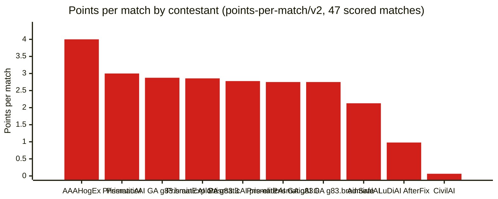
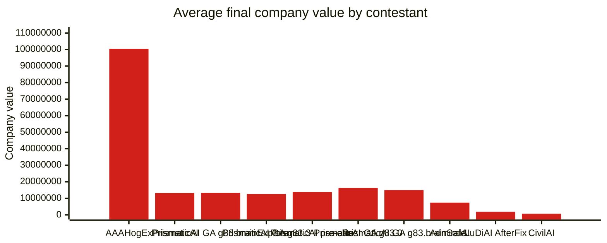
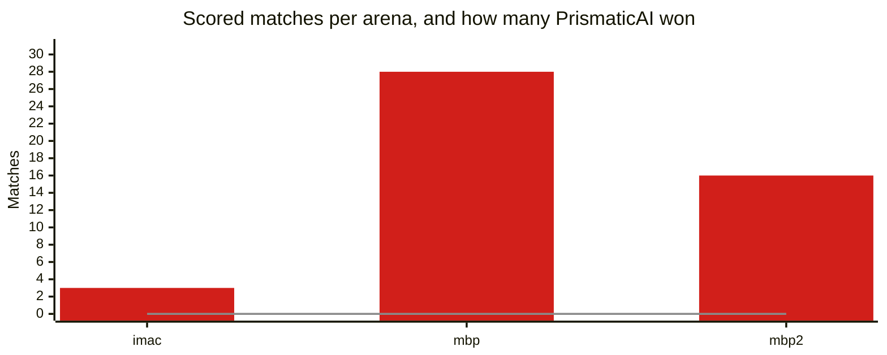

# battle-20261120T020155-6b012404

Derived from `battle-20261120T020155-6b012404.json` by `tools/research/ai-battle/battle.py report`; do not edit.

- Edition `6b0124046d3eb70a`: PrismaticAI and referee at `23775ac070fd3fe12e281f826efbf16b2bb05172`, base set `opengfx-8.0.tar`
- 20-year free-for-all from 1960, map 256x256 temperate, breakdowns 1
- 47 scored match(es) on `imac` (20261119-master-gdf1e05e7d8), `mbp` (20261120-master-ma7416470de), `mbp2` (20261119-master-gdf1e05e7d8)
- Replays: 0 of 1 identical to their original on another arena

| # | Contestant | Played | Wins | Points | Points/match | Avg rank | Avg final value | Squirrel errors | Matches with anomalies |
|---|---|---|---|---|---|---|---|---|---|
| 1 | AAAHogEx | 47 | 47 | 188 | 4.0 | 1.0 | 100.5 M | 0 | 0 |
| 2 | PrismaticAI | 7 | 0 | 21 | 3.0 | 2.0 | 13.3 M | 0 | 4 |
| 3 | PrismaticAI GA g83.brainExplore | 8 | 0 | 23 | 2.875 | 2.12 | 13.4 M | 0 | 2 |
| 4 | PrismaticAI GA g83.3 | 7 | 0 | 20 | 2.857 | 2.14 | 12.6 M | 0 | 0 |
| 5 | PrismaticAI pre-elite | 9 | 0 | 25 | 2.778 | 2.22 | 13.8 M | 0 | 0 |
| 6 | PrismaticAI GA g83.0 | 8 | 0 | 22 | 2.75 | 2.25 | 16.3 M | 0 | 3 |
| 7 | PrismaticAI GA g83.brainSafe | 8 | 0 | 22 | 2.75 | 2.25 | 15.0 M | 0 | 1 |
| 8 | AdmiralAI | 47 | 0 | 100 | 2.128 | 2.87 | 7.4 M | 44 | 6 |
| 9 | LuDiAI AfterFix | 47 | 0 | 46 | 0.979 | 4.02 | 1.9 M | 0 | 0 |
| 10 | CivilAI | 47 | 0 | 3 | 0.064 | 4.94 | 669.9 k | 3892 | 7 |

```mermaid
---
config:
  xyChart:
    width: 900
    height: 360
  themeVariables:
    xyChart:
      plotColorPalette: "#d11f1a, #8a8a8a, #0b0b0b, #ece4d6"
---
xychart-beta
    title "Final company value per scored match: winner vs best PrismaticAI"
    x-axis ["m-0001", "m-0002", "m-0003", "m-0004", "m-0005", "m-0006", "m-0007", "m-0008", "m-0009", "m-0010", "m-0011", "m-0012", "m-0013", "m-0014", "m-0015", "m-0016", "m-0017", "m-0018", "m-0019", "m-0020", "m-0021", "m-0022", "m-0023", "m-0024", "m-0025", "m-0026", "m-0027", "m-0028", "m-0036", "m-0037", "m-0038", "m-0039", "m-0040", "m-0041", "m-0042", "m-0043", "m-0044", "m-0045", "m-0046", "m-0047", "m-0049", "m-0050", "m-0051", "m-0054", "m-0055", "m-0058", "m-0059"]
    %% series: Winner | Best PrismaticAI
    %% links: battle-20261120T020155-6b012404.md?col=Match&filter=m-0001 | battle-20261120T020155-6b012404.md?col=Match&filter=m-0002 | battle-20261120T020155-6b012404.md?col=Match&filter=m-0003 | battle-20261120T020155-6b012404.md?col=Match&filter=m-0004 | battle-20261120T020155-6b012404.md?col=Match&filter=m-0005 | battle-20261120T020155-6b012404.md?col=Match&filter=m-0006 | battle-20261120T020155-6b012404.md?col=Match&filter=m-0007 | battle-20261120T020155-6b012404.md?col=Match&filter=m-0008 | battle-20261120T020155-6b012404.md?col=Match&filter=m-0009 | battle-20261120T020155-6b012404.md?col=Match&filter=m-0010 | battle-20261120T020155-6b012404.md?col=Match&filter=m-0011 | battle-20261120T020155-6b012404.md?col=Match&filter=m-0012 | battle-20261120T020155-6b012404.md?col=Match&filter=m-0013 | battle-20261120T020155-6b012404.md?col=Match&filter=m-0014 | battle-20261120T020155-6b012404.md?col=Match&filter=m-0015 | battle-20261120T020155-6b012404.md?col=Match&filter=m-0016 | battle-20261120T020155-6b012404.md?col=Match&filter=m-0017 | battle-20261120T020155-6b012404.md?col=Match&filter=m-0018 | battle-20261120T020155-6b012404.md?col=Match&filter=m-0019 | battle-20261120T020155-6b012404.md?col=Match&filter=m-0020 | battle-20261120T020155-6b012404.md?col=Match&filter=m-0021 | battle-20261120T020155-6b012404.md?col=Match&filter=m-0022 | battle-20261120T020155-6b012404.md?col=Match&filter=m-0023 | battle-20261120T020155-6b012404.md?col=Match&filter=m-0024 | battle-20261120T020155-6b012404.md?col=Match&filter=m-0025 | battle-20261120T020155-6b012404.md?col=Match&filter=m-0026 | battle-20261120T020155-6b012404.md?col=Match&filter=m-0027 | battle-20261120T020155-6b012404.md?col=Match&filter=m-0028 | battle-20261120T020155-6b012404.md?col=Match&filter=m-0036 | battle-20261120T020155-6b012404.md?col=Match&filter=m-0037 | battle-20261120T020155-6b012404.md?col=Match&filter=m-0038 | battle-20261120T020155-6b012404.md?col=Match&filter=m-0039 | battle-20261120T020155-6b012404.md?col=Match&filter=m-0040 | battle-20261120T020155-6b012404.md?col=Match&filter=m-0041 | battle-20261120T020155-6b012404.md?col=Match&filter=m-0042 | battle-20261120T020155-6b012404.md?col=Match&filter=m-0043 | battle-20261120T020155-6b012404.md?col=Match&filter=m-0044 | battle-20261120T020155-6b012404.md?col=Match&filter=m-0045 | battle-20261120T020155-6b012404.md?col=Match&filter=m-0046 | battle-20261120T020155-6b012404.md?col=Match&filter=m-0047 | battle-20261120T020155-6b012404.md?col=Match&filter=m-0049 | battle-20261120T020155-6b012404.md?col=Match&filter=m-0050 | battle-20261120T020155-6b012404.md?col=Match&filter=m-0051 | battle-20261120T020155-6b012404.md?col=Match&filter=m-0054 | battle-20261120T020155-6b012404.md?col=Match&filter=m-0055 | battle-20261120T020155-6b012404.md?col=Match&filter=m-0058 | battle-20261120T020155-6b012404.md?col=Match&filter=m-0059
    y-axis "Company value" 0 --> 161000000
    bar [122118405, 136094812, 146380389, 136173733, 97105020, 103979661, 125516793, 91521409, 74879131, 89598705, 107538494, 99744759, 105851920, 94408231, 75961013, 126588827, 97194371, 69614542, 88949775, 85167821, 91304396, 95967145, 97595981, 95173642, 98740921, 95823825, 96953396, 78918794, 123985524, 93543670, 93743628, 78298852, 88436039, 92693737, 83124930, 115877303, 97089661, 101371410, 114775221, 90646348, 136006559, 97700671, 136586975, 83770460, 96342544, 88289109, 85485470]
    line [22184742, 25055226, 13527708, 18893045, 19378538, 11726375, 13713320, 13187009, 16882486, 17647274, 8998038, 10369020, 3300707, 3982496, 6406735, 6315708, 11351981, 23034419, 18492889, 18874793, 16459129, 14147466, 12843627, 12575971, 14592374, 14963912, 21285588, 15836493, 7701921, 5074049, 9535191, 8033393, 9359195, 8877302, 14963453, 14020171, 20357756, 13713075, 7399185, 13477632, 19834569, 24237680, 23583894, 12385368, 13158736, 17380057, 13276138]
```

<!-- battle-charts:begin -->
<!-- derived from battle-20261120T020155-6b012404.json by `battle.py render`; `battle.py check` fails when it is stale -->

<!-- battle-charts:end -->

| Seed | Original | Replay | Arenas | Identical |
|---|---|---|---|---|
| 226729829 | m-0011 | m-0048 | imac / mbp | NO |

| Match | Arena | Seed | Winner | Value | Last | Anomalies |
|---|---|---|---|---|---|---|
| m-0001 | mbp | 769902559 | AAAHogEx | 122.1 M | CivilAI | - |
| m-0002 | mbp | 769902559 | AAAHogEx | 136.1 M | CivilAI | - |
| m-0003 | mbp | 769902559 | AAAHogEx | 146.4 M | CivilAI | - |
| m-0004 | mbp | 769902559 | AAAHogEx | 136.2 M | CivilAI | AdmiralAI: squirrel_errors:44; CivilAI: squirrel_errors:32 |
| m-0005 | mbp | 769902559 | AAAHogEx | 97.1 M | CivilAI | - |
| m-0006 | mbp | 226729829 | AAAHogEx | 104.0 M | CivilAI | PrismaticAI: fleet_drop:76->48 |
| m-0007 | mbp | 226729829 | AAAHogEx | 125.5 M | CivilAI | - |
| m-0008 | mbp | 226729829 | AAAHogEx | 91.5 M | CivilAI | - |
| m-0009 | mbp | 226729829 | AAAHogEx | 74.9 M | CivilAI | - |
| m-0010 | imac | 226729829 | AAAHogEx | 89.6 M | CivilAI | PrismaticAI GA g83.brainExplore: fleet_drop:114->75 |
| m-0011 | imac | 226729829 | AAAHogEx | 107.5 M | CivilAI | - |
| m-0012 | imac | 52242568 | AAAHogEx | 99.7 M | CivilAI | PrismaticAI: fleet_drop:129->75 |
| m-0013 | mbp2 | 52242568 | AAAHogEx | 105.9 M | CivilAI | - |
| m-0014 | mbp2 | 52242568 | AAAHogEx | 94.4 M | CivilAI | - |
| m-0015 | mbp2 | 52242568 | AAAHogEx | 76.0 M | CivilAI | PrismaticAI GA g83.brainSafe: fleet_drop:43->30; CivilAI: fleet_drop:53->37 |
| m-0016 | mbp2 | 52242568 | AAAHogEx | 126.6 M | CivilAI | PrismaticAI GA g83.brainExplore: fleet_drop:100->57; CivilAI: fleet_drop:34->22 |
| m-0017 | mbp2 | 52242568 | AAAHogEx | 97.2 M | CivilAI | - |
| m-0018 | mbp2 | 280809611 | AAAHogEx | 69.6 M | CivilAI | PrismaticAI: fleet_drop:65->40 |
| m-0019 | mbp2 | 280809611 | AAAHogEx | 88.9 M | CivilAI | - |
| m-0020 | mbp2 | 280809611 | AAAHogEx | 85.2 M | CivilAI | AdmiralAI: fleet_drop:131->84 |
| m-0021 | mbp2 | 280809611 | AAAHogEx | 91.3 M | CivilAI | CivilAI: squirrel_errors:3860 |
| m-0022 | mbp2 | 280809611 | AAAHogEx | 96.0 M | CivilAI | - |
| m-0023 | mbp2 | 280809611 | AAAHogEx | 97.6 M | CivilAI | - |
| m-0024 | mbp2 | 500610737 | AAAHogEx | 95.2 M | CivilAI | - |
| m-0025 | mbp2 | 500610737 | AAAHogEx | 98.7 M | CivilAI | - |
| m-0026 | mbp2 | 500610737 | AAAHogEx | 95.8 M | LuDiAI AfterFix | PrismaticAI GA g83.0: fleet_drop:87->60 |
| m-0027 | mbp2 | 500610737 | AAAHogEx | 97.0 M | CivilAI | - |
| m-0028 | mbp2 | 500610737 | AAAHogEx | 78.9 M | CivilAI | CivilAI: fleet_drop:53->30 |
| m-0036 | mbp | 638098796 | AAAHogEx | 124.0 M | CivilAI | - |
| m-0037 | mbp | 638098796 | AAAHogEx | 93.5 M | CivilAI | - |
| m-0038 | mbp | 638098796 | AAAHogEx | 93.7 M | CivilAI | AdmiralAI: fleet_drop:288->196 |
| m-0039 | mbp | 638098796 | AAAHogEx | 78.3 M | CivilAI | CivilAI: fleet_drop:17->10 |
| m-0040 | mbp | 638098796 | AAAHogEx | 88.4 M | CivilAI | - |
| m-0041 | mbp | 638098796 | AAAHogEx | 92.7 M | CivilAI | - |
| m-0042 | mbp | 1649671290 | AAAHogEx | 83.1 M | CivilAI | PrismaticAI: fleet_drop:73->42 |
| m-0043 | mbp | 1649671290 | AAAHogEx | 115.9 M | CivilAI | AdmiralAI: fleet_drop:79->52 |
| m-0044 | mbp | 1649671290 | AAAHogEx | 97.1 M | CivilAI | PrismaticAI GA g83.0: fleet_drop:101->62 |
| m-0045 | mbp | 1649671290 | AAAHogEx | 101.4 M | CivilAI | - |
| m-0046 | mbp | 1649671290 | AAAHogEx | 114.8 M | CivilAI | AdmiralAI: fleet_drop:188->123 |
| m-0047 | mbp | 1649671290 | AAAHogEx | 90.6 M | CivilAI | - |
| m-0048 (replay) | mbp | 226729829 | AAAHogEx | 121.8 M | CivilAI | - |
| m-0049 | mbp | 1279219838 | AAAHogEx | 136.0 M | CivilAI | AdmiralAI: fleet_drop:252->127 |
| m-0050 | mbp | 1279219838 | AAAHogEx | 97.7 M | CivilAI | PrismaticAI GA g83.0: fleet_drop:120->76 |
| m-0051 | mbp | 1279219838 | AAAHogEx | 136.6 M | CivilAI | CivilAI: fleet_drop:104->66 |
| m-0054 | mbp | 335127460 | AAAHogEx | 83.8 M | CivilAI | - |
| m-0055 | mbp | 335127460 | AAAHogEx | 96.3 M | LuDiAI AfterFix | - |
| m-0058 | mbp | 335127460 | AAAHogEx | 88.3 M | CivilAI | - |
| m-0059 | mbp | 335127460 | AAAHogEx | 85.5 M | LuDiAI AfterFix | - |
