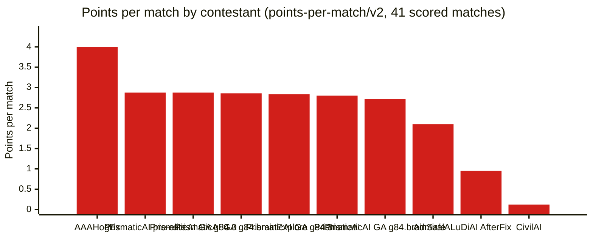
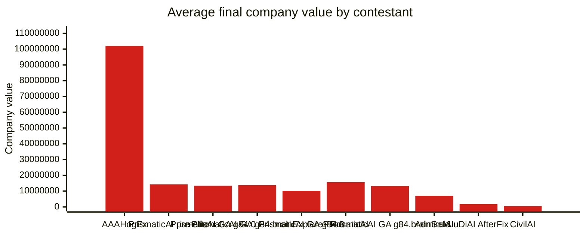
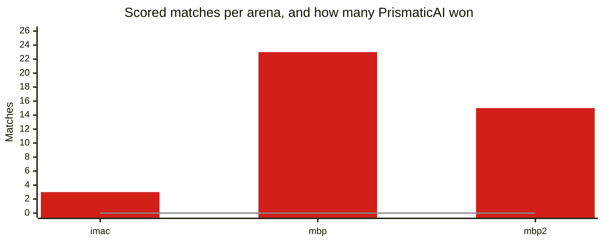

# battle-20261120T021304-935721ec

Derived from `battle-20261120T021304-935721ec.json` by `tools/research/ai-battle/battle.py report`; do not edit.

- Edition `935721ecc3cef4a6`: PrismaticAI and referee at `23775ac070fd3fe12e281f826efbf16b2bb05172`, base set `opengfx-8.0.tar`
- 20-year free-for-all from 1960, map 256x256 temperate, breakdowns 1
- 41 scored match(es) on `imac` (20261119-master-gdf1e05e7d8), `mbp` (20261120-master-ma7416470de), `mbp2` (20261119-master-gdf1e05e7d8)
- Replays: 0 of 0 identical to their original on another arena

| # | Contestant | Played | Wins | Points | Points/match | Avg rank | Avg final value | Squirrel errors | Matches with anomalies |
|---|---|---|---|---|---|---|---|---|---|
| 1 | AAAHogEx | 41 | 41 | 164 | 4.0 | 1.0 | 102.1 M | 0 | 0 |
| 2 | PrismaticAI pre-elite | 8 | 0 | 23 | 2.875 | 2.12 | 14.3 M | 0 | 0 |
| 3 | PrismaticAI GA g84.0 | 8 | 0 | 23 | 2.875 | 2.12 | 13.4 M | 0 | 0 |
| 4 | PrismaticAI GA g84.brainExplore | 7 | 0 | 20 | 2.857 | 2.14 | 13.8 M | 0 | 5 |
| 5 | PrismaticAI GA g84.3 | 6 | 0 | 17 | 2.833 | 2.17 | 10.2 M | 0 | 0 |
| 6 | PrismaticAI | 5 | 0 | 14 | 2.8 | 2.2 | 15.7 M | 0 | 0 |
| 7 | PrismaticAI GA g84.brainSafe | 7 | 0 | 19 | 2.714 | 2.29 | 13.2 M | 0 | 0 |
| 8 | AdmiralAI | 41 | 0 | 86 | 2.098 | 2.9 | 7.0 M | 57 | 1 |
| 9 | LuDiAI AfterFix | 41 | 0 | 39 | 0.951 | 4.05 | 1.8 M | 0 | 3 |
| 10 | CivilAI | 41 | 0 | 5 | 0.122 | 4.88 | 541.5 k | 0 | 10 |

```mermaid
---
config:
  xyChart:
    width: 900
    height: 360
  themeVariables:
    xyChart:
      plotColorPalette: "#d11f1a, #8a8a8a, #0b0b0b, #ece4d6"
---
xychart-beta
    title "Final company value per scored match: winner vs best PrismaticAI"
    x-axis ["m-0001", "m-0002", "m-0003", "m-0004", "m-0005", "m-0006", "m-0007", "m-0008", "m-0009", "m-0010", "m-0011", "m-0012", "m-0013", "m-0014", "m-0015", "m-0016", "m-0017", "m-0018", "m-0019", "m-0020", "m-0021", "m-0022", "m-0023", "m-0025", "m-0026", "m-0027", "m-0028", "m-0036", "m-0037", "m-0038", "m-0039", "m-0040", "m-0041", "m-0042", "m-0043", "m-0044", "m-0045", "m-0046", "m-0047", "m-0049", "m-0050"]
    %% series: Winner | Best PrismaticAI
    %% links: battle-20261120T021304-935721ec.md?col=Match&filter=m-0001 | battle-20261120T021304-935721ec.md?col=Match&filter=m-0002 | battle-20261120T021304-935721ec.md?col=Match&filter=m-0003 | battle-20261120T021304-935721ec.md?col=Match&filter=m-0004 | battle-20261120T021304-935721ec.md?col=Match&filter=m-0005 | battle-20261120T021304-935721ec.md?col=Match&filter=m-0006 | battle-20261120T021304-935721ec.md?col=Match&filter=m-0007 | battle-20261120T021304-935721ec.md?col=Match&filter=m-0008 | battle-20261120T021304-935721ec.md?col=Match&filter=m-0009 | battle-20261120T021304-935721ec.md?col=Match&filter=m-0010 | battle-20261120T021304-935721ec.md?col=Match&filter=m-0011 | battle-20261120T021304-935721ec.md?col=Match&filter=m-0012 | battle-20261120T021304-935721ec.md?col=Match&filter=m-0013 | battle-20261120T021304-935721ec.md?col=Match&filter=m-0014 | battle-20261120T021304-935721ec.md?col=Match&filter=m-0015 | battle-20261120T021304-935721ec.md?col=Match&filter=m-0016 | battle-20261120T021304-935721ec.md?col=Match&filter=m-0017 | battle-20261120T021304-935721ec.md?col=Match&filter=m-0018 | battle-20261120T021304-935721ec.md?col=Match&filter=m-0019 | battle-20261120T021304-935721ec.md?col=Match&filter=m-0020 | battle-20261120T021304-935721ec.md?col=Match&filter=m-0021 | battle-20261120T021304-935721ec.md?col=Match&filter=m-0022 | battle-20261120T021304-935721ec.md?col=Match&filter=m-0023 | battle-20261120T021304-935721ec.md?col=Match&filter=m-0025 | battle-20261120T021304-935721ec.md?col=Match&filter=m-0026 | battle-20261120T021304-935721ec.md?col=Match&filter=m-0027 | battle-20261120T021304-935721ec.md?col=Match&filter=m-0028 | battle-20261120T021304-935721ec.md?col=Match&filter=m-0036 | battle-20261120T021304-935721ec.md?col=Match&filter=m-0037 | battle-20261120T021304-935721ec.md?col=Match&filter=m-0038 | battle-20261120T021304-935721ec.md?col=Match&filter=m-0039 | battle-20261120T021304-935721ec.md?col=Match&filter=m-0040 | battle-20261120T021304-935721ec.md?col=Match&filter=m-0041 | battle-20261120T021304-935721ec.md?col=Match&filter=m-0042 | battle-20261120T021304-935721ec.md?col=Match&filter=m-0043 | battle-20261120T021304-935721ec.md?col=Match&filter=m-0044 | battle-20261120T021304-935721ec.md?col=Match&filter=m-0045 | battle-20261120T021304-935721ec.md?col=Match&filter=m-0046 | battle-20261120T021304-935721ec.md?col=Match&filter=m-0047 | battle-20261120T021304-935721ec.md?col=Match&filter=m-0049 | battle-20261120T021304-935721ec.md?col=Match&filter=m-0050
    y-axis "Company value" 0 --> 148000000
    bar [86457400, 87755905, 94389532, 103393047, 109924299, 114968085, 102763660, 105491105, 99564533, 107725626, 97236651, 88282181, 82019830, 84603358, 94301290, 109533382, 124406596, 92892664, 127871713, 106865000, 126757856, 111090441, 125613939, 107382308, 106751161, 130056532, 85396536, 78948928, 45270563, 59302265, 57350114, 75998544, 60201942, 117240599, 126027271, 122900070, 133331164, 128382007, 134806562, 112816667, 120668049]
    line [10323798, 18886422, 12123281, 15082057, 6739320, 15666972, 22328508, 20094353, 14638006, 14400400, 11095675, 6949998, 15039382, 11004301, 10413531, 12485850, 8582835, 20909962, 5376329, 18330400, 20291622, 20526818, 7843396, 3725807, 5604397, 4208045, 3276182, 11441922, 12437535, 7261673, 7382513, 9225926, 7764794, 23580010, 23955319, 15154972, 23568243, 21777201, 19256319, 21157745, 10772755]
```

<!-- battle-charts:begin -->
<!-- derived from battle-20261120T021304-935721ec.json by `battle.py render`; `battle.py check` fails when it is stale -->

<!-- battle-charts:end -->

| Match | Arena | Seed | Winner | Value | Last | Anomalies |
|---|---|---|---|---|---|---|
| m-0001 | mbp | 458619530 | AAAHogEx | 86.5 M | CivilAI | - |
| m-0002 | mbp | 458619530 | AAAHogEx | 87.8 M | CivilAI | - |
| m-0003 | mbp | 458619530 | AAAHogEx | 94.4 M | CivilAI | - |
| m-0004 | mbp | 458619530 | AAAHogEx | 103.4 M | CivilAI | PrismaticAI GA g84.brainExplore: fleet_drop:77->46 |
| m-0005 | mbp | 458619530 | AAAHogEx | 109.9 M | CivilAI | - |
| m-0006 | mbp | 799578955 | AAAHogEx | 115.0 M | CivilAI | AdmiralAI: squirrel_errors:57 |
| m-0007 | mbp | 799578955 | AAAHogEx | 102.8 M | CivilAI | CivilAI: fleet_drop:40->19 |
| m-0008 | mbp | 799578955 | AAAHogEx | 105.5 M | AdmiralAI | CivilAI: fleet_drop:66->44 |
| m-0009 | mbp | 799578955 | AAAHogEx | 99.6 M | CivilAI | - |
| m-0010 | imac | 799578955 | AAAHogEx | 107.7 M | CivilAI | PrismaticAI GA g84.brainExplore: fleet_drop:103->47 |
| m-0011 | imac | 799578955 | AAAHogEx | 97.2 M | CivilAI | - |
| m-0012 | imac | 1714453031 | AAAHogEx | 88.3 M | CivilAI | CivilAI: fleet_drop:13->8 |
| m-0013 | mbp2 | 1714453031 | AAAHogEx | 82.0 M | CivilAI | CivilAI: fleet_drop:23->13 |
| m-0014 | mbp2 | 1714453031 | AAAHogEx | 84.6 M | CivilAI | - |
| m-0015 | mbp2 | 1714453031 | AAAHogEx | 94.3 M | CivilAI | - |
| m-0016 | mbp2 | 1714453031 | AAAHogEx | 109.5 M | CivilAI | PrismaticAI GA g84.brainExplore: fleet_drop:91->59 |
| m-0017 | mbp2 | 1714453031 | AAAHogEx | 124.4 M | CivilAI | - |
| m-0018 | mbp2 | 1812624087 | AAAHogEx | 92.9 M | CivilAI | - |
| m-0019 | mbp2 | 1812624087 | AAAHogEx | 127.9 M | CivilAI | - |
| m-0020 | mbp2 | 1812624087 | AAAHogEx | 106.9 M | CivilAI | - |
| m-0021 | mbp2 | 1812624087 | AAAHogEx | 126.8 M | CivilAI | LuDiAI AfterFix: fleet_drop:136->91 |
| m-0022 | mbp2 | 1812624087 | AAAHogEx | 111.1 M | LuDiAI AfterFix | - |
| m-0023 | mbp2 | 1812624087 | AAAHogEx | 125.6 M | CivilAI | - |
| m-0025 | mbp2 | 1858914493 | AAAHogEx | 107.4 M | CivilAI | CivilAI: fleet_drop:62->16 |
| m-0026 | mbp2 | 1858914493 | AAAHogEx | 106.8 M | CivilAI | - |
| m-0027 | mbp2 | 1858914493 | AAAHogEx | 130.1 M | CivilAI | - |
| m-0028 | mbp2 | 1858914493 | AAAHogEx | 85.4 M | CivilAI | CivilAI: fleet_drop:13->7 |
| m-0036 | mbp | 1501326831 | AAAHogEx | 78.9 M | CivilAI | CivilAI: fleet_drop:26->6 |
| m-0037 | mbp | 1501326831 | AAAHogEx | 45.3 M | CivilAI | CivilAI: fleet_drop:52->34 |
| m-0038 | mbp | 1501326831 | AAAHogEx | 59.3 M | CivilAI | - |
| m-0039 | mbp | 1501326831 | AAAHogEx | 57.4 M | CivilAI | LuDiAI AfterFix: fleet_drop:132->87 |
| m-0040 | mbp | 1501326831 | AAAHogEx | 76.0 M | CivilAI | PrismaticAI GA g84.brainExplore: fleet_drop:43->28; CivilAI: fleet_drop:44->23 |
| m-0041 | mbp | 1501326831 | AAAHogEx | 60.2 M | CivilAI | - |
| m-0042 | mbp | 1554219289 | AAAHogEx | 117.2 M | CivilAI | - |
| m-0043 | mbp | 1554219289 | AAAHogEx | 126.0 M | LuDiAI AfterFix | - |
| m-0044 | mbp | 1554219289 | AAAHogEx | 122.9 M | CivilAI | - |
| m-0045 | mbp | 1554219289 | AAAHogEx | 133.3 M | CivilAI | - |
| m-0046 | mbp | 1554219289 | AAAHogEx | 128.4 M | LuDiAI AfterFix | PrismaticAI GA g84.brainExplore: fleet_drop:175->117 |
| m-0047 | mbp | 1554219289 | AAAHogEx | 134.8 M | CivilAI | - |
| m-0049 | mbp | 42158952 | AAAHogEx | 112.8 M | LuDiAI AfterFix | LuDiAI AfterFix: fleet_drop:35->24 |
| m-0050 | mbp | 42158952 | AAAHogEx | 120.7 M | CivilAI | CivilAI: fleet_drop:53->32 |
