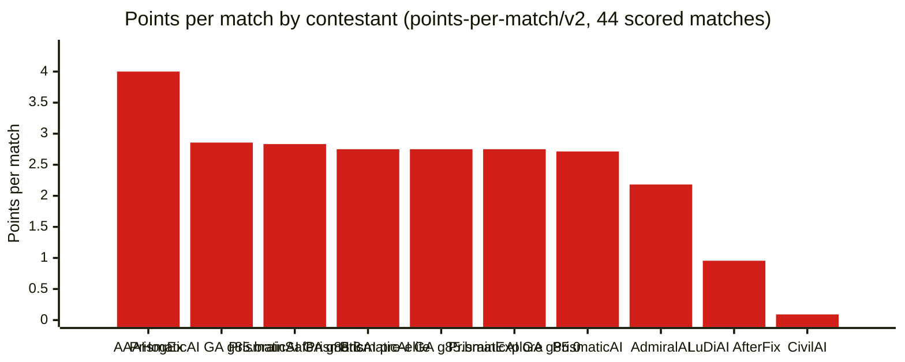
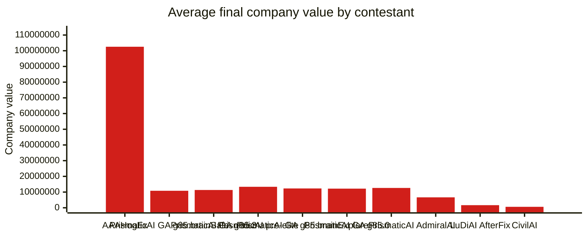
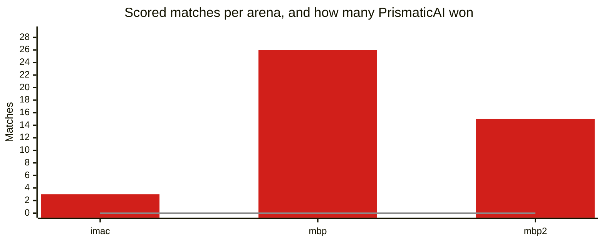

# battle-20261120T022327-aa650ee6

Derived from `battle-20261120T022327-aa650ee6.json` by `tools/research/ai-battle/battle.py report`; do not edit.

- Edition `aa650ee642bbcff9`: PrismaticAI and referee at `23775ac070fd3fe12e281f826efbf16b2bb05172`, base set `opengfx-8.0.tar`
- 20-year free-for-all from 1960, map 256x256 temperate, breakdowns 1
- 44 scored match(es) on `imac` (20261119-master-gdf1e05e7d8), `mbp` (20261120-master-ma7416470de), `mbp2` (20261119-master-gdf1e05e7d8)
- Replays: 0 of 0 identical to their original on another arena

| # | Contestant | Played | Wins | Points | Points/match | Avg rank | Avg final value | Squirrel errors | Matches with anomalies |
|---|---|---|---|---|---|---|---|---|---|
| 1 | AAAHogEx | 44 | 44 | 176 | 4.0 | 1.0 | 102.5 M | 0 | 0 |
| 2 | PrismaticAI GA g85.brainSafe | 7 | 0 | 20 | 2.857 | 2.14 | 10.8 M | 0 | 1 |
| 3 | PrismaticAI GA g85.3 | 6 | 0 | 17 | 2.833 | 2.17 | 11.3 M | 0 | 2 |
| 4 | PrismaticAI pre-elite | 8 | 0 | 22 | 2.75 | 2.25 | 13.4 M | 0 | 0 |
| 5 | PrismaticAI GA g85.brainExplore | 8 | 0 | 22 | 2.75 | 2.25 | 12.3 M | 0 | 1 |
| 6 | PrismaticAI GA g85.0 | 8 | 0 | 22 | 2.75 | 2.25 | 12.2 M | 0 | 2 |
| 7 | PrismaticAI | 7 | 0 | 19 | 2.714 | 2.29 | 12.6 M | 0 | 3 |
| 8 | AdmiralAI | 44 | 0 | 96 | 2.182 | 2.82 | 6.6 M | 0 | 1 |
| 9 | LuDiAI AfterFix | 44 | 0 | 42 | 0.955 | 4.05 | 1.7 M | 0 | 0 |
| 10 | CivilAI | 44 | 0 | 4 | 0.091 | 4.91 | 610.3 k | 3680 | 7 |

```mermaid
---
config:
  xyChart:
    width: 900
    height: 360
  themeVariables:
    xyChart:
      plotColorPalette: "#d11f1a, #8a8a8a, #0b0b0b, #ece4d6"
---
xychart-beta
    title "Final company value per scored match: winner vs best PrismaticAI"
    x-axis ["m-0001", "m-0002", "m-0003", "m-0004", "m-0005", "m-0006", "m-0007", "m-0008", "m-0009", "m-0010", "m-0011", "m-0012", "m-0013", "m-0014", "m-0015", "m-0016", "m-0017", "m-0018", "m-0019", "m-0020", "m-0022", "m-0023", "m-0024", "m-0025", "m-0026", "m-0027", "m-0028", "m-0036", "m-0037", "m-0038", "m-0039", "m-0040", "m-0041", "m-0042", "m-0043", "m-0044", "m-0045", "m-0046", "m-0047", "m-0048", "m-0049", "m-0050", "m-0051", "m-0052"]
    %% series: Winner | Best PrismaticAI
    %% links: battle-20261120T022327-aa650ee6.md?col=Match&filter=m-0001 | battle-20261120T022327-aa650ee6.md?col=Match&filter=m-0002 | battle-20261120T022327-aa650ee6.md?col=Match&filter=m-0003 | battle-20261120T022327-aa650ee6.md?col=Match&filter=m-0004 | battle-20261120T022327-aa650ee6.md?col=Match&filter=m-0005 | battle-20261120T022327-aa650ee6.md?col=Match&filter=m-0006 | battle-20261120T022327-aa650ee6.md?col=Match&filter=m-0007 | battle-20261120T022327-aa650ee6.md?col=Match&filter=m-0008 | battle-20261120T022327-aa650ee6.md?col=Match&filter=m-0009 | battle-20261120T022327-aa650ee6.md?col=Match&filter=m-0010 | battle-20261120T022327-aa650ee6.md?col=Match&filter=m-0011 | battle-20261120T022327-aa650ee6.md?col=Match&filter=m-0012 | battle-20261120T022327-aa650ee6.md?col=Match&filter=m-0013 | battle-20261120T022327-aa650ee6.md?col=Match&filter=m-0014 | battle-20261120T022327-aa650ee6.md?col=Match&filter=m-0015 | battle-20261120T022327-aa650ee6.md?col=Match&filter=m-0016 | battle-20261120T022327-aa650ee6.md?col=Match&filter=m-0017 | battle-20261120T022327-aa650ee6.md?col=Match&filter=m-0018 | battle-20261120T022327-aa650ee6.md?col=Match&filter=m-0019 | battle-20261120T022327-aa650ee6.md?col=Match&filter=m-0020 | battle-20261120T022327-aa650ee6.md?col=Match&filter=m-0022 | battle-20261120T022327-aa650ee6.md?col=Match&filter=m-0023 | battle-20261120T022327-aa650ee6.md?col=Match&filter=m-0024 | battle-20261120T022327-aa650ee6.md?col=Match&filter=m-0025 | battle-20261120T022327-aa650ee6.md?col=Match&filter=m-0026 | battle-20261120T022327-aa650ee6.md?col=Match&filter=m-0027 | battle-20261120T022327-aa650ee6.md?col=Match&filter=m-0028 | battle-20261120T022327-aa650ee6.md?col=Match&filter=m-0036 | battle-20261120T022327-aa650ee6.md?col=Match&filter=m-0037 | battle-20261120T022327-aa650ee6.md?col=Match&filter=m-0038 | battle-20261120T022327-aa650ee6.md?col=Match&filter=m-0039 | battle-20261120T022327-aa650ee6.md?col=Match&filter=m-0040 | battle-20261120T022327-aa650ee6.md?col=Match&filter=m-0041 | battle-20261120T022327-aa650ee6.md?col=Match&filter=m-0042 | battle-20261120T022327-aa650ee6.md?col=Match&filter=m-0043 | battle-20261120T022327-aa650ee6.md?col=Match&filter=m-0044 | battle-20261120T022327-aa650ee6.md?col=Match&filter=m-0045 | battle-20261120T022327-aa650ee6.md?col=Match&filter=m-0046 | battle-20261120T022327-aa650ee6.md?col=Match&filter=m-0047 | battle-20261120T022327-aa650ee6.md?col=Match&filter=m-0048 | battle-20261120T022327-aa650ee6.md?col=Match&filter=m-0049 | battle-20261120T022327-aa650ee6.md?col=Match&filter=m-0050 | battle-20261120T022327-aa650ee6.md?col=Match&filter=m-0051 | battle-20261120T022327-aa650ee6.md?col=Match&filter=m-0052
    y-axis "Company value" 0 --> 173000000
    bar [55965552, 70044489, 71613307, 47741347, 84916679, 152681346, 115127701, 117821506, 104435368, 105713979, 88914709, 104016307, 103803804, 107594025, 121397904, 92685030, 104102029, 106591293, 90356099, 105254239, 92397080, 101373730, 156855358, 127127773, 132159210, 142943857, 137797905, 77016629, 110890823, 87413295, 98153593, 85026853, 110518073, 128522011, 127120065, 136923036, 119756809, 118806581, 141694768, 74322225, 67047755, 59140757, 58580502, 69720753]
    line [15912916, 14253678, 10895605, 10331397, 3936454, 9109047, 16421240, 7439665, 10814059, 7498190, 9830958, 17262123, 12060521, 13027657, 12168880, 13516982, 9963522, 22160406, 16044668, 19235321, 20320016, 18163364, 9452266, 9130960, 5395208, 5073708, 7177136, 14525003, 17233115, 15636993, 14603802, 16755855, 17138475, 13870664, 14460434, 14856580, 14744111, 15665045, 8945158, 2002743, 5630605, 7660785, 7514805, 7204243]
```

<!-- battle-charts:begin -->
<!-- derived from battle-20261120T022327-aa650ee6.json by `battle.py render`; `battle.py check` fails when it is stale -->

<!-- battle-charts:end -->

| Match | Arena | Seed | Winner | Value | Last | Anomalies |
|---|---|---|---|---|---|---|
| m-0001 | mbp | 1792154751 | AAAHogEx | 56.0 M | CivilAI | - |
| m-0002 | mbp | 1792154751 | AAAHogEx | 70.0 M | LuDiAI AfterFix | - |
| m-0003 | mbp | 1792154751 | AAAHogEx | 71.6 M | CivilAI | AdmiralAI: fleet_drop:147->72 |
| m-0004 | mbp | 1792154751 | AAAHogEx | 47.7 M | CivilAI | PrismaticAI GA g85.brainExplore: fleet_drop:79->50 |
| m-0005 | mbp | 1792154751 | AAAHogEx | 84.9 M | CivilAI | - |
| m-0006 | mbp | 1287373767 | AAAHogEx | 152.7 M | CivilAI | PrismaticAI: fleet_drop:88->46 |
| m-0007 | mbp | 1287373767 | AAAHogEx | 115.1 M | CivilAI | - |
| m-0008 | mbp | 1287373767 | AAAHogEx | 117.8 M | CivilAI | - |
| m-0009 | mbp | 1287373767 | AAAHogEx | 104.4 M | CivilAI | PrismaticAI GA g85.brainSafe: fleet_drop:42->29 |
| m-0010 | imac | 1287373767 | AAAHogEx | 105.7 M | CivilAI | - |
| m-0011 | imac | 1287373767 | AAAHogEx | 88.9 M | CivilAI | PrismaticAI GA g85.3: fleet_drop:63->41 |
| m-0012 | imac | 982357413 | AAAHogEx | 104.0 M | CivilAI | PrismaticAI: fleet_drop:102->45 |
| m-0013 | mbp2 | 982357413 | AAAHogEx | 103.8 M | CivilAI | CivilAI: fleet_drop:35->15 |
| m-0014 | mbp2 | 982357413 | AAAHogEx | 107.6 M | CivilAI | PrismaticAI GA g85.0: fleet_drop:88->47 |
| m-0015 | mbp2 | 982357413 | AAAHogEx | 121.4 M | CivilAI | - |
| m-0016 | mbp2 | 982357413 | AAAHogEx | 92.7 M | CivilAI | - |
| m-0017 | mbp2 | 982357413 | AAAHogEx | 104.1 M | CivilAI | - |
| m-0018 | mbp2 | 394958213 | AAAHogEx | 106.6 M | CivilAI | CivilAI: squirrel_errors:3680 |
| m-0019 | mbp2 | 394958213 | AAAHogEx | 90.4 M | CivilAI | - |
| m-0020 | mbp2 | 394958213 | AAAHogEx | 105.3 M | CivilAI | - |
| m-0022 | mbp2 | 394958213 | AAAHogEx | 92.4 M | CivilAI | - |
| m-0023 | mbp2 | 394958213 | AAAHogEx | 101.4 M | LuDiAI AfterFix | - |
| m-0024 | mbp2 | 500664348 | AAAHogEx | 156.9 M | CivilAI | - |
| m-0025 | mbp2 | 500664348 | AAAHogEx | 127.1 M | CivilAI | - |
| m-0026 | mbp2 | 500664348 | AAAHogEx | 132.2 M | CivilAI | PrismaticAI GA g85.0: fleet_drop:85->42 |
| m-0027 | mbp2 | 500664348 | AAAHogEx | 142.9 M | CivilAI | - |
| m-0028 | mbp2 | 500664348 | AAAHogEx | 137.8 M | CivilAI | - |
| m-0036 | mbp | 1595378971 | AAAHogEx | 77.0 M | CivilAI | - |
| m-0037 | mbp | 1595378971 | AAAHogEx | 110.9 M | CivilAI | - |
| m-0038 | mbp | 1595378971 | AAAHogEx | 87.4 M | CivilAI | CivilAI: fleet_drop:106->47 |
| m-0039 | mbp | 1595378971 | AAAHogEx | 98.2 M | CivilAI | - |
| m-0040 | mbp | 1595378971 | AAAHogEx | 85.0 M | CivilAI | - |
| m-0041 | mbp | 1595378971 | AAAHogEx | 110.5 M | CivilAI | PrismaticAI GA g85.3: fleet_drop:69->44 |
| m-0042 | mbp | 505649347 | AAAHogEx | 128.5 M | CivilAI | PrismaticAI: fleet_drop:104->53 |
| m-0043 | mbp | 505649347 | AAAHogEx | 127.1 M | CivilAI | CivilAI: fleet_drop:12->8 |
| m-0044 | mbp | 505649347 | AAAHogEx | 136.9 M | CivilAI | CivilAI: fleet_drop:38->14 |
| m-0045 | mbp | 505649347 | AAAHogEx | 119.8 M | CivilAI | CivilAI: fleet_drop:12->8 |
| m-0046 | mbp | 505649347 | AAAHogEx | 118.8 M | CivilAI | - |
| m-0047 | mbp | 505649347 | AAAHogEx | 141.7 M | LuDiAI AfterFix | CivilAI: fleet_drop:75->42 |
| m-0048 | mbp | 46917574 | AAAHogEx | 74.3 M | CivilAI | - |
| m-0049 | mbp | 46917574 | AAAHogEx | 67.0 M | CivilAI | - |
| m-0050 | mbp | 46917574 | AAAHogEx | 59.1 M | CivilAI | - |
| m-0051 | mbp | 46917574 | AAAHogEx | 58.6 M | CivilAI | - |
| m-0052 | mbp | 46917574 | AAAHogEx | 69.7 M | LuDiAI AfterFix | - |
