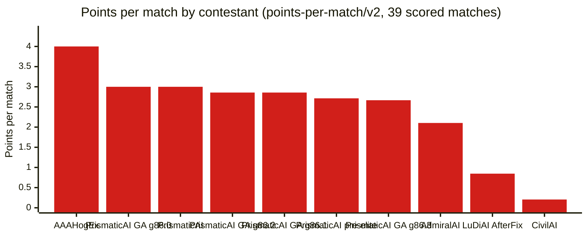
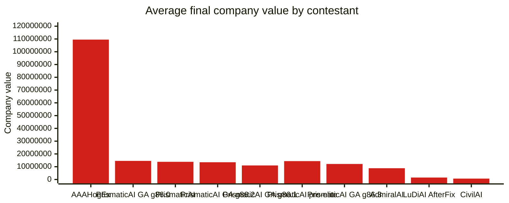
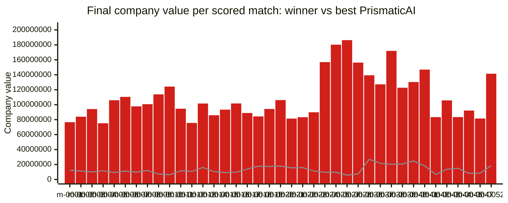
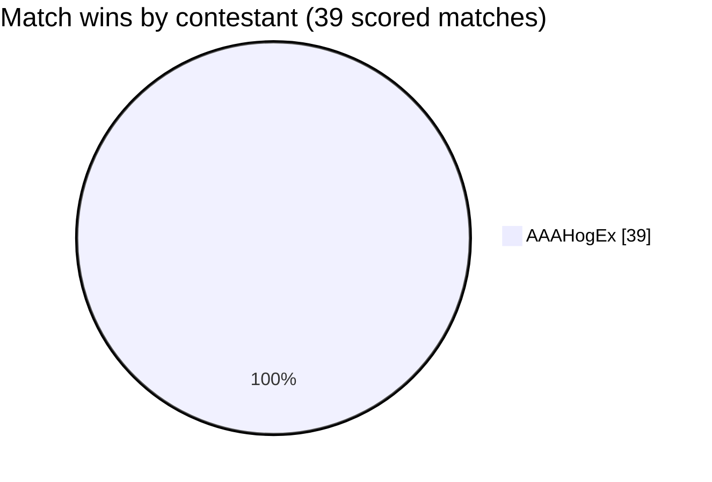
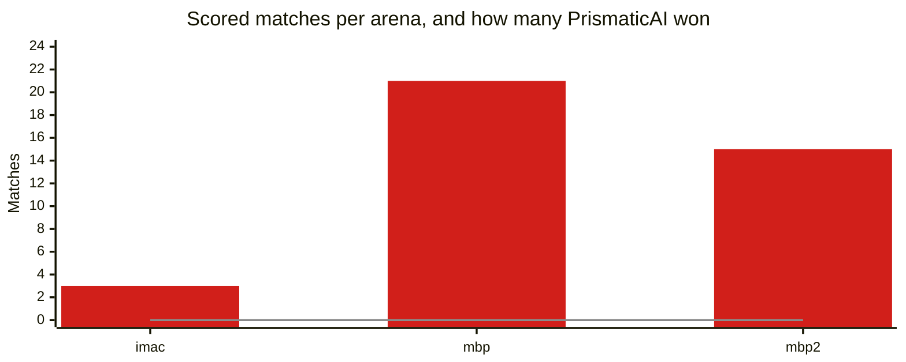

# battle-20261120T023429-a52e3ee8

Derived from `battle-20261120T023429-a52e3ee8.json` by `tools/research/ai-battle/battle.py report`; do not edit.

- Edition `a52e3ee81bc7d469`: PrismaticAI and referee at `23775ac070fd3fe12e281f826efbf16b2bb05172`, base set `opengfx-8.0.tar`
- 20-year free-for-all from 1960, map 256x256 temperate, breakdowns 1
- 39 scored match(es) on `imac` (20261119-master-gdf1e05e7d8), `mbp` (20261120-master-ma7416470de), `mbp2` (20261119-master-gdf1e05e7d8)
- Replays: 0 of 1 identical to their original on another arena

| # | Contestant | Played | Wins | Points | Points/match | Avg rank | Avg final value | Squirrel errors | Matches with anomalies |
|---|---|---|---|---|---|---|---|---|---|
| 1 | AAAHogEx | 39 | 39 | 156 | 4.0 | 1.0 | 109.5 M | 0 | 0 |
| 2 | PrismaticAI GA g86.0 | 6 | 0 | 18 | 3.0 | 2.0 | 14.6 M | 0 | 0 |
| 3 | PrismaticAI | 6 | 0 | 18 | 3.0 | 2.0 | 13.8 M | 0 | 1 |
| 4 | PrismaticAI GA g86.2 | 7 | 0 | 20 | 2.857 | 2.14 | 13.5 M | 0 | 0 |
| 5 | PrismaticAI GA g86.1 | 7 | 0 | 20 | 2.857 | 2.14 | 11.0 M | 0 | 1 |
| 6 | PrismaticAI pre-elite | 7 | 0 | 19 | 2.714 | 2.29 | 14.4 M | 0 | 0 |
| 7 | PrismaticAI GA g86.3 | 6 | 0 | 16 | 2.667 | 2.33 | 12.1 M | 0 | 0 |
| 8 | AdmiralAI | 39 | 0 | 82 | 2.103 | 2.9 | 8.8 M | 0 | 1 |
| 9 | LuDiAI AfterFix | 39 | 0 | 33 | 0.846 | 4.15 | 1.5 M | 0 | 2 |
| 10 | CivilAI | 39 | 0 | 8 | 0.205 | 4.79 | 692.6 k | 0 | 5 |

<!-- battle-charts:begin -->
<!-- derived from battle-20261120T023429-a52e3ee8.json by `battle.py render`; `battle.py check` fails when it is stale -->

<!-- battle-charts:end -->

| Seed | Original | Replay | Arenas | Identical |
|---|---|---|---|---|
| 1045185957 | m-0011 | m-0048 | imac / mbp | NO |

| Match | Arena | Seed | Winner | Value | Last | Anomalies |
|---|---|---|---|---|---|---|
| m-0001 | mbp | 1106233669 | AAAHogEx | 76.6 M | CivilAI | - |
| m-0002 | mbp | 1106233669 | AAAHogEx | 84.0 M | CivilAI | CivilAI: fleet_drop:62->35 |
| m-0003 | mbp | 1106233669 | AAAHogEx | 94.2 M | CivilAI | - |
| m-0004 | mbp | 1106233669 | AAAHogEx | 75.2 M | CivilAI | - |
| m-0005 | mbp | 1106233669 | AAAHogEx | 106.0 M | CivilAI | - |
| m-0006 | mbp | 1045185957 | AAAHogEx | 110.5 M | CivilAI | CivilAI: fleet_drop:56->26 |
| m-0007 | mbp | 1045185957 | AAAHogEx | 97.8 M | CivilAI | - |
| m-0008 | mbp | 1045185957 | AAAHogEx | 100.7 M | CivilAI | - |
| m-0009 | mbp | 1045185957 | AAAHogEx | 113.8 M | CivilAI | - |
| m-0010 | imac | 1045185957 | AAAHogEx | 124.2 M | LuDiAI AfterFix | - |
| m-0011 | imac | 1045185957 | AAAHogEx | 94.6 M | CivilAI | - |
| m-0012 | imac | 273564283 | AAAHogEx | 75.6 M | LuDiAI AfterFix | PrismaticAI: fleet_drop:101->66 |
| m-0013 | mbp2 | 273564283 | AAAHogEx | 101.6 M | CivilAI | LuDiAI AfterFix: fleet_drop:55->32 |
| m-0014 | mbp2 | 273564283 | AAAHogEx | 85.9 M | LuDiAI AfterFix | - |
| m-0015 | mbp2 | 273564283 | AAAHogEx | 93.4 M | LuDiAI AfterFix | - |
| m-0016 | mbp2 | 273564283 | AAAHogEx | 101.7 M | LuDiAI AfterFix | - |
| m-0017 | mbp2 | 273564283 | AAAHogEx | 88.9 M | CivilAI | LuDiAI AfterFix: fleet_drop:28->15 |
| m-0018 | mbp2 | 18905754 | AAAHogEx | 84.3 M | CivilAI | - |
| m-0019 | mbp2 | 18905754 | AAAHogEx | 94.3 M | CivilAI | - |
| m-0020 | mbp2 | 18905754 | AAAHogEx | 106.2 M | CivilAI | - |
| m-0021 | mbp2 | 18905754 | AAAHogEx | 81.5 M | LuDiAI AfterFix | - |
| m-0022 | mbp2 | 18905754 | AAAHogEx | 83.3 M | CivilAI | - |
| m-0023 | mbp2 | 18905754 | AAAHogEx | 89.9 M | CivilAI | - |
| m-0024 | mbp2 | 778157419 | AAAHogEx | 157.0 M | CivilAI | - |
| m-0025 | mbp2 | 778157419 | AAAHogEx | 180.3 M | CivilAI | AdmiralAI: fleet_drop:270->182 |
| m-0027 | mbp2 | 778157419 | AAAHogEx | 186.4 M | CivilAI | PrismaticAI GA g86.1: fleet_drop:176->88 |
| m-0028 | mbp2 | 778157419 | AAAHogEx | 156.3 M | CivilAI | - |
| m-0036 | mbp | 292371094 | AAAHogEx | 139.4 M | CivilAI | - |
| m-0037 | mbp | 292371094 | AAAHogEx | 127.2 M | CivilAI | - |
| m-0038 | mbp | 292371094 | AAAHogEx | 172.0 M | LuDiAI AfterFix | CivilAI: fleet_drop:55->16 |
| m-0039 | mbp | 292371094 | AAAHogEx | 122.7 M | CivilAI | CivilAI: fleet_drop:15->10 |
| m-0040 | mbp | 292371094 | AAAHogEx | 130.3 M | CivilAI | - |
| m-0041 | mbp | 292371094 | AAAHogEx | 147.0 M | CivilAI | - |
| m-0042 | mbp | 1860553096 | AAAHogEx | 83.4 M | CivilAI | - |
| m-0043 | mbp | 1860553096 | AAAHogEx | 105.8 M | CivilAI | - |
| m-0044 | mbp | 1860553096 | AAAHogEx | 83.5 M | CivilAI | - |
| m-0045 | mbp | 1860553096 | AAAHogEx | 92.2 M | CivilAI | CivilAI: no_vehicles |
| m-0047 | mbp | 1860553096 | AAAHogEx | 81.5 M | CivilAI | - |
| m-0048 (replay) | mbp | 1045185957 | AAAHogEx | 92.6 M | CivilAI | - |
| m-0052 | mbp | 1599410790 | AAAHogEx | 141.4 M | AdmiralAI | - |
