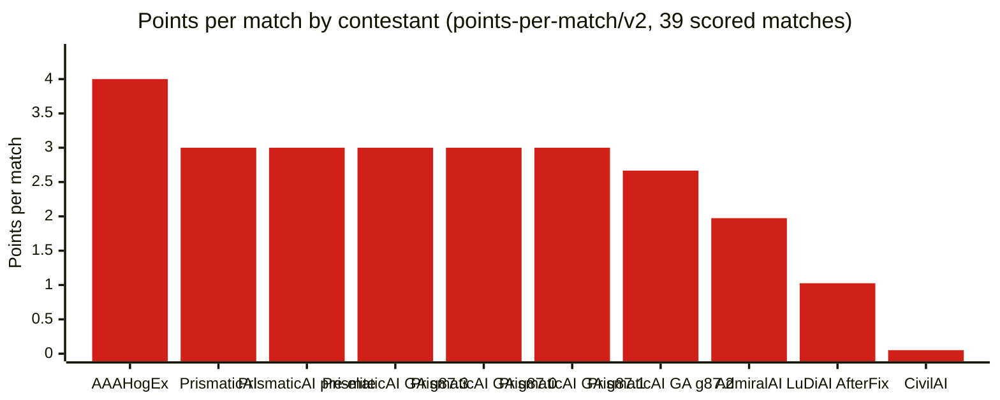
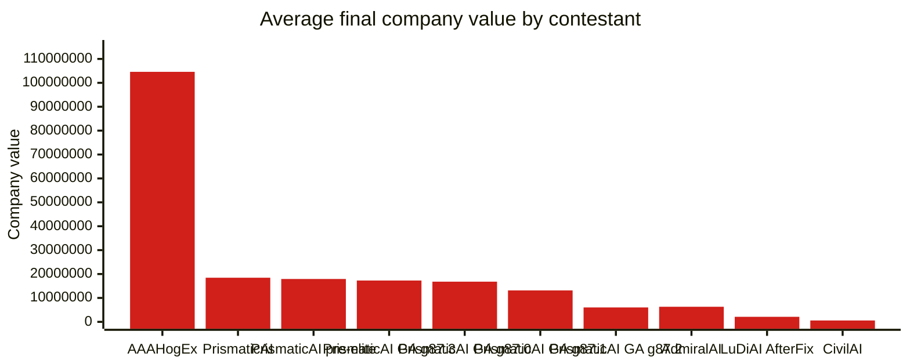
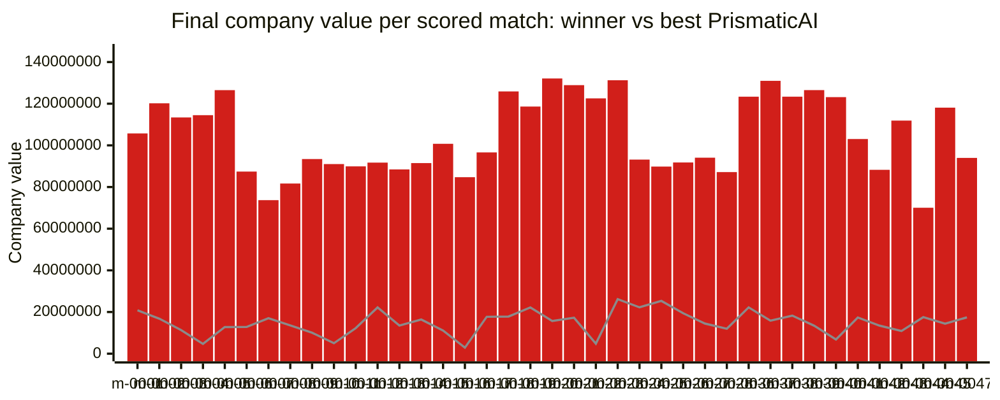
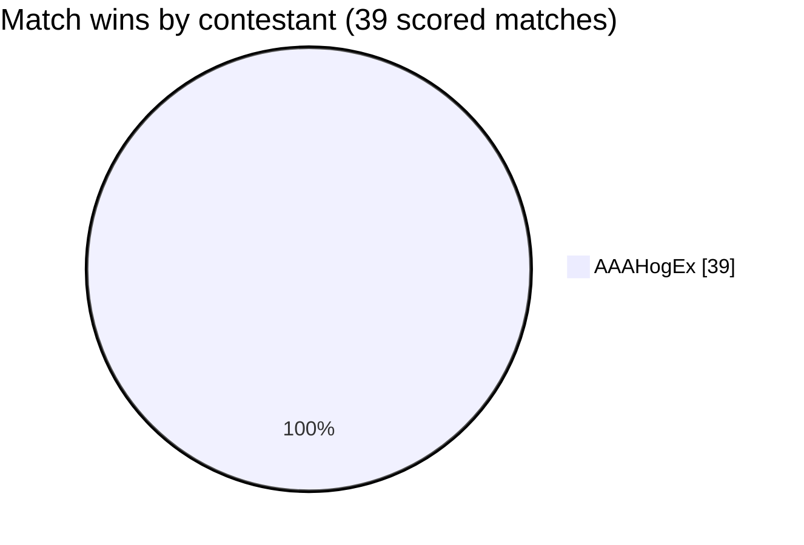
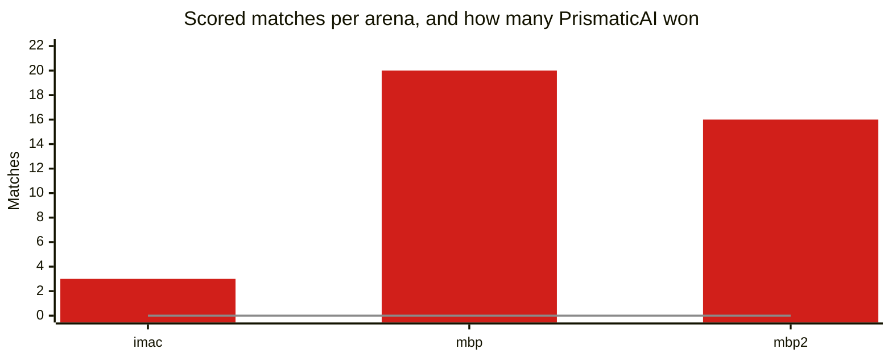

# battle-20261120T024519-a0aa2682

Derived from `battle-20261120T024519-a0aa2682.json` by `tools/research/ai-battle/battle.py report`; do not edit.

- Edition `a0aa2682b7c8e466`: PrismaticAI and referee at `23775ac070fd3fe12e281f826efbf16b2bb05172`, base set `opengfx-8.0.tar`
- 20-year free-for-all from 1960, map 256x256 temperate, breakdowns 1
- 39 scored match(es) on `imac` (20261119-master-gdf1e05e7d8), `mbp` (20261120-master-ma7416470de), `mbp2` (20261119-master-gdf1e05e7d8)
- Replays: 0 of 0 identical to their original on another arena

| # | Contestant | Played | Wins | Points | Points/match | Avg rank | Avg final value | Squirrel errors | Matches with anomalies |
|---|---|---|---|---|---|---|---|---|---|
| 1 | AAAHogEx | 39 | 39 | 156 | 4.0 | 1.0 | 104.6 M | 0 | 0 |
| 2 | PrismaticAI | 6 | 0 | 18 | 3.0 | 2.0 | 18.5 M | 0 | 1 |
| 3 | PrismaticAI pre-elite | 7 | 0 | 21 | 3.0 | 2.0 | 17.9 M | 0 | 0 |
| 4 | PrismaticAI GA g87.3 | 6 | 0 | 18 | 3.0 | 2.0 | 17.3 M | 0 | 0 |
| 5 | PrismaticAI GA g87.0 | 7 | 0 | 21 | 3.0 | 2.0 | 16.8 M | 0 | 0 |
| 6 | PrismaticAI GA g87.1 | 7 | 0 | 21 | 3.0 | 2.0 | 13.1 M | 0 | 3 |
| 7 | PrismaticAI GA g87.2 | 6 | 0 | 16 | 2.667 | 2.33 | 6.0 M | 0 | 0 |
| 8 | AdmiralAI | 39 | 0 | 77 | 1.974 | 3.03 | 6.3 M | 72 | 3 |
| 9 | LuDiAI AfterFix | 39 | 0 | 40 | 1.026 | 3.97 | 2.1 M | 0 | 0 |
| 10 | CivilAI | 39 | 0 | 2 | 0.051 | 4.95 | 567.8 k | 0 | 6 |

<!-- battle-charts:begin -->
<!-- derived from battle-20261120T024519-a0aa2682.json by `battle.py render`; `battle.py check` fails when it is stale -->

<!-- battle-charts:end -->

| Match | Arena | Seed | Winner | Value | Last | Anomalies |
|---|---|---|---|---|---|---|
| m-0001 | mbp | 290108072 | AAAHogEx | 105.7 M | CivilAI | - |
| m-0002 | mbp | 290108072 | AAAHogEx | 120.2 M | CivilAI | - |
| m-0003 | mbp | 290108072 | AAAHogEx | 113.4 M | CivilAI | - |
| m-0004 | mbp | 290108072 | AAAHogEx | 114.5 M | CivilAI | - |
| m-0005 | mbp | 290108072 | AAAHogEx | 126.5 M | CivilAI | - |
| m-0006 | mbp | 1638425079 | AAAHogEx | 87.4 M | CivilAI | - |
| m-0007 | mbp | 1638425079 | AAAHogEx | 73.7 M | CivilAI | - |
| m-0008 | mbp | 1638425079 | AAAHogEx | 81.7 M | CivilAI | - |
| m-0009 | mbp | 1638425079 | AAAHogEx | 93.4 M | CivilAI | PrismaticAI GA g87.1: fleet_drop:86->59 |
| m-0010 | imac | 1638425079 | AAAHogEx | 91.0 M | CivilAI | CivilAI: fleet_drop:13->9 |
| m-0011 | imac | 1638425079 | AAAHogEx | 89.9 M | CivilAI | - |
| m-0012 | imac | 1010100429 | AAAHogEx | 91.7 M | CivilAI | CivilAI: fleet_drop:56->38 |
| m-0013 | mbp2 | 1010100429 | AAAHogEx | 88.4 M | CivilAI | - |
| m-0014 | mbp2 | 1010100429 | AAAHogEx | 91.5 M | CivilAI | - |
| m-0015 | mbp2 | 1010100429 | AAAHogEx | 100.7 M | CivilAI | PrismaticAI GA g87.1: fleet_drop:95->61; CivilAI: fleet_drop:59->38 |
| m-0016 | mbp2 | 1010100429 | AAAHogEx | 84.7 M | CivilAI | - |
| m-0017 | mbp2 | 1010100429 | AAAHogEx | 96.6 M | CivilAI | CivilAI: fleet_drop:49->21 |
| m-0018 | mbp2 | 339925815 | AAAHogEx | 125.9 M | CivilAI | PrismaticAI: fleet_drop:117->69 |
| m-0019 | mbp2 | 339925815 | AAAHogEx | 118.6 M | CivilAI | - |
| m-0020 | mbp2 | 339925815 | AAAHogEx | 132.1 M | CivilAI | - |
| m-0021 | mbp2 | 339925815 | AAAHogEx | 128.9 M | CivilAI | - |
| m-0022 | mbp2 | 339925815 | AAAHogEx | 122.6 M | CivilAI | - |
| m-0023 | mbp2 | 339925815 | AAAHogEx | 131.3 M | CivilAI | - |
| m-0024 | mbp2 | 1305737621 | AAAHogEx | 93.2 M | CivilAI | CivilAI: fleet_drop:48->32 |
| m-0025 | mbp2 | 1305737621 | AAAHogEx | 89.8 M | LuDiAI AfterFix | - |
| m-0026 | mbp2 | 1305737621 | AAAHogEx | 91.8 M | LuDiAI AfterFix | - |
| m-0027 | mbp2 | 1305737621 | AAAHogEx | 94.1 M | CivilAI | - |
| m-0028 | mbp2 | 1305737621 | AAAHogEx | 87.2 M | CivilAI | - |
| m-0036 | mbp | 1531718479 | AAAHogEx | 123.4 M | CivilAI | - |
| m-0037 | mbp | 1531718479 | AAAHogEx | 131.0 M | CivilAI | - |
| m-0038 | mbp | 1531718479 | AAAHogEx | 123.4 M | CivilAI | CivilAI: fleet_drop:21->10 |
| m-0039 | mbp | 1531718479 | AAAHogEx | 126.5 M | CivilAI | PrismaticAI GA g87.1: fleet_drop:97->65 |
| m-0040 | mbp | 1531718479 | AAAHogEx | 123.2 M | CivilAI | - |
| m-0041 | mbp | 1531718479 | AAAHogEx | 103.0 M | CivilAI | - |
| m-0042 | mbp | 1245561282 | AAAHogEx | 88.3 M | CivilAI | AdmiralAI: fleet_drop:180->115 |
| m-0043 | mbp | 1245561282 | AAAHogEx | 111.9 M | CivilAI | - |
| m-0044 | mbp | 1245561282 | AAAHogEx | 70.1 M | CivilAI | - |
| m-0045 | mbp | 1245561282 | AAAHogEx | 118.1 M | CivilAI | AdmiralAI: squirrel_errors:72 |
| m-0047 | mbp | 1245561282 | AAAHogEx | 94.0 M | CivilAI | AdmiralAI: fleet_drop:287->187 |
