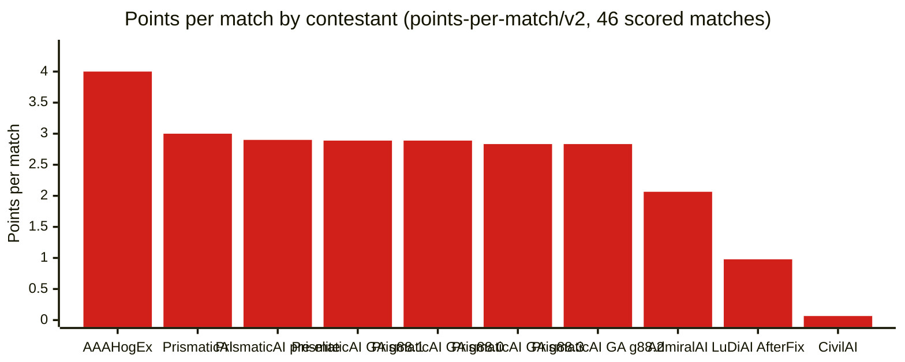
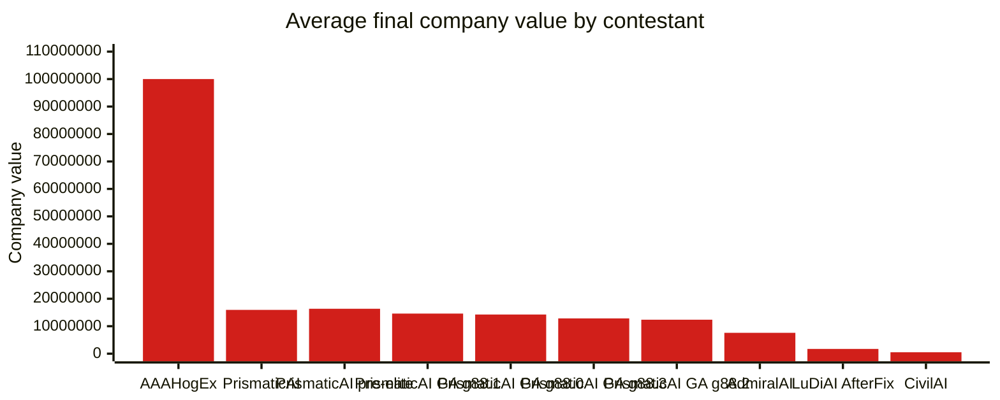
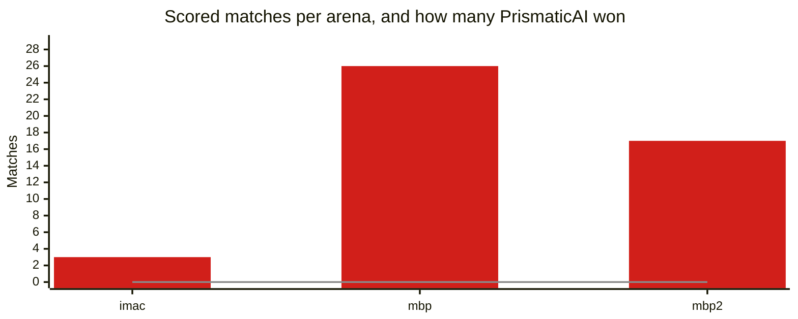

# battle-20261120T025728-1a5295a7

Derived from `battle-20261120T025728-1a5295a7.json` by `tools/research/ai-battle/battle.py report`; do not edit.

- Edition `1a5295a79221e9fc`: PrismaticAI and referee at `23775ac070fd3fe12e281f826efbf16b2bb05172`, base set `opengfx-8.0.tar`
- 20-year free-for-all from 1960, map 256x256 temperate, breakdowns 1
- 46 scored match(es) on `imac` (20261119-master-gdf1e05e7d8), `mbp` (20261120-master-ma7416470de), `mbp2` (20261119-master-gdf1e05e7d8)
- Replays: 0 of 1 identical to their original on another arena

| # | Contestant | Played | Wins | Points | Points/match | Avg rank | Avg final value | Squirrel errors | Matches with anomalies |
|---|---|---|---|---|---|---|---|---|---|
| 1 | AAAHogEx | 46 | 46 | 184 | 4.0 | 1.0 | 100.0 M | 0 | 0 |
| 2 | PrismaticAI | 6 | 0 | 18 | 3.0 | 2.0 | 15.9 M | 0 | 3 |
| 3 | PrismaticAI pre-elite | 10 | 0 | 29 | 2.9 | 2.1 | 16.4 M | 0 | 0 |
| 4 | PrismaticAI GA g88.1 | 9 | 0 | 26 | 2.889 | 2.11 | 14.6 M | 0 | 1 |
| 5 | PrismaticAI GA g88.0 | 9 | 0 | 26 | 2.889 | 2.11 | 14.3 M | 0 | 1 |
| 6 | PrismaticAI GA g88.3 | 6 | 0 | 17 | 2.833 | 2.17 | 12.8 M | 0 | 4 |
| 7 | PrismaticAI GA g88.2 | 6 | 0 | 17 | 2.833 | 2.17 | 12.4 M | 0 | 1 |
| 8 | AdmiralAI | 46 | 0 | 95 | 2.065 | 2.93 | 7.6 M | 47 | 4 |
| 9 | LuDiAI AfterFix | 46 | 0 | 45 | 0.978 | 4.02 | 1.7 M | 0 | 2 |
| 10 | CivilAI | 46 | 0 | 3 | 0.065 | 4.93 | 508.5 k | 0 | 7 |

```mermaid
---
config:
  xyChart:
    width: 900
    height: 360
  themeVariables:
    xyChart:
      plotColorPalette: "#d11f1a, #8a8a8a, #0b0b0b, #ece4d6"
---
xychart-beta
    title "Final company value per scored match: winner vs best PrismaticAI"
    x-axis ["m-0001", "m-0002", "m-0003", "m-0004", "m-0005", "m-0006", "m-0007", "m-0008", "m-0009", "m-0010", "m-0011", "m-0012", "m-0013", "m-0014", "m-0015", "m-0016", "m-0017", "m-0018", "m-0019", "m-0020", "m-0021", "m-0022", "m-0023", "m-0024", "m-0025", "m-0026", "m-0027", "m-0028", "m-0036", "m-0037", "m-0038", "m-0039", "m-0040", "m-0041", "m-0042", "m-0043", "m-0044", "m-0045", "m-0053", "m-0055", "m-0057", "m-0061", "m-0062", "m-0063", "m-0067", "m-0068"]
    %% series: Winner | Best PrismaticAI
    %% links: battle-20261120T025728-1a5295a7.md?col=Match&filter=m-0001 | battle-20261120T025728-1a5295a7.md?col=Match&filter=m-0002 | battle-20261120T025728-1a5295a7.md?col=Match&filter=m-0003 | battle-20261120T025728-1a5295a7.md?col=Match&filter=m-0004 | battle-20261120T025728-1a5295a7.md?col=Match&filter=m-0005 | battle-20261120T025728-1a5295a7.md?col=Match&filter=m-0006 | battle-20261120T025728-1a5295a7.md?col=Match&filter=m-0007 | battle-20261120T025728-1a5295a7.md?col=Match&filter=m-0008 | battle-20261120T025728-1a5295a7.md?col=Match&filter=m-0009 | battle-20261120T025728-1a5295a7.md?col=Match&filter=m-0010 | battle-20261120T025728-1a5295a7.md?col=Match&filter=m-0011 | battle-20261120T025728-1a5295a7.md?col=Match&filter=m-0012 | battle-20261120T025728-1a5295a7.md?col=Match&filter=m-0013 | battle-20261120T025728-1a5295a7.md?col=Match&filter=m-0014 | battle-20261120T025728-1a5295a7.md?col=Match&filter=m-0015 | battle-20261120T025728-1a5295a7.md?col=Match&filter=m-0016 | battle-20261120T025728-1a5295a7.md?col=Match&filter=m-0017 | battle-20261120T025728-1a5295a7.md?col=Match&filter=m-0018 | battle-20261120T025728-1a5295a7.md?col=Match&filter=m-0019 | battle-20261120T025728-1a5295a7.md?col=Match&filter=m-0020 | battle-20261120T025728-1a5295a7.md?col=Match&filter=m-0021 | battle-20261120T025728-1a5295a7.md?col=Match&filter=m-0022 | battle-20261120T025728-1a5295a7.md?col=Match&filter=m-0023 | battle-20261120T025728-1a5295a7.md?col=Match&filter=m-0024 | battle-20261120T025728-1a5295a7.md?col=Match&filter=m-0025 | battle-20261120T025728-1a5295a7.md?col=Match&filter=m-0026 | battle-20261120T025728-1a5295a7.md?col=Match&filter=m-0027 | battle-20261120T025728-1a5295a7.md?col=Match&filter=m-0028 | battle-20261120T025728-1a5295a7.md?col=Match&filter=m-0036 | battle-20261120T025728-1a5295a7.md?col=Match&filter=m-0037 | battle-20261120T025728-1a5295a7.md?col=Match&filter=m-0038 | battle-20261120T025728-1a5295a7.md?col=Match&filter=m-0039 | battle-20261120T025728-1a5295a7.md?col=Match&filter=m-0040 | battle-20261120T025728-1a5295a7.md?col=Match&filter=m-0041 | battle-20261120T025728-1a5295a7.md?col=Match&filter=m-0042 | battle-20261120T025728-1a5295a7.md?col=Match&filter=m-0043 | battle-20261120T025728-1a5295a7.md?col=Match&filter=m-0044 | battle-20261120T025728-1a5295a7.md?col=Match&filter=m-0045 | battle-20261120T025728-1a5295a7.md?col=Match&filter=m-0053 | battle-20261120T025728-1a5295a7.md?col=Match&filter=m-0055 | battle-20261120T025728-1a5295a7.md?col=Match&filter=m-0057 | battle-20261120T025728-1a5295a7.md?col=Match&filter=m-0061 | battle-20261120T025728-1a5295a7.md?col=Match&filter=m-0062 | battle-20261120T025728-1a5295a7.md?col=Match&filter=m-0063 | battle-20261120T025728-1a5295a7.md?col=Match&filter=m-0067 | battle-20261120T025728-1a5295a7.md?col=Match&filter=m-0068
    y-axis "Company value" 0 --> 171000000
    bar [87442735, 105348433, 67193917, 77137143, 98556711, 78842071, 72196488, 89815787, 74582835, 65871204, 81683146, 114408504, 140387696, 130166415, 128898987, 102582408, 112063334, 111223002, 122124732, 110418021, 104485407, 111917104, 127598205, 71521903, 80325740, 66177233, 60329667, 77738723, 123604911, 125301747, 108430295, 116289205, 97493199, 108855961, 89149659, 109150819, 69892139, 93619078, 78543040, 98626090, 111640964, 94658226, 102367625, 104146519, 155500482, 141967177]
    line [14678187, 10601205, 14765737, 11620540, 11889606, 15243375, 18209625, 11011849, 12277867, 10755627, 10851442, 12446308, 7560582, 4544793, 5647232, 10680890, 10295951, 11760830, 16672141, 13629662, 8577765, 16098252, 12324696, 15213074, 12334062, 9074967, 16527619, 13299879, 20318539, 21507098, 22507387, 24983698, 11758311, 19794269, 20676184, 24377891, 14081881, 13662874, 11895908, 14063440, 17303944, 17408613, 16475499, 17628378, 16717317, 26384442]
```

<!-- battle-charts:begin -->
<!-- derived from battle-20261120T025728-1a5295a7.json by `battle.py render`; `battle.py check` fails when it is stale -->

<!-- battle-charts:end -->

| Seed | Original | Replay | Arenas | Identical |
|---|---|---|---|---|
| 1207180488 | m-0010 | m-0056 | imac / mbp | NO |

| Match | Arena | Seed | Winner | Value | Last | Anomalies |
|---|---|---|---|---|---|---|
| m-0001 | mbp | 1009687143 | AAAHogEx | 87.4 M | CivilAI | - |
| m-0002 | mbp | 1009687143 | AAAHogEx | 105.3 M | CivilAI | PrismaticAI GA g88.0: fleet_drop:32->22 |
| m-0003 | mbp | 1009687143 | AAAHogEx | 67.2 M | CivilAI | PrismaticAI GA g88.1: fleet_drop:127->77 |
| m-0004 | mbp | 1009687143 | AAAHogEx | 77.1 M | CivilAI | - |
| m-0005 | mbp | 1009687143 | AAAHogEx | 98.6 M | CivilAI | PrismaticAI GA g88.3: fleet_drop:46->28 |
| m-0006 | mbp | 1207180488 | AAAHogEx | 78.8 M | CivilAI | PrismaticAI: fleet_drop:100->48 |
| m-0007 | mbp | 1207180488 | AAAHogEx | 72.2 M | CivilAI | - |
| m-0008 | mbp | 1207180488 | AAAHogEx | 89.8 M | CivilAI | - |
| m-0009 | mbp | 1207180488 | AAAHogEx | 74.6 M | CivilAI | - |
| m-0010 | imac | 1207180488 | AAAHogEx | 65.9 M | CivilAI | - |
| m-0011 | imac | 1207180488 | AAAHogEx | 81.7 M | CivilAI | PrismaticAI GA g88.3: fleet_drop:62->42 |
| m-0012 | imac | 200075477 | AAAHogEx | 114.4 M | CivilAI | PrismaticAI: fleet_drop:114->55 |
| m-0013 | mbp2 | 200075477 | AAAHogEx | 140.4 M | CivilAI | - |
| m-0014 | mbp2 | 200075477 | AAAHogEx | 130.2 M | LuDiAI AfterFix | CivilAI: fleet_drop:28->18; LuDiAI AfterFix: fleet_drop:31->18 |
| m-0015 | mbp2 | 200075477 | AAAHogEx | 128.9 M | LuDiAI AfterFix | - |
| m-0016 | mbp2 | 200075477 | AAAHogEx | 102.6 M | CivilAI | - |
| m-0017 | mbp2 | 200075477 | AAAHogEx | 112.1 M | CivilAI | PrismaticAI GA g88.3: fleet_drop:62->38 |
| m-0018 | mbp2 | 202819829 | AAAHogEx | 111.2 M | LuDiAI AfterFix | PrismaticAI: fleet_drop:90->43; LuDiAI AfterFix: fleet_drop:20->6 |
| m-0019 | mbp2 | 202819829 | AAAHogEx | 122.1 M | CivilAI | - |
| m-0020 | mbp2 | 202819829 | AAAHogEx | 110.4 M | CivilAI | - |
| m-0021 | mbp2 | 202819829 | AAAHogEx | 104.5 M | CivilAI | CivilAI: no_vehicles |
| m-0022 | mbp2 | 202819829 | AAAHogEx | 111.9 M | CivilAI | PrismaticAI GA g88.2: fleet_drop:54->36 |
| m-0023 | mbp2 | 202819829 | AAAHogEx | 127.6 M | CivilAI | PrismaticAI GA g88.3: fleet_drop:54->34 |
| m-0024 | mbp2 | 1814914469 | AAAHogEx | 71.5 M | CivilAI | - |
| m-0025 | mbp2 | 1814914469 | AAAHogEx | 80.3 M | CivilAI | AdmiralAI: squirrel_errors:47 |
| m-0026 | mbp2 | 1814914469 | AAAHogEx | 66.2 M | CivilAI | - |
| m-0027 | mbp2 | 1814914469 | AAAHogEx | 60.3 M | CivilAI | - |
| m-0028 | mbp2 | 1814914469 | AAAHogEx | 77.7 M | CivilAI | AdmiralAI: fleet_drop:217->136 |
| m-0036 | mbp | 1008125334 | AAAHogEx | 123.6 M | CivilAI | - |
| m-0037 | mbp | 1008125334 | AAAHogEx | 125.3 M | CivilAI | CivilAI: fleet_drop:66->42 |
| m-0038 | mbp | 1008125334 | AAAHogEx | 108.4 M | CivilAI | - |
| m-0039 | mbp | 1008125334 | AAAHogEx | 116.3 M | CivilAI | AdmiralAI: fleet_drop:215->140 |
| m-0040 | mbp | 1008125334 | AAAHogEx | 97.5 M | CivilAI | - |
| m-0041 | mbp | 1008125334 | AAAHogEx | 108.9 M | CivilAI | - |
| m-0042 | mbp | 186077757 | AAAHogEx | 89.1 M | CivilAI | - |
| m-0043 | mbp | 186077757 | AAAHogEx | 109.2 M | CivilAI | - |
| m-0044 | mbp | 186077757 | AAAHogEx | 69.9 M | CivilAI | - |
| m-0045 | mbp | 186077757 | AAAHogEx | 93.6 M | CivilAI | CivilAI: fleet_drop:71->38 |
| m-0053 | mbp2 | 289913368 | AAAHogEx | 78.5 M | CivilAI | CivilAI: fleet_drop:26->12 |
| m-0055 | mbp | 1304600684 | AAAHogEx | 98.6 M | CivilAI | - |
| m-0056 (replay) | mbp | 1207180488 | AAAHogEx | 61.8 M | CivilAI | - |
| m-0057 | mbp | 1304600684 | AAAHogEx | 111.6 M | CivilAI | - |
| m-0061 | mbp | 367051219 | AAAHogEx | 94.7 M | CivilAI | - |
| m-0062 | mbp | 367051219 | AAAHogEx | 102.4 M | CivilAI | CivilAI: no_vehicles |
| m-0063 | mbp | 367051219 | AAAHogEx | 104.1 M | CivilAI | CivilAI: fleet_drop:12->6 |
| m-0067 | mbp | 8938877 | AAAHogEx | 155.5 M | CivilAI | - |
| m-0068 | mbp | 8938877 | AAAHogEx | 142.0 M | CivilAI | AdmiralAI: fleet_drop:285->194 |
