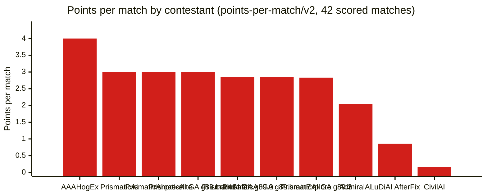
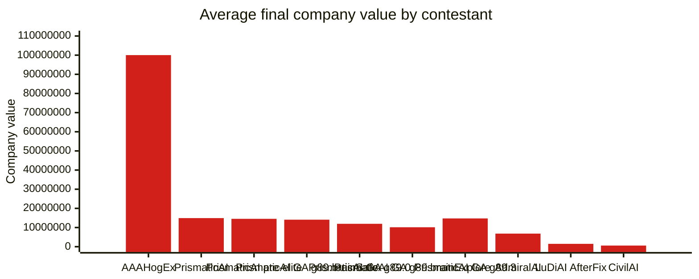
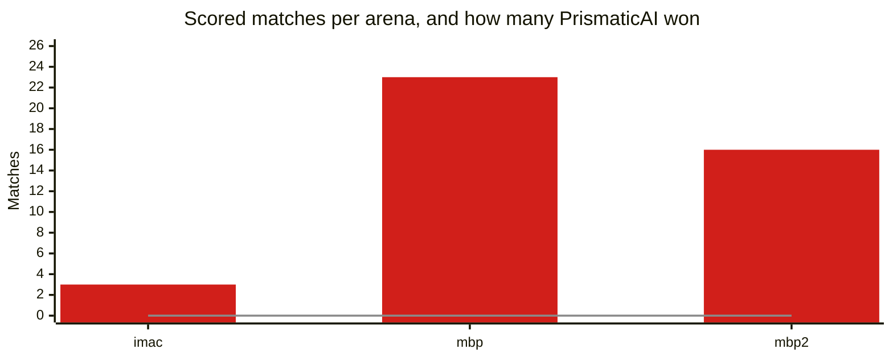

# battle-20261120T030832-0490dbe4

Derived from `battle-20261120T030832-0490dbe4.json` by `tools/research/ai-battle/battle.py report`; do not edit.

- Edition `0490dbe4ede0353b`: PrismaticAI and referee at `23775ac070fd3fe12e281f826efbf16b2bb05172`, base set `opengfx-8.0.tar`
- 20-year free-for-all from 1960, map 256x256 temperate, breakdowns 1
- 42 scored match(es) on `imac` (20261119-master-gdf1e05e7d8), `mbp` (20261120-master-ma7416470de), `mbp2` (20261119-master-gdf1e05e7d8)
- Replays: 1 of 3 identical to their original on another arena

| # | Contestant | Played | Wins | Points | Points/match | Avg rank | Avg final value | Squirrel errors | Matches with anomalies |
|---|---|---|---|---|---|---|---|---|---|
| 1 | AAAHogEx | 42 | 42 | 168 | 4.0 | 1.0 | 100.0 M | 0 | 0 |
| 2 | PrismaticAI | 6 | 0 | 18 | 3.0 | 2.0 | 14.9 M | 0 | 4 |
| 3 | PrismaticAI pre-elite | 8 | 0 | 24 | 3.0 | 2.0 | 14.5 M | 0 | 0 |
| 4 | PrismaticAI GA g89.brainSafe | 8 | 0 | 24 | 3.0 | 2.0 | 14.1 M | 0 | 0 |
| 5 | PrismaticAI GA g89.0 | 7 | 0 | 20 | 2.857 | 2.14 | 11.9 M | 0 | 0 |
| 6 | PrismaticAI GA g89.brainExplore | 7 | 0 | 20 | 2.857 | 2.14 | 10.1 M | 0 | 0 |
| 7 | PrismaticAI GA g89.3 | 6 | 0 | 17 | 2.833 | 2.17 | 14.8 M | 0 | 0 |
| 8 | AdmiralAI | 42 | 0 | 86 | 2.048 | 2.95 | 6.8 M | 45 | 3 |
| 9 | LuDiAI AfterFix | 42 | 0 | 36 | 0.857 | 4.14 | 1.5 M | 0 | 3 |
| 10 | CivilAI | 42 | 0 | 7 | 0.167 | 4.83 | 586.3 k | 0 | 6 |

```mermaid
---
config:
  xyChart:
    width: 900
    height: 360
  themeVariables:
    xyChart:
      plotColorPalette: "#d11f1a, #8a8a8a, #0b0b0b, #ece4d6"
---
xychart-beta
    title "Final company value per scored match: winner vs best PrismaticAI"
    x-axis ["m-0001", "m-0002", "m-0003", "m-0004", "m-0005", "m-0006", "m-0007", "m-0008", "m-0009", "m-0010", "m-0011", "m-0012", "m-0013", "m-0014", "m-0015", "m-0016", "m-0017", "m-0018", "m-0019", "m-0020", "m-0021", "m-0022", "m-0023", "m-0024", "m-0025", "m-0026", "m-0027", "m-0028", "m-0036", "m-0037", "m-0038", "m-0039", "m-0040", "m-0041", "m-0042", "m-0043", "m-0044", "m-0046", "m-0055", "m-0057", "m-0059", "m-0063"]
    %% series: Winner | Best PrismaticAI
    %% links: battle-20261120T030832-0490dbe4.md?col=Match&filter=m-0001 | battle-20261120T030832-0490dbe4.md?col=Match&filter=m-0002 | battle-20261120T030832-0490dbe4.md?col=Match&filter=m-0003 | battle-20261120T030832-0490dbe4.md?col=Match&filter=m-0004 | battle-20261120T030832-0490dbe4.md?col=Match&filter=m-0005 | battle-20261120T030832-0490dbe4.md?col=Match&filter=m-0006 | battle-20261120T030832-0490dbe4.md?col=Match&filter=m-0007 | battle-20261120T030832-0490dbe4.md?col=Match&filter=m-0008 | battle-20261120T030832-0490dbe4.md?col=Match&filter=m-0009 | battle-20261120T030832-0490dbe4.md?col=Match&filter=m-0010 | battle-20261120T030832-0490dbe4.md?col=Match&filter=m-0011 | battle-20261120T030832-0490dbe4.md?col=Match&filter=m-0012 | battle-20261120T030832-0490dbe4.md?col=Match&filter=m-0013 | battle-20261120T030832-0490dbe4.md?col=Match&filter=m-0014 | battle-20261120T030832-0490dbe4.md?col=Match&filter=m-0015 | battle-20261120T030832-0490dbe4.md?col=Match&filter=m-0016 | battle-20261120T030832-0490dbe4.md?col=Match&filter=m-0017 | battle-20261120T030832-0490dbe4.md?col=Match&filter=m-0018 | battle-20261120T030832-0490dbe4.md?col=Match&filter=m-0019 | battle-20261120T030832-0490dbe4.md?col=Match&filter=m-0020 | battle-20261120T030832-0490dbe4.md?col=Match&filter=m-0021 | battle-20261120T030832-0490dbe4.md?col=Match&filter=m-0022 | battle-20261120T030832-0490dbe4.md?col=Match&filter=m-0023 | battle-20261120T030832-0490dbe4.md?col=Match&filter=m-0024 | battle-20261120T030832-0490dbe4.md?col=Match&filter=m-0025 | battle-20261120T030832-0490dbe4.md?col=Match&filter=m-0026 | battle-20261120T030832-0490dbe4.md?col=Match&filter=m-0027 | battle-20261120T030832-0490dbe4.md?col=Match&filter=m-0028 | battle-20261120T030832-0490dbe4.md?col=Match&filter=m-0036 | battle-20261120T030832-0490dbe4.md?col=Match&filter=m-0037 | battle-20261120T030832-0490dbe4.md?col=Match&filter=m-0038 | battle-20261120T030832-0490dbe4.md?col=Match&filter=m-0039 | battle-20261120T030832-0490dbe4.md?col=Match&filter=m-0040 | battle-20261120T030832-0490dbe4.md?col=Match&filter=m-0041 | battle-20261120T030832-0490dbe4.md?col=Match&filter=m-0042 | battle-20261120T030832-0490dbe4.md?col=Match&filter=m-0043 | battle-20261120T030832-0490dbe4.md?col=Match&filter=m-0044 | battle-20261120T030832-0490dbe4.md?col=Match&filter=m-0046 | battle-20261120T030832-0490dbe4.md?col=Match&filter=m-0055 | battle-20261120T030832-0490dbe4.md?col=Match&filter=m-0057 | battle-20261120T030832-0490dbe4.md?col=Match&filter=m-0059 | battle-20261120T030832-0490dbe4.md?col=Match&filter=m-0063
    y-axis "Company value" 0 --> 187000000
    bar [65499883, 42662345, 62390409, 57358438, 50478568, 95788096, 84826879, 97811615, 107731738, 89150749, 90244919, 137404412, 112097105, 104931662, 122578484, 129076604, 100742188, 75048218, 86935838, 75908518, 85061886, 86201286, 82829167, 113878054, 96639577, 103212280, 82413523, 111066686, 95117582, 120370590, 133044954, 107721346, 127679461, 116201706, 116734893, 109075079, 85336840, 100882763, 116674173, 140466530, 170203743, 111384409]
    line [10464916, 6667614, 14397134, 8726804, 10421498, 17145511, 11187761, 12382048, 11955368, 6273116, 21398642, 12996663, 14562741, 9081024, 10751210, 10873014, 9490520, 15322789, 16492887, 13801284, 10285231, 6934502, 14542819, 16947876, 15897179, 14422982, 13363987, 10579172, 15125638, 13643436, 10623108, 17355528, 10813119, 13645872, 11994088, 13524021, 16654376, 16829733, 20573280, 20791628, 19008223, 13848100]
```

<!-- battle-charts:begin -->
<!-- derived from battle-20261120T030832-0490dbe4.json by `battle.py render`; `battle.py check` fails when it is stale -->

<!-- battle-charts:end -->

| Seed | Original | Replay | Arenas | Identical |
|---|---|---|---|---|
| 492752339 | m-0001 | m-0048 | mbp / mbp2 | yes |
| 72944068 | m-0012 | m-0056 | imac / mbp | NO |
| 1901579790 | m-0010 | m-0064 | imac / mbp | NO |

| Match | Arena | Seed | Winner | Value | Last | Anomalies |
|---|---|---|---|---|---|---|
| m-0001 | mbp | 492752339 | AAAHogEx | 65.5 M | CivilAI | LuDiAI AfterFix: fleet_drop:75->49 |
| m-0002 | mbp | 492752339 | AAAHogEx | 42.7 M | CivilAI | AdmiralAI: squirrel_errors:45 |
| m-0003 | mbp | 492752339 | AAAHogEx | 62.4 M | CivilAI | - |
| m-0004 | mbp | 492752339 | AAAHogEx | 57.4 M | CivilAI | - |
| m-0005 | mbp | 492752339 | AAAHogEx | 50.5 M | CivilAI | - |
| m-0006 | mbp | 1901579790 | AAAHogEx | 95.8 M | CivilAI | PrismaticAI: fleet_drop:63->43 |
| m-0007 | mbp | 1901579790 | AAAHogEx | 84.8 M | CivilAI | - |
| m-0008 | mbp | 1901579790 | AAAHogEx | 97.8 M | CivilAI | - |
| m-0009 | mbp | 1901579790 | AAAHogEx | 107.7 M | LuDiAI AfterFix | - |
| m-0010 | imac | 1901579790 | AAAHogEx | 89.2 M | CivilAI | - |
| m-0011 | imac | 1901579790 | AAAHogEx | 90.2 M | CivilAI | AdmiralAI: fleet_drop:370->226 |
| m-0012 | imac | 72944068 | AAAHogEx | 137.4 M | CivilAI | PrismaticAI: fleet_drop:94->44 |
| m-0013 | mbp2 | 72944068 | AAAHogEx | 112.1 M | CivilAI | - |
| m-0014 | mbp2 | 72944068 | AAAHogEx | 104.9 M | LuDiAI AfterFix | - |
| m-0015 | mbp2 | 72944068 | AAAHogEx | 122.6 M | LuDiAI AfterFix | LuDiAI AfterFix: fleet_drop:35->9 |
| m-0016 | mbp2 | 72944068 | AAAHogEx | 129.1 M | LuDiAI AfterFix | - |
| m-0017 | mbp2 | 72944068 | AAAHogEx | 100.7 M | CivilAI | - |
| m-0018 | mbp2 | 426419310 | AAAHogEx | 75.0 M | CivilAI | CivilAI: fleet_drop:56->34 |
| m-0019 | mbp2 | 426419310 | AAAHogEx | 86.9 M | LuDiAI AfterFix | - |
| m-0020 | mbp2 | 426419310 | AAAHogEx | 75.9 M | CivilAI | CivilAI: fleet_drop:11->6 |
| m-0021 | mbp2 | 426419310 | AAAHogEx | 85.1 M | CivilAI | - |
| m-0022 | mbp2 | 426419310 | AAAHogEx | 86.2 M | CivilAI | CivilAI: fleet_drop:42->29 |
| m-0023 | mbp2 | 426419310 | AAAHogEx | 82.8 M | LuDiAI AfterFix | - |
| m-0024 | mbp2 | 971710491 | AAAHogEx | 113.9 M | CivilAI | PrismaticAI: fleet_drop:91->40 |
| m-0025 | mbp2 | 971710491 | AAAHogEx | 96.6 M | CivilAI | - |
| m-0026 | mbp2 | 971710491 | AAAHogEx | 103.2 M | CivilAI | - |
| m-0027 | mbp2 | 971710491 | AAAHogEx | 82.4 M | CivilAI | - |
| m-0028 | mbp2 | 971710491 | AAAHogEx | 111.1 M | CivilAI | - |
| m-0036 | mbp | 924490544 | AAAHogEx | 95.1 M | CivilAI | - |
| m-0037 | mbp | 924490544 | AAAHogEx | 120.4 M | CivilAI | - |
| m-0038 | mbp | 924490544 | AAAHogEx | 133.0 M | CivilAI | LuDiAI AfterFix: fleet_drop:105->72 |
| m-0039 | mbp | 924490544 | AAAHogEx | 107.7 M | CivilAI | - |
| m-0040 | mbp | 924490544 | AAAHogEx | 127.7 M | CivilAI | AdmiralAI: fleet_drop:213->92 |
| m-0041 | mbp | 924490544 | AAAHogEx | 116.2 M | CivilAI | CivilAI: fleet_drop:26->17 |
| m-0042 | mbp | 646679411 | AAAHogEx | 116.7 M | CivilAI | PrismaticAI: fleet_drop:86->56; CivilAI: fleet_drop:26->13 |
| m-0043 | mbp | 646679411 | AAAHogEx | 109.1 M | CivilAI | CivilAI: fleet_drop:25->17 |
| m-0044 | mbp | 646679411 | AAAHogEx | 85.3 M | CivilAI | - |
| m-0046 | mbp | 646679411 | AAAHogEx | 100.9 M | CivilAI | - |
| m-0048 (replay) | mbp2 | 492752339 | AAAHogEx | 65.5 M | CivilAI | LuDiAI AfterFix: fleet_drop:75->49 |
| m-0055 | mbp | 833406126 | AAAHogEx | 116.7 M | CivilAI | - |
| m-0056 (replay) | mbp | 72944068 | AAAHogEx | 141.7 M | CivilAI | PrismaticAI: fleet_drop:85->58 |
| m-0057 | mbp | 833406126 | AAAHogEx | 140.5 M | CivilAI | - |
| m-0059 | mbp | 833406126 | AAAHogEx | 170.2 M | CivilAI | - |
| m-0063 | mbp | 176961109 | AAAHogEx | 111.4 M | LuDiAI AfterFix | - |
| m-0064 (replay) | mbp | 1901579790 | AAAHogEx | 88.0 M | CivilAI | - |
