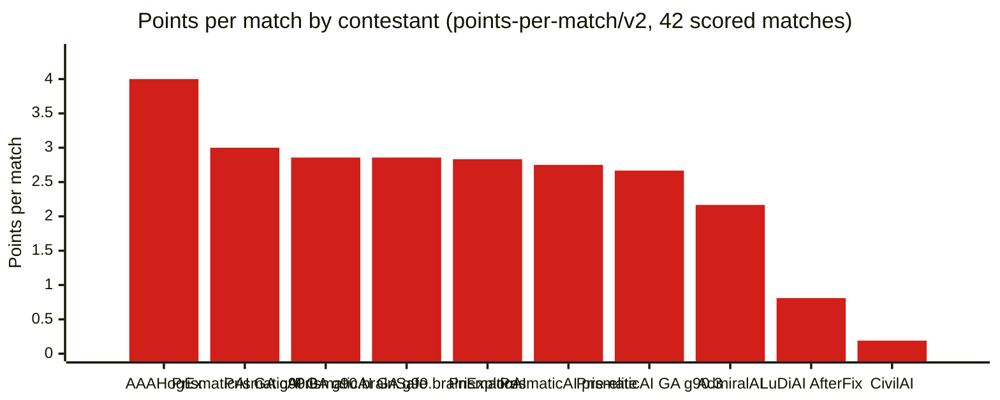
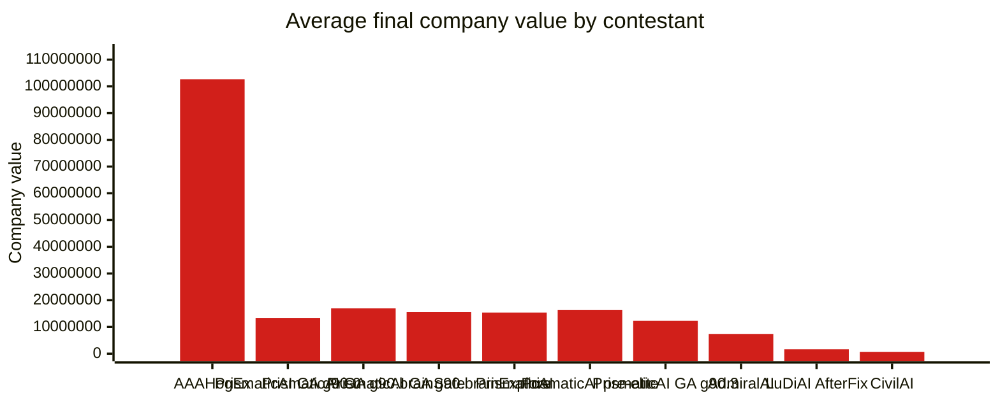
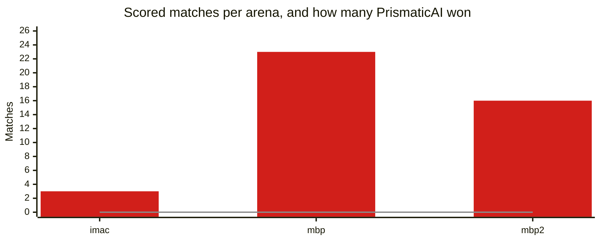

# battle-20261120T031914-84db6585

Derived from `battle-20261120T031914-84db6585.json` by `tools/research/ai-battle/battle.py report`; do not edit.

- Edition `84db65852f76c733`: PrismaticAI and referee at `23775ac070fd3fe12e281f826efbf16b2bb05172`, base set `opengfx-8.0.tar`
- 20-year free-for-all from 1960, map 256x256 temperate, breakdowns 1
- 42 scored match(es) on `imac` (20261119-master-gdf1e05e7d8), `mbp` (20261120-master-ma7416470de), `mbp2` (20261119-master-gdf1e05e7d8)
- Replays: 0 of 1 identical to their original on another arena

| # | Contestant | Played | Wins | Points | Points/match | Avg rank | Avg final value | Squirrel errors | Matches with anomalies |
|---|---|---|---|---|---|---|---|---|---|
| 1 | AAAHogEx | 42 | 42 | 168 | 4.0 | 1.0 | 102.7 M | 0 | 0 |
| 2 | PrismaticAI GA g90.0 | 8 | 0 | 24 | 3.0 | 2.0 | 13.4 M | 0 | 0 |
| 3 | PrismaticAI GA g90.brainSafe | 7 | 0 | 20 | 2.857 | 2.14 | 16.9 M | 0 | 0 |
| 4 | PrismaticAI GA g90.brainExplore | 7 | 0 | 20 | 2.857 | 2.14 | 15.5 M | 0 | 0 |
| 5 | PrismaticAI | 6 | 0 | 17 | 2.833 | 2.17 | 15.4 M | 0 | 3 |
| 6 | PrismaticAI pre-elite | 8 | 0 | 22 | 2.75 | 2.25 | 16.3 M | 0 | 0 |
| 7 | PrismaticAI GA g90.3 | 6 | 0 | 16 | 2.667 | 2.33 | 12.3 M | 0 | 0 |
| 8 | AdmiralAI | 42 | 0 | 91 | 2.167 | 2.83 | 7.4 M | 114 | 3 |
| 9 | LuDiAI AfterFix | 42 | 0 | 34 | 0.81 | 4.19 | 1.7 M | 0 | 1 |
| 10 | CivilAI | 42 | 0 | 8 | 0.19 | 4.81 | 626.1 k | 7345 | 9 |

```mermaid
---
config:
  xyChart:
    width: 900
    height: 360
  themeVariables:
    xyChart:
      plotColorPalette: "#d11f1a, #8a8a8a, #0b0b0b, #ece4d6"
---
xychart-beta
    title "Final company value per scored match: winner vs best PrismaticAI"
    x-axis ["m-0001", "m-0002", "m-0003", "m-0004", "m-0005", "m-0006", "m-0007", "m-0008", "m-0009", "m-0010", "m-0011", "m-0012", "m-0013", "m-0014", "m-0015", "m-0016", "m-0017", "m-0018", "m-0019", "m-0020", "m-0021", "m-0022", "m-0023", "m-0024", "m-0025", "m-0026", "m-0027", "m-0028", "m-0036", "m-0037", "m-0038", "m-0039", "m-0040", "m-0041", "m-0042", "m-0043", "m-0044", "m-0047", "m-0049", "m-0050", "m-0051", "m-0052"]
    %% series: Winner | Best PrismaticAI
    %% links: battle-20261120T031914-84db6585.md?col=Match&filter=m-0001 | battle-20261120T031914-84db6585.md?col=Match&filter=m-0002 | battle-20261120T031914-84db6585.md?col=Match&filter=m-0003 | battle-20261120T031914-84db6585.md?col=Match&filter=m-0004 | battle-20261120T031914-84db6585.md?col=Match&filter=m-0005 | battle-20261120T031914-84db6585.md?col=Match&filter=m-0006 | battle-20261120T031914-84db6585.md?col=Match&filter=m-0007 | battle-20261120T031914-84db6585.md?col=Match&filter=m-0008 | battle-20261120T031914-84db6585.md?col=Match&filter=m-0009 | battle-20261120T031914-84db6585.md?col=Match&filter=m-0010 | battle-20261120T031914-84db6585.md?col=Match&filter=m-0011 | battle-20261120T031914-84db6585.md?col=Match&filter=m-0012 | battle-20261120T031914-84db6585.md?col=Match&filter=m-0013 | battle-20261120T031914-84db6585.md?col=Match&filter=m-0014 | battle-20261120T031914-84db6585.md?col=Match&filter=m-0015 | battle-20261120T031914-84db6585.md?col=Match&filter=m-0016 | battle-20261120T031914-84db6585.md?col=Match&filter=m-0017 | battle-20261120T031914-84db6585.md?col=Match&filter=m-0018 | battle-20261120T031914-84db6585.md?col=Match&filter=m-0019 | battle-20261120T031914-84db6585.md?col=Match&filter=m-0020 | battle-20261120T031914-84db6585.md?col=Match&filter=m-0021 | battle-20261120T031914-84db6585.md?col=Match&filter=m-0022 | battle-20261120T031914-84db6585.md?col=Match&filter=m-0023 | battle-20261120T031914-84db6585.md?col=Match&filter=m-0024 | battle-20261120T031914-84db6585.md?col=Match&filter=m-0025 | battle-20261120T031914-84db6585.md?col=Match&filter=m-0026 | battle-20261120T031914-84db6585.md?col=Match&filter=m-0027 | battle-20261120T031914-84db6585.md?col=Match&filter=m-0028 | battle-20261120T031914-84db6585.md?col=Match&filter=m-0036 | battle-20261120T031914-84db6585.md?col=Match&filter=m-0037 | battle-20261120T031914-84db6585.md?col=Match&filter=m-0038 | battle-20261120T031914-84db6585.md?col=Match&filter=m-0039 | battle-20261120T031914-84db6585.md?col=Match&filter=m-0040 | battle-20261120T031914-84db6585.md?col=Match&filter=m-0041 | battle-20261120T031914-84db6585.md?col=Match&filter=m-0042 | battle-20261120T031914-84db6585.md?col=Match&filter=m-0043 | battle-20261120T031914-84db6585.md?col=Match&filter=m-0044 | battle-20261120T031914-84db6585.md?col=Match&filter=m-0047 | battle-20261120T031914-84db6585.md?col=Match&filter=m-0049 | battle-20261120T031914-84db6585.md?col=Match&filter=m-0050 | battle-20261120T031914-84db6585.md?col=Match&filter=m-0051 | battle-20261120T031914-84db6585.md?col=Match&filter=m-0052
    y-axis "Company value" 0 --> 149000000
    bar [120303281, 128327102, 107057589, 115031266, 117441918, 105678635, 131473716, 119819450, 111491358, 126305586, 91065928, 61994186, 62851936, 66809721, 74817009, 71223702, 59252312, 132116968, 116728271, 127199663, 118482303, 130979037, 135446358, 104086810, 81671739, 131808286, 122657331, 107082663, 88085393, 75683529, 115930241, 78012422, 101386082, 98537982, 93712644, 104594093, 84174805, 81403691, 98647742, 113558056, 106898721, 92267733]
    line [13704087, 6719907, 16356752, 14492228, 10609400, 9157621, 7873956, 12324918, 3906730, 11587470, 5303464, 15608298, 17393104, 11369465, 10301978, 14624990, 12659156, 18634043, 23415747, 10109047, 24629228, 19762576, 23222087, 19064219, 25936904, 19694043, 24351193, 19464214, 17872947, 19522199, 18284026, 17897230, 16936804, 13481280, 11967103, 9064349, 15948645, 8432674, 13501442, 12624519, 21121529, 11969440]
```

<!-- battle-charts:begin -->
<!-- derived from battle-20261120T031914-84db6585.json by `battle.py render`; `battle.py check` fails when it is stale -->

<!-- battle-charts:end -->

| Seed | Original | Replay | Arenas | Identical |
|---|---|---|---|---|
| 1268040823 | m-0011 | m-0048 | imac / mbp | NO |

| Match | Arena | Seed | Winner | Value | Last | Anomalies |
|---|---|---|---|---|---|---|
| m-0001 | mbp | 432856928 | AAAHogEx | 120.3 M | CivilAI | - |
| m-0002 | mbp | 432856928 | AAAHogEx | 128.3 M | CivilAI | - |
| m-0003 | mbp | 432856928 | AAAHogEx | 107.1 M | CivilAI | - |
| m-0004 | mbp | 432856928 | AAAHogEx | 115.0 M | CivilAI | - |
| m-0005 | mbp | 432856928 | AAAHogEx | 117.4 M | CivilAI | - |
| m-0006 | mbp | 1268040823 | AAAHogEx | 105.7 M | CivilAI | PrismaticAI: fleet_drop:85->53 |
| m-0007 | mbp | 1268040823 | AAAHogEx | 131.5 M | LuDiAI AfterFix | CivilAI: fleet_drop:78->53 |
| m-0008 | mbp | 1268040823 | AAAHogEx | 119.8 M | CivilAI | - |
| m-0009 | mbp | 1268040823 | AAAHogEx | 111.5 M | CivilAI | - |
| m-0010 | imac | 1268040823 | AAAHogEx | 126.3 M | CivilAI | - |
| m-0011 | imac | 1268040823 | AAAHogEx | 91.1 M | LuDiAI AfterFix | - |
| m-0012 | imac | 1047050451 | AAAHogEx | 62.0 M | LuDiAI AfterFix | PrismaticAI: fleet_drop:88->60 |
| m-0013 | mbp2 | 1047050451 | AAAHogEx | 62.9 M | CivilAI | CivilAI: fleet_drop:36->10 |
| m-0014 | mbp2 | 1047050451 | AAAHogEx | 66.8 M | CivilAI | - |
| m-0015 | mbp2 | 1047050451 | AAAHogEx | 74.8 M | CivilAI | - |
| m-0016 | mbp2 | 1047050451 | AAAHogEx | 71.2 M | LuDiAI AfterFix | - |
| m-0017 | mbp2 | 1047050451 | AAAHogEx | 59.3 M | CivilAI | CivilAI: squirrel_errors:3670 |
| m-0018 | mbp2 | 85622656 | AAAHogEx | 132.1 M | CivilAI | PrismaticAI: fleet_drop:95->64 |
| m-0019 | mbp2 | 85622656 | AAAHogEx | 116.7 M | CivilAI | CivilAI: fleet_drop:56->35 |
| m-0020 | mbp2 | 85622656 | AAAHogEx | 127.2 M | CivilAI | - |
| m-0021 | mbp2 | 85622656 | AAAHogEx | 118.5 M | CivilAI | AdmiralAI: squirrel_errors:57 |
| m-0022 | mbp2 | 85622656 | AAAHogEx | 131.0 M | CivilAI | - |
| m-0023 | mbp2 | 85622656 | AAAHogEx | 135.4 M | CivilAI | - |
| m-0024 | mbp2 | 799959327 | AAAHogEx | 104.1 M | CivilAI | CivilAI: fleet_drop:12->8 |
| m-0025 | mbp2 | 799959327 | AAAHogEx | 81.7 M | LuDiAI AfterFix | - |
| m-0026 | mbp2 | 799959327 | AAAHogEx | 131.8 M | CivilAI | AdmiralAI: squirrel_errors:57, fleet_drop:156->107 |
| m-0027 | mbp2 | 799959327 | AAAHogEx | 122.7 M | CivilAI | CivilAI: squirrel_errors:3675 |
| m-0028 | mbp2 | 799959327 | AAAHogEx | 107.1 M | LuDiAI AfterFix | - |
| m-0036 | mbp | 1923494015 | AAAHogEx | 88.1 M | CivilAI | - |
| m-0037 | mbp | 1923494015 | AAAHogEx | 75.7 M | CivilAI | - |
| m-0038 | mbp | 1923494015 | AAAHogEx | 115.9 M | CivilAI | - |
| m-0039 | mbp | 1923494015 | AAAHogEx | 78.0 M | CivilAI | LuDiAI AfterFix: fleet_drop:94->64 |
| m-0040 | mbp | 1923494015 | AAAHogEx | 101.4 M | CivilAI | CivilAI: fleet_drop:50->27 |
| m-0041 | mbp | 1923494015 | AAAHogEx | 98.5 M | CivilAI | - |
| m-0042 | mbp | 595939179 | AAAHogEx | 93.7 M | LuDiAI AfterFix | AdmiralAI: fleet_drop:228->155 |
| m-0043 | mbp | 595939179 | AAAHogEx | 104.6 M | CivilAI | - |
| m-0044 | mbp | 595939179 | AAAHogEx | 84.2 M | LuDiAI AfterFix | CivilAI: fleet_drop:59->38 |
| m-0047 | mbp | 595939179 | AAAHogEx | 81.4 M | CivilAI | - |
| m-0048 (replay) | mbp | 1268040823 | AAAHogEx | 108.5 M | CivilAI | - |
| m-0049 | mbp | 558010804 | AAAHogEx | 98.6 M | CivilAI | - |
| m-0050 | mbp | 558010804 | AAAHogEx | 113.6 M | CivilAI | - |
| m-0051 | mbp | 558010804 | AAAHogEx | 106.9 M | CivilAI | - |
| m-0052 | mbp | 558010804 | AAAHogEx | 92.3 M | CivilAI | CivilAI: fleet_drop:57->28 |
