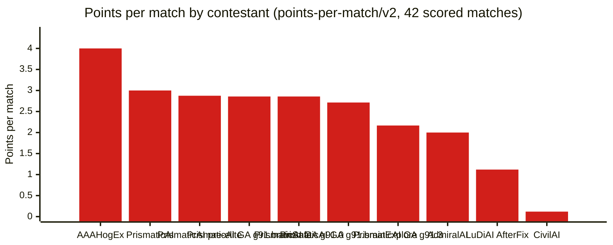
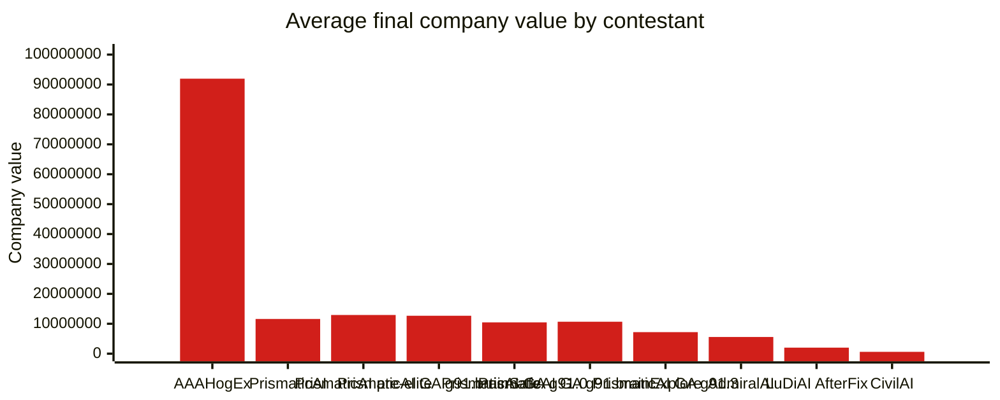
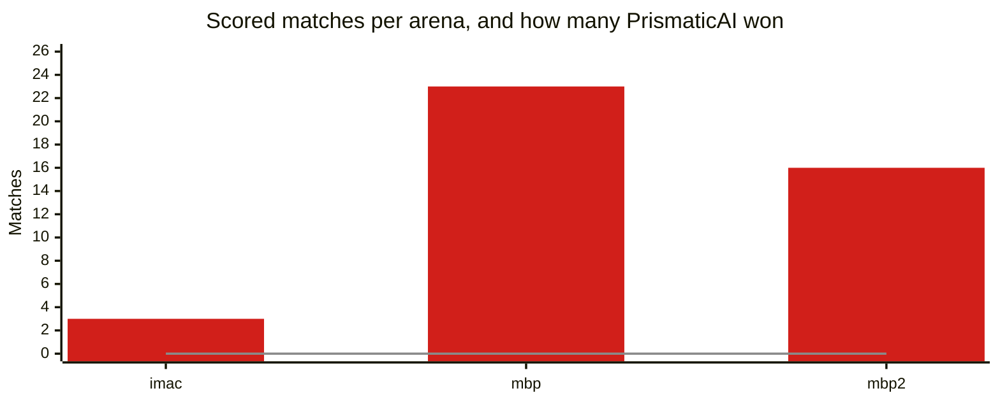

# battle-20261120T033154-d950e586

Derived from `battle-20261120T033154-d950e586.json` by `tools/research/ai-battle/battle.py report`; do not edit.

- Edition `d950e5869557ea80`: PrismaticAI and referee at `23775ac070fd3fe12e281f826efbf16b2bb05172`, base set `opengfx-8.0.tar`
- 20-year free-for-all from 1960, map 256x256 temperate, breakdowns 1
- 42 scored match(es) on `imac` (20261119-master-gdf1e05e7d8), `mbp` (20261120-master-ma7416470de), `mbp2` (20261119-master-gdf1e05e7d8)
- Replays: 0 of 1 identical to their original on another arena

| # | Contestant | Played | Wins | Points | Points/match | Avg rank | Avg final value | Squirrel errors | Matches with anomalies |
|---|---|---|---|---|---|---|---|---|---|
| 1 | AAAHogEx | 42 | 42 | 168 | 4.0 | 1.0 | 92.0 M | 0 | 0 |
| 2 | PrismaticAI | 7 | 0 | 21 | 3.0 | 2.0 | 11.6 M | 0 | 2 |
| 3 | PrismaticAI pre-elite | 8 | 0 | 23 | 2.875 | 2.12 | 12.9 M | 0 | 0 |
| 4 | PrismaticAI GA g91.brainSafe | 7 | 0 | 20 | 2.857 | 2.14 | 12.7 M | 0 | 1 |
| 5 | PrismaticAI GA g91.0 | 7 | 0 | 20 | 2.857 | 2.14 | 10.5 M | 0 | 0 |
| 6 | PrismaticAI GA g91.brainExplore | 7 | 0 | 19 | 2.714 | 2.29 | 10.7 M | 0 | 1 |
| 7 | PrismaticAI GA g91.3 | 6 | 0 | 13 | 2.167 | 2.83 | 7.2 M | 0 | 1 |
| 8 | AdmiralAI | 42 | 0 | 84 | 2.0 | 3.0 | 5.6 M | 0 | 3 |
| 9 | LuDiAI AfterFix | 42 | 0 | 47 | 1.119 | 3.88 | 2.0 M | 0 | 0 |
| 10 | CivilAI | 42 | 0 | 5 | 0.119 | 4.88 | 609.6 k | 0 | 10 |

```mermaid
---
config:
  xyChart:
    width: 900
    height: 360
  themeVariables:
    xyChart:
      plotColorPalette: "#d11f1a, #8a8a8a, #0b0b0b, #ece4d6"
---
xychart-beta
    title "Final company value per scored match: winner vs best PrismaticAI"
    x-axis ["m-0001", "m-0002", "m-0003", "m-0004", "m-0005", "m-0006", "m-0007", "m-0008", "m-0009", "m-0010", "m-0011", "m-0012", "m-0013", "m-0014", "m-0015", "m-0016", "m-0017", "m-0018", "m-0019", "m-0020", "m-0021", "m-0022", "m-0023", "m-0024", "m-0025", "m-0026", "m-0027", "m-0028", "m-0036", "m-0037", "m-0038", "m-0039", "m-0040", "m-0041", "m-0042", "m-0043", "m-0044", "m-0045", "m-0046", "m-0047", "m-0054", "m-0055"]
    %% series: Winner | Best PrismaticAI
    %% links: battle-20261120T033154-d950e586.md?col=Match&filter=m-0001 | battle-20261120T033154-d950e586.md?col=Match&filter=m-0002 | battle-20261120T033154-d950e586.md?col=Match&filter=m-0003 | battle-20261120T033154-d950e586.md?col=Match&filter=m-0004 | battle-20261120T033154-d950e586.md?col=Match&filter=m-0005 | battle-20261120T033154-d950e586.md?col=Match&filter=m-0006 | battle-20261120T033154-d950e586.md?col=Match&filter=m-0007 | battle-20261120T033154-d950e586.md?col=Match&filter=m-0008 | battle-20261120T033154-d950e586.md?col=Match&filter=m-0009 | battle-20261120T033154-d950e586.md?col=Match&filter=m-0010 | battle-20261120T033154-d950e586.md?col=Match&filter=m-0011 | battle-20261120T033154-d950e586.md?col=Match&filter=m-0012 | battle-20261120T033154-d950e586.md?col=Match&filter=m-0013 | battle-20261120T033154-d950e586.md?col=Match&filter=m-0014 | battle-20261120T033154-d950e586.md?col=Match&filter=m-0015 | battle-20261120T033154-d950e586.md?col=Match&filter=m-0016 | battle-20261120T033154-d950e586.md?col=Match&filter=m-0017 | battle-20261120T033154-d950e586.md?col=Match&filter=m-0018 | battle-20261120T033154-d950e586.md?col=Match&filter=m-0019 | battle-20261120T033154-d950e586.md?col=Match&filter=m-0020 | battle-20261120T033154-d950e586.md?col=Match&filter=m-0021 | battle-20261120T033154-d950e586.md?col=Match&filter=m-0022 | battle-20261120T033154-d950e586.md?col=Match&filter=m-0023 | battle-20261120T033154-d950e586.md?col=Match&filter=m-0024 | battle-20261120T033154-d950e586.md?col=Match&filter=m-0025 | battle-20261120T033154-d950e586.md?col=Match&filter=m-0026 | battle-20261120T033154-d950e586.md?col=Match&filter=m-0027 | battle-20261120T033154-d950e586.md?col=Match&filter=m-0028 | battle-20261120T033154-d950e586.md?col=Match&filter=m-0036 | battle-20261120T033154-d950e586.md?col=Match&filter=m-0037 | battle-20261120T033154-d950e586.md?col=Match&filter=m-0038 | battle-20261120T033154-d950e586.md?col=Match&filter=m-0039 | battle-20261120T033154-d950e586.md?col=Match&filter=m-0040 | battle-20261120T033154-d950e586.md?col=Match&filter=m-0041 | battle-20261120T033154-d950e586.md?col=Match&filter=m-0042 | battle-20261120T033154-d950e586.md?col=Match&filter=m-0043 | battle-20261120T033154-d950e586.md?col=Match&filter=m-0044 | battle-20261120T033154-d950e586.md?col=Match&filter=m-0045 | battle-20261120T033154-d950e586.md?col=Match&filter=m-0046 | battle-20261120T033154-d950e586.md?col=Match&filter=m-0047 | battle-20261120T033154-d950e586.md?col=Match&filter=m-0054 | battle-20261120T033154-d950e586.md?col=Match&filter=m-0055
    y-axis "Company value" 0 --> 137000000
    bar [73884393, 73415105, 57314683, 74649916, 71550691, 95088656, 80651864, 120337488, 86298710, 117529440, 76271129, 120353358, 107118006, 79788872, 90988499, 108574132, 93433211, 65667534, 79546739, 62624447, 54923532, 87283839, 79415023, 95394618, 90850590, 66541036, 64095107, 106304855, 103837336, 97577309, 106393496, 121731670, 114601209, 124558169, 103220537, 112123111, 106813732, 117001674, 102240505, 110412561, 76525095, 85058475]
    line [9587459, 8932392, 11374501, 10450653, 265996, 9855927, 10638322, 10964887, 4601633, 11240937, 2542756, 16252410, 15000455, 16226314, 13617016, 13479437, 12602011, 15014154, 13502297, 7940375, 11932147, 7835739, 8798115, 10520096, 7458924, 8001533, 14041969, 11339607, 10158491, 15681860, 11385329, 18075759, 12093587, 6702687, 11776340, 15859520, 9716826, 15095284, 8298660, 12268351, 7659767, 15746873]
```

<!-- battle-charts:begin -->
<!-- derived from battle-20261120T033154-d950e586.json by `battle.py render`; `battle.py check` fails when it is stale -->

<!-- battle-charts:end -->

| Seed | Original | Replay | Arenas | Identical |
|---|---|---|---|---|
| 1060975291 | m-0012 | m-0048 | imac / mbp | NO |

| Match | Arena | Seed | Winner | Value | Last | Anomalies |
|---|---|---|---|---|---|---|
| m-0001 | mbp | 1439892342 | AAAHogEx | 73.9 M | CivilAI | - |
| m-0002 | mbp | 1439892342 | AAAHogEx | 73.4 M | CivilAI | AdmiralAI: fleet_drop:260->174 |
| m-0003 | mbp | 1439892342 | AAAHogEx | 57.3 M | CivilAI | CivilAI: no_vehicles |
| m-0004 | mbp | 1439892342 | AAAHogEx | 74.6 M | CivilAI | - |
| m-0005 | mbp | 1439892342 | AAAHogEx | 71.6 M | PrismaticAI GA g91.3 | PrismaticAI GA g91.3: fleet_drop:15->4 |
| m-0006 | mbp | 1975358088 | AAAHogEx | 95.1 M | CivilAI | PrismaticAI: fleet_drop:99->63; AdmiralAI: fleet_drop:197->122 |
| m-0007 | mbp | 1975358088 | AAAHogEx | 80.7 M | CivilAI | - |
| m-0008 | mbp | 1975358088 | AAAHogEx | 120.3 M | CivilAI | CivilAI: fleet_drop:50->34 |
| m-0009 | mbp | 1975358088 | AAAHogEx | 86.3 M | CivilAI | - |
| m-0010 | imac | 1975358088 | AAAHogEx | 117.5 M | CivilAI | PrismaticAI GA g91.brainExplore: fleet_drop:73->47 |
| m-0011 | imac | 1975358088 | AAAHogEx | 76.3 M | CivilAI | - |
| m-0012 | imac | 1060975291 | AAAHogEx | 120.4 M | CivilAI | - |
| m-0013 | mbp2 | 1060975291 | AAAHogEx | 107.1 M | CivilAI | CivilAI: fleet_drop:19->13 |
| m-0014 | mbp2 | 1060975291 | AAAHogEx | 79.8 M | CivilAI | - |
| m-0015 | mbp2 | 1060975291 | AAAHogEx | 91.0 M | CivilAI | - |
| m-0016 | mbp2 | 1060975291 | AAAHogEx | 108.6 M | CivilAI | - |
| m-0017 | mbp2 | 1060975291 | AAAHogEx | 93.4 M | CivilAI | CivilAI: fleet_drop:16->10 |
| m-0018 | mbp2 | 1752964750 | AAAHogEx | 65.7 M | LuDiAI AfterFix | - |
| m-0019 | mbp2 | 1752964750 | AAAHogEx | 79.5 M | CivilAI | - |
| m-0020 | mbp2 | 1752964750 | AAAHogEx | 62.6 M | CivilAI | - |
| m-0021 | mbp2 | 1752964750 | AAAHogEx | 54.9 M | CivilAI | CivilAI: no_vehicles |
| m-0022 | mbp2 | 1752964750 | AAAHogEx | 87.3 M | CivilAI | - |
| m-0023 | mbp2 | 1752964750 | AAAHogEx | 79.4 M | CivilAI | - |
| m-0024 | mbp2 | 1554726469 | AAAHogEx | 95.4 M | CivilAI | PrismaticAI: fleet_drop:67->45 |
| m-0025 | mbp2 | 1554726469 | AAAHogEx | 90.9 M | CivilAI | - |
| m-0026 | mbp2 | 1554726469 | AAAHogEx | 66.5 M | CivilAI | - |
| m-0027 | mbp2 | 1554726469 | AAAHogEx | 64.1 M | CivilAI | PrismaticAI GA g91.brainSafe: fleet_drop:75->51 |
| m-0028 | mbp2 | 1554726469 | AAAHogEx | 106.3 M | CivilAI | CivilAI: no_vehicles |
| m-0036 | mbp | 829495518 | AAAHogEx | 103.8 M | CivilAI | - |
| m-0037 | mbp | 829495518 | AAAHogEx | 97.6 M | CivilAI | - |
| m-0038 | mbp | 829495518 | AAAHogEx | 106.4 M | CivilAI | CivilAI: fleet_drop:126->86 |
| m-0039 | mbp | 829495518 | AAAHogEx | 121.7 M | LuDiAI AfterFix | - |
| m-0040 | mbp | 829495518 | AAAHogEx | 114.6 M | CivilAI | AdmiralAI: fleet_drop:263->179; CivilAI: fleet_drop:39->26 |
| m-0041 | mbp | 829495518 | AAAHogEx | 124.6 M | CivilAI | CivilAI: fleet_drop:88->53 |
| m-0042 | mbp | 355348175 | AAAHogEx | 103.2 M | CivilAI | - |
| m-0043 | mbp | 355348175 | AAAHogEx | 112.1 M | CivilAI | - |
| m-0044 | mbp | 355348175 | AAAHogEx | 106.8 M | CivilAI | CivilAI: fleet_drop:61->36 |
| m-0045 | mbp | 355348175 | AAAHogEx | 117.0 M | CivilAI | - |
| m-0046 | mbp | 355348175 | AAAHogEx | 102.2 M | CivilAI | - |
| m-0047 | mbp | 355348175 | AAAHogEx | 110.4 M | CivilAI | - |
| m-0048 (replay) | mbp | 1060975291 | AAAHogEx | 111.7 M | CivilAI | PrismaticAI: fleet_drop:112->73; AdmiralAI: fleet_drop:172->115 |
| m-0054 | mbp | 17941313 | AAAHogEx | 76.5 M | LuDiAI AfterFix | - |
| m-0055 | mbp | 17941313 | AAAHogEx | 85.1 M | AdmiralAI | - |
