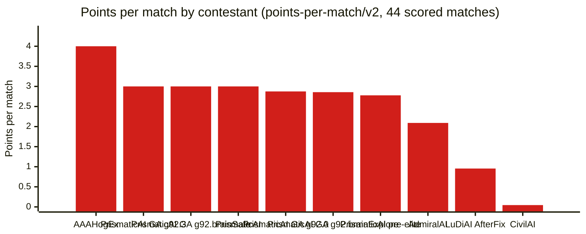
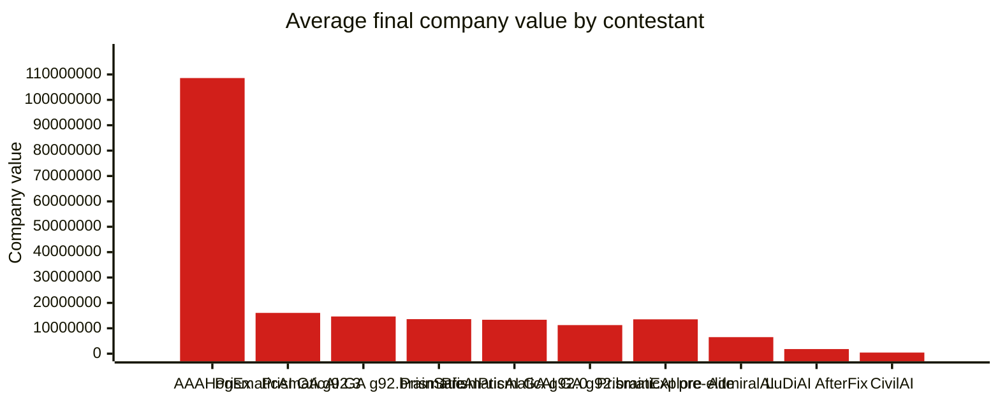
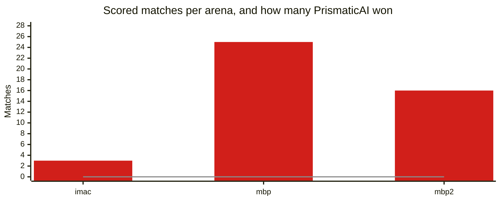

# battle-20261120T034356-c4a14a38

Derived from `battle-20261120T034356-c4a14a38.json` by `tools/research/ai-battle/battle.py report`; do not edit.

- Edition `c4a14a38239d8fc2`: PrismaticAI and referee at `cbd774f94108d495482a04435618a1effe17f9fc`, base set `opengfx-8.0.tar`
- 20-year free-for-all from 1960, map 256x256 temperate, breakdowns 1
- 44 scored match(es) on `imac` (20261119-master-gdf1e05e7d8), `mbp` (20261120-master-m7a925f73d1), `mbp2` (20261119-master-gdf1e05e7d8)
- Replays: 0 of 0 identical to their original on another arena

| # | Contestant | Played | Wins | Points | Points/match | Avg rank | Avg final value | Squirrel errors | Matches with anomalies |
|---|---|---|---|---|---|---|---|---|---|
| 1 | AAAHogEx | 44 | 44 | 176 | 4.0 | 1.0 | 108.6 M | 0 | 0 |
| 2 | PrismaticAI GA g92.3 | 6 | 0 | 18 | 3.0 | 2.0 | 16.1 M | 0 | 0 |
| 3 | PrismaticAI GA g92.brainSafe | 7 | 0 | 21 | 3.0 | 2.0 | 14.7 M | 0 | 0 |
| 4 | PrismaticAI | 7 | 0 | 21 | 3.0 | 2.0 | 13.6 M | 0 | 6 |
| 5 | PrismaticAI GA g92.0 | 8 | 0 | 23 | 2.875 | 2.12 | 13.4 M | 0 | 3 |
| 6 | PrismaticAI GA g92.brainExplore | 7 | 0 | 20 | 2.857 | 2.14 | 11.3 M | 0 | 3 |
| 7 | PrismaticAI pre-elite | 9 | 0 | 25 | 2.778 | 2.22 | 13.5 M | 0 | 0 |
| 8 | AdmiralAI | 44 | 0 | 92 | 2.091 | 2.91 | 6.5 M | 0 | 0 |
| 9 | LuDiAI AfterFix | 44 | 0 | 42 | 0.955 | 4.05 | 1.8 M | 0 | 2 |
| 10 | CivilAI | 44 | 0 | 2 | 0.045 | 4.95 | 435.5 k | 7265 | 8 |

```mermaid
---
config:
  xyChart:
    width: 900
    height: 360
  themeVariables:
    xyChart:
      plotColorPalette: "#d11f1a, #8a8a8a, #0b0b0b, #ece4d6"
---
xychart-beta
    title "Final company value per scored match: winner vs best PrismaticAI"
    x-axis ["m-0001", "m-0002", "m-0003", "m-0004", "m-0005", "m-0006", "m-0007", "m-0008", "m-0009", "m-0010", "m-0011", "m-0012", "m-0013", "m-0014", "m-0015", "m-0016", "m-0017", "m-0018", "m-0019", "m-0020", "m-0021", "m-0022", "m-0023", "m-0024", "m-0025", "m-0026", "m-0027", "m-0028", "m-0036", "m-0037", "m-0038", "m-0039", "m-0040", "m-0041", "m-0042", "m-0043", "m-0044", "m-0049", "m-0050", "m-0053", "m-0054", "m-0055", "m-0057", "m-0058"]
    %% series: Winner | Best PrismaticAI
    %% links: battle-20261120T034356-c4a14a38.md?col=Match&filter=m-0001 | battle-20261120T034356-c4a14a38.md?col=Match&filter=m-0002 | battle-20261120T034356-c4a14a38.md?col=Match&filter=m-0003 | battle-20261120T034356-c4a14a38.md?col=Match&filter=m-0004 | battle-20261120T034356-c4a14a38.md?col=Match&filter=m-0005 | battle-20261120T034356-c4a14a38.md?col=Match&filter=m-0006 | battle-20261120T034356-c4a14a38.md?col=Match&filter=m-0007 | battle-20261120T034356-c4a14a38.md?col=Match&filter=m-0008 | battle-20261120T034356-c4a14a38.md?col=Match&filter=m-0009 | battle-20261120T034356-c4a14a38.md?col=Match&filter=m-0010 | battle-20261120T034356-c4a14a38.md?col=Match&filter=m-0011 | battle-20261120T034356-c4a14a38.md?col=Match&filter=m-0012 | battle-20261120T034356-c4a14a38.md?col=Match&filter=m-0013 | battle-20261120T034356-c4a14a38.md?col=Match&filter=m-0014 | battle-20261120T034356-c4a14a38.md?col=Match&filter=m-0015 | battle-20261120T034356-c4a14a38.md?col=Match&filter=m-0016 | battle-20261120T034356-c4a14a38.md?col=Match&filter=m-0017 | battle-20261120T034356-c4a14a38.md?col=Match&filter=m-0018 | battle-20261120T034356-c4a14a38.md?col=Match&filter=m-0019 | battle-20261120T034356-c4a14a38.md?col=Match&filter=m-0020 | battle-20261120T034356-c4a14a38.md?col=Match&filter=m-0021 | battle-20261120T034356-c4a14a38.md?col=Match&filter=m-0022 | battle-20261120T034356-c4a14a38.md?col=Match&filter=m-0023 | battle-20261120T034356-c4a14a38.md?col=Match&filter=m-0024 | battle-20261120T034356-c4a14a38.md?col=Match&filter=m-0025 | battle-20261120T034356-c4a14a38.md?col=Match&filter=m-0026 | battle-20261120T034356-c4a14a38.md?col=Match&filter=m-0027 | battle-20261120T034356-c4a14a38.md?col=Match&filter=m-0028 | battle-20261120T034356-c4a14a38.md?col=Match&filter=m-0036 | battle-20261120T034356-c4a14a38.md?col=Match&filter=m-0037 | battle-20261120T034356-c4a14a38.md?col=Match&filter=m-0038 | battle-20261120T034356-c4a14a38.md?col=Match&filter=m-0039 | battle-20261120T034356-c4a14a38.md?col=Match&filter=m-0040 | battle-20261120T034356-c4a14a38.md?col=Match&filter=m-0041 | battle-20261120T034356-c4a14a38.md?col=Match&filter=m-0042 | battle-20261120T034356-c4a14a38.md?col=Match&filter=m-0043 | battle-20261120T034356-c4a14a38.md?col=Match&filter=m-0044 | battle-20261120T034356-c4a14a38.md?col=Match&filter=m-0049 | battle-20261120T034356-c4a14a38.md?col=Match&filter=m-0050 | battle-20261120T034356-c4a14a38.md?col=Match&filter=m-0053 | battle-20261120T034356-c4a14a38.md?col=Match&filter=m-0054 | battle-20261120T034356-c4a14a38.md?col=Match&filter=m-0055 | battle-20261120T034356-c4a14a38.md?col=Match&filter=m-0057 | battle-20261120T034356-c4a14a38.md?col=Match&filter=m-0058
    y-axis "Company value" 0 --> 176000000
    bar [95737981, 121858658, 122050393, 98355324, 103303555, 123646095, 160282763, 139590639, 153069774, 127370681, 111886528, 110404396, 110056810, 111350645, 120219068, 115589954, 92807495, 104327375, 71935874, 100011778, 89946220, 90145562, 107195482, 116429540, 117705611, 119841413, 146435684, 125596749, 90351404, 92409674, 102980143, 98185844, 103096514, 111848530, 153662722, 155449874, 138628872, 94172824, 81895576, 69679237, 70740614, 74589901, 69561133, 63506294]
    line [20216399, 16741968, 15133912, 16361336, 19681555, 11934678, 13374175, 16603500, 12561879, 9119928, 12708011, 11682790, 12892132, 12230759, 16722426, 12668011, 12353244, 15159822, 17732998, 10523649, 16181599, 11052669, 17524474, 18468612, 11710715, 10584731, 19028592, 8000917, 16250161, 12423715, 15092927, 10896566, 7852288, 11563942, 9142562, 6831402, 13548888, 18162688, 11545234, 22544667, 12601736, 8433846, 12037153, 13720054]
```

<!-- battle-charts:begin -->
<!-- derived from battle-20261120T034356-c4a14a38.json by `battle.py render`; `battle.py check` fails when it is stale -->

<!-- battle-charts:end -->

| Match | Arena | Seed | Winner | Value | Last | Anomalies |
|---|---|---|---|---|---|---|
| m-0001 | mbp | 672323417 | AAAHogEx | 95.7 M | CivilAI | - |
| m-0002 | mbp | 672323417 | AAAHogEx | 121.9 M | CivilAI | - |
| m-0003 | mbp | 672323417 | AAAHogEx | 122.1 M | CivilAI | - |
| m-0004 | mbp | 672323417 | AAAHogEx | 98.4 M | CivilAI | PrismaticAI GA g92.brainExplore: fleet_drop:106->72; CivilAI: fleet_drop:20->9 |
| m-0005 | mbp | 672323417 | AAAHogEx | 103.3 M | CivilAI | - |
| m-0006 | mbp | 121168670 | AAAHogEx | 123.6 M | CivilAI | PrismaticAI: fleet_drop:68->43 |
| m-0007 | mbp | 121168670 | AAAHogEx | 160.3 M | CivilAI | - |
| m-0008 | mbp | 121168670 | AAAHogEx | 139.6 M | CivilAI | - |
| m-0009 | mbp | 121168670 | AAAHogEx | 153.1 M | CivilAI | - |
| m-0010 | imac | 121168670 | AAAHogEx | 127.4 M | CivilAI | PrismaticAI GA g92.brainExplore: fleet_drop:88->48 |
| m-0011 | imac | 121168670 | AAAHogEx | 111.9 M | CivilAI | - |
| m-0012 | imac | 1471575622 | AAAHogEx | 110.4 M | LuDiAI AfterFix | PrismaticAI: fleet_drop:89->61 |
| m-0013 | mbp2 | 1471575622 | AAAHogEx | 110.1 M | LuDiAI AfterFix | - |
| m-0014 | mbp2 | 1471575622 | AAAHogEx | 111.4 M | CivilAI | - |
| m-0015 | mbp2 | 1471575622 | AAAHogEx | 120.2 M | CivilAI | - |
| m-0016 | mbp2 | 1471575622 | AAAHogEx | 115.6 M | CivilAI | LuDiAI AfterFix: fleet_drop:16->5 |
| m-0017 | mbp2 | 1471575622 | AAAHogEx | 92.8 M | CivilAI | - |
| m-0018 | mbp2 | 621873915 | AAAHogEx | 104.3 M | CivilAI | PrismaticAI: fleet_drop:96->65 |
| m-0019 | mbp2 | 621873915 | AAAHogEx | 71.9 M | CivilAI | - |
| m-0020 | mbp2 | 621873915 | AAAHogEx | 100.0 M | CivilAI | PrismaticAI GA g92.0: fleet_drop:91->56 |
| m-0021 | mbp2 | 621873915 | AAAHogEx | 89.9 M | CivilAI | - |
| m-0022 | mbp2 | 621873915 | AAAHogEx | 90.1 M | CivilAI | - |
| m-0023 | mbp2 | 621873915 | AAAHogEx | 107.2 M | CivilAI | - |
| m-0024 | mbp2 | 605098917 | AAAHogEx | 116.4 M | CivilAI | PrismaticAI: fleet_drop:94->53 |
| m-0025 | mbp2 | 605098917 | AAAHogEx | 117.7 M | CivilAI | - |
| m-0026 | mbp2 | 605098917 | AAAHogEx | 119.8 M | CivilAI | CivilAI: fleet_drop:37->13 |
| m-0027 | mbp2 | 605098917 | AAAHogEx | 146.4 M | CivilAI | - |
| m-0028 | mbp2 | 605098917 | AAAHogEx | 125.6 M | CivilAI | PrismaticAI GA g92.brainExplore: fleet_drop:92->62 |
| m-0036 | mbp | 420430661 | AAAHogEx | 90.4 M | CivilAI | PrismaticAI: fleet_drop:80->47 |
| m-0037 | mbp | 420430661 | AAAHogEx | 92.4 M | CivilAI | - |
| m-0038 | mbp | 420430661 | AAAHogEx | 103.0 M | CivilAI | PrismaticAI GA g92.0: fleet_drop:81->50 |
| m-0039 | mbp | 420430661 | AAAHogEx | 98.2 M | CivilAI | CivilAI: no_vehicles |
| m-0040 | mbp | 420430661 | AAAHogEx | 103.1 M | CivilAI | CivilAI: squirrel_errors:3640 |
| m-0041 | mbp | 420430661 | AAAHogEx | 111.8 M | CivilAI | LuDiAI AfterFix: fleet_drop:70->46; CivilAI: squirrel_errors:3625 |
| m-0042 | mbp | 29945202 | AAAHogEx | 153.7 M | CivilAI | - |
| m-0043 | mbp | 29945202 | AAAHogEx | 155.4 M | CivilAI | - |
| m-0044 | mbp | 29945202 | AAAHogEx | 138.6 M | CivilAI | - |
| m-0049 | mbp | 1731809804 | AAAHogEx | 94.2 M | CivilAI | - |
| m-0050 | mbp | 1731809804 | AAAHogEx | 81.9 M | CivilAI | PrismaticAI GA g92.0: fleet_drop:98->57 |
| m-0053 | mbp | 1731809804 | AAAHogEx | 69.7 M | CivilAI | - |
| m-0054 | mbp | 1101374043 | AAAHogEx | 70.7 M | CivilAI | PrismaticAI: fleet_drop:81->27; CivilAI: fleet_drop:12->7 |
| m-0055 | mbp | 1101374043 | AAAHogEx | 74.6 M | CivilAI | - |
| m-0057 | mbp | 1101374043 | AAAHogEx | 69.6 M | CivilAI | CivilAI: no_vehicles |
| m-0058 | mbp | 1101374043 | AAAHogEx | 63.5 M | CivilAI | CivilAI: fleet_drop:14->9 |
