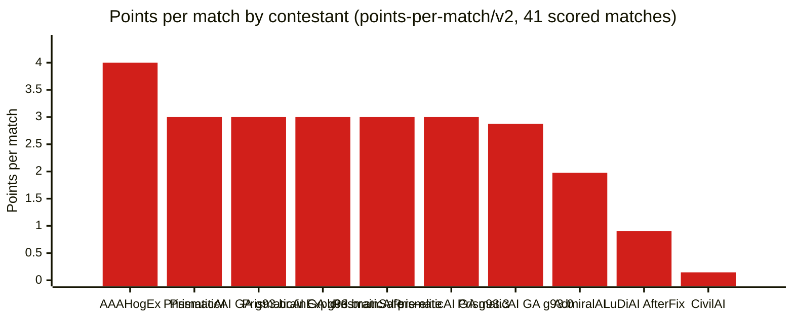
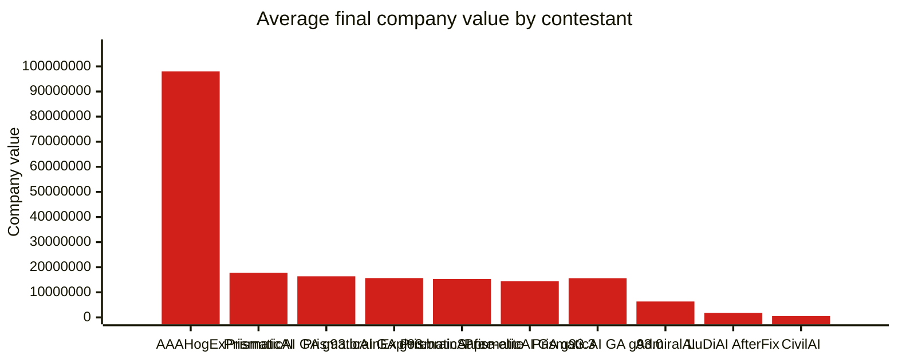
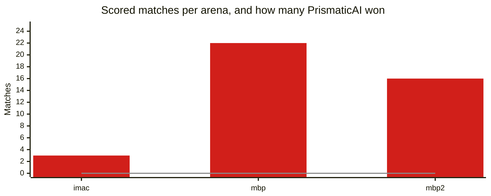

# battle-20261120T035451-1d3052e4

Derived from `battle-20261120T035451-1d3052e4.json` by `tools/research/ai-battle/battle.py report`; do not edit.

- Edition `1d3052e4a859f263`: PrismaticAI and referee at `cbd774f94108d495482a04435618a1effe17f9fc`, base set `opengfx-8.0.tar`
- 20-year free-for-all from 1960, map 256x256 temperate, breakdowns 1
- 41 scored match(es) on `imac` (20261119-master-gdf1e05e7d8), `mbp` (20261120-master-m7a925f73d1), `mbp2` (20261119-master-gdf1e05e7d8)
- Replays: 0 of 1 identical to their original on another arena

| # | Contestant | Played | Wins | Points | Points/match | Avg rank | Avg final value | Squirrel errors | Matches with anomalies |
|---|---|---|---|---|---|---|---|---|---|
| 1 | AAAHogEx | 41 | 41 | 164 | 4.0 | 1.0 | 98.0 M | 0 | 0 |
| 2 | PrismaticAI | 6 | 0 | 18 | 3.0 | 2.0 | 17.8 M | 0 | 0 |
| 3 | PrismaticAI GA g93.brainExplore | 6 | 0 | 18 | 3.0 | 2.0 | 16.4 M | 0 | 0 |
| 4 | PrismaticAI GA g93.brainSafe | 7 | 0 | 21 | 3.0 | 2.0 | 15.7 M | 0 | 0 |
| 5 | PrismaticAI pre-elite | 8 | 0 | 24 | 3.0 | 2.0 | 15.3 M | 0 | 0 |
| 6 | PrismaticAI GA g93.3 | 6 | 0 | 18 | 3.0 | 2.0 | 14.4 M | 0 | 0 |
| 7 | PrismaticAI GA g93.0 | 8 | 0 | 23 | 2.875 | 2.12 | 15.6 M | 0 | 0 |
| 8 | AdmiralAI | 41 | 0 | 81 | 1.976 | 3.02 | 6.4 M | 0 | 1 |
| 9 | LuDiAI AfterFix | 41 | 0 | 37 | 0.902 | 4.1 | 1.8 M | 0 | 2 |
| 10 | CivilAI | 41 | 0 | 6 | 0.146 | 4.85 | 517.2 k | 0 | 8 |

```mermaid
---
config:
  xyChart:
    width: 900
    height: 360
  themeVariables:
    xyChart:
      plotColorPalette: "#d11f1a, #8a8a8a, #0b0b0b, #ece4d6"
---
xychart-beta
    title "Final company value per scored match: winner vs best PrismaticAI"
    x-axis ["m-0001", "m-0002", "m-0003", "m-0004", "m-0005", "m-0006", "m-0007", "m-0008", "m-0009", "m-0010", "m-0011", "m-0012", "m-0013", "m-0014", "m-0015", "m-0016", "m-0017", "m-0018", "m-0019", "m-0020", "m-0021", "m-0022", "m-0023", "m-0024", "m-0025", "m-0026", "m-0027", "m-0028", "m-0036", "m-0037", "m-0038", "m-0039", "m-0040", "m-0041", "m-0042", "m-0043", "m-0044", "m-0047", "m-0049", "m-0050", "m-0051"]
    %% series: Winner | Best PrismaticAI
    %% links: battle-20261120T035451-1d3052e4.md?col=Match&filter=m-0001 | battle-20261120T035451-1d3052e4.md?col=Match&filter=m-0002 | battle-20261120T035451-1d3052e4.md?col=Match&filter=m-0003 | battle-20261120T035451-1d3052e4.md?col=Match&filter=m-0004 | battle-20261120T035451-1d3052e4.md?col=Match&filter=m-0005 | battle-20261120T035451-1d3052e4.md?col=Match&filter=m-0006 | battle-20261120T035451-1d3052e4.md?col=Match&filter=m-0007 | battle-20261120T035451-1d3052e4.md?col=Match&filter=m-0008 | battle-20261120T035451-1d3052e4.md?col=Match&filter=m-0009 | battle-20261120T035451-1d3052e4.md?col=Match&filter=m-0010 | battle-20261120T035451-1d3052e4.md?col=Match&filter=m-0011 | battle-20261120T035451-1d3052e4.md?col=Match&filter=m-0012 | battle-20261120T035451-1d3052e4.md?col=Match&filter=m-0013 | battle-20261120T035451-1d3052e4.md?col=Match&filter=m-0014 | battle-20261120T035451-1d3052e4.md?col=Match&filter=m-0015 | battle-20261120T035451-1d3052e4.md?col=Match&filter=m-0016 | battle-20261120T035451-1d3052e4.md?col=Match&filter=m-0017 | battle-20261120T035451-1d3052e4.md?col=Match&filter=m-0018 | battle-20261120T035451-1d3052e4.md?col=Match&filter=m-0019 | battle-20261120T035451-1d3052e4.md?col=Match&filter=m-0020 | battle-20261120T035451-1d3052e4.md?col=Match&filter=m-0021 | battle-20261120T035451-1d3052e4.md?col=Match&filter=m-0022 | battle-20261120T035451-1d3052e4.md?col=Match&filter=m-0023 | battle-20261120T035451-1d3052e4.md?col=Match&filter=m-0024 | battle-20261120T035451-1d3052e4.md?col=Match&filter=m-0025 | battle-20261120T035451-1d3052e4.md?col=Match&filter=m-0026 | battle-20261120T035451-1d3052e4.md?col=Match&filter=m-0027 | battle-20261120T035451-1d3052e4.md?col=Match&filter=m-0028 | battle-20261120T035451-1d3052e4.md?col=Match&filter=m-0036 | battle-20261120T035451-1d3052e4.md?col=Match&filter=m-0037 | battle-20261120T035451-1d3052e4.md?col=Match&filter=m-0038 | battle-20261120T035451-1d3052e4.md?col=Match&filter=m-0039 | battle-20261120T035451-1d3052e4.md?col=Match&filter=m-0040 | battle-20261120T035451-1d3052e4.md?col=Match&filter=m-0041 | battle-20261120T035451-1d3052e4.md?col=Match&filter=m-0042 | battle-20261120T035451-1d3052e4.md?col=Match&filter=m-0043 | battle-20261120T035451-1d3052e4.md?col=Match&filter=m-0044 | battle-20261120T035451-1d3052e4.md?col=Match&filter=m-0047 | battle-20261120T035451-1d3052e4.md?col=Match&filter=m-0049 | battle-20261120T035451-1d3052e4.md?col=Match&filter=m-0050 | battle-20261120T035451-1d3052e4.md?col=Match&filter=m-0051
    y-axis "Company value" 0 --> 167000000
    bar [81395990, 102949446, 110104581, 117718166, 111739952, 86344068, 82323380, 63159091, 60570685, 101878154, 92193124, 129871501, 100641355, 112869702, 141181680, 112214631, 98267152, 65590083, 63848509, 65322178, 68465295, 87074731, 66037924, 116882181, 110350076, 140920209, 143064618, 140566714, 58944662, 91237904, 73840120, 68967590, 101910149, 71946914, 143658860, 151808216, 111983932, 102096673, 93586048, 84225997, 90964986]
    line [21391514, 16989263, 16417915, 19231126, 17498943, 17244220, 12366100, 14241053, 15687192, 14899090, 9740341, 18832805, 17118348, 12652265, 13289313, 16232974, 14633368, 11469081, 11012547, 9010440, 9444106, 8108679, 10234617, 21777455, 17807208, 17366743, 13333318, 23047049, 18347220, 19473914, 20119783, 22694357, 16728164, 18156223, 19187391, 12603795, 18834845, 16033166, 10843572, 15666112, 18844014]
```

<!-- battle-charts:begin -->
<!-- derived from battle-20261120T035451-1d3052e4.json by `battle.py render`; `battle.py check` fails when it is stale -->

<!-- battle-charts:end -->

| Seed | Original | Replay | Arenas | Identical |
|---|---|---|---|---|
| 1428114102 | m-0010 | m-0048 | imac / mbp | NO |

| Match | Arena | Seed | Winner | Value | Last | Anomalies |
|---|---|---|---|---|---|---|
| m-0001 | mbp | 1579619094 | AAAHogEx | 81.4 M | CivilAI | - |
| m-0002 | mbp | 1579619094 | AAAHogEx | 102.9 M | CivilAI | - |
| m-0003 | mbp | 1579619094 | AAAHogEx | 110.1 M | LuDiAI AfterFix | - |
| m-0004 | mbp | 1579619094 | AAAHogEx | 117.7 M | CivilAI | - |
| m-0005 | mbp | 1579619094 | AAAHogEx | 111.7 M | CivilAI | - |
| m-0006 | mbp | 1428114102 | AAAHogEx | 86.3 M | CivilAI | CivilAI: fleet_drop:31->16 |
| m-0007 | mbp | 1428114102 | AAAHogEx | 82.3 M | CivilAI | - |
| m-0008 | mbp | 1428114102 | AAAHogEx | 63.2 M | CivilAI | - |
| m-0009 | mbp | 1428114102 | AAAHogEx | 60.6 M | CivilAI | - |
| m-0010 | imac | 1428114102 | AAAHogEx | 101.9 M | CivilAI | - |
| m-0011 | imac | 1428114102 | AAAHogEx | 92.2 M | CivilAI | - |
| m-0012 | imac | 1789316323 | AAAHogEx | 129.9 M | CivilAI | - |
| m-0013 | mbp2 | 1789316323 | AAAHogEx | 100.6 M | CivilAI | - |
| m-0014 | mbp2 | 1789316323 | AAAHogEx | 112.9 M | CivilAI | - |
| m-0015 | mbp2 | 1789316323 | AAAHogEx | 141.2 M | CivilAI | - |
| m-0016 | mbp2 | 1789316323 | AAAHogEx | 112.2 M | CivilAI | CivilAI: no_vehicles |
| m-0017 | mbp2 | 1789316323 | AAAHogEx | 98.3 M | CivilAI | CivilAI: no_vehicles |
| m-0018 | mbp2 | 1291559736 | AAAHogEx | 65.6 M | CivilAI | - |
| m-0019 | mbp2 | 1291559736 | AAAHogEx | 63.8 M | CivilAI | - |
| m-0020 | mbp2 | 1291559736 | AAAHogEx | 65.3 M | CivilAI | CivilAI: fleet_drop:99->55 |
| m-0021 | mbp2 | 1291559736 | AAAHogEx | 68.5 M | CivilAI | - |
| m-0022 | mbp2 | 1291559736 | AAAHogEx | 87.1 M | CivilAI | - |
| m-0023 | mbp2 | 1291559736 | AAAHogEx | 66.0 M | CivilAI | - |
| m-0024 | mbp2 | 703602819 | AAAHogEx | 116.9 M | CivilAI | - |
| m-0025 | mbp2 | 703602819 | AAAHogEx | 110.4 M | CivilAI | - |
| m-0026 | mbp2 | 703602819 | AAAHogEx | 140.9 M | CivilAI | - |
| m-0027 | mbp2 | 703602819 | AAAHogEx | 143.1 M | AdmiralAI | - |
| m-0028 | mbp2 | 703602819 | AAAHogEx | 140.6 M | CivilAI | - |
| m-0036 | mbp | 1381416817 | AAAHogEx | 58.9 M | CivilAI | - |
| m-0037 | mbp | 1381416817 | AAAHogEx | 91.2 M | CivilAI | - |
| m-0038 | mbp | 1381416817 | AAAHogEx | 73.8 M | LuDiAI AfterFix | - |
| m-0039 | mbp | 1381416817 | AAAHogEx | 69.0 M | LuDiAI AfterFix | CivilAI: fleet_drop:29->20; LuDiAI AfterFix: fleet_drop:49->31 |
| m-0040 | mbp | 1381416817 | AAAHogEx | 101.9 M | LuDiAI AfterFix | LuDiAI AfterFix: fleet_drop:51->21 |
| m-0041 | mbp | 1381416817 | AAAHogEx | 71.9 M | CivilAI | CivilAI: fleet_drop:24->13 |
| m-0042 | mbp | 1362005779 | AAAHogEx | 143.7 M | CivilAI | - |
| m-0043 | mbp | 1362005779 | AAAHogEx | 151.8 M | LuDiAI AfterFix | CivilAI: fleet_drop:57->25 |
| m-0044 | mbp | 1362005779 | AAAHogEx | 112.0 M | CivilAI | AdmiralAI: fleet_drop:202->134 |
| m-0047 | mbp | 1362005779 | AAAHogEx | 102.1 M | CivilAI | - |
| m-0048 (replay) | mbp | 1428114102 | AAAHogEx | 100.9 M | CivilAI | - |
| m-0049 | mbp | 1130840432 | AAAHogEx | 93.6 M | CivilAI | CivilAI: fleet_drop:31->21 |
| m-0050 | mbp | 1130840432 | AAAHogEx | 84.2 M | CivilAI | - |
| m-0051 | mbp | 1130840432 | AAAHogEx | 91.0 M | CivilAI | - |
