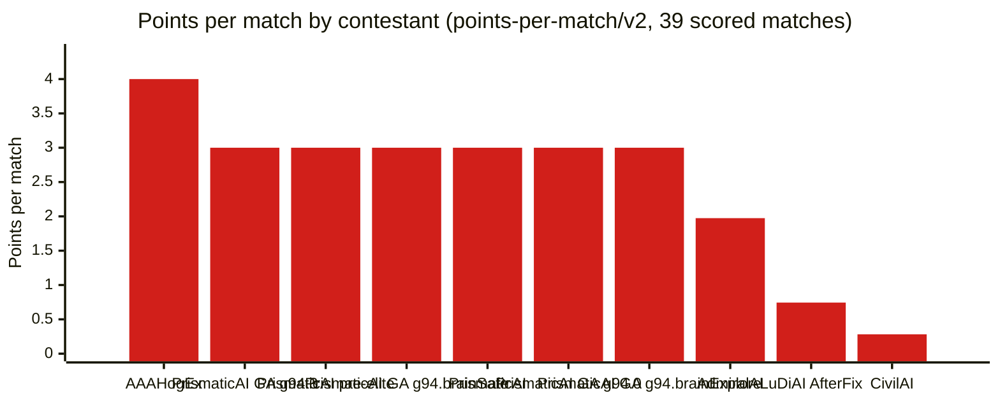
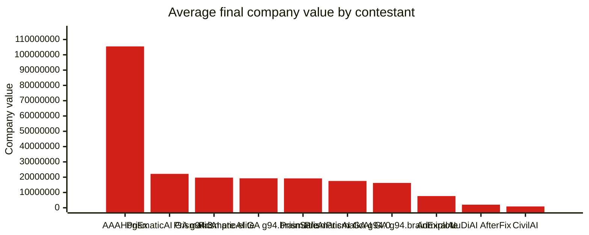
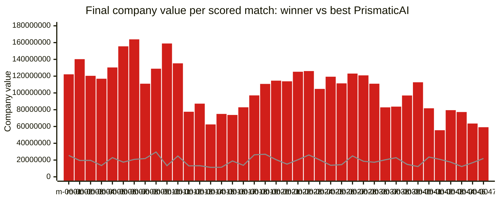
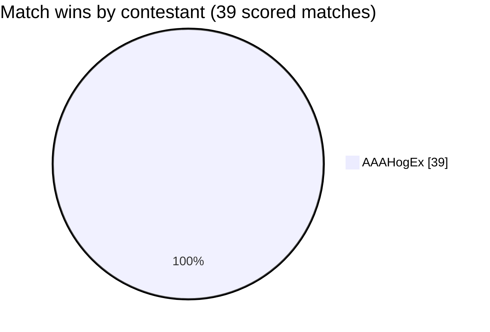
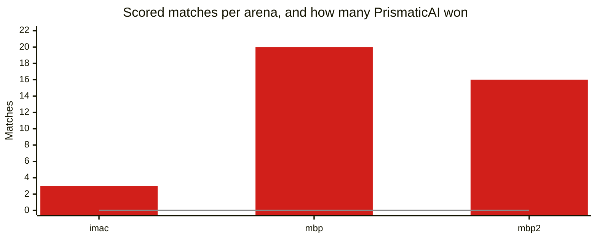

# battle-20261120T040605-cab83ddf

Derived from `battle-20261120T040605-cab83ddf.json` by `tools/research/ai-battle/battle.py report`; do not edit.

- Edition `cab83ddf90f94a17`: PrismaticAI and referee at `cbd774f94108d495482a04435618a1effe17f9fc`, base set `opengfx-8.0.tar`
- 20-year free-for-all from 1960, map 256x256 temperate, breakdowns 1
- 39 scored match(es) on `imac` (20261119-master-gdf1e05e7d8), `mbp` (20261120-master-m7a925f73d1), `mbp2` (20261119-master-gdf1e05e7d8)
- Replays: 0 of 1 identical to their original on another arena

| # | Contestant | Played | Wins | Points | Points/match | Avg rank | Avg final value | Squirrel errors | Matches with anomalies |
|---|---|---|---|---|---|---|---|---|---|
| 1 | AAAHogEx | 39 | 39 | 156 | 4.0 | 1.0 | 105.5 M | 0 | 0 |
| 2 | PrismaticAI GA g94.3 | 6 | 0 | 18 | 3.0 | 2.0 | 22.2 M | 0 | 0 |
| 3 | PrismaticAI pre-elite | 7 | 0 | 21 | 3.0 | 2.0 | 19.7 M | 0 | 0 |
| 4 | PrismaticAI GA g94.brainSafe | 6 | 0 | 18 | 3.0 | 2.0 | 19.3 M | 0 | 1 |
| 5 | PrismaticAI | 6 | 0 | 18 | 3.0 | 2.0 | 19.2 M | 0 | 3 |
| 6 | PrismaticAI GA g94.0 | 7 | 0 | 21 | 3.0 | 2.0 | 17.5 M | 0 | 0 |
| 7 | PrismaticAI GA g94.brainExplore | 7 | 0 | 21 | 3.0 | 2.0 | 16.2 M | 0 | 3 |
| 8 | AdmiralAI | 39 | 0 | 77 | 1.974 | 3.03 | 7.7 M | 0 | 1 |
| 9 | LuDiAI AfterFix | 39 | 0 | 29 | 0.744 | 4.26 | 2.0 M | 0 | 1 |
| 10 | CivilAI | 39 | 0 | 11 | 0.282 | 4.72 | 881.6 k | 0 | 4 |

<!-- battle-charts:begin -->
<!-- derived from battle-20261120T040605-cab83ddf.json by `battle.py render`; `battle.py check` fails when it is stale -->

<!-- battle-charts:end -->

| Seed | Original | Replay | Arenas | Identical |
|---|---|---|---|---|
| 755516473 | m-0012 | m-0048 | imac / mbp | NO |

| Match | Arena | Seed | Winner | Value | Last | Anomalies |
|---|---|---|---|---|---|---|
| m-0001 | mbp | 87447771 | AAAHogEx | 122.2 M | LuDiAI AfterFix | - |
| m-0002 | mbp | 87447771 | AAAHogEx | 140.3 M | CivilAI | - |
| m-0003 | mbp | 87447771 | AAAHogEx | 120.4 M | CivilAI | - |
| m-0004 | mbp | 87447771 | AAAHogEx | 116.9 M | CivilAI | - |
| m-0005 | mbp | 87447771 | AAAHogEx | 130.4 M | CivilAI | - |
| m-0006 | mbp | 1174746780 | AAAHogEx | 155.5 M | CivilAI | - |
| m-0007 | mbp | 1174746780 | AAAHogEx | 163.9 M | CivilAI | - |
| m-0008 | mbp | 1174746780 | AAAHogEx | 111.0 M | CivilAI | - |
| m-0009 | mbp | 1174746780 | AAAHogEx | 128.9 M | CivilAI | CivilAI: fleet_drop:58->31 |
| m-0010 | imac | 1174746780 | AAAHogEx | 158.9 M | CivilAI | PrismaticAI GA g94.brainExplore: fleet_drop:69->47 |
| m-0011 | imac | 1174746780 | AAAHogEx | 135.3 M | CivilAI | - |
| m-0012 | imac | 755516473 | AAAHogEx | 77.6 M | LuDiAI AfterFix | PrismaticAI: fleet_drop:70->45 |
| m-0013 | mbp2 | 755516473 | AAAHogEx | 87.2 M | LuDiAI AfterFix | - |
| m-0014 | mbp2 | 755516473 | AAAHogEx | 62.5 M | LuDiAI AfterFix | CivilAI: fleet_drop:76->50 |
| m-0015 | mbp2 | 755516473 | AAAHogEx | 75.0 M | LuDiAI AfterFix | - |
| m-0016 | mbp2 | 755516473 | AAAHogEx | 73.8 M | CivilAI | PrismaticAI GA g94.brainExplore: fleet_drop:80->55 |
| m-0017 | mbp2 | 755516473 | AAAHogEx | 82.9 M | LuDiAI AfterFix | - |
| m-0018 | mbp2 | 350848848 | AAAHogEx | 97.1 M | CivilAI | PrismaticAI: fleet_drop:106->55 |
| m-0019 | mbp2 | 350848848 | AAAHogEx | 110.8 M | CivilAI | CivilAI: fleet_drop:13->8 |
| m-0020 | mbp2 | 350848848 | AAAHogEx | 114.6 M | CivilAI | - |
| m-0021 | mbp2 | 350848848 | AAAHogEx | 113.8 M | CivilAI | - |
| m-0022 | mbp2 | 350848848 | AAAHogEx | 125.3 M | CivilAI | - |
| m-0023 | mbp2 | 350848848 | AAAHogEx | 126.1 M | CivilAI | - |
| m-0024 | mbp2 | 1191157857 | AAAHogEx | 104.8 M | CivilAI | - |
| m-0025 | mbp2 | 1191157857 | AAAHogEx | 119.3 M | LuDiAI AfterFix | - |
| m-0026 | mbp2 | 1191157857 | AAAHogEx | 111.4 M | CivilAI | AdmiralAI: fleet_drop:110->68 |
| m-0027 | mbp2 | 1191157857 | AAAHogEx | 123.1 M | CivilAI | - |
| m-0028 | mbp2 | 1191157857 | AAAHogEx | 120.9 M | LuDiAI AfterFix | - |
| m-0036 | mbp | 615893600 | AAAHogEx | 111.0 M | CivilAI | PrismaticAI: fleet_drop:124->51; CivilAI: fleet_drop:82->28 |
| m-0037 | mbp | 615893600 | AAAHogEx | 82.8 M | CivilAI | - |
| m-0038 | mbp | 615893600 | AAAHogEx | 83.7 M | CivilAI | - |
| m-0039 | mbp | 615893600 | AAAHogEx | 97.0 M | CivilAI | PrismaticAI GA g94.brainSafe: fleet_drop:63->36 |
| m-0040 | mbp | 615893600 | AAAHogEx | 112.7 M | CivilAI | PrismaticAI GA g94.brainExplore: fleet_drop:71->48 |
| m-0041 | mbp | 615893600 | AAAHogEx | 81.7 M | CivilAI | - |
| m-0042 | mbp | 219607045 | AAAHogEx | 55.6 M | LuDiAI AfterFix | - |
| m-0043 | mbp | 219607045 | AAAHogEx | 79.5 M | CivilAI | - |
| m-0044 | mbp | 219607045 | AAAHogEx | 77.3 M | LuDiAI AfterFix | - |
| m-0046 | mbp | 219607045 | AAAHogEx | 63.5 M | LuDiAI AfterFix | LuDiAI AfterFix: fleet_drop:42->24 |
| m-0047 | mbp | 219607045 | AAAHogEx | 59.1 M | CivilAI | - |
| m-0048 (replay) | mbp | 755516473 | AAAHogEx | 84.1 M | LuDiAI AfterFix | PrismaticAI: fleet_drop:90->49; CivilAI: fleet_drop:15->10 |
