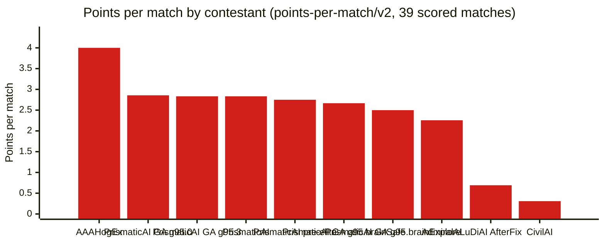
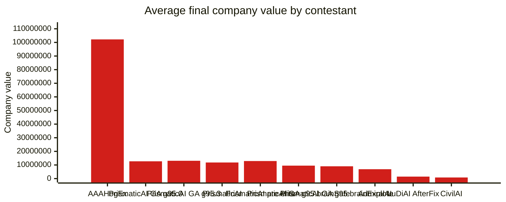
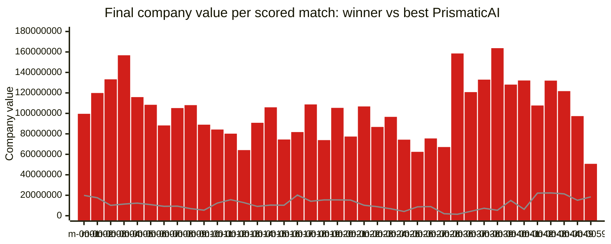
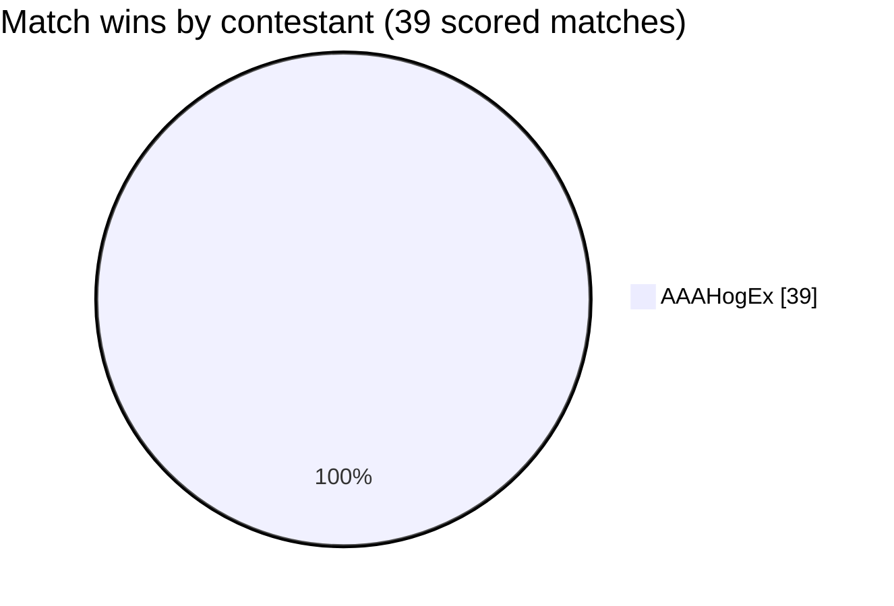
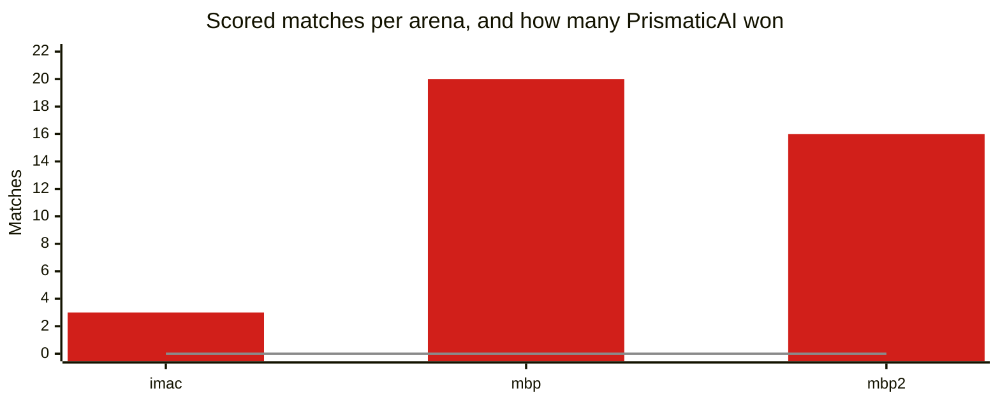

# battle-20261120T041601-40bca4e2

Derived from `battle-20261120T041601-40bca4e2.json` by `tools/research/ai-battle/battle.py report`; do not edit.

- Edition `40bca4e20d706ad1`: PrismaticAI and referee at `cbd774f94108d495482a04435618a1effe17f9fc`, base set `opengfx-8.0.tar`
- 20-year free-for-all from 1960, map 256x256 temperate, breakdowns 1
- 39 scored match(es) on `imac` (20261119-master-gdf1e05e7d8), `mbp` (20261120-master-m7a925f73d1), `mbp2` (20261119-master-gdf1e05e7d8)
- Replays: 0 of 0 identical to their original on another arena

| # | Contestant | Played | Wins | Points | Points/match | Avg rank | Avg final value | Squirrel errors | Matches with anomalies |
|---|---|---|---|---|---|---|---|---|---|
| 1 | AAAHogEx | 39 | 39 | 156 | 4.0 | 1.0 | 102.2 M | 0 | 0 |
| 2 | PrismaticAI GA g95.0 | 7 | 0 | 20 | 2.857 | 2.14 | 12.7 M | 0 | 0 |
| 3 | PrismaticAI GA g95.3 | 6 | 0 | 17 | 2.833 | 2.17 | 13.1 M | 0 | 1 |
| 4 | PrismaticAI | 6 | 0 | 17 | 2.833 | 2.17 | 11.8 M | 0 | 2 |
| 5 | PrismaticAI pre-elite | 8 | 0 | 22 | 2.75 | 2.25 | 12.9 M | 0 | 3 |
| 6 | PrismaticAI GA g95.brainSafe | 6 | 0 | 16 | 2.667 | 2.33 | 9.5 M | 0 | 1 |
| 7 | PrismaticAI GA g95.brainExplore | 6 | 0 | 15 | 2.5 | 2.5 | 9.0 M | 0 | 0 |
| 8 | AdmiralAI | 39 | 0 | 88 | 2.256 | 2.74 | 6.9 M | 59 | 1 |
| 9 | LuDiAI AfterFix | 39 | 0 | 27 | 0.692 | 4.31 | 1.5 M | 0 | 1 |
| 10 | CivilAI | 39 | 0 | 12 | 0.308 | 4.69 | 823.8 k | 3663 | 5 |

<!-- battle-charts:begin -->
<!-- derived from battle-20261120T041601-40bca4e2.json by `battle.py render`; `battle.py check` fails when it is stale -->

<!-- battle-charts:end -->

| Match | Arena | Seed | Winner | Value | Last | Anomalies |
|---|---|---|---|---|---|---|
| m-0001 | mbp | 1964270442 | AAAHogEx | 99.6 M | CivilAI | - |
| m-0002 | mbp | 1964270442 | AAAHogEx | 119.9 M | CivilAI | - |
| m-0003 | mbp | 1964270442 | AAAHogEx | 133.3 M | CivilAI | CivilAI: fleet_drop:57->31 |
| m-0004 | mbp | 1964270442 | AAAHogEx | 156.8 M | CivilAI | - |
| m-0005 | mbp | 1964270442 | AAAHogEx | 115.9 M | CivilAI | CivilAI: fleet_drop:49->18 |
| m-0006 | mbp | 267422998 | AAAHogEx | 108.4 M | LuDiAI AfterFix | PrismaticAI: fleet_drop:114->55 |
| m-0007 | mbp | 267422998 | AAAHogEx | 88.2 M | CivilAI | PrismaticAI pre-elite: fleet_drop:56->39 |
| m-0008 | mbp | 267422998 | AAAHogEx | 105.2 M | LuDiAI AfterFix | LuDiAI AfterFix: fleet_drop:56->27 |
| m-0009 | mbp | 267422998 | AAAHogEx | 108.1 M | LuDiAI AfterFix | - |
| m-0010 | imac | 267422998 | AAAHogEx | 89.0 M | LuDiAI AfterFix | - |
| m-0011 | imac | 267422998 | AAAHogEx | 84.2 M | CivilAI | - |
| m-0012 | imac | 203220061 | AAAHogEx | 80.2 M | CivilAI | PrismaticAI: fleet_drop:86->50 |
| m-0013 | mbp2 | 203220061 | AAAHogEx | 64.1 M | CivilAI | PrismaticAI pre-elite: fleet_drop:67->46 |
| m-0014 | mbp2 | 203220061 | AAAHogEx | 90.8 M | CivilAI | - |
| m-0015 | mbp2 | 203220061 | AAAHogEx | 105.9 M | CivilAI | - |
| m-0016 | mbp2 | 203220061 | AAAHogEx | 74.5 M | CivilAI | - |
| m-0017 | mbp2 | 203220061 | AAAHogEx | 81.7 M | CivilAI | CivilAI: fleet_drop:29->18 |
| m-0018 | mbp2 | 1401343549 | AAAHogEx | 108.7 M | LuDiAI AfterFix | AdmiralAI: squirrel_errors:59 |
| m-0019 | mbp2 | 1401343549 | AAAHogEx | 73.9 M | LuDiAI AfterFix | - |
| m-0020 | mbp2 | 1401343549 | AAAHogEx | 105.4 M | CivilAI | - |
| m-0021 | mbp2 | 1401343549 | AAAHogEx | 77.4 M | CivilAI | - |
| m-0022 | mbp2 | 1401343549 | AAAHogEx | 106.8 M | LuDiAI AfterFix | - |
| m-0023 | mbp2 | 1401343549 | AAAHogEx | 86.7 M | CivilAI | CivilAI: squirrel_errors:3630 |
| m-0024 | mbp2 | 1978528859 | AAAHogEx | 96.6 M | CivilAI | - |
| m-0025 | mbp2 | 1978528859 | AAAHogEx | 74.3 M | LuDiAI AfterFix | PrismaticAI pre-elite: fleet_drop:72->34 |
| m-0026 | mbp2 | 1978528859 | AAAHogEx | 62.4 M | CivilAI | - |
| m-0027 | mbp2 | 1978528859 | AAAHogEx | 75.5 M | CivilAI | - |
| m-0028 | mbp2 | 1978528859 | AAAHogEx | 67.1 M | CivilAI | - |
| m-0036 | mbp | 667580262 | AAAHogEx | 158.5 M | CivilAI | - |
| m-0037 | mbp | 667580262 | AAAHogEx | 120.8 M | LuDiAI AfterFix | - |
| m-0038 | mbp | 667580262 | AAAHogEx | 133.0 M | LuDiAI AfterFix | - |
| m-0039 | mbp | 667580262 | AAAHogEx | 163.7 M | CivilAI | PrismaticAI GA g95.brainSafe: fleet_drop:21->13 |
| m-0040 | mbp | 667580262 | AAAHogEx | 128.1 M | CivilAI | - |
| m-0041 | mbp | 667580262 | AAAHogEx | 132.1 M | LuDiAI AfterFix | PrismaticAI GA g95.3: fleet_drop:41->26 |
| m-0042 | mbp | 1571262851 | AAAHogEx | 107.7 M | CivilAI | - |
| m-0043 | mbp | 1571262851 | AAAHogEx | 132.0 M | CivilAI | - |
| m-0044 | mbp | 1571262851 | AAAHogEx | 121.7 M | CivilAI | - |
| m-0049 | mbp | 702350742 | AAAHogEx | 97.3 M | CivilAI | - |
| m-0059 | mbp | 149846972 | AAAHogEx | 50.7 M | LuDiAI AfterFix | CivilAI: squirrel_errors:33 |
