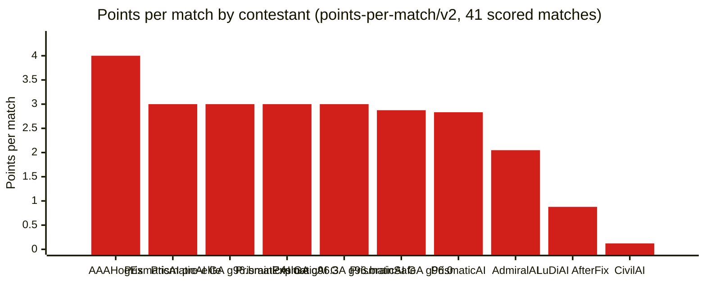
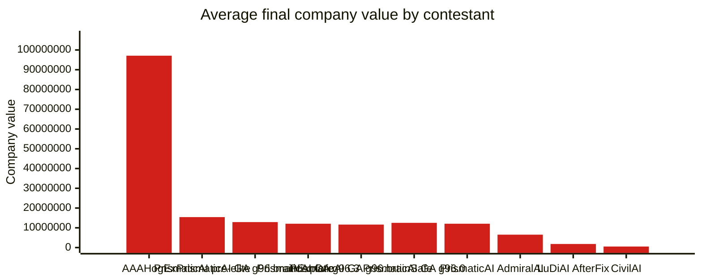
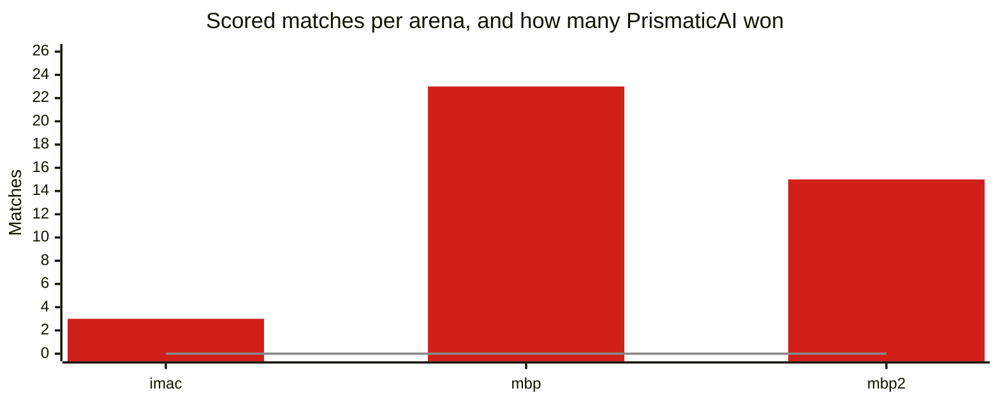

# battle-20261120T042713-1f1b1f1b

Derived from `battle-20261120T042713-1f1b1f1b.json` by `tools/research/ai-battle/battle.py report`; do not edit.

- Edition `1f1b1f1bac9a005e`: PrismaticAI and referee at `cbd774f94108d495482a04435618a1effe17f9fc`, base set `opengfx-8.0.tar`
- 20-year free-for-all from 1960, map 256x256 temperate, breakdowns 1
- 41 scored match(es) on `imac` (20261119-master-gdf1e05e7d8), `mbp` (20261120-master-m7a925f73d1), `mbp2` (20261119-master-gdf1e05e7d8)
- Replays: 0 of 1 identical to their original on another arena

| # | Contestant | Played | Wins | Points | Points/match | Avg rank | Avg final value | Squirrel errors | Matches with anomalies |
|---|---|---|---|---|---|---|---|---|---|
| 1 | AAAHogEx | 41 | 41 | 164 | 4.0 | 1.0 | 97.1 M | 0 | 0 |
| 2 | PrismaticAI pre-elite | 8 | 0 | 24 | 3.0 | 2.0 | 15.4 M | 0 | 0 |
| 3 | PrismaticAI GA g96.brainExplore | 6 | 0 | 18 | 3.0 | 2.0 | 12.9 M | 0 | 0 |
| 4 | PrismaticAI GA g96.3 | 6 | 0 | 18 | 3.0 | 2.0 | 12.1 M | 0 | 0 |
| 5 | PrismaticAI GA g96.brainSafe | 7 | 0 | 21 | 3.0 | 2.0 | 11.6 M | 0 | 0 |
| 6 | PrismaticAI GA g96.0 | 8 | 0 | 23 | 2.875 | 2.12 | 12.5 M | 0 | 0 |
| 7 | PrismaticAI | 6 | 0 | 17 | 2.833 | 2.17 | 12.1 M | 0 | 2 |
| 8 | AdmiralAI | 41 | 0 | 84 | 2.049 | 2.95 | 6.5 M | 0 | 2 |
| 9 | LuDiAI AfterFix | 41 | 0 | 36 | 0.878 | 4.12 | 1.8 M | 0 | 0 |
| 10 | CivilAI | 41 | 0 | 5 | 0.122 | 4.88 | 525.8 k | 0 | 6 |

```mermaid
---
config:
  xyChart:
    width: 900
    height: 360
  themeVariables:
    xyChart:
      plotColorPalette: "#d11f1a, #8a8a8a, #0b0b0b, #ece4d6"
---
xychart-beta
    title "Final company value per scored match: winner vs best PrismaticAI"
    x-axis ["m-0001", "m-0002", "m-0003", "m-0004", "m-0005", "m-0006", "m-0007", "m-0008", "m-0009", "m-0010", "m-0011", "m-0012", "m-0013", "m-0014", "m-0015", "m-0017", "m-0018", "m-0019", "m-0020", "m-0021", "m-0022", "m-0023", "m-0024", "m-0025", "m-0026", "m-0027", "m-0028", "m-0036", "m-0037", "m-0038", "m-0039", "m-0040", "m-0041", "m-0042", "m-0043", "m-0044", "m-0045", "m-0046", "m-0047", "m-0049", "m-0050"]
    %% series: Winner | Best PrismaticAI
    %% links: battle-20261120T042713-1f1b1f1b.md?col=Match&filter=m-0001 | battle-20261120T042713-1f1b1f1b.md?col=Match&filter=m-0002 | battle-20261120T042713-1f1b1f1b.md?col=Match&filter=m-0003 | battle-20261120T042713-1f1b1f1b.md?col=Match&filter=m-0004 | battle-20261120T042713-1f1b1f1b.md?col=Match&filter=m-0005 | battle-20261120T042713-1f1b1f1b.md?col=Match&filter=m-0006 | battle-20261120T042713-1f1b1f1b.md?col=Match&filter=m-0007 | battle-20261120T042713-1f1b1f1b.md?col=Match&filter=m-0008 | battle-20261120T042713-1f1b1f1b.md?col=Match&filter=m-0009 | battle-20261120T042713-1f1b1f1b.md?col=Match&filter=m-0010 | battle-20261120T042713-1f1b1f1b.md?col=Match&filter=m-0011 | battle-20261120T042713-1f1b1f1b.md?col=Match&filter=m-0012 | battle-20261120T042713-1f1b1f1b.md?col=Match&filter=m-0013 | battle-20261120T042713-1f1b1f1b.md?col=Match&filter=m-0014 | battle-20261120T042713-1f1b1f1b.md?col=Match&filter=m-0015 | battle-20261120T042713-1f1b1f1b.md?col=Match&filter=m-0017 | battle-20261120T042713-1f1b1f1b.md?col=Match&filter=m-0018 | battle-20261120T042713-1f1b1f1b.md?col=Match&filter=m-0019 | battle-20261120T042713-1f1b1f1b.md?col=Match&filter=m-0020 | battle-20261120T042713-1f1b1f1b.md?col=Match&filter=m-0021 | battle-20261120T042713-1f1b1f1b.md?col=Match&filter=m-0022 | battle-20261120T042713-1f1b1f1b.md?col=Match&filter=m-0023 | battle-20261120T042713-1f1b1f1b.md?col=Match&filter=m-0024 | battle-20261120T042713-1f1b1f1b.md?col=Match&filter=m-0025 | battle-20261120T042713-1f1b1f1b.md?col=Match&filter=m-0026 | battle-20261120T042713-1f1b1f1b.md?col=Match&filter=m-0027 | battle-20261120T042713-1f1b1f1b.md?col=Match&filter=m-0028 | battle-20261120T042713-1f1b1f1b.md?col=Match&filter=m-0036 | battle-20261120T042713-1f1b1f1b.md?col=Match&filter=m-0037 | battle-20261120T042713-1f1b1f1b.md?col=Match&filter=m-0038 | battle-20261120T042713-1f1b1f1b.md?col=Match&filter=m-0039 | battle-20261120T042713-1f1b1f1b.md?col=Match&filter=m-0040 | battle-20261120T042713-1f1b1f1b.md?col=Match&filter=m-0041 | battle-20261120T042713-1f1b1f1b.md?col=Match&filter=m-0042 | battle-20261120T042713-1f1b1f1b.md?col=Match&filter=m-0043 | battle-20261120T042713-1f1b1f1b.md?col=Match&filter=m-0044 | battle-20261120T042713-1f1b1f1b.md?col=Match&filter=m-0045 | battle-20261120T042713-1f1b1f1b.md?col=Match&filter=m-0046 | battle-20261120T042713-1f1b1f1b.md?col=Match&filter=m-0047 | battle-20261120T042713-1f1b1f1b.md?col=Match&filter=m-0049 | battle-20261120T042713-1f1b1f1b.md?col=Match&filter=m-0050
    y-axis "Company value" 0 --> 180000000
    bar [78056614, 113084248, 88942074, 83211867, 105102017, 84563685, 109266327, 100285176, 97086489, 101702049, 111458774, 81639363, 84381547, 93403347, 85787045, 97404953, 69118557, 73518671, 76341508, 73916393, 72086461, 90121905, 103545042, 104035215, 104065223, 84823536, 78157031, 93670083, 86631579, 82912005, 80179945, 78910071, 99232971, 127093256, 115368748, 123807205, 89285547, 124114057, 131525785, 139410830, 163970909]
    line [16834161, 18244920, 13562340, 17776288, 16887272, 12953038, 20446836, 21863116, 10653145, 4150239, 12202998, 9729228, 11859286, 9396109, 10331195, 6082769, 17766853, 15843746, 10232623, 10589741, 18976324, 14561369, 11206320, 6796626, 7437682, 7467701, 9987817, 10344027, 12229269, 12014707, 14351855, 11293332, 8302640, 10399187, 24373634, 7187193, 14473646, 15139627, 14360123, 14966593, 13707102]
```

<!-- battle-charts:begin -->
<!-- derived from battle-20261120T042713-1f1b1f1b.json by `battle.py render`; `battle.py check` fails when it is stale -->

<!-- battle-charts:end -->

| Seed | Original | Replay | Arenas | Identical |
|---|---|---|---|---|
| 659068704 | m-0011 | m-0048 | imac / mbp | NO |

| Match | Arena | Seed | Winner | Value | Last | Anomalies |
|---|---|---|---|---|---|---|
| m-0001 | mbp | 598972019 | AAAHogEx | 78.1 M | CivilAI | CivilAI: fleet_drop:14->9 |
| m-0002 | mbp | 598972019 | AAAHogEx | 113.1 M | CivilAI | - |
| m-0003 | mbp | 598972019 | AAAHogEx | 88.9 M | CivilAI | - |
| m-0004 | mbp | 598972019 | AAAHogEx | 83.2 M | CivilAI | - |
| m-0005 | mbp | 598972019 | AAAHogEx | 105.1 M | CivilAI | - |
| m-0006 | mbp | 659068704 | AAAHogEx | 84.6 M | CivilAI | - |
| m-0007 | mbp | 659068704 | AAAHogEx | 109.3 M | CivilAI | - |
| m-0008 | mbp | 659068704 | AAAHogEx | 100.3 M | CivilAI | - |
| m-0009 | mbp | 659068704 | AAAHogEx | 97.1 M | CivilAI | - |
| m-0010 | imac | 659068704 | AAAHogEx | 101.7 M | CivilAI | - |
| m-0011 | imac | 659068704 | AAAHogEx | 111.5 M | CivilAI | AdmiralAI: fleet_drop:249->112 |
| m-0012 | imac | 933006377 | AAAHogEx | 81.6 M | CivilAI | - |
| m-0013 | mbp2 | 933006377 | AAAHogEx | 84.4 M | CivilAI | - |
| m-0014 | mbp2 | 933006377 | AAAHogEx | 93.4 M | CivilAI | CivilAI: fleet_drop:32->7 |
| m-0015 | mbp2 | 933006377 | AAAHogEx | 85.8 M | CivilAI | - |
| m-0017 | mbp2 | 933006377 | AAAHogEx | 97.4 M | CivilAI | - |
| m-0018 | mbp2 | 170949227 | AAAHogEx | 69.1 M | CivilAI | - |
| m-0019 | mbp2 | 170949227 | AAAHogEx | 73.5 M | CivilAI | - |
| m-0020 | mbp2 | 170949227 | AAAHogEx | 76.3 M | CivilAI | - |
| m-0021 | mbp2 | 170949227 | AAAHogEx | 73.9 M | CivilAI | - |
| m-0022 | mbp2 | 170949227 | AAAHogEx | 72.1 M | CivilAI | CivilAI: fleet_drop:42->28 |
| m-0023 | mbp2 | 170949227 | AAAHogEx | 90.1 M | CivilAI | CivilAI: fleet_drop:13->8 |
| m-0024 | mbp2 | 767121851 | AAAHogEx | 103.5 M | LuDiAI AfterFix | - |
| m-0025 | mbp2 | 767121851 | AAAHogEx | 104.0 M | CivilAI | - |
| m-0026 | mbp2 | 767121851 | AAAHogEx | 104.1 M | CivilAI | - |
| m-0027 | mbp2 | 767121851 | AAAHogEx | 84.8 M | CivilAI | - |
| m-0028 | mbp2 | 767121851 | AAAHogEx | 78.2 M | CivilAI | - |
| m-0036 | mbp | 125372761 | AAAHogEx | 93.7 M | CivilAI | PrismaticAI: fleet_drop:96->56 |
| m-0037 | mbp | 125372761 | AAAHogEx | 86.6 M | CivilAI | - |
| m-0038 | mbp | 125372761 | AAAHogEx | 82.9 M | LuDiAI AfterFix | - |
| m-0039 | mbp | 125372761 | AAAHogEx | 80.2 M | LuDiAI AfterFix | CivilAI: fleet_drop:59->17 |
| m-0040 | mbp | 125372761 | AAAHogEx | 78.9 M | CivilAI | - |
| m-0041 | mbp | 125372761 | AAAHogEx | 99.2 M | CivilAI | - |
| m-0042 | mbp | 1925878247 | AAAHogEx | 127.1 M | CivilAI | AdmiralAI: fleet_drop:269->182; PrismaticAI: fleet_drop:121->53 |
| m-0043 | mbp | 1925878247 | AAAHogEx | 115.4 M | CivilAI | CivilAI: fleet_drop:22->15 |
| m-0044 | mbp | 1925878247 | AAAHogEx | 123.8 M | CivilAI | - |
| m-0045 | mbp | 1925878247 | AAAHogEx | 89.3 M | CivilAI | - |
| m-0046 | mbp | 1925878247 | AAAHogEx | 124.1 M | LuDiAI AfterFix | - |
| m-0047 | mbp | 1925878247 | AAAHogEx | 131.5 M | LuDiAI AfterFix | - |
| m-0048 (replay) | mbp | 659068704 | AAAHogEx | 107.8 M | CivilAI | - |
| m-0049 | mbp | 78298566 | AAAHogEx | 139.4 M | CivilAI | - |
| m-0050 | mbp | 78298566 | AAAHogEx | 164.0 M | CivilAI | - |
