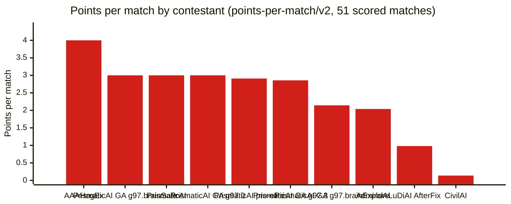
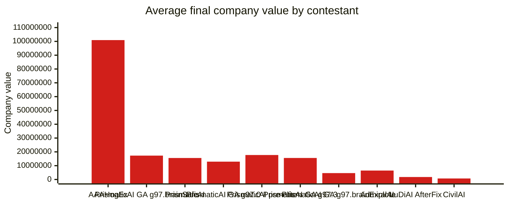
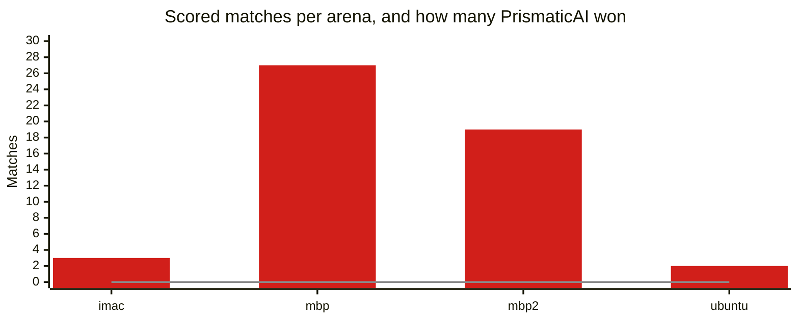

# battle-20261120T044112-632a0bda

Derived from `battle-20261120T044112-632a0bda.json` by `tools/research/ai-battle/battle.py report`; do not edit.

- Edition `632a0bda72eaa56e`: PrismaticAI and referee at `cbd774f94108d495482a04435618a1effe17f9fc`, base set `opengfx-8.0.tar`
- 20-year free-for-all from 1960, map 256x256 temperate, breakdowns 1
- 51 scored match(es) on `imac` (20261119-master-gdf1e05e7d8), `mbp` (20261120-master-m7a925f73d1), `mbp2` (20261119-master-gdf1e05e7d8), `ubuntu` (20261119-master-gdf1e05e7d8)
- Replays: 1 of 3 identical to their original on another arena

| # | Contestant | Played | Wins | Points | Points/match | Avg rank | Avg final value | Squirrel errors | Matches with anomalies |
|---|---|---|---|---|---|---|---|---|---|
| 1 | AAAHogEx | 51 | 51 | 204 | 4.0 | 1.0 | 100.9 M | 0 | 0 |
| 2 | PrismaticAI GA g97.brainSafe | 9 | 0 | 27 | 3.0 | 2.0 | 17.3 M | 0 | 0 |
| 3 | PrismaticAI | 7 | 0 | 21 | 3.0 | 2.0 | 15.6 M | 0 | 3 |
| 4 | PrismaticAI GA g97.0 | 10 | 0 | 30 | 3.0 | 2.0 | 12.9 M | 0 | 1 |
| 5 | PrismaticAI pre-elite | 11 | 0 | 32 | 2.909 | 2.09 | 17.7 M | 0 | 0 |
| 6 | PrismaticAI GA g97.3 | 7 | 0 | 20 | 2.857 | 2.14 | 15.6 M | 0 | 0 |
| 7 | PrismaticAI GA g97.brainExplore | 7 | 0 | 15 | 2.143 | 2.86 | 4.6 M | 0 | 1 |
| 8 | AdmiralAI | 51 | 0 | 104 | 2.039 | 2.96 | 6.5 M | 47 | 3 |
| 9 | LuDiAI AfterFix | 51 | 0 | 50 | 0.98 | 4.02 | 1.8 M | 0 | 3 |
| 10 | CivilAI | 51 | 0 | 7 | 0.137 | 4.86 | 729.2 k | 3665 | 6 |

```mermaid
---
config:
  xyChart:
    width: 900
    height: 360
  themeVariables:
    xyChart:
      plotColorPalette: "#d11f1a, #8a8a8a, #0b0b0b, #ece4d6"
---
xychart-beta
    title "Final company value per scored match: winner vs best PrismaticAI"
    x-axis ["m-0001", "m-0002", "m-0003", "m-0004", "m-0005", "m-0006", "m-0007", "m-0008", "m-0009", "m-0010", "m-0011", "m-0012", "m-0013", "m-0014", "m-0015", "m-0016", "m-0017", "m-0018", "m-0019", "m-0020", "m-0021", "m-0022", "m-0023", "m-0024", "m-0025", "m-0026", "m-0027", "m-0028", "m-0029", "m-0031", "m-0036", "m-0037", "m-0038", "m-0039", "m-0040", "m-0041", "m-0042", "m-0043", "m-0044", "m-0045", "m-0049", "m-0050", "m-0052", "m-0053", "m-0060", "m-0061", "m-0062", "m-0063", "m-0068", "m-0073", "m-0075"]
    %% series: Winner | Best PrismaticAI
    %% links: battle-20261120T044112-632a0bda.md?col=Match&filter=m-0001 | battle-20261120T044112-632a0bda.md?col=Match&filter=m-0002 | battle-20261120T044112-632a0bda.md?col=Match&filter=m-0003 | battle-20261120T044112-632a0bda.md?col=Match&filter=m-0004 | battle-20261120T044112-632a0bda.md?col=Match&filter=m-0005 | battle-20261120T044112-632a0bda.md?col=Match&filter=m-0006 | battle-20261120T044112-632a0bda.md?col=Match&filter=m-0007 | battle-20261120T044112-632a0bda.md?col=Match&filter=m-0008 | battle-20261120T044112-632a0bda.md?col=Match&filter=m-0009 | battle-20261120T044112-632a0bda.md?col=Match&filter=m-0010 | battle-20261120T044112-632a0bda.md?col=Match&filter=m-0011 | battle-20261120T044112-632a0bda.md?col=Match&filter=m-0012 | battle-20261120T044112-632a0bda.md?col=Match&filter=m-0013 | battle-20261120T044112-632a0bda.md?col=Match&filter=m-0014 | battle-20261120T044112-632a0bda.md?col=Match&filter=m-0015 | battle-20261120T044112-632a0bda.md?col=Match&filter=m-0016 | battle-20261120T044112-632a0bda.md?col=Match&filter=m-0017 | battle-20261120T044112-632a0bda.md?col=Match&filter=m-0018 | battle-20261120T044112-632a0bda.md?col=Match&filter=m-0019 | battle-20261120T044112-632a0bda.md?col=Match&filter=m-0020 | battle-20261120T044112-632a0bda.md?col=Match&filter=m-0021 | battle-20261120T044112-632a0bda.md?col=Match&filter=m-0022 | battle-20261120T044112-632a0bda.md?col=Match&filter=m-0023 | battle-20261120T044112-632a0bda.md?col=Match&filter=m-0024 | battle-20261120T044112-632a0bda.md?col=Match&filter=m-0025 | battle-20261120T044112-632a0bda.md?col=Match&filter=m-0026 | battle-20261120T044112-632a0bda.md?col=Match&filter=m-0027 | battle-20261120T044112-632a0bda.md?col=Match&filter=m-0028 | battle-20261120T044112-632a0bda.md?col=Match&filter=m-0029 | battle-20261120T044112-632a0bda.md?col=Match&filter=m-0031 | battle-20261120T044112-632a0bda.md?col=Match&filter=m-0036 | battle-20261120T044112-632a0bda.md?col=Match&filter=m-0037 | battle-20261120T044112-632a0bda.md?col=Match&filter=m-0038 | battle-20261120T044112-632a0bda.md?col=Match&filter=m-0039 | battle-20261120T044112-632a0bda.md?col=Match&filter=m-0040 | battle-20261120T044112-632a0bda.md?col=Match&filter=m-0041 | battle-20261120T044112-632a0bda.md?col=Match&filter=m-0042 | battle-20261120T044112-632a0bda.md?col=Match&filter=m-0043 | battle-20261120T044112-632a0bda.md?col=Match&filter=m-0044 | battle-20261120T044112-632a0bda.md?col=Match&filter=m-0045 | battle-20261120T044112-632a0bda.md?col=Match&filter=m-0049 | battle-20261120T044112-632a0bda.md?col=Match&filter=m-0050 | battle-20261120T044112-632a0bda.md?col=Match&filter=m-0052 | battle-20261120T044112-632a0bda.md?col=Match&filter=m-0053 | battle-20261120T044112-632a0bda.md?col=Match&filter=m-0060 | battle-20261120T044112-632a0bda.md?col=Match&filter=m-0061 | battle-20261120T044112-632a0bda.md?col=Match&filter=m-0062 | battle-20261120T044112-632a0bda.md?col=Match&filter=m-0063 | battle-20261120T044112-632a0bda.md?col=Match&filter=m-0068 | battle-20261120T044112-632a0bda.md?col=Match&filter=m-0073 | battle-20261120T044112-632a0bda.md?col=Match&filter=m-0075
    y-axis "Company value" 0 --> 154000000
    bar [95643074, 107802599, 79770386, 76813811, 102204464, 97014303, 103247295, 123937221, 82723744, 118560136, 126558117, 97783242, 116656249, 98284216, 95248969, 82798084, 95167510, 140419617, 127811908, 119201141, 121676944, 129060345, 118961719, 73432160, 83652513, 96624976, 93135377, 95274552, 46580046, 77968866, 118171846, 120003891, 108128822, 89733224, 104845118, 108227721, 110745943, 111385753, 122220215, 111203718, 80475055, 92444763, 71804052, 84877110, 97827142, 92977836, 90857750, 79553132, 80144341, 109396973, 138643530]
    line [9239606, 15381898, 19108138, 7480518, 11797600, 16883489, 19755490, 11024793, 15048191, 3512805, 15171349, 14002712, 17638037, 12999096, 13142578, 3114116, 19027078, 15416305, 25492676, 15770815, 23154161, 5886685, 16047067, 10290900, 9977713, 10751725, 9627665, 2040915, 13063640, 20836035, 17683716, 18314827, 16398878, 18374733, 4634188, 24673036, 15760143, 23738250, 14540180, 28108904, 14817064, 13667801, 5702987, 9267924, 18868465, 19870479, 12277637, 14573923, 6300782, 15266490, 14400862]
```

<!-- battle-charts:begin -->
<!-- derived from battle-20261120T044112-632a0bda.json by `battle.py render`; `battle.py check` fails when it is stale -->

<!-- battle-charts:end -->

| Seed | Original | Replay | Arenas | Identical |
|---|---|---|---|---|
| 183013274 | m-0013 | m-0048 | mbp2 / mbp | yes |
| 1460733152 | m-0010 | m-0064 | imac / mbp | NO |
| 1460733152 | m-0011 | m-0072 | imac / mbp | NO |

| Match | Arena | Seed | Winner | Value | Last | Anomalies |
|---|---|---|---|---|---|---|
| m-0001 | mbp | 1412335785 | AAAHogEx | 95.6 M | CivilAI | - |
| m-0002 | mbp | 1412335785 | AAAHogEx | 107.8 M | CivilAI | CivilAI: squirrel_errors:3665 |
| m-0003 | mbp | 1412335785 | AAAHogEx | 79.8 M | AdmiralAI | - |
| m-0004 | mbp | 1412335785 | AAAHogEx | 76.8 M | CivilAI | - |
| m-0005 | mbp | 1412335785 | AAAHogEx | 102.2 M | CivilAI | - |
| m-0006 | mbp | 1460733152 | AAAHogEx | 97.0 M | CivilAI | - |
| m-0007 | mbp | 1460733152 | AAAHogEx | 103.2 M | CivilAI | - |
| m-0008 | mbp | 1460733152 | AAAHogEx | 123.9 M | CivilAI | - |
| m-0009 | mbp | 1460733152 | AAAHogEx | 82.7 M | CivilAI | CivilAI: fleet_drop:62->39 |
| m-0010 | imac | 1460733152 | AAAHogEx | 118.6 M | CivilAI | - |
| m-0011 | imac | 1460733152 | AAAHogEx | 126.6 M | LuDiAI AfterFix | - |
| m-0012 | imac | 183013274 | AAAHogEx | 97.8 M | CivilAI | PrismaticAI: fleet_drop:89->54 |
| m-0013 | mbp2 | 183013274 | AAAHogEx | 116.7 M | CivilAI | - |
| m-0014 | mbp2 | 183013274 | AAAHogEx | 98.3 M | CivilAI | - |
| m-0015 | mbp2 | 183013274 | AAAHogEx | 95.2 M | CivilAI | - |
| m-0016 | mbp2 | 183013274 | AAAHogEx | 82.8 M | CivilAI | - |
| m-0017 | mbp2 | 183013274 | AAAHogEx | 95.2 M | CivilAI | LuDiAI AfterFix: fleet_drop:17->7 |
| m-0018 | mbp2 | 1809396077 | AAAHogEx | 140.4 M | CivilAI | PrismaticAI: fleet_drop:91->63 |
| m-0019 | mbp2 | 1809396077 | AAAHogEx | 127.8 M | CivilAI | CivilAI: fleet_drop:42->27 |
| m-0020 | mbp2 | 1809396077 | AAAHogEx | 119.2 M | CivilAI | PrismaticAI GA g97.0: fleet_drop:46->32 |
| m-0021 | mbp2 | 1809396077 | AAAHogEx | 121.7 M | LuDiAI AfterFix | - |
| m-0022 | mbp2 | 1809396077 | AAAHogEx | 129.1 M | CivilAI | - |
| m-0023 | mbp2 | 1809396077 | AAAHogEx | 119.0 M | CivilAI | - |
| m-0024 | mbp2 | 1667726044 | AAAHogEx | 73.4 M | LuDiAI AfterFix | CivilAI: fleet_drop:81->39 |
| m-0025 | mbp2 | 1667726044 | AAAHogEx | 83.7 M | CivilAI | - |
| m-0026 | mbp2 | 1667726044 | AAAHogEx | 96.6 M | CivilAI | - |
| m-0027 | mbp2 | 1667726044 | AAAHogEx | 93.1 M | CivilAI | - |
| m-0028 | mbp2 | 1667726044 | AAAHogEx | 95.3 M | LuDiAI AfterFix | PrismaticAI GA g97.brainExplore: fleet_drop:25->16; LuDiAI AfterFix: fleet_drop:32->20 |
| m-0029 | ubuntu | 1667726044 | AAAHogEx | 46.6 M | CivilAI | - |
| m-0031 | ubuntu | 1865937902 | AAAHogEx | 78.0 M | CivilAI | CivilAI: fleet_drop:22->12 |
| m-0036 | mbp | 1298612555 | AAAHogEx | 118.2 M | CivilAI | PrismaticAI: fleet_drop:94->62 |
| m-0037 | mbp | 1298612555 | AAAHogEx | 120.0 M | CivilAI | - |
| m-0038 | mbp | 1298612555 | AAAHogEx | 108.1 M | CivilAI | - |
| m-0039 | mbp | 1298612555 | AAAHogEx | 89.7 M | CivilAI | LuDiAI AfterFix: fleet_drop:38->26 |
| m-0040 | mbp | 1298612555 | AAAHogEx | 104.8 M | CivilAI | - |
| m-0041 | mbp | 1298612555 | AAAHogEx | 108.2 M | CivilAI | AdmiralAI: fleet_drop:210->132 |
| m-0042 | mbp | 698284442 | AAAHogEx | 110.7 M | CivilAI | AdmiralAI: squirrel_errors:47, fleet_drop:322->203 |
| m-0043 | mbp | 698284442 | AAAHogEx | 111.4 M | CivilAI | - |
| m-0044 | mbp | 698284442 | AAAHogEx | 122.2 M | LuDiAI AfterFix | AdmiralAI: fleet_drop:307->209 |
| m-0045 | mbp | 698284442 | AAAHogEx | 111.2 M | CivilAI | - |
| m-0048 (replay) | mbp | 183013274 | AAAHogEx | 116.7 M | CivilAI | - |
| m-0049 | mbp | 1618515626 | AAAHogEx | 80.5 M | CivilAI | - |
| m-0050 | mbp2 | 1618515626 | AAAHogEx | 92.4 M | CivilAI | - |
| m-0052 | mbp2 | 1618515626 | AAAHogEx | 71.8 M | CivilAI | - |
| m-0053 | mbp2 | 1618515626 | AAAHogEx | 84.9 M | CivilAI | - |
| m-0060 | mbp | 403394187 | AAAHogEx | 97.8 M | CivilAI | - |
| m-0061 | mbp | 403394187 | AAAHogEx | 93.0 M | CivilAI | CivilAI: fleet_drop:10->6 |
| m-0062 | mbp | 403394187 | AAAHogEx | 90.9 M | LuDiAI AfterFix | - |
| m-0063 | mbp | 403394187 | AAAHogEx | 79.6 M | CivilAI | - |
| m-0064 (replay) | mbp | 1460733152 | AAAHogEx | 134.7 M | CivilAI | - |
| m-0068 | mbp | 1433459175 | AAAHogEx | 80.1 M | CivilAI | - |
| m-0072 (replay) | mbp | 1460733152 | AAAHogEx | 125.7 M | LuDiAI AfterFix | - |
| m-0073 | mbp | 245175495 | AAAHogEx | 109.4 M | CivilAI | - |
| m-0075 | mbp | 245175495 | AAAHogEx | 138.6 M | CivilAI | - |
