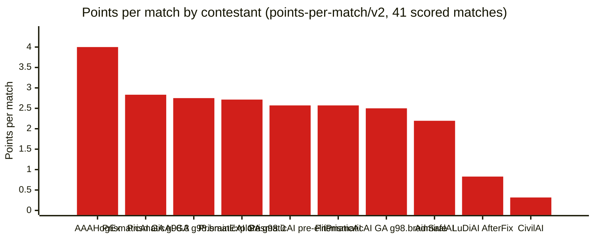
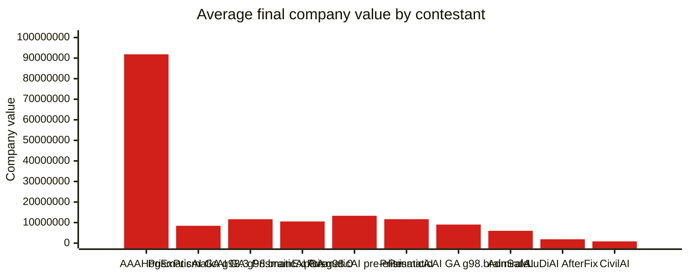
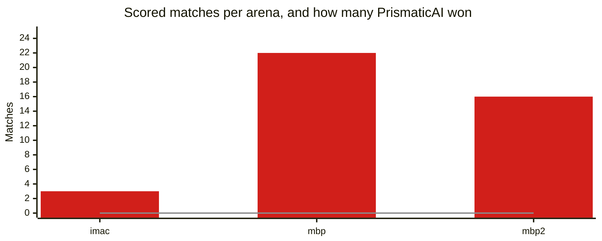

# battle-20261120T045217-682d4f00

Derived from `battle-20261120T045217-682d4f00.json` by `tools/research/ai-battle/battle.py report`; do not edit.

- Edition `682d4f00e600f0f7`: PrismaticAI and referee at `cbd774f94108d495482a04435618a1effe17f9fc`, base set `opengfx-8.0.tar`
- 20-year free-for-all from 1960, map 256x256 temperate, breakdowns 1
- 41 scored match(es) on `imac` (20261119-master-gdf1e05e7d8), `mbp` (20261120-master-m7a925f73d1), `mbp2` (20261119-master-gdf1e05e7d8)
- Replays: 0 of 1 identical to their original on another arena

| # | Contestant | Played | Wins | Points | Points/match | Avg rank | Avg final value | Squirrel errors | Matches with anomalies |
|---|---|---|---|---|---|---|---|---|---|
| 1 | AAAHogEx | 41 | 41 | 164 | 4.0 | 1.0 | 91.8 M | 0 | 0 |
| 2 | PrismaticAI GA g98.3 | 6 | 0 | 17 | 2.833 | 2.17 | 8.4 M | 0 | 0 |
| 3 | PrismaticAI GA g98.brainExplore | 8 | 0 | 22 | 2.75 | 2.25 | 11.6 M | 0 | 0 |
| 4 | PrismaticAI GA g98.0 | 7 | 0 | 19 | 2.714 | 2.29 | 10.6 M | 0 | 1 |
| 5 | PrismaticAI pre-elite | 7 | 0 | 18 | 2.571 | 2.43 | 13.3 M | 0 | 1 |
| 6 | PrismaticAI | 7 | 0 | 18 | 2.571 | 2.43 | 11.7 M | 0 | 4 |
| 7 | PrismaticAI GA g98.brainSafe | 6 | 0 | 15 | 2.5 | 2.5 | 9.0 M | 0 | 0 |
| 8 | AdmiralAI | 41 | 0 | 90 | 2.195 | 2.8 | 6.0 M | 0 | 4 |
| 9 | LuDiAI AfterFix | 41 | 0 | 34 | 0.829 | 4.17 | 1.9 M | 0 | 1 |
| 10 | CivilAI | 41 | 0 | 13 | 0.317 | 4.68 | 850.3 k | 7375 | 10 |

```mermaid
---
config:
  xyChart:
    width: 900
    height: 360
  themeVariables:
    xyChart:
      plotColorPalette: "#d11f1a, #8a8a8a, #0b0b0b, #ece4d6"
---
xychart-beta
    title "Final company value per scored match: winner vs best PrismaticAI"
    x-axis ["m-0001", "m-0002", "m-0003", "m-0004", "m-0005", "m-0006", "m-0007", "m-0008", "m-0009", "m-0010", "m-0011", "m-0012", "m-0013", "m-0014", "m-0015", "m-0016", "m-0017", "m-0018", "m-0019", "m-0020", "m-0021", "m-0022", "m-0023", "m-0024", "m-0025", "m-0026", "m-0027", "m-0028", "m-0036", "m-0037", "m-0038", "m-0039", "m-0040", "m-0041", "m-0042", "m-0043", "m-0044", "m-0046", "m-0047", "m-0052", "m-0054"]
    %% series: Winner | Best PrismaticAI
    %% links: battle-20261120T045217-682d4f00.md?col=Match&filter=m-0001 | battle-20261120T045217-682d4f00.md?col=Match&filter=m-0002 | battle-20261120T045217-682d4f00.md?col=Match&filter=m-0003 | battle-20261120T045217-682d4f00.md?col=Match&filter=m-0004 | battle-20261120T045217-682d4f00.md?col=Match&filter=m-0005 | battle-20261120T045217-682d4f00.md?col=Match&filter=m-0006 | battle-20261120T045217-682d4f00.md?col=Match&filter=m-0007 | battle-20261120T045217-682d4f00.md?col=Match&filter=m-0008 | battle-20261120T045217-682d4f00.md?col=Match&filter=m-0009 | battle-20261120T045217-682d4f00.md?col=Match&filter=m-0010 | battle-20261120T045217-682d4f00.md?col=Match&filter=m-0011 | battle-20261120T045217-682d4f00.md?col=Match&filter=m-0012 | battle-20261120T045217-682d4f00.md?col=Match&filter=m-0013 | battle-20261120T045217-682d4f00.md?col=Match&filter=m-0014 | battle-20261120T045217-682d4f00.md?col=Match&filter=m-0015 | battle-20261120T045217-682d4f00.md?col=Match&filter=m-0016 | battle-20261120T045217-682d4f00.md?col=Match&filter=m-0017 | battle-20261120T045217-682d4f00.md?col=Match&filter=m-0018 | battle-20261120T045217-682d4f00.md?col=Match&filter=m-0019 | battle-20261120T045217-682d4f00.md?col=Match&filter=m-0020 | battle-20261120T045217-682d4f00.md?col=Match&filter=m-0021 | battle-20261120T045217-682d4f00.md?col=Match&filter=m-0022 | battle-20261120T045217-682d4f00.md?col=Match&filter=m-0023 | battle-20261120T045217-682d4f00.md?col=Match&filter=m-0024 | battle-20261120T045217-682d4f00.md?col=Match&filter=m-0025 | battle-20261120T045217-682d4f00.md?col=Match&filter=m-0026 | battle-20261120T045217-682d4f00.md?col=Match&filter=m-0027 | battle-20261120T045217-682d4f00.md?col=Match&filter=m-0028 | battle-20261120T045217-682d4f00.md?col=Match&filter=m-0036 | battle-20261120T045217-682d4f00.md?col=Match&filter=m-0037 | battle-20261120T045217-682d4f00.md?col=Match&filter=m-0038 | battle-20261120T045217-682d4f00.md?col=Match&filter=m-0039 | battle-20261120T045217-682d4f00.md?col=Match&filter=m-0040 | battle-20261120T045217-682d4f00.md?col=Match&filter=m-0041 | battle-20261120T045217-682d4f00.md?col=Match&filter=m-0042 | battle-20261120T045217-682d4f00.md?col=Match&filter=m-0043 | battle-20261120T045217-682d4f00.md?col=Match&filter=m-0044 | battle-20261120T045217-682d4f00.md?col=Match&filter=m-0046 | battle-20261120T045217-682d4f00.md?col=Match&filter=m-0047 | battle-20261120T045217-682d4f00.md?col=Match&filter=m-0052 | battle-20261120T045217-682d4f00.md?col=Match&filter=m-0054
    y-axis "Company value" 0 --> 140000000
    bar [70674835, 89233494, 83730027, 68360500, 69874775, 96674810, 106250530, 92236233, 97102254, 100769420, 120489971, 66398677, 89223164, 102376985, 89480055, 84578307, 88879907, 102503441, 71100836, 77282601, 71918471, 73558660, 54880718, 115211840, 117404295, 115130261, 109725645, 127326314, 77386655, 119996412, 110115361, 72928100, 85880166, 95509708, 85285135, 95918574, 88052354, 73196818, 96041254, 111967844, 100496426]
    line [19131699, 5202695, 10882452, 13369553, 12950514, 14977055, 9954648, 11849320, 8724300, 14877657, 6945225, 12561827, 9120653, 9843762, 5961160, 8042505, 3032774, 1, 394259, 880844, 5193518, 7209274, 4514813, 13416180, 18182637, 11042529, 7331249, 9010832, 14711932, 12315261, 17290501, 16190956, 12907068, 12096887, 16285855, 24111277, 17744114, 14278067, 11113054, 13418949, 9640278]
```

<!-- battle-charts:begin -->
<!-- derived from battle-20261120T045217-682d4f00.json by `battle.py render`; `battle.py check` fails when it is stale -->

<!-- battle-charts:end -->

| Seed | Original | Replay | Arenas | Identical |
|---|---|---|---|---|
| 12991156 | m-0010 | m-0048 | imac / mbp | NO |

| Match | Arena | Seed | Winner | Value | Last | Anomalies |
|---|---|---|---|---|---|---|
| m-0001 | mbp | 1732386012 | AAAHogEx | 70.7 M | LuDiAI AfterFix | - |
| m-0002 | mbp | 1732386012 | AAAHogEx | 89.2 M | LuDiAI AfterFix | PrismaticAI GA g98.0: fleet_drop:32->14 |
| m-0003 | mbp | 1732386012 | AAAHogEx | 83.7 M | CivilAI | - |
| m-0004 | mbp | 1732386012 | AAAHogEx | 68.4 M | LuDiAI AfterFix | CivilAI: squirrel_errors:3675 |
| m-0005 | mbp | 1732386012 | AAAHogEx | 69.9 M | CivilAI | - |
| m-0006 | mbp | 12991156 | AAAHogEx | 96.7 M | LuDiAI AfterFix | CivilAI: fleet_drop:44->28 |
| m-0007 | mbp | 12991156 | AAAHogEx | 106.3 M | CivilAI | AdmiralAI: fleet_drop:253->139 |
| m-0008 | mbp | 12991156 | AAAHogEx | 92.2 M | CivilAI | CivilAI: fleet_drop:12->8 |
| m-0009 | mbp | 12991156 | AAAHogEx | 97.1 M | CivilAI | - |
| m-0010 | imac | 12991156 | AAAHogEx | 100.8 M | LuDiAI AfterFix | - |
| m-0011 | imac | 12991156 | AAAHogEx | 120.5 M | CivilAI | AdmiralAI: fleet_drop:200->127; CivilAI: fleet_drop:35->11 |
| m-0012 | imac | 231053859 | AAAHogEx | 66.4 M | LuDiAI AfterFix | PrismaticAI: fleet_drop:116->60 |
| m-0013 | mbp2 | 231053859 | AAAHogEx | 89.2 M | CivilAI | - |
| m-0014 | mbp2 | 231053859 | AAAHogEx | 102.4 M | LuDiAI AfterFix | - |
| m-0015 | mbp2 | 231053859 | AAAHogEx | 89.5 M | LuDiAI AfterFix | - |
| m-0016 | mbp2 | 231053859 | AAAHogEx | 84.6 M | LuDiAI AfterFix | LuDiAI AfterFix: fleet_drop:47->31 |
| m-0017 | mbp2 | 231053859 | AAAHogEx | 88.9 M | LuDiAI AfterFix | CivilAI: fleet_drop:80->54 |
| m-0018 | mbp2 | 1787809485 | AAAHogEx | 102.5 M | PrismaticAI | PrismaticAI: fleet_drop:12->6 |
| m-0019 | mbp2 | 1787809485 | AAAHogEx | 71.1 M | PrismaticAI pre-elite | PrismaticAI pre-elite: fleet_drop:26->14 |
| m-0020 | mbp2 | 1787809485 | AAAHogEx | 77.3 M | CivilAI | - |
| m-0021 | mbp2 | 1787809485 | AAAHogEx | 71.9 M | CivilAI | - |
| m-0022 | mbp2 | 1787809485 | AAAHogEx | 73.6 M | CivilAI | - |
| m-0023 | mbp2 | 1787809485 | AAAHogEx | 54.9 M | CivilAI | AdmiralAI: fleet_drop:237->156 |
| m-0024 | mbp2 | 379342950 | AAAHogEx | 115.2 M | CivilAI | PrismaticAI: fleet_drop:80->51 |
| m-0025 | mbp2 | 379342950 | AAAHogEx | 117.4 M | CivilAI | - |
| m-0026 | mbp2 | 379342950 | AAAHogEx | 115.1 M | CivilAI | - |
| m-0027 | mbp2 | 379342950 | AAAHogEx | 109.7 M | CivilAI | - |
| m-0028 | mbp2 | 379342950 | AAAHogEx | 127.3 M | CivilAI | CivilAI: fleet_drop:32->16 |
| m-0036 | mbp | 937592347 | AAAHogEx | 77.4 M | CivilAI | CivilAI: squirrel_errors:3700, fleet_drop:34->19 |
| m-0037 | mbp | 937592347 | AAAHogEx | 120.0 M | CivilAI | AdmiralAI: fleet_drop:152->83 |
| m-0038 | mbp | 937592347 | AAAHogEx | 110.1 M | CivilAI | CivilAI: fleet_drop:44->22 |
| m-0039 | mbp | 937592347 | AAAHogEx | 72.9 M | CivilAI | - |
| m-0040 | mbp | 937592347 | AAAHogEx | 85.9 M | CivilAI | - |
| m-0041 | mbp | 937592347 | AAAHogEx | 95.5 M | CivilAI | - |
| m-0042 | mbp | 1372726110 | AAAHogEx | 85.3 M | CivilAI | - |
| m-0043 | mbp | 1372726110 | AAAHogEx | 95.9 M | CivilAI | - |
| m-0044 | mbp | 1372726110 | AAAHogEx | 88.1 M | CivilAI | - |
| m-0046 | mbp | 1372726110 | AAAHogEx | 73.2 M | CivilAI | - |
| m-0047 | mbp | 1372726110 | AAAHogEx | 96.0 M | CivilAI | - |
| m-0048 (replay) | mbp | 12991156 | AAAHogEx | 103.1 M | LuDiAI AfterFix | AdmiralAI: fleet_drop:157->99 |
| m-0052 | mbp | 279155095 | AAAHogEx | 112.0 M | LuDiAI AfterFix | CivilAI: fleet_drop:63->43 |
| m-0054 | mbp | 944767621 | AAAHogEx | 100.5 M | CivilAI | PrismaticAI: fleet_drop:86->50; CivilAI: no_vehicles |
