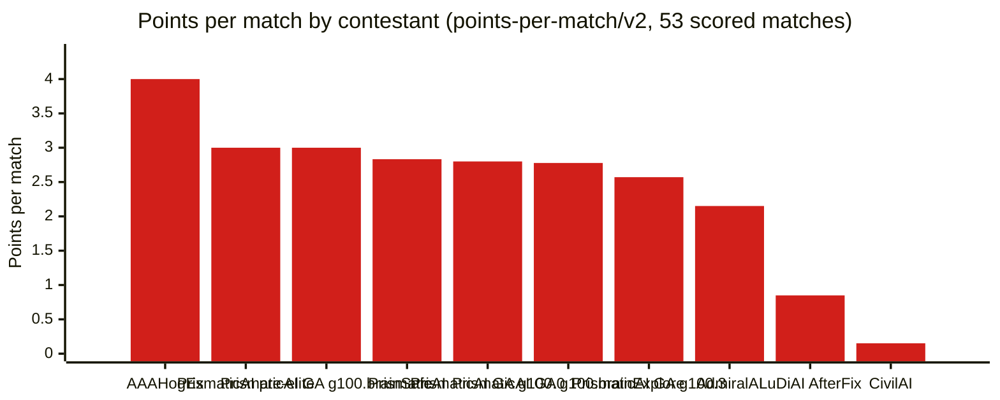
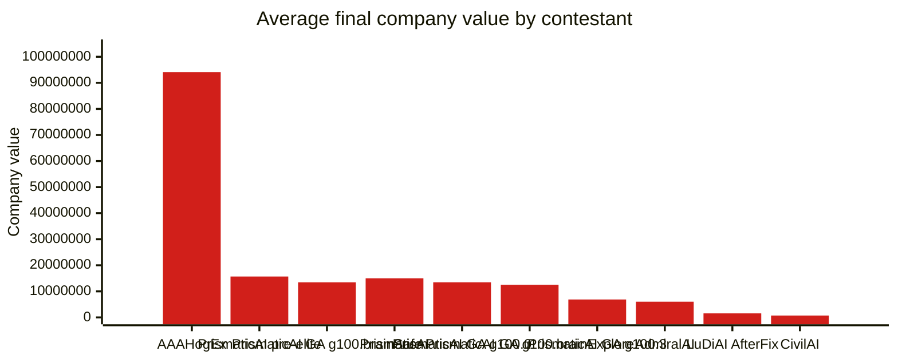
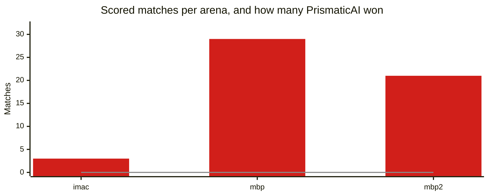

# battle-20261120T051858-8bd335c4

Derived from `battle-20261120T051858-8bd335c4.json` by `tools/research/ai-battle/battle.py report`; do not edit.

- Edition `8bd335c4b908cab8`: PrismaticAI and referee at `cbd774f94108d495482a04435618a1effe17f9fc`, base set `opengfx-8.0.tar`
- 20-year free-for-all from 1960, map 256x256 temperate, breakdowns 1
- 53 scored match(es) on `imac` (20261119-master-gdf1e05e7d8), `mbp` (20261120-master-m7a925f73d1), `mbp2` (20261119-master-gdf1e05e7d8)
- Replays: 2 of 3 identical to their original on another arena

| # | Contestant | Played | Wins | Points | Points/match | Avg rank | Avg final value | Squirrel errors | Matches with anomalies |
|---|---|---|---|---|---|---|---|---|---|
| 1 | AAAHogEx | 53 | 53 | 212 | 4.0 | 1.0 | 94.1 M | 0 | 0 |
| 2 | PrismaticAI pre-elite | 11 | 0 | 33 | 3.0 | 2.0 | 15.7 M | 0 | 0 |
| 3 | PrismaticAI GA g100.brainSafe | 10 | 0 | 30 | 3.0 | 2.0 | 13.4 M | 0 | 0 |
| 4 | PrismaticAI | 6 | 0 | 17 | 2.833 | 2.17 | 15.0 M | 0 | 3 |
| 5 | PrismaticAI GA g100.0 | 10 | 0 | 28 | 2.8 | 2.2 | 13.5 M | 0 | 0 |
| 6 | PrismaticAI GA g100.brainExplore | 9 | 0 | 25 | 2.778 | 2.22 | 12.5 M | 0 | 0 |
| 7 | PrismaticAI GA g100.3 | 7 | 0 | 18 | 2.571 | 2.43 | 6.9 M | 0 | 0 |
| 8 | AdmiralAI | 53 | 0 | 114 | 2.151 | 2.85 | 6.0 M | 47 | 3 |
| 9 | LuDiAI AfterFix | 53 | 0 | 45 | 0.849 | 4.15 | 1.5 M | 0 | 2 |
| 10 | CivilAI | 53 | 0 | 8 | 0.151 | 4.85 | 714.1 k | 0 | 4 |

```mermaid
---
config:
  xyChart:
    width: 900
    height: 360
  themeVariables:
    xyChart:
      plotColorPalette: "#d11f1a, #8a8a8a, #0b0b0b, #ece4d6"
---
xychart-beta
    title "Final company value per scored match: winner vs best PrismaticAI"
    x-axis ["m-0001", "m-0002", "m-0003", "m-0004", "m-0005", "m-0006", "m-0007", "m-0008", "m-0009", "m-0010", "m-0011", "m-0012", "m-0013", "m-0014", "m-0015", "m-0016", "m-0017", "m-0018", "m-0019", "m-0020", "m-0021", "m-0022", "m-0023", "m-0024", "m-0025", "m-0026", "m-0027", "m-0028", "m-0036", "m-0037", "m-0038", "m-0039", "m-0040", "m-0041", "m-0042", "m-0043", "m-0044", "m-0045", "m-0046", "m-0049", "m-0050", "m-0051", "m-0052", "m-0053", "m-0055", "m-0057", "m-0058", "m-0062", "m-0067", "m-0073", "m-0074", "m-0075", "m-0077"]
    %% series: Winner | Best PrismaticAI
    %% links: battle-20261120T051858-8bd335c4.md?col=Match&filter=m-0001 | battle-20261120T051858-8bd335c4.md?col=Match&filter=m-0002 | battle-20261120T051858-8bd335c4.md?col=Match&filter=m-0003 | battle-20261120T051858-8bd335c4.md?col=Match&filter=m-0004 | battle-20261120T051858-8bd335c4.md?col=Match&filter=m-0005 | battle-20261120T051858-8bd335c4.md?col=Match&filter=m-0006 | battle-20261120T051858-8bd335c4.md?col=Match&filter=m-0007 | battle-20261120T051858-8bd335c4.md?col=Match&filter=m-0008 | battle-20261120T051858-8bd335c4.md?col=Match&filter=m-0009 | battle-20261120T051858-8bd335c4.md?col=Match&filter=m-0010 | battle-20261120T051858-8bd335c4.md?col=Match&filter=m-0011 | battle-20261120T051858-8bd335c4.md?col=Match&filter=m-0012 | battle-20261120T051858-8bd335c4.md?col=Match&filter=m-0013 | battle-20261120T051858-8bd335c4.md?col=Match&filter=m-0014 | battle-20261120T051858-8bd335c4.md?col=Match&filter=m-0015 | battle-20261120T051858-8bd335c4.md?col=Match&filter=m-0016 | battle-20261120T051858-8bd335c4.md?col=Match&filter=m-0017 | battle-20261120T051858-8bd335c4.md?col=Match&filter=m-0018 | battle-20261120T051858-8bd335c4.md?col=Match&filter=m-0019 | battle-20261120T051858-8bd335c4.md?col=Match&filter=m-0020 | battle-20261120T051858-8bd335c4.md?col=Match&filter=m-0021 | battle-20261120T051858-8bd335c4.md?col=Match&filter=m-0022 | battle-20261120T051858-8bd335c4.md?col=Match&filter=m-0023 | battle-20261120T051858-8bd335c4.md?col=Match&filter=m-0024 | battle-20261120T051858-8bd335c4.md?col=Match&filter=m-0025 | battle-20261120T051858-8bd335c4.md?col=Match&filter=m-0026 | battle-20261120T051858-8bd335c4.md?col=Match&filter=m-0027 | battle-20261120T051858-8bd335c4.md?col=Match&filter=m-0028 | battle-20261120T051858-8bd335c4.md?col=Match&filter=m-0036 | battle-20261120T051858-8bd335c4.md?col=Match&filter=m-0037 | battle-20261120T051858-8bd335c4.md?col=Match&filter=m-0038 | battle-20261120T051858-8bd335c4.md?col=Match&filter=m-0039 | battle-20261120T051858-8bd335c4.md?col=Match&filter=m-0040 | battle-20261120T051858-8bd335c4.md?col=Match&filter=m-0041 | battle-20261120T051858-8bd335c4.md?col=Match&filter=m-0042 | battle-20261120T051858-8bd335c4.md?col=Match&filter=m-0043 | battle-20261120T051858-8bd335c4.md?col=Match&filter=m-0044 | battle-20261120T051858-8bd335c4.md?col=Match&filter=m-0045 | battle-20261120T051858-8bd335c4.md?col=Match&filter=m-0046 | battle-20261120T051858-8bd335c4.md?col=Match&filter=m-0049 | battle-20261120T051858-8bd335c4.md?col=Match&filter=m-0050 | battle-20261120T051858-8bd335c4.md?col=Match&filter=m-0051 | battle-20261120T051858-8bd335c4.md?col=Match&filter=m-0052 | battle-20261120T051858-8bd335c4.md?col=Match&filter=m-0053 | battle-20261120T051858-8bd335c4.md?col=Match&filter=m-0055 | battle-20261120T051858-8bd335c4.md?col=Match&filter=m-0057 | battle-20261120T051858-8bd335c4.md?col=Match&filter=m-0058 | battle-20261120T051858-8bd335c4.md?col=Match&filter=m-0062 | battle-20261120T051858-8bd335c4.md?col=Match&filter=m-0067 | battle-20261120T051858-8bd335c4.md?col=Match&filter=m-0073 | battle-20261120T051858-8bd335c4.md?col=Match&filter=m-0074 | battle-20261120T051858-8bd335c4.md?col=Match&filter=m-0075 | battle-20261120T051858-8bd335c4.md?col=Match&filter=m-0077
    y-axis "Company value" 0 --> 146000000
    bar [106774599, 129673986, 110959115, 113825608, 102369952, 106322539, 93815493, 91506842, 105787719, 86232936, 109304716, 99127831, 104106294, 117054850, 133119608, 111644503, 118850970, 66515258, 63136639, 47716597, 91768267, 69644815, 70980617, 101600534, 88448767, 96880941, 99615741, 101006758, 83298928, 95111978, 113982112, 89339517, 85974196, 86954051, 83781165, 101677607, 112680119, 99998654, 87068341, 98643941, 104967277, 77711423, 92930311, 88230251, 63958284, 78940679, 82462653, 115663317, 89330772, 78812445, 66662041, 80395547, 90894836]
    line [27590904, 19138069, 16382583, 17557640, 12569183, 9073233, 11776181, 9639980, 8566621, 10453425, 10144911, 24638226, 14835460, 17346556, 11565002, 13243619, 6318648, 13678198, 15896358, 14273514, 13647906, 9813335, 6452544, 19046560, 18213858, 15887436, 14896028, 15079082, 19854598, 12856462, 8992993, 22578009, 14722791, 3166767, 3615067, 8006962, 4089476, 3957121, 3655699, 15138154, 4888039, 12269785, 12848599, 6177236, 12307821, 15672377, 15264961, 21968278, 25742612, 10276221, 18348687, 14921961, 3288233]
```

<!-- battle-charts:begin -->
<!-- derived from battle-20261120T051858-8bd335c4.json by `battle.py render`; `battle.py check` fails when it is stale -->

<!-- battle-charts:end -->

| Seed | Original | Replay | Arenas | Identical |
|---|---|---|---|---|
| 368739496 | m-0001 | m-0048 | mbp / mbp2 | yes |
| 1088837125 | m-0018 | m-0056 | mbp2 / mbp | yes |
| 1109918121 | m-0010 | m-0072 | imac / mbp | NO |

| Match | Arena | Seed | Winner | Value | Last | Anomalies |
|---|---|---|---|---|---|---|
| m-0001 | mbp | 368739496 | AAAHogEx | 106.8 M | CivilAI | - |
| m-0002 | mbp | 368739496 | AAAHogEx | 129.7 M | CivilAI | - |
| m-0003 | mbp | 368739496 | AAAHogEx | 111.0 M | CivilAI | - |
| m-0004 | mbp | 368739496 | AAAHogEx | 113.8 M | CivilAI | - |
| m-0005 | mbp | 368739496 | AAAHogEx | 102.4 M | CivilAI | - |
| m-0006 | mbp | 1109918121 | AAAHogEx | 106.3 M | LuDiAI AfterFix | LuDiAI AfterFix: fleet_drop:65->43 |
| m-0007 | mbp | 1109918121 | AAAHogEx | 93.8 M | CivilAI | LuDiAI AfterFix: fleet_drop:136->74 |
| m-0008 | mbp | 1109918121 | AAAHogEx | 91.5 M | CivilAI | - |
| m-0009 | mbp | 1109918121 | AAAHogEx | 105.8 M | CivilAI | - |
| m-0010 | imac | 1109918121 | AAAHogEx | 86.2 M | CivilAI | CivilAI: fleet_drop:37->23 |
| m-0011 | imac | 1109918121 | AAAHogEx | 109.3 M | CivilAI | - |
| m-0012 | imac | 1481738629 | AAAHogEx | 99.1 M | CivilAI | - |
| m-0013 | mbp2 | 1481738629 | AAAHogEx | 104.1 M | CivilAI | - |
| m-0014 | mbp2 | 1481738629 | AAAHogEx | 117.1 M | CivilAI | - |
| m-0015 | mbp2 | 1481738629 | AAAHogEx | 133.1 M | CivilAI | - |
| m-0016 | mbp2 | 1481738629 | AAAHogEx | 111.6 M | CivilAI | - |
| m-0017 | mbp2 | 1481738629 | AAAHogEx | 118.9 M | LuDiAI AfterFix | - |
| m-0018 | mbp2 | 1088837125 | AAAHogEx | 66.5 M | CivilAI | PrismaticAI: fleet_drop:62->43 |
| m-0019 | mbp2 | 1088837125 | AAAHogEx | 63.1 M | LuDiAI AfterFix | - |
| m-0020 | mbp2 | 1088837125 | AAAHogEx | 47.7 M | CivilAI | CivilAI: fleet_drop:22->14 |
| m-0021 | mbp2 | 1088837125 | AAAHogEx | 91.8 M | CivilAI | - |
| m-0022 | mbp2 | 1088837125 | AAAHogEx | 69.6 M | CivilAI | - |
| m-0023 | mbp2 | 1088837125 | AAAHogEx | 71.0 M | CivilAI | - |
| m-0024 | mbp2 | 1094551225 | AAAHogEx | 101.6 M | CivilAI | - |
| m-0025 | mbp2 | 1094551225 | AAAHogEx | 88.4 M | CivilAI | AdmiralAI: fleet_drop:202->124 |
| m-0026 | mbp2 | 1094551225 | AAAHogEx | 96.9 M | CivilAI | - |
| m-0027 | mbp2 | 1094551225 | AAAHogEx | 99.6 M | LuDiAI AfterFix | - |
| m-0028 | mbp2 | 1094551225 | AAAHogEx | 101.0 M | CivilAI | - |
| m-0036 | mbp | 1698476308 | AAAHogEx | 83.3 M | CivilAI | PrismaticAI: fleet_drop:124->58; CivilAI: no_vehicles |
| m-0037 | mbp | 1698476308 | AAAHogEx | 95.1 M | LuDiAI AfterFix | - |
| m-0038 | mbp | 1698476308 | AAAHogEx | 114.0 M | LuDiAI AfterFix | - |
| m-0039 | mbp | 1698476308 | AAAHogEx | 89.3 M | CivilAI | - |
| m-0040 | mbp | 1698476308 | AAAHogEx | 86.0 M | CivilAI | - |
| m-0041 | mbp | 1698476308 | AAAHogEx | 87.0 M | CivilAI | - |
| m-0042 | mbp | 285767529 | AAAHogEx | 83.8 M | CivilAI | PrismaticAI: fleet_drop:71->46 |
| m-0043 | mbp | 285767529 | AAAHogEx | 101.7 M | LuDiAI AfterFix | - |
| m-0044 | mbp | 285767529 | AAAHogEx | 112.7 M | CivilAI | CivilAI: fleet_drop:62->23 |
| m-0045 | mbp2 | 285767529 | AAAHogEx | 100.0 M | CivilAI | - |
| m-0046 | mbp2 | 285767529 | AAAHogEx | 87.1 M | CivilAI | - |
| m-0048 (replay) | mbp2 | 368739496 | AAAHogEx | 106.8 M | CivilAI | - |
| m-0049 | mbp2 | 1238250544 | AAAHogEx | 98.6 M | CivilAI | - |
| m-0050 | mbp2 | 1238250544 | AAAHogEx | 105.0 M | CivilAI | - |
| m-0051 | mbp | 1238250544 | AAAHogEx | 77.7 M | CivilAI | - |
| m-0052 | mbp | 1238250544 | AAAHogEx | 92.9 M | CivilAI | - |
| m-0053 | mbp2 | 1238250544 | AAAHogEx | 88.2 M | CivilAI | - |
| m-0055 | mbp | 1707847144 | AAAHogEx | 64.0 M | CivilAI | - |
| m-0056 (replay) | mbp | 1088837125 | AAAHogEx | 66.5 M | CivilAI | PrismaticAI: fleet_drop:62->43 |
| m-0057 | mbp | 1707847144 | AAAHogEx | 78.9 M | CivilAI | - |
| m-0058 | mbp | 1707847144 | AAAHogEx | 82.5 M | CivilAI | - |
| m-0062 | mbp | 135128610 | AAAHogEx | 115.7 M | CivilAI | AdmiralAI: fleet_drop:255->174 |
| m-0067 | mbp | 212014714 | AAAHogEx | 89.3 M | CivilAI | - |
| m-0072 (replay) | mbp | 1109918121 | AAAHogEx | 87.5 M | CivilAI | - |
| m-0073 | mbp | 1973163654 | AAAHogEx | 78.8 M | LuDiAI AfterFix | - |
| m-0074 | mbp | 1973163654 | AAAHogEx | 66.7 M | CivilAI | - |
| m-0075 | mbp | 1973163654 | AAAHogEx | 80.4 M | CivilAI | AdmiralAI: squirrel_errors:47 |
| m-0077 | mbp | 1973163654 | AAAHogEx | 90.9 M | CivilAI | - |
