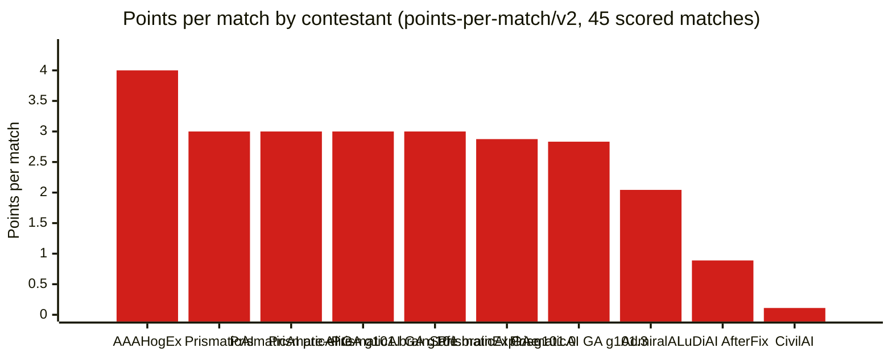
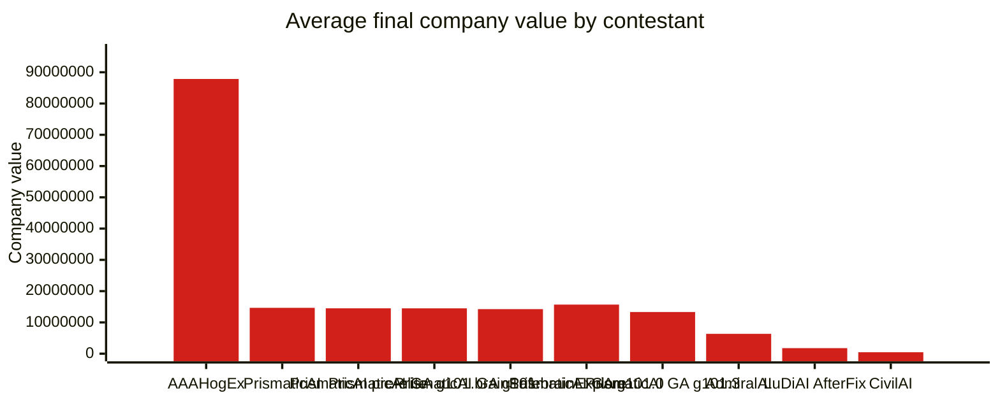
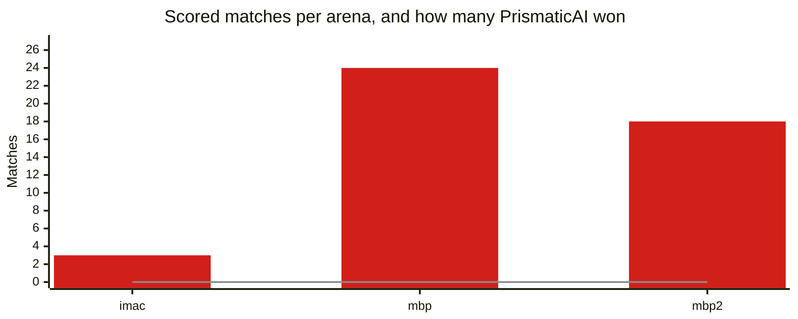

# battle-20261120T052836-528348a4

Derived from `battle-20261120T052836-528348a4.json` by `tools/research/ai-battle/battle.py report`; do not edit.

- Edition `528348a4552f19a9`: PrismaticAI and referee at `cbd774f94108d495482a04435618a1effe17f9fc`, base set `opengfx-8.0.tar`
- 20-year free-for-all from 1960, map 256x256 temperate, breakdowns 1
- 45 scored match(es) on `imac` (20261119-master-gdf1e05e7d8), `mbp` (20261120-master-m7a925f73d1), `mbp2` (20261119-master-gdf1e05e7d8)
- Replays: 0 of 1 identical to their original on another arena

| # | Contestant | Played | Wins | Points | Points/match | Avg rank | Avg final value | Squirrel errors | Matches with anomalies |
|---|---|---|---|---|---|---|---|---|---|
| 1 | AAAHogEx | 45 | 45 | 180 | 4.0 | 1.0 | 87.9 M | 0 | 0 |
| 2 | PrismaticAI | 8 | 0 | 24 | 3.0 | 2.0 | 14.7 M | 0 | 4 |
| 3 | PrismaticAI pre-elite | 9 | 0 | 27 | 3.0 | 2.0 | 14.5 M | 0 | 1 |
| 4 | PrismaticAI GA g101.brainSafe | 7 | 0 | 21 | 3.0 | 2.0 | 14.5 M | 0 | 1 |
| 5 | PrismaticAI GA g101.brainExplore | 7 | 0 | 21 | 3.0 | 2.0 | 14.2 M | 0 | 3 |
| 6 | PrismaticAI GA g101.0 | 8 | 0 | 23 | 2.875 | 2.12 | 15.7 M | 0 | 2 |
| 7 | PrismaticAI GA g101.3 | 6 | 0 | 17 | 2.833 | 2.17 | 13.3 M | 0 | 0 |
| 8 | AdmiralAI | 45 | 0 | 92 | 2.044 | 2.96 | 6.3 M | 106 | 2 |
| 9 | LuDiAI AfterFix | 45 | 0 | 40 | 0.889 | 4.11 | 1.8 M | 0 | 1 |
| 10 | CivilAI | 45 | 0 | 5 | 0.111 | 4.89 | 452.0 k | 0 | 8 |

```mermaid
---
config:
  xyChart:
    width: 900
    height: 360
  themeVariables:
    xyChart:
      plotColorPalette: "#d11f1a, #8a8a8a, #0b0b0b, #ece4d6"
---
xychart-beta
    title "Final company value per scored match: winner vs best PrismaticAI"
    x-axis ["m-0001", "m-0002", "m-0003", "m-0004", "m-0005", "m-0006", "m-0007", "m-0008", "m-0009", "m-0010", "m-0011", "m-0012", "m-0013", "m-0014", "m-0015", "m-0016", "m-0017", "m-0018", "m-0019", "m-0020", "m-0021", "m-0022", "m-0023", "m-0024", "m-0025", "m-0026", "m-0027", "m-0028", "m-0036", "m-0037", "m-0038", "m-0039", "m-0040", "m-0041", "m-0042", "m-0043", "m-0044", "m-0045", "m-0046", "m-0054", "m-0055", "m-0065", "m-0066", "m-0067", "m-0068"]
    %% series: Winner | Best PrismaticAI
    %% links: battle-20261120T052836-528348a4.md?col=Match&filter=m-0001 | battle-20261120T052836-528348a4.md?col=Match&filter=m-0002 | battle-20261120T052836-528348a4.md?col=Match&filter=m-0003 | battle-20261120T052836-528348a4.md?col=Match&filter=m-0004 | battle-20261120T052836-528348a4.md?col=Match&filter=m-0005 | battle-20261120T052836-528348a4.md?col=Match&filter=m-0006 | battle-20261120T052836-528348a4.md?col=Match&filter=m-0007 | battle-20261120T052836-528348a4.md?col=Match&filter=m-0008 | battle-20261120T052836-528348a4.md?col=Match&filter=m-0009 | battle-20261120T052836-528348a4.md?col=Match&filter=m-0010 | battle-20261120T052836-528348a4.md?col=Match&filter=m-0011 | battle-20261120T052836-528348a4.md?col=Match&filter=m-0012 | battle-20261120T052836-528348a4.md?col=Match&filter=m-0013 | battle-20261120T052836-528348a4.md?col=Match&filter=m-0014 | battle-20261120T052836-528348a4.md?col=Match&filter=m-0015 | battle-20261120T052836-528348a4.md?col=Match&filter=m-0016 | battle-20261120T052836-528348a4.md?col=Match&filter=m-0017 | battle-20261120T052836-528348a4.md?col=Match&filter=m-0018 | battle-20261120T052836-528348a4.md?col=Match&filter=m-0019 | battle-20261120T052836-528348a4.md?col=Match&filter=m-0020 | battle-20261120T052836-528348a4.md?col=Match&filter=m-0021 | battle-20261120T052836-528348a4.md?col=Match&filter=m-0022 | battle-20261120T052836-528348a4.md?col=Match&filter=m-0023 | battle-20261120T052836-528348a4.md?col=Match&filter=m-0024 | battle-20261120T052836-528348a4.md?col=Match&filter=m-0025 | battle-20261120T052836-528348a4.md?col=Match&filter=m-0026 | battle-20261120T052836-528348a4.md?col=Match&filter=m-0027 | battle-20261120T052836-528348a4.md?col=Match&filter=m-0028 | battle-20261120T052836-528348a4.md?col=Match&filter=m-0036 | battle-20261120T052836-528348a4.md?col=Match&filter=m-0037 | battle-20261120T052836-528348a4.md?col=Match&filter=m-0038 | battle-20261120T052836-528348a4.md?col=Match&filter=m-0039 | battle-20261120T052836-528348a4.md?col=Match&filter=m-0040 | battle-20261120T052836-528348a4.md?col=Match&filter=m-0041 | battle-20261120T052836-528348a4.md?col=Match&filter=m-0042 | battle-20261120T052836-528348a4.md?col=Match&filter=m-0043 | battle-20261120T052836-528348a4.md?col=Match&filter=m-0044 | battle-20261120T052836-528348a4.md?col=Match&filter=m-0045 | battle-20261120T052836-528348a4.md?col=Match&filter=m-0046 | battle-20261120T052836-528348a4.md?col=Match&filter=m-0054 | battle-20261120T052836-528348a4.md?col=Match&filter=m-0055 | battle-20261120T052836-528348a4.md?col=Match&filter=m-0065 | battle-20261120T052836-528348a4.md?col=Match&filter=m-0066 | battle-20261120T052836-528348a4.md?col=Match&filter=m-0067 | battle-20261120T052836-528348a4.md?col=Match&filter=m-0068
    y-axis "Company value" 0 --> 142000000
    bar [108384606, 102959146, 112851191, 92109640, 93329680, 80302438, 104585061, 72973936, 87232897, 100162511, 88474241, 62378281, 63896524, 59896617, 74920283, 52963785, 57282189, 129522450, 78447749, 109001601, 101109667, 98935019, 108095800, 86302307, 73061591, 64546611, 82804118, 82722639, 94310823, 97607916, 95321613, 85563350, 102232672, 72580486, 94217918, 77474467, 65387640, 91691617, 65619478, 99053426, 93735988, 122829527, 92531215, 85715809, 88301840]
    line [17676627, 18026639, 19300023, 21694944, 20670500, 16013728, 5806646, 5215025, 9341461, 6405871, 7124526, 16926825, 17114967, 13449797, 9105779, 11134516, 14693189, 6978430, 19021148, 21835872, 17368614, 20934070, 8343870, 11908750, 17520415, 10104319, 13500101, 12814474, 20494416, 15708884, 17405607, 19637485, 14788242, 14063908, 14775412, 11192732, 13228217, 13187397, 11917797, 14075663, 10610288, 15030271, 16080944, 15874810, 26265673]
```

<!-- battle-charts:begin -->
<!-- derived from battle-20261120T052836-528348a4.json by `battle.py render`; `battle.py check` fails when it is stale -->

<!-- battle-charts:end -->

| Seed | Original | Replay | Arenas | Identical |
|---|---|---|---|---|
| 1913024246 | m-0010 | m-0064 | imac / mbp | NO |

| Match | Arena | Seed | Winner | Value | Last | Anomalies |
|---|---|---|---|---|---|---|
| m-0001 | mbp | 1792568953 | AAAHogEx | 108.4 M | CivilAI | - |
| m-0002 | mbp | 1792568953 | AAAHogEx | 103.0 M | LuDiAI AfterFix | - |
| m-0003 | mbp | 1792568953 | AAAHogEx | 112.9 M | CivilAI | - |
| m-0004 | mbp | 1792568953 | AAAHogEx | 92.1 M | CivilAI | - |
| m-0005 | mbp | 1792568953 | AAAHogEx | 93.3 M | LuDiAI AfterFix | - |
| m-0006 | mbp | 1913024246 | AAAHogEx | 80.3 M | CivilAI | - |
| m-0007 | mbp | 1913024246 | AAAHogEx | 104.6 M | CivilAI | CivilAI: no_vehicles |
| m-0008 | mbp | 1913024246 | AAAHogEx | 73.0 M | CivilAI | PrismaticAI GA g101.0: fleet_drop:32->21 |
| m-0009 | mbp | 1913024246 | AAAHogEx | 87.2 M | CivilAI | PrismaticAI GA g101.brainSafe: fleet_drop:39->26 |
| m-0010 | imac | 1913024246 | AAAHogEx | 100.2 M | CivilAI | PrismaticAI GA g101.brainExplore: fleet_drop:34->22; AdmiralAI: squirrel_errors:59 |
| m-0011 | imac | 1913024246 | AAAHogEx | 88.5 M | CivilAI | CivilAI: no_vehicles |
| m-0012 | imac | 957534335 | AAAHogEx | 62.4 M | CivilAI | - |
| m-0013 | mbp2 | 957534335 | AAAHogEx | 63.9 M | CivilAI | - |
| m-0014 | mbp2 | 957534335 | AAAHogEx | 59.9 M | CivilAI | - |
| m-0015 | mbp2 | 957534335 | AAAHogEx | 74.9 M | CivilAI | CivilAI: fleet_drop:18->9 |
| m-0016 | mbp2 | 957534335 | AAAHogEx | 53.0 M | CivilAI | PrismaticAI GA g101.brainExplore: fleet_drop:56->34 |
| m-0017 | mbp2 | 957534335 | AAAHogEx | 57.3 M | CivilAI | - |
| m-0018 | mbp2 | 153481036 | AAAHogEx | 129.5 M | CivilAI | PrismaticAI: fleet_drop:94->46 |
| m-0019 | mbp2 | 153481036 | AAAHogEx | 78.4 M | CivilAI | - |
| m-0020 | mbp2 | 153481036 | AAAHogEx | 109.0 M | CivilAI | - |
| m-0021 | mbp2 | 153481036 | AAAHogEx | 101.1 M | CivilAI | - |
| m-0022 | mbp2 | 153481036 | AAAHogEx | 98.9 M | CivilAI | CivilAI: no_vehicles |
| m-0023 | mbp2 | 153481036 | AAAHogEx | 108.1 M | CivilAI | - |
| m-0024 | mbp2 | 476892618 | AAAHogEx | 86.3 M | CivilAI | - |
| m-0025 | mbp2 | 476892618 | AAAHogEx | 73.1 M | CivilAI | - |
| m-0026 | mbp2 | 476892618 | AAAHogEx | 64.5 M | CivilAI | PrismaticAI GA g101.0: fleet_drop:45->25 |
| m-0027 | mbp2 | 476892618 | AAAHogEx | 82.8 M | CivilAI | CivilAI: fleet_drop:18->5 |
| m-0028 | mbp2 | 476892618 | AAAHogEx | 82.7 M | CivilAI | AdmiralAI: squirrel_errors:47 |
| m-0036 | mbp | 184694360 | AAAHogEx | 94.3 M | CivilAI | PrismaticAI: fleet_drop:122->67 |
| m-0037 | mbp | 184694360 | AAAHogEx | 97.6 M | CivilAI | PrismaticAI pre-elite: fleet_drop:91->56; LuDiAI AfterFix: fleet_drop:166->103 |
| m-0038 | mbp | 184694360 | AAAHogEx | 95.3 M | CivilAI | - |
| m-0039 | mbp | 184694360 | AAAHogEx | 85.6 M | CivilAI | - |
| m-0040 | mbp | 184694360 | AAAHogEx | 102.2 M | CivilAI | - |
| m-0041 | mbp | 184694360 | AAAHogEx | 72.6 M | CivilAI | - |
| m-0042 | mbp | 96910726 | AAAHogEx | 94.2 M | LuDiAI AfterFix | PrismaticAI: fleet_drop:73->34; CivilAI: fleet_drop:25->6 |
| m-0043 | mbp | 96910726 | AAAHogEx | 77.5 M | CivilAI | - |
| m-0044 | mbp | 96910726 | AAAHogEx | 65.4 M | CivilAI | - |
| m-0045 | mbp2 | 96910726 | AAAHogEx | 91.7 M | CivilAI | CivilAI: no_vehicles |
| m-0046 | mbp2 | 96910726 | AAAHogEx | 65.6 M | CivilAI | PrismaticAI GA g101.brainExplore: fleet_drop:44->30; CivilAI: fleet_drop:34->13 |
| m-0054 | mbp | 427099258 | AAAHogEx | 99.1 M | CivilAI | PrismaticAI: fleet_drop:81->46 |
| m-0055 | mbp | 427099258 | AAAHogEx | 93.7 M | CivilAI | - |
| m-0064 (replay) | mbp | 1913024246 | AAAHogEx | 105.6 M | CivilAI | AdmiralAI: squirrel_errors:59 |
| m-0065 | mbp | 940776333 | AAAHogEx | 122.8 M | CivilAI | - |
| m-0066 | mbp | 1565059575 | AAAHogEx | 92.5 M | LuDiAI AfterFix | - |
| m-0067 | mbp | 1565059575 | AAAHogEx | 85.7 M | LuDiAI AfterFix | - |
| m-0068 | mbp | 1565059575 | AAAHogEx | 88.3 M | CivilAI | - |
