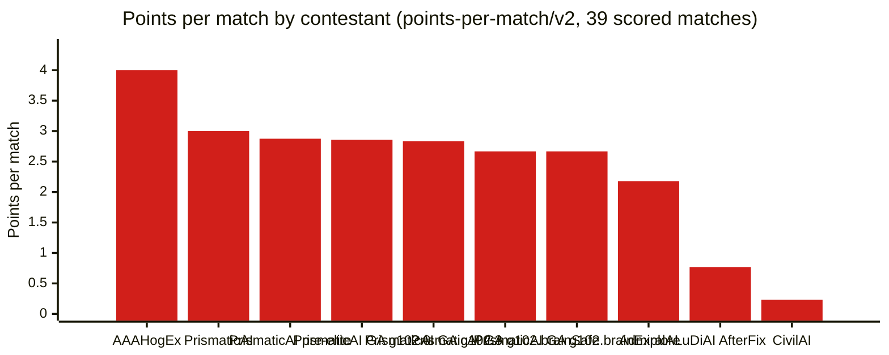
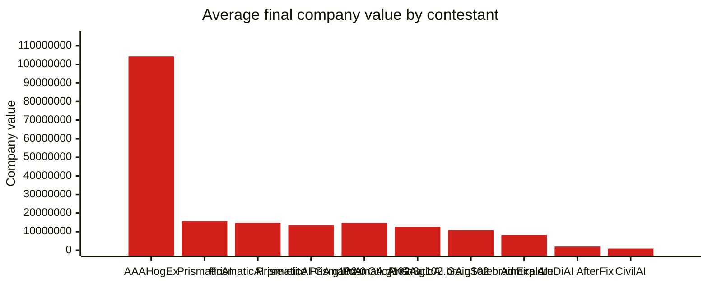
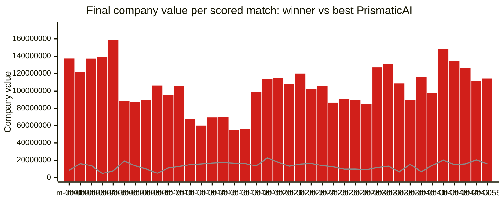
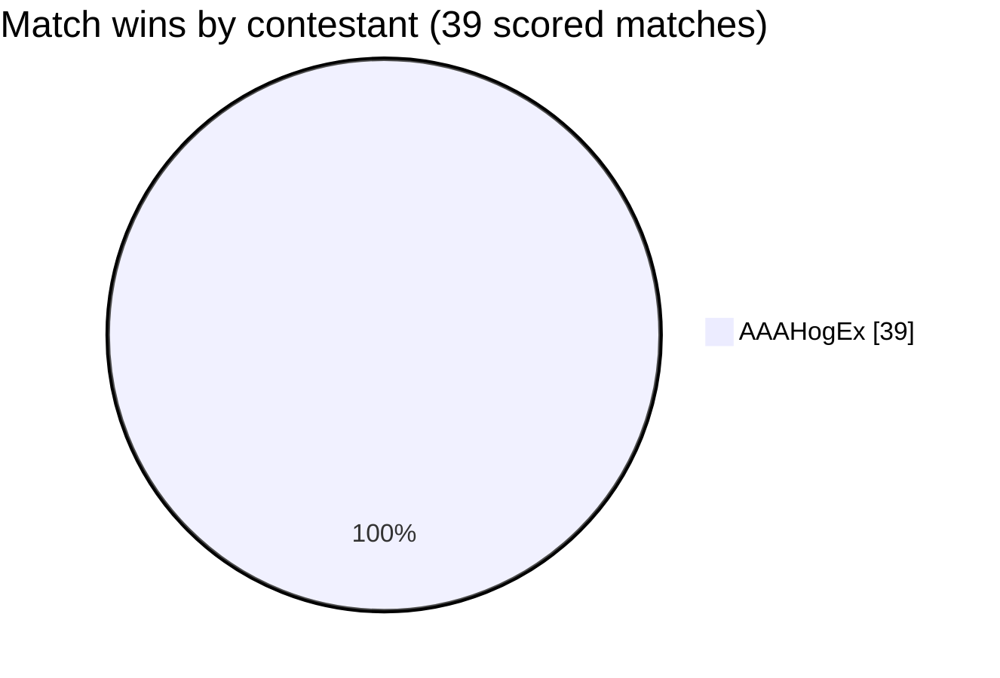
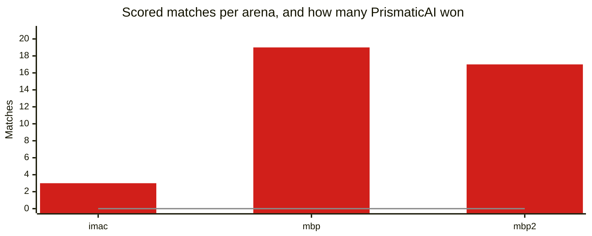

# battle-20261120T053809-e0509aa1

Derived from `battle-20261120T053809-e0509aa1.json` by `tools/research/ai-battle/battle.py report`; do not edit.

- Edition `e0509aa144b362f0`: PrismaticAI and referee at `cbd774f94108d495482a04435618a1effe17f9fc`, base set `opengfx-8.0.tar`
- 20-year free-for-all from 1960, map 256x256 temperate, breakdowns 1
- 39 scored match(es) on `imac` (20261119-master-gdf1e05e7d8), `mbp` (20261120-master-m7a925f73d1), `mbp2` (20261119-master-gdf1e05e7d8)
- Replays: 1 of 2 identical to their original on another arena

| # | Contestant | Played | Wins | Points | Points/match | Avg rank | Avg final value | Squirrel errors | Matches with anomalies |
|---|---|---|---|---|---|---|---|---|---|
| 1 | AAAHogEx | 39 | 39 | 156 | 4.0 | 1.0 | 104.3 M | 0 | 0 |
| 2 | PrismaticAI | 6 | 0 | 18 | 3.0 | 2.0 | 15.7 M | 0 | 5 |
| 3 | PrismaticAI pre-elite | 8 | 0 | 23 | 2.875 | 2.12 | 14.8 M | 0 | 0 |
| 4 | PrismaticAI GA g102.0 | 7 | 0 | 20 | 2.857 | 2.14 | 13.4 M | 0 | 1 |
| 5 | PrismaticAI GA g102.3 | 6 | 0 | 17 | 2.833 | 2.17 | 14.7 M | 0 | 0 |
| 6 | PrismaticAI GA g102.brainSafe | 6 | 0 | 16 | 2.667 | 2.33 | 12.6 M | 0 | 0 |
| 7 | PrismaticAI GA g102.brainExplore | 6 | 0 | 16 | 2.667 | 2.33 | 10.8 M | 0 | 0 |
| 8 | AdmiralAI | 39 | 0 | 85 | 2.179 | 2.82 | 8.1 M | 0 | 0 |
| 9 | LuDiAI AfterFix | 39 | 0 | 30 | 0.769 | 4.23 | 2.0 M | 0 | 1 |
| 10 | CivilAI | 39 | 0 | 9 | 0.231 | 4.77 | 900.6 k | 3845 | 5 |

<!-- battle-charts:begin -->
<!-- derived from battle-20261120T053809-e0509aa1.json by `battle.py render`; `battle.py check` fails when it is stale -->

<!-- battle-charts:end -->

| Seed | Original | Replay | Arenas | Identical |
|---|---|---|---|---|
| 934391234 | m-0013 | m-0056 | mbp2 / mbp | yes |
| 294232027 | m-0011 | m-0064 | imac / mbp | NO |

| Match | Arena | Seed | Winner | Value | Last | Anomalies |
|---|---|---|---|---|---|---|
| m-0001 | mbp | 286767776 | AAAHogEx | 137.6 M | CivilAI | - |
| m-0002 | mbp | 286767776 | AAAHogEx | 121.7 M | CivilAI | - |
| m-0003 | mbp | 286767776 | AAAHogEx | 137.5 M | CivilAI | CivilAI: fleet_drop:45->31 |
| m-0004 | mbp | 286767776 | AAAHogEx | 139.3 M | CivilAI | - |
| m-0005 | mbp | 286767776 | AAAHogEx | 159.1 M | CivilAI | - |
| m-0006 | mbp | 294232027 | AAAHogEx | 88.1 M | LuDiAI AfterFix | PrismaticAI: fleet_drop:81->50 |
| m-0007 | mbp | 294232027 | AAAHogEx | 87.2 M | LuDiAI AfterFix | - |
| m-0008 | mbp | 294232027 | AAAHogEx | 89.8 M | LuDiAI AfterFix | - |
| m-0009 | mbp | 294232027 | AAAHogEx | 106.1 M | LuDiAI AfterFix | - |
| m-0010 | imac | 294232027 | AAAHogEx | 95.6 M | LuDiAI AfterFix | - |
| m-0011 | imac | 294232027 | AAAHogEx | 105.4 M | LuDiAI AfterFix | - |
| m-0012 | imac | 934391234 | AAAHogEx | 67.7 M | CivilAI | - |
| m-0013 | mbp2 | 934391234 | AAAHogEx | 60.0 M | CivilAI | - |
| m-0014 | mbp2 | 934391234 | AAAHogEx | 69.4 M | CivilAI | - |
| m-0015 | mbp2 | 934391234 | AAAHogEx | 70.4 M | CivilAI | - |
| m-0016 | mbp2 | 934391234 | AAAHogEx | 55.4 M | CivilAI | - |
| m-0017 | mbp2 | 934391234 | AAAHogEx | 56.0 M | CivilAI | CivilAI: fleet_drop:30->19 |
| m-0018 | mbp2 | 740774232 | AAAHogEx | 99.1 M | CivilAI | PrismaticAI: fleet_drop:108->45 |
| m-0019 | mbp2 | 740774232 | AAAHogEx | 113.4 M | CivilAI | - |
| m-0020 | mbp2 | 740774232 | AAAHogEx | 114.9 M | CivilAI | - |
| m-0021 | mbp2 | 740774232 | AAAHogEx | 108.0 M | CivilAI | - |
| m-0022 | mbp2 | 740774232 | AAAHogEx | 120.1 M | CivilAI | - |
| m-0023 | mbp2 | 740774232 | AAAHogEx | 102.5 M | CivilAI | - |
| m-0024 | mbp2 | 548557179 | AAAHogEx | 105.6 M | LuDiAI AfterFix | PrismaticAI: fleet_drop:89->55 |
| m-0025 | mbp2 | 548557179 | AAAHogEx | 86.5 M | LuDiAI AfterFix | - |
| m-0026 | mbp2 | 548557179 | AAAHogEx | 90.5 M | CivilAI | - |
| m-0027 | mbp2 | 548557179 | AAAHogEx | 89.9 M | LuDiAI AfterFix | LuDiAI AfterFix: fleet_drop:41->28 |
| m-0028 | mbp2 | 548557179 | AAAHogEx | 84.6 M | CivilAI | - |
| m-0036 | mbp | 917515850 | AAAHogEx | 127.4 M | CivilAI | PrismaticAI: fleet_drop:84->53 |
| m-0037 | mbp | 917515850 | AAAHogEx | 131.1 M | CivilAI | - |
| m-0038 | mbp | 917515850 | AAAHogEx | 108.8 M | CivilAI | PrismaticAI GA g102.0: fleet_drop:39->25 |
| m-0039 | mbp | 917515850 | AAAHogEx | 89.7 M | CivilAI | - |
| m-0040 | mbp | 917515850 | AAAHogEx | 116.3 M | CivilAI | - |
| m-0041 | mbp | 917515850 | AAAHogEx | 97.4 M | CivilAI | - |
| m-0042 | mbp | 383653093 | AAAHogEx | 148.5 M | CivilAI | PrismaticAI: fleet_drop:133->93; CivilAI: fleet_drop:57->27 |
| m-0043 | mbp | 383653093 | AAAHogEx | 134.6 M | CivilAI | - |
| m-0044 | mbp | 383653093 | AAAHogEx | 126.9 M | CivilAI | CivilAI: squirrel_errors:3845 |
| m-0047 | mbp2 | 383653093 | AAAHogEx | 111.4 M | CivilAI | - |
| m-0055 | mbp | 1117583319 | AAAHogEx | 114.3 M | CivilAI | CivilAI: no_vehicles |
| m-0056 (replay) | mbp | 934391234 | AAAHogEx | 60.0 M | CivilAI | - |
| m-0064 (replay) | mbp | 294232027 | AAAHogEx | 101.4 M | LuDiAI AfterFix | - |
