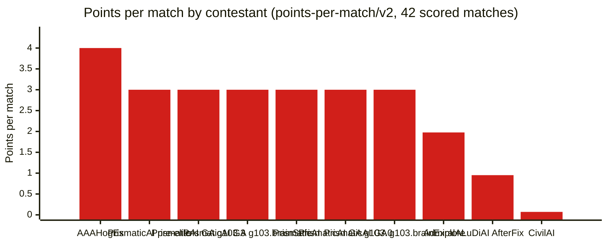
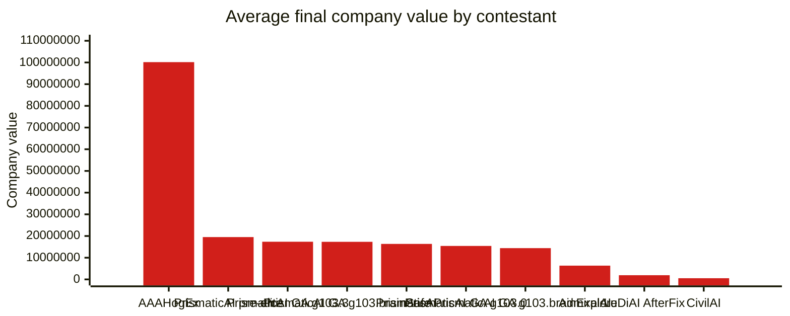
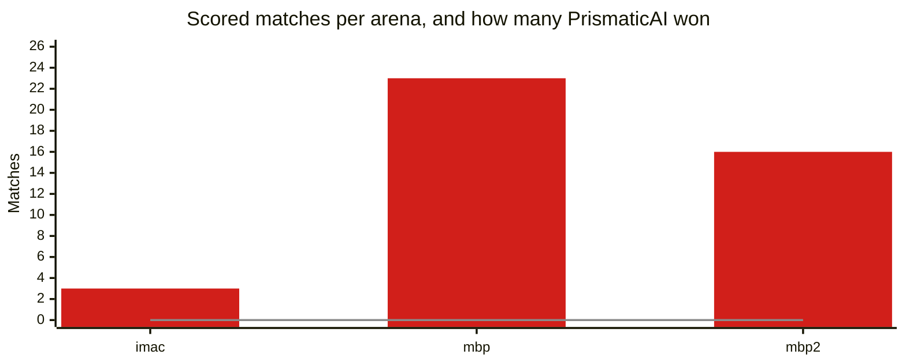

# battle-20261120T054727-989403b7

Derived from `battle-20261120T054727-989403b7.json` by `tools/research/ai-battle/battle.py report`; do not edit.

- Edition `989403b7c1064b1a`: PrismaticAI and referee at `cbd774f94108d495482a04435618a1effe17f9fc`, base set `opengfx-8.0.tar`
- 20-year free-for-all from 1960, map 256x256 temperate, breakdowns 1
- 42 scored match(es) on `imac` (20261119-master-gdf1e05e7d8), `mbp` (20261120-master-m7a925f73d1), `mbp2` (20261119-master-gdf1e05e7d8)
- Replays: 0 of 1 identical to their original on another arena

| # | Contestant | Played | Wins | Points | Points/match | Avg rank | Avg final value | Squirrel errors | Matches with anomalies |
|---|---|---|---|---|---|---|---|---|---|
| 1 | AAAHogEx | 42 | 42 | 168 | 4.0 | 1.0 | 100.2 M | 0 | 0 |
| 2 | PrismaticAI pre-elite | 9 | 0 | 27 | 3.0 | 2.0 | 19.5 M | 0 | 0 |
| 3 | PrismaticAI GA g103.3 | 6 | 0 | 18 | 3.0 | 2.0 | 17.4 M | 0 | 0 |
| 4 | PrismaticAI GA g103.brainSafe | 6 | 0 | 18 | 3.0 | 2.0 | 17.3 M | 0 | 0 |
| 5 | PrismaticAI | 6 | 0 | 18 | 3.0 | 2.0 | 16.4 M | 0 | 3 |
| 6 | PrismaticAI GA g103.0 | 8 | 0 | 24 | 3.0 | 2.0 | 15.4 M | 0 | 1 |
| 7 | PrismaticAI GA g103.brainExplore | 7 | 0 | 21 | 3.0 | 2.0 | 14.4 M | 0 | 0 |
| 8 | AdmiralAI | 42 | 0 | 83 | 1.976 | 3.02 | 6.3 M | 0 | 0 |
| 9 | LuDiAI AfterFix | 42 | 0 | 40 | 0.952 | 4.05 | 1.9 M | 0 | 1 |
| 10 | CivilAI | 42 | 0 | 3 | 0.071 | 4.93 | 534.2 k | 0 | 4 |

```mermaid
---
config:
  xyChart:
    width: 900
    height: 360
  themeVariables:
    xyChart:
      plotColorPalette: "#d11f1a, #8a8a8a, #0b0b0b, #ece4d6"
---
xychart-beta
    title "Final company value per scored match: winner vs best PrismaticAI"
    x-axis ["m-0001", "m-0002", "m-0003", "m-0004", "m-0005", "m-0006", "m-0007", "m-0008", "m-0009", "m-0010", "m-0011", "m-0012", "m-0013", "m-0014", "m-0015", "m-0016", "m-0017", "m-0018", "m-0019", "m-0020", "m-0021", "m-0022", "m-0023", "m-0024", "m-0025", "m-0026", "m-0027", "m-0028", "m-0036", "m-0037", "m-0038", "m-0039", "m-0040", "m-0041", "m-0042", "m-0043", "m-0044", "m-0049", "m-0050", "m-0052", "m-0053", "m-0055"]
    %% series: Winner | Best PrismaticAI
    %% links: battle-20261120T054727-989403b7.md?col=Match&filter=m-0001 | battle-20261120T054727-989403b7.md?col=Match&filter=m-0002 | battle-20261120T054727-989403b7.md?col=Match&filter=m-0003 | battle-20261120T054727-989403b7.md?col=Match&filter=m-0004 | battle-20261120T054727-989403b7.md?col=Match&filter=m-0005 | battle-20261120T054727-989403b7.md?col=Match&filter=m-0006 | battle-20261120T054727-989403b7.md?col=Match&filter=m-0007 | battle-20261120T054727-989403b7.md?col=Match&filter=m-0008 | battle-20261120T054727-989403b7.md?col=Match&filter=m-0009 | battle-20261120T054727-989403b7.md?col=Match&filter=m-0010 | battle-20261120T054727-989403b7.md?col=Match&filter=m-0011 | battle-20261120T054727-989403b7.md?col=Match&filter=m-0012 | battle-20261120T054727-989403b7.md?col=Match&filter=m-0013 | battle-20261120T054727-989403b7.md?col=Match&filter=m-0014 | battle-20261120T054727-989403b7.md?col=Match&filter=m-0015 | battle-20261120T054727-989403b7.md?col=Match&filter=m-0016 | battle-20261120T054727-989403b7.md?col=Match&filter=m-0017 | battle-20261120T054727-989403b7.md?col=Match&filter=m-0018 | battle-20261120T054727-989403b7.md?col=Match&filter=m-0019 | battle-20261120T054727-989403b7.md?col=Match&filter=m-0020 | battle-20261120T054727-989403b7.md?col=Match&filter=m-0021 | battle-20261120T054727-989403b7.md?col=Match&filter=m-0022 | battle-20261120T054727-989403b7.md?col=Match&filter=m-0023 | battle-20261120T054727-989403b7.md?col=Match&filter=m-0024 | battle-20261120T054727-989403b7.md?col=Match&filter=m-0025 | battle-20261120T054727-989403b7.md?col=Match&filter=m-0026 | battle-20261120T054727-989403b7.md?col=Match&filter=m-0027 | battle-20261120T054727-989403b7.md?col=Match&filter=m-0028 | battle-20261120T054727-989403b7.md?col=Match&filter=m-0036 | battle-20261120T054727-989403b7.md?col=Match&filter=m-0037 | battle-20261120T054727-989403b7.md?col=Match&filter=m-0038 | battle-20261120T054727-989403b7.md?col=Match&filter=m-0039 | battle-20261120T054727-989403b7.md?col=Match&filter=m-0040 | battle-20261120T054727-989403b7.md?col=Match&filter=m-0041 | battle-20261120T054727-989403b7.md?col=Match&filter=m-0042 | battle-20261120T054727-989403b7.md?col=Match&filter=m-0043 | battle-20261120T054727-989403b7.md?col=Match&filter=m-0044 | battle-20261120T054727-989403b7.md?col=Match&filter=m-0049 | battle-20261120T054727-989403b7.md?col=Match&filter=m-0050 | battle-20261120T054727-989403b7.md?col=Match&filter=m-0052 | battle-20261120T054727-989403b7.md?col=Match&filter=m-0053 | battle-20261120T054727-989403b7.md?col=Match&filter=m-0055
    y-axis "Company value" 0 --> 158000000
    bar [86869246, 88728689, 102412530, 78080944, 91513610, 96754386, 68176323, 82382530, 106451638, 96466249, 100875845, 82494663, 133025033, 120437101, 98920907, 123084039, 125644964, 107182119, 108116822, 102162174, 99026979, 120597071, 125470276, 102072037, 108700943, 111931666, 105069573, 95713974, 76312869, 83535073, 63312738, 73204980, 71562160, 72932286, 113305744, 118350821, 144045770, 117190119, 117973267, 102633379, 89142004, 94692731]
    line [22199521, 15813866, 17895337, 19023934, 20309608, 11869094, 16409140, 13608760, 17274799, 10955056, 13089589, 18823192, 25566240, 23566728, 15776032, 14399668, 24394939, 13852117, 16678017, 12981797, 16557922, 9417368, 13589432, 20834744, 23793488, 20572658, 17681802, 24093219, 14632460, 14257652, 12008963, 18733440, 11888153, 18465044, 18126138, 18877228, 15418953, 18400114, 9384664, 11071282, 14315277, 19354544]
```

<!-- battle-charts:begin -->
<!-- derived from battle-20261120T054727-989403b7.json by `battle.py render`; `battle.py check` fails when it is stale -->

<!-- battle-charts:end -->

| Seed | Original | Replay | Arenas | Identical |
|---|---|---|---|---|
| 859776769 | m-0011 | m-0056 | imac / mbp | NO |

| Match | Arena | Seed | Winner | Value | Last | Anomalies |
|---|---|---|---|---|---|---|
| m-0001 | mbp | 689980587 | AAAHogEx | 86.9 M | CivilAI | - |
| m-0002 | mbp | 689980587 | AAAHogEx | 88.7 M | CivilAI | - |
| m-0003 | mbp | 689980587 | AAAHogEx | 102.4 M | CivilAI | CivilAI: fleet_drop:13->7 |
| m-0004 | mbp | 689980587 | AAAHogEx | 78.1 M | CivilAI | - |
| m-0005 | mbp | 689980587 | AAAHogEx | 91.5 M | CivilAI | - |
| m-0006 | mbp | 859776769 | AAAHogEx | 96.8 M | CivilAI | PrismaticAI: fleet_drop:80->39 |
| m-0007 | mbp | 859776769 | AAAHogEx | 68.2 M | CivilAI | - |
| m-0008 | mbp | 859776769 | AAAHogEx | 82.4 M | CivilAI | CivilAI: fleet_drop:28->16 |
| m-0009 | mbp | 859776769 | AAAHogEx | 106.5 M | LuDiAI AfterFix | - |
| m-0010 | imac | 859776769 | AAAHogEx | 96.5 M | CivilAI | - |
| m-0011 | imac | 859776769 | AAAHogEx | 100.9 M | CivilAI | - |
| m-0012 | imac | 1329527953 | AAAHogEx | 82.5 M | LuDiAI AfterFix | LuDiAI AfterFix: fleet_drop:112->57 |
| m-0013 | mbp2 | 1329527953 | AAAHogEx | 133.0 M | CivilAI | - |
| m-0014 | mbp2 | 1329527953 | AAAHogEx | 120.4 M | CivilAI | - |
| m-0015 | mbp2 | 1329527953 | AAAHogEx | 98.9 M | CivilAI | - |
| m-0016 | mbp2 | 1329527953 | AAAHogEx | 123.1 M | LuDiAI AfterFix | - |
| m-0017 | mbp2 | 1329527953 | AAAHogEx | 125.6 M | CivilAI | - |
| m-0018 | mbp2 | 1743089226 | AAAHogEx | 107.2 M | CivilAI | PrismaticAI: fleet_drop:76->49 |
| m-0019 | mbp2 | 1743089226 | AAAHogEx | 108.1 M | CivilAI | CivilAI: fleet_drop:52->36 |
| m-0020 | mbp2 | 1743089226 | AAAHogEx | 102.2 M | CivilAI | - |
| m-0021 | mbp2 | 1743089226 | AAAHogEx | 99.0 M | CivilAI | CivilAI: fleet_drop:27->14 |
| m-0022 | mbp2 | 1743089226 | AAAHogEx | 120.6 M | CivilAI | - |
| m-0023 | mbp2 | 1743089226 | AAAHogEx | 125.5 M | CivilAI | - |
| m-0024 | mbp2 | 365134593 | AAAHogEx | 102.1 M | CivilAI | - |
| m-0025 | mbp2 | 365134593 | AAAHogEx | 108.7 M | CivilAI | - |
| m-0026 | mbp2 | 365134593 | AAAHogEx | 111.9 M | CivilAI | - |
| m-0027 | mbp2 | 365134593 | AAAHogEx | 105.1 M | CivilAI | - |
| m-0028 | mbp2 | 365134593 | AAAHogEx | 95.7 M | CivilAI | - |
| m-0036 | mbp | 800036138 | AAAHogEx | 76.3 M | CivilAI | PrismaticAI: fleet_drop:93->62 |
| m-0037 | mbp | 800036138 | AAAHogEx | 83.5 M | CivilAI | - |
| m-0038 | mbp | 800036138 | AAAHogEx | 63.3 M | CivilAI | - |
| m-0039 | mbp | 800036138 | AAAHogEx | 73.2 M | CivilAI | - |
| m-0040 | mbp | 800036138 | AAAHogEx | 71.6 M | CivilAI | - |
| m-0041 | mbp | 800036138 | AAAHogEx | 72.9 M | CivilAI | - |
| m-0042 | mbp | 434266909 | AAAHogEx | 113.3 M | CivilAI | - |
| m-0043 | mbp | 434266909 | AAAHogEx | 118.4 M | CivilAI | - |
| m-0044 | mbp | 434266909 | AAAHogEx | 144.0 M | CivilAI | PrismaticAI GA g103.0: fleet_drop:83->42 |
| m-0049 | mbp | 451980243 | AAAHogEx | 117.2 M | CivilAI | - |
| m-0050 | mbp | 451980243 | AAAHogEx | 118.0 M | CivilAI | - |
| m-0052 | mbp | 451980243 | AAAHogEx | 102.6 M | CivilAI | - |
| m-0053 | mbp | 451980243 | AAAHogEx | 89.1 M | CivilAI | - |
| m-0055 | mbp | 1874228895 | AAAHogEx | 94.7 M | CivilAI | - |
| m-0056 (replay) | mbp | 859776769 | AAAHogEx | 104.3 M | CivilAI | - |
