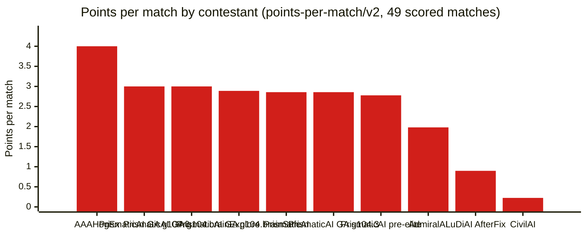
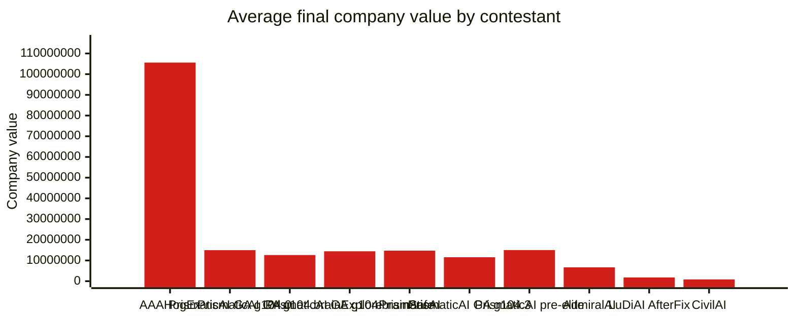
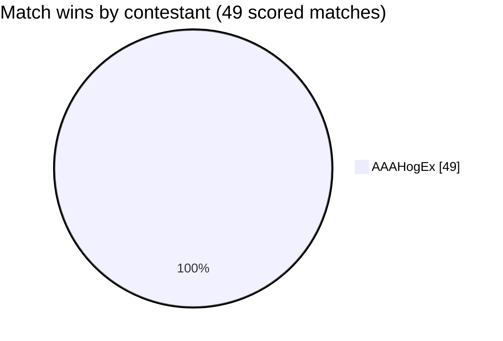
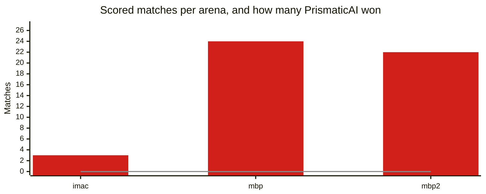

# battle-20261120T055819-fb73f23e

Derived from `battle-20261120T055819-fb73f23e.json` by `tools/research/ai-battle/battle.py report`; do not edit.

- Edition `fb73f23eae2ec904`: PrismaticAI and referee at `cbd774f94108d495482a04435618a1effe17f9fc`, base set `opengfx-8.0.tar`
- 20-year free-for-all from 1960, map 256x256 temperate, breakdowns 1
- 49 scored match(es) on `imac` (20261119-master-gdf1e05e7d8), `mbp` (20261120-master-m7a925f73d1), `mbp2` (20261119-master-gdf1e05e7d8)
- Replays: 2 of 3 identical to their original on another arena

| # | Contestant | Played | Wins | Points | Points/match | Avg rank | Avg final value | Squirrel errors | Matches with anomalies |
|---|---|---|---|---|---|---|---|---|---|
| 1 | AAAHogEx | 49 | 49 | 196 | 4.0 | 1.0 | 105.6 M | 0 | 0 |
| 2 | PrismaticAI GA g104.0 | 9 | 0 | 27 | 3.0 | 2.0 | 15.0 M | 0 | 0 |
| 3 | PrismaticAI GA g104.brainExplore | 8 | 0 | 24 | 3.0 | 2.0 | 12.6 M | 0 | 0 |
| 4 | PrismaticAI GA g104.brainSafe | 9 | 0 | 26 | 2.889 | 2.11 | 14.4 M | 0 | 0 |
| 5 | PrismaticAI | 7 | 0 | 20 | 2.857 | 2.14 | 14.7 M | 0 | 1 |
| 6 | PrismaticAI GA g104.3 | 7 | 0 | 20 | 2.857 | 2.14 | 11.6 M | 0 | 0 |
| 7 | PrismaticAI pre-elite | 9 | 0 | 25 | 2.778 | 2.22 | 15.0 M | 0 | 1 |
| 8 | AdmiralAI | 49 | 0 | 97 | 1.98 | 3.02 | 6.7 M | 0 | 1 |
| 9 | LuDiAI AfterFix | 49 | 0 | 44 | 0.898 | 4.1 | 1.8 M | 0 | 0 |
| 10 | CivilAI | 49 | 0 | 11 | 0.224 | 4.78 | 849.6 k | 0 | 2 |

```mermaid
---
config:
  xyChart:
    width: 900
    height: 360
  themeVariables:
    xyChart:
      plotColorPalette: "#d11f1a, #8a8a8a, #0b0b0b, #ece4d6"
---
xychart-beta
    title "Final company value per scored match: winner vs best PrismaticAI"
    x-axis ["m-0001", "m-0002", "m-0003", "m-0004", "m-0005", "m-0006", "m-0007", "m-0008", "m-0009", "m-0010", "m-0011", "m-0012", "m-0013", "m-0014", "m-0015", "m-0016", "m-0017", "m-0018", "m-0019", "m-0020", "m-0021", "m-0022", "m-0023", "m-0024", "m-0025", "m-0026", "m-0027", "m-0028", "m-0036", "m-0037", "m-0038", "m-0039", "m-0040", "m-0041", "m-0042", "m-0043", "m-0044", "m-0045", "m-0046", "m-0047", "m-0049", "m-0051", "m-0053", "m-0054", "m-0055", "m-0058", "m-0062", "m-0063", "m-0074"]
    %% series: Winner | Best PrismaticAI
    %% links: battle-20261120T055819-fb73f23e.md?col=Match&filter=m-0001 | battle-20261120T055819-fb73f23e.md?col=Match&filter=m-0002 | battle-20261120T055819-fb73f23e.md?col=Match&filter=m-0003 | battle-20261120T055819-fb73f23e.md?col=Match&filter=m-0004 | battle-20261120T055819-fb73f23e.md?col=Match&filter=m-0005 | battle-20261120T055819-fb73f23e.md?col=Match&filter=m-0006 | battle-20261120T055819-fb73f23e.md?col=Match&filter=m-0007 | battle-20261120T055819-fb73f23e.md?col=Match&filter=m-0008 | battle-20261120T055819-fb73f23e.md?col=Match&filter=m-0009 | battle-20261120T055819-fb73f23e.md?col=Match&filter=m-0010 | battle-20261120T055819-fb73f23e.md?col=Match&filter=m-0011 | battle-20261120T055819-fb73f23e.md?col=Match&filter=m-0012 | battle-20261120T055819-fb73f23e.md?col=Match&filter=m-0013 | battle-20261120T055819-fb73f23e.md?col=Match&filter=m-0014 | battle-20261120T055819-fb73f23e.md?col=Match&filter=m-0015 | battle-20261120T055819-fb73f23e.md?col=Match&filter=m-0016 | battle-20261120T055819-fb73f23e.md?col=Match&filter=m-0017 | battle-20261120T055819-fb73f23e.md?col=Match&filter=m-0018 | battle-20261120T055819-fb73f23e.md?col=Match&filter=m-0019 | battle-20261120T055819-fb73f23e.md?col=Match&filter=m-0020 | battle-20261120T055819-fb73f23e.md?col=Match&filter=m-0021 | battle-20261120T055819-fb73f23e.md?col=Match&filter=m-0022 | battle-20261120T055819-fb73f23e.md?col=Match&filter=m-0023 | battle-20261120T055819-fb73f23e.md?col=Match&filter=m-0024 | battle-20261120T055819-fb73f23e.md?col=Match&filter=m-0025 | battle-20261120T055819-fb73f23e.md?col=Match&filter=m-0026 | battle-20261120T055819-fb73f23e.md?col=Match&filter=m-0027 | battle-20261120T055819-fb73f23e.md?col=Match&filter=m-0028 | battle-20261120T055819-fb73f23e.md?col=Match&filter=m-0036 | battle-20261120T055819-fb73f23e.md?col=Match&filter=m-0037 | battle-20261120T055819-fb73f23e.md?col=Match&filter=m-0038 | battle-20261120T055819-fb73f23e.md?col=Match&filter=m-0039 | battle-20261120T055819-fb73f23e.md?col=Match&filter=m-0040 | battle-20261120T055819-fb73f23e.md?col=Match&filter=m-0041 | battle-20261120T055819-fb73f23e.md?col=Match&filter=m-0042 | battle-20261120T055819-fb73f23e.md?col=Match&filter=m-0043 | battle-20261120T055819-fb73f23e.md?col=Match&filter=m-0044 | battle-20261120T055819-fb73f23e.md?col=Match&filter=m-0045 | battle-20261120T055819-fb73f23e.md?col=Match&filter=m-0046 | battle-20261120T055819-fb73f23e.md?col=Match&filter=m-0047 | battle-20261120T055819-fb73f23e.md?col=Match&filter=m-0049 | battle-20261120T055819-fb73f23e.md?col=Match&filter=m-0051 | battle-20261120T055819-fb73f23e.md?col=Match&filter=m-0053 | battle-20261120T055819-fb73f23e.md?col=Match&filter=m-0054 | battle-20261120T055819-fb73f23e.md?col=Match&filter=m-0055 | battle-20261120T055819-fb73f23e.md?col=Match&filter=m-0058 | battle-20261120T055819-fb73f23e.md?col=Match&filter=m-0062 | battle-20261120T055819-fb73f23e.md?col=Match&filter=m-0063 | battle-20261120T055819-fb73f23e.md?col=Match&filter=m-0074
    y-axis "Company value" 0 --> 163000000
    bar [115982119, 71289625, 102465354, 108418358, 120537593, 90559631, 122110223, 89110155, 108933905, 83948692, 103589737, 66497341, 101180743, 105399238, 134816853, 88273607, 107344482, 77996125, 104584109, 83740272, 85083179, 78594416, 94902512, 132789734, 102763517, 126066258, 140256054, 113575574, 126498905, 102344468, 120634037, 135770194, 98222032, 99183196, 148117252, 135242225, 131480713, 129692037, 114643331, 126317978, 74282167, 126176735, 58687223, 91224934, 79286130, 70401306, 125306372, 126658049, 93157639]
    line [19147496, 24026571, 19887006, 15812786, 9382638, 12018083, 9689716, 12407758, 10369541, 10913120, 8012087, 17700333, 11334540, 14851685, 7577961, 13866253, 12558426, 15512566, 6568342, 6078023, 8471969, 9570937, 8013004, 7297980, 17047503, 17654257, 15786970, 14505703, 18046743, 30453636, 16827895, 16517322, 13446376, 17973607, 15779384, 11028330, 14626009, 14475204, 13011143, 11760840, 15012378, 18890352, 13214388, 16848253, 14930180, 9853475, 12382291, 17925815, 15918031]
```

<!-- battle-charts:begin -->
<!-- derived from battle-20261120T055819-fb73f23e.json by `battle.py render`; `battle.py check` fails when it is stale -->

<!-- battle-charts:end -->

| Seed | Original | Replay | Arenas | Identical |
|---|---|---|---|---|
| 1185483291 | m-0017 | m-0048 | mbp2 / mbp | yes |
| 1185483291 | m-0014 | m-0056 | mbp2 / mbp | yes |
| 1430633417 | m-0011 | m-0064 | imac / mbp | NO |

| Match | Arena | Seed | Winner | Value | Last | Anomalies |
|---|---|---|---|---|---|---|
| m-0001 | mbp | 1627563775 | AAAHogEx | 116.0 M | LuDiAI AfterFix | - |
| m-0002 | mbp | 1627563775 | AAAHogEx | 71.3 M | LuDiAI AfterFix | - |
| m-0003 | mbp | 1627563775 | AAAHogEx | 102.5 M | CivilAI | - |
| m-0004 | mbp | 1627563775 | AAAHogEx | 108.4 M | CivilAI | - |
| m-0005 | mbp | 1627563775 | AAAHogEx | 120.5 M | LuDiAI AfterFix | - |
| m-0006 | mbp | 1430633417 | AAAHogEx | 90.6 M | CivilAI | - |
| m-0007 | mbp | 1430633417 | AAAHogEx | 122.1 M | CivilAI | - |
| m-0008 | mbp | 1430633417 | AAAHogEx | 89.1 M | CivilAI | - |
| m-0009 | mbp | 1430633417 | AAAHogEx | 108.9 M | AdmiralAI | - |
| m-0010 | imac | 1430633417 | AAAHogEx | 83.9 M | CivilAI | - |
| m-0011 | imac | 1430633417 | AAAHogEx | 103.6 M | CivilAI | - |
| m-0012 | imac | 1185483291 | AAAHogEx | 66.5 M | CivilAI | - |
| m-0013 | mbp2 | 1185483291 | AAAHogEx | 101.2 M | CivilAI | PrismaticAI pre-elite: fleet_drop:71->41 |
| m-0014 | mbp2 | 1185483291 | AAAHogEx | 105.4 M | CivilAI | - |
| m-0015 | mbp2 | 1185483291 | AAAHogEx | 134.8 M | CivilAI | - |
| m-0016 | mbp2 | 1185483291 | AAAHogEx | 88.3 M | CivilAI | - |
| m-0017 | mbp2 | 1185483291 | AAAHogEx | 107.3 M | CivilAI | CivilAI: fleet_drop:37->14 |
| m-0018 | mbp2 | 1061531245 | AAAHogEx | 78.0 M | CivilAI | - |
| m-0019 | mbp2 | 1061531245 | AAAHogEx | 104.6 M | CivilAI | - |
| m-0020 | mbp2 | 1061531245 | AAAHogEx | 83.7 M | CivilAI | - |
| m-0021 | mbp2 | 1061531245 | AAAHogEx | 85.1 M | CivilAI | AdmiralAI: fleet_drop:153->104 |
| m-0022 | mbp2 | 1061531245 | AAAHogEx | 78.6 M | CivilAI | - |
| m-0023 | mbp2 | 1061531245 | AAAHogEx | 94.9 M | CivilAI | - |
| m-0024 | mbp2 | 1406591165 | AAAHogEx | 132.8 M | CivilAI | PrismaticAI: fleet_drop:121->76 |
| m-0025 | mbp2 | 1406591165 | AAAHogEx | 102.8 M | CivilAI | - |
| m-0026 | mbp2 | 1406591165 | AAAHogEx | 126.1 M | CivilAI | - |
| m-0027 | mbp2 | 1406591165 | AAAHogEx | 140.3 M | LuDiAI AfterFix | - |
| m-0028 | mbp2 | 1406591165 | AAAHogEx | 113.6 M | CivilAI | - |
| m-0036 | mbp | 303153818 | AAAHogEx | 126.5 M | CivilAI | CivilAI: no_vehicles |
| m-0037 | mbp | 303153818 | AAAHogEx | 102.3 M | LuDiAI AfterFix | - |
| m-0038 | mbp | 303153818 | AAAHogEx | 120.6 M | LuDiAI AfterFix | - |
| m-0039 | mbp | 303153818 | AAAHogEx | 135.8 M | LuDiAI AfterFix | - |
| m-0040 | mbp | 303153818 | AAAHogEx | 98.2 M | CivilAI | - |
| m-0041 | mbp | 303153818 | AAAHogEx | 99.2 M | LuDiAI AfterFix | - |
| m-0042 | mbp | 916447429 | AAAHogEx | 148.1 M | CivilAI | - |
| m-0043 | mbp | 916447429 | AAAHogEx | 135.2 M | CivilAI | - |
| m-0044 | mbp | 916447429 | AAAHogEx | 131.5 M | AdmiralAI | - |
| m-0045 | mbp2 | 916447429 | AAAHogEx | 129.7 M | CivilAI | - |
| m-0046 | mbp2 | 916447429 | AAAHogEx | 114.6 M | CivilAI | - |
| m-0047 | mbp2 | 916447429 | AAAHogEx | 126.3 M | CivilAI | - |
| m-0048 (replay) | mbp | 1185483291 | AAAHogEx | 107.3 M | CivilAI | CivilAI: fleet_drop:37->14 |
| m-0049 | mbp | 633460720 | AAAHogEx | 74.3 M | CivilAI | - |
| m-0051 | mbp2 | 633460720 | AAAHogEx | 126.2 M | CivilAI | - |
| m-0053 | mbp2 | 633460720 | AAAHogEx | 58.7 M | CivilAI | - |
| m-0054 | mbp | 467946144 | AAAHogEx | 91.2 M | CivilAI | - |
| m-0055 | mbp | 467946144 | AAAHogEx | 79.3 M | CivilAI | - |
| m-0056 (replay) | mbp | 1185483291 | AAAHogEx | 105.4 M | CivilAI | - |
| m-0058 | mbp2 | 467946144 | AAAHogEx | 70.4 M | CivilAI | - |
| m-0062 | mbp | 172223405 | AAAHogEx | 125.3 M | CivilAI | - |
| m-0063 | mbp | 172223405 | AAAHogEx | 126.7 M | CivilAI | - |
| m-0064 (replay) | mbp | 1430633417 | AAAHogEx | 100.8 M | CivilAI | - |
| m-0074 | mbp | 1433121275 | AAAHogEx | 93.2 M | CivilAI | - |
