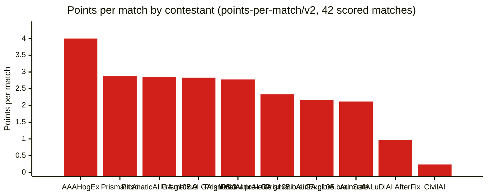
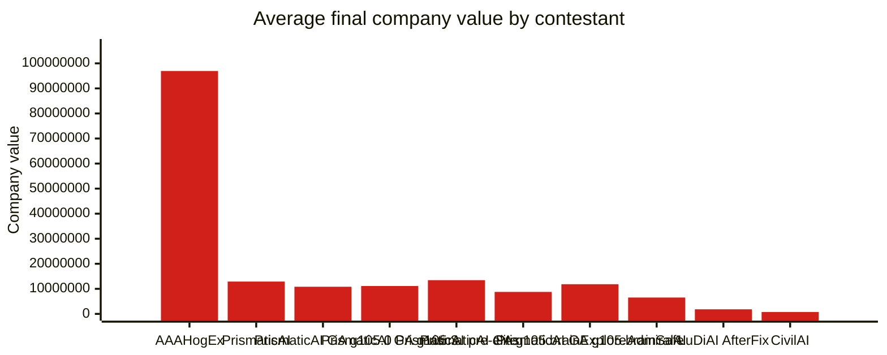
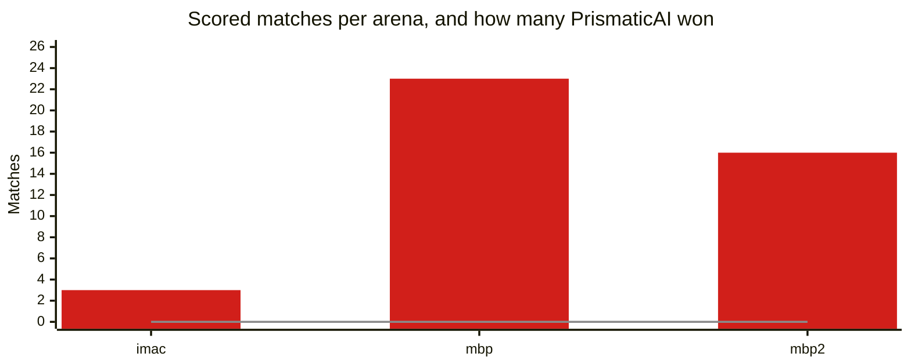

# battle-20261120T060804-526b6b0a

Derived from `battle-20261120T060804-526b6b0a.json` by `tools/research/ai-battle/battle.py report`; do not edit.

- Edition `526b6b0acf58810e`: PrismaticAI and referee at `cbd774f94108d495482a04435618a1effe17f9fc`, base set `opengfx-8.0.tar`
- 20-year free-for-all from 1960, map 256x256 temperate, breakdowns 1
- 42 scored match(es) on `imac` (20261119-master-gdf1e05e7d8), `mbp` (20261120-master-m7a925f73d1), `mbp2` (20261119-master-gdf1e05e7d8)
- Replays: 0 of 0 identical to their original on another arena

| # | Contestant | Played | Wins | Points | Points/match | Avg rank | Avg final value | Squirrel errors | Matches with anomalies |
|---|---|---|---|---|---|---|---|---|---|
| 1 | AAAHogEx | 42 | 42 | 168 | 4.0 | 1.0 | 97.0 M | 0 | 1 |
| 2 | PrismaticAI | 8 | 0 | 23 | 2.875 | 2.12 | 12.9 M | 0 | 3 |
| 3 | PrismaticAI GA g105.0 | 7 | 0 | 20 | 2.857 | 2.14 | 10.8 M | 0 | 0 |
| 4 | PrismaticAI GA g105.3 | 6 | 0 | 17 | 2.833 | 2.17 | 11.1 M | 0 | 0 |
| 5 | PrismaticAI pre-elite | 9 | 0 | 25 | 2.778 | 2.22 | 13.5 M | 0 | 0 |
| 6 | PrismaticAI GA g105.brainExplore | 6 | 0 | 14 | 2.333 | 2.67 | 8.8 M | 0 | 2 |
| 7 | PrismaticAI GA g105.brainSafe | 6 | 0 | 13 | 2.167 | 2.83 | 11.8 M | 0 | 1 |
| 8 | AdmiralAI | 42 | 0 | 89 | 2.119 | 2.88 | 6.5 M | 0 | 0 |
| 9 | LuDiAI AfterFix | 42 | 0 | 41 | 0.976 | 4.02 | 1.8 M | 0 | 0 |
| 10 | CivilAI | 42 | 0 | 10 | 0.238 | 4.76 | 744.3 k | 0 | 6 |

```mermaid
---
config:
  xyChart:
    width: 900
    height: 360
  themeVariables:
    xyChart:
      plotColorPalette: "#d11f1a, #8a8a8a, #0b0b0b, #ece4d6"
---
xychart-beta
    title "Final company value per scored match: winner vs best PrismaticAI"
    x-axis ["m-0001", "m-0002", "m-0003", "m-0004", "m-0005", "m-0006", "m-0007", "m-0008", "m-0009", "m-0010", "m-0011", "m-0012", "m-0013", "m-0014", "m-0015", "m-0016", "m-0017", "m-0018", "m-0019", "m-0020", "m-0021", "m-0022", "m-0023", "m-0024", "m-0025", "m-0026", "m-0027", "m-0028", "m-0036", "m-0037", "m-0038", "m-0039", "m-0040", "m-0041", "m-0042", "m-0043", "m-0044", "m-0054", "m-0055", "m-0059", "m-0060", "m-0061"]
    %% series: Winner | Best PrismaticAI
    %% links: battle-20261120T060804-526b6b0a.md?col=Match&filter=m-0001 | battle-20261120T060804-526b6b0a.md?col=Match&filter=m-0002 | battle-20261120T060804-526b6b0a.md?col=Match&filter=m-0003 | battle-20261120T060804-526b6b0a.md?col=Match&filter=m-0004 | battle-20261120T060804-526b6b0a.md?col=Match&filter=m-0005 | battle-20261120T060804-526b6b0a.md?col=Match&filter=m-0006 | battle-20261120T060804-526b6b0a.md?col=Match&filter=m-0007 | battle-20261120T060804-526b6b0a.md?col=Match&filter=m-0008 | battle-20261120T060804-526b6b0a.md?col=Match&filter=m-0009 | battle-20261120T060804-526b6b0a.md?col=Match&filter=m-0010 | battle-20261120T060804-526b6b0a.md?col=Match&filter=m-0011 | battle-20261120T060804-526b6b0a.md?col=Match&filter=m-0012 | battle-20261120T060804-526b6b0a.md?col=Match&filter=m-0013 | battle-20261120T060804-526b6b0a.md?col=Match&filter=m-0014 | battle-20261120T060804-526b6b0a.md?col=Match&filter=m-0015 | battle-20261120T060804-526b6b0a.md?col=Match&filter=m-0016 | battle-20261120T060804-526b6b0a.md?col=Match&filter=m-0017 | battle-20261120T060804-526b6b0a.md?col=Match&filter=m-0018 | battle-20261120T060804-526b6b0a.md?col=Match&filter=m-0019 | battle-20261120T060804-526b6b0a.md?col=Match&filter=m-0020 | battle-20261120T060804-526b6b0a.md?col=Match&filter=m-0021 | battle-20261120T060804-526b6b0a.md?col=Match&filter=m-0022 | battle-20261120T060804-526b6b0a.md?col=Match&filter=m-0023 | battle-20261120T060804-526b6b0a.md?col=Match&filter=m-0024 | battle-20261120T060804-526b6b0a.md?col=Match&filter=m-0025 | battle-20261120T060804-526b6b0a.md?col=Match&filter=m-0026 | battle-20261120T060804-526b6b0a.md?col=Match&filter=m-0027 | battle-20261120T060804-526b6b0a.md?col=Match&filter=m-0028 | battle-20261120T060804-526b6b0a.md?col=Match&filter=m-0036 | battle-20261120T060804-526b6b0a.md?col=Match&filter=m-0037 | battle-20261120T060804-526b6b0a.md?col=Match&filter=m-0038 | battle-20261120T060804-526b6b0a.md?col=Match&filter=m-0039 | battle-20261120T060804-526b6b0a.md?col=Match&filter=m-0040 | battle-20261120T060804-526b6b0a.md?col=Match&filter=m-0041 | battle-20261120T060804-526b6b0a.md?col=Match&filter=m-0042 | battle-20261120T060804-526b6b0a.md?col=Match&filter=m-0043 | battle-20261120T060804-526b6b0a.md?col=Match&filter=m-0044 | battle-20261120T060804-526b6b0a.md?col=Match&filter=m-0054 | battle-20261120T060804-526b6b0a.md?col=Match&filter=m-0055 | battle-20261120T060804-526b6b0a.md?col=Match&filter=m-0059 | battle-20261120T060804-526b6b0a.md?col=Match&filter=m-0060 | battle-20261120T060804-526b6b0a.md?col=Match&filter=m-0061
    y-axis "Company value" 0 --> 138000000
    bar [124110060, 125365734, 111474872, 123479662, 121950511, 92732426, 102364402, 95563409, 67013786, 110863377, 97489522, 100482350, 103818255, 84712320, 81054531, 93463010, 113095746, 104565148, 105347264, 82812877, 95283605, 109348217, 102211319, 86859373, 81441512, 89666206, 84964252, 88003096, 82654044, 110898509, 109121845, 99975033, 73480818, 110582403, 78590878, 79952368, 59142680, 98816893, 94286962, 94266715, 111617675, 89224416]
    line [18268199, 14833066, 27227710, 17566764, 11504931, 5842357, 4905690, 5033541, 496496, 335094, 3168907, 9204880, 15291497, 18709962, 20537596, 15150930, 13547310, 15356960, 8663682, 14843667, 11562163, 8230443, 8073296, 12518871, 11967139, 7862234, 910350, 277227, 9638695, 15203178, 7434785, 10295187, 11011842, 7517490, 12828182, 12269426, 7051169, 20457778, 23843003, 22917950, 17327027, 10688398]
```

<!-- battle-charts:begin -->
<!-- derived from battle-20261120T060804-526b6b0a.json by `battle.py render`; `battle.py check` fails when it is stale -->

<!-- battle-charts:end -->

| Match | Arena | Seed | Winner | Value | Last | Anomalies |
|---|---|---|---|---|---|---|
| m-0001 | mbp | 207939138 | AAAHogEx | 124.1 M | CivilAI | - |
| m-0002 | mbp | 207939138 | AAAHogEx | 125.4 M | CivilAI | CivilAI: fleet_drop:71->28 |
| m-0003 | mbp | 207939138 | AAAHogEx | 111.5 M | CivilAI | - |
| m-0004 | mbp | 207939138 | AAAHogEx | 123.5 M | CivilAI | CivilAI: fleet_drop:60->38 |
| m-0005 | mbp | 207939138 | AAAHogEx | 122.0 M | LuDiAI AfterFix | - |
| m-0006 | mbp | 1468539409 | AAAHogEx | 92.7 M | CivilAI | PrismaticAI: fleet_drop:68->25 |
| m-0007 | mbp | 1468539409 | AAAHogEx | 102.4 M | CivilAI | - |
| m-0008 | mbp | 1468539409 | AAAHogEx | 95.6 M | CivilAI | - |
| m-0009 | mbp | 1468539409 | AAAHogEx | 67.0 M | PrismaticAI GA g105.brainSafe | - |
| m-0010 | imac | 1468539409 | AAAHogEx | 110.9 M | AdmiralAI | PrismaticAI GA g105.brainExplore: fleet_drop:45->26 |
| m-0011 | imac | 1468539409 | AAAHogEx | 97.5 M | CivilAI | - |
| m-0012 | imac | 1772638714 | AAAHogEx | 100.5 M | CivilAI | CivilAI: fleet_drop:42->16 |
| m-0013 | mbp2 | 1772638714 | AAAHogEx | 103.8 M | CivilAI | - |
| m-0014 | mbp2 | 1772638714 | AAAHogEx | 84.7 M | LuDiAI AfterFix | - |
| m-0015 | mbp2 | 1772638714 | AAAHogEx | 81.1 M | CivilAI | - |
| m-0016 | mbp2 | 1772638714 | AAAHogEx | 93.5 M | CivilAI | - |
| m-0017 | mbp2 | 1772638714 | AAAHogEx | 113.1 M | CivilAI | - |
| m-0018 | mbp2 | 480635527 | AAAHogEx | 104.6 M | CivilAI | - |
| m-0019 | mbp2 | 480635527 | AAAHogEx | 105.3 M | LuDiAI AfterFix | - |
| m-0020 | mbp2 | 480635527 | AAAHogEx | 82.8 M | CivilAI | - |
| m-0021 | mbp2 | 480635527 | AAAHogEx | 95.3 M | CivilAI | CivilAI: fleet_drop:39->26 |
| m-0022 | mbp2 | 480635527 | AAAHogEx | 109.3 M | CivilAI | CivilAI: fleet_drop:24->16 |
| m-0023 | mbp2 | 480635527 | AAAHogEx | 102.2 M | LuDiAI AfterFix | CivilAI: fleet_drop:94->60 |
| m-0024 | mbp2 | 531636104 | AAAHogEx | 86.9 M | CivilAI | - |
| m-0025 | mbp2 | 531636104 | AAAHogEx | 81.4 M | CivilAI | - |
| m-0026 | mbp2 | 531636104 | AAAHogEx | 89.7 M | CivilAI | - |
| m-0027 | mbp2 | 531636104 | AAAHogEx | 85.0 M | CivilAI | PrismaticAI GA g105.brainSafe: fleet_drop:54->30 |
| m-0028 | mbp2 | 531636104 | AAAHogEx | 88.0 M | CivilAI | PrismaticAI GA g105.brainExplore: fleet_drop:35->18 |
| m-0036 | mbp | 1321034223 | AAAHogEx | 82.7 M | CivilAI | PrismaticAI: fleet_drop:110->49 |
| m-0037 | mbp | 1321034223 | AAAHogEx | 110.9 M | CivilAI | - |
| m-0038 | mbp | 1321034223 | AAAHogEx | 109.1 M | CivilAI | - |
| m-0039 | mbp | 1321034223 | AAAHogEx | 100.0 M | CivilAI | - |
| m-0040 | mbp | 1321034223 | AAAHogEx | 73.5 M | CivilAI | - |
| m-0041 | mbp | 1321034223 | AAAHogEx | 110.6 M | LuDiAI AfterFix | - |
| m-0042 | mbp | 1917955302 | AAAHogEx | 78.6 M | CivilAI | - |
| m-0043 | mbp | 1917955302 | AAAHogEx | 80.0 M | CivilAI | - |
| m-0044 | mbp | 1917955302 | AAAHogEx | 59.1 M | CivilAI | AAAHogEx: fleet_drop:353->240 |
| m-0054 | mbp | 346969187 | AAAHogEx | 98.8 M | CivilAI | - |
| m-0055 | mbp | 346969187 | AAAHogEx | 94.3 M | LuDiAI AfterFix | - |
| m-0059 | mbp | 346969187 | AAAHogEx | 94.3 M | CivilAI | - |
| m-0060 | mbp | 528491642 | AAAHogEx | 111.6 M | CivilAI | PrismaticAI: fleet_drop:113->60 |
| m-0061 | mbp | 528491642 | AAAHogEx | 89.2 M | CivilAI | - |
