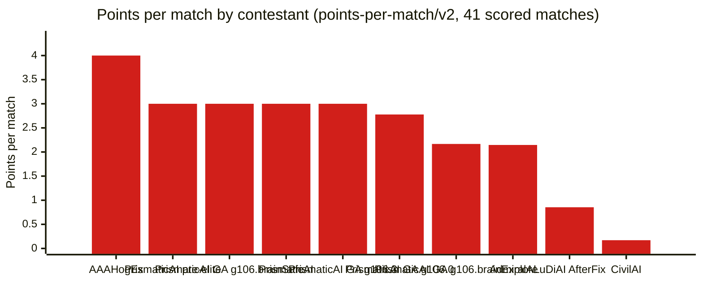
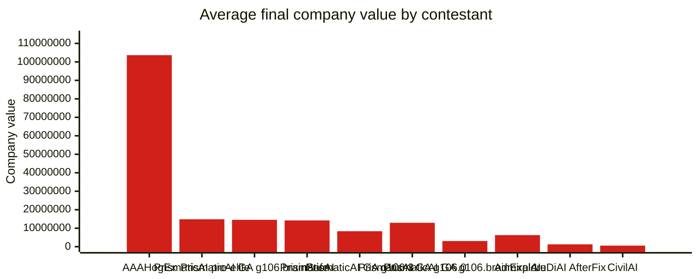
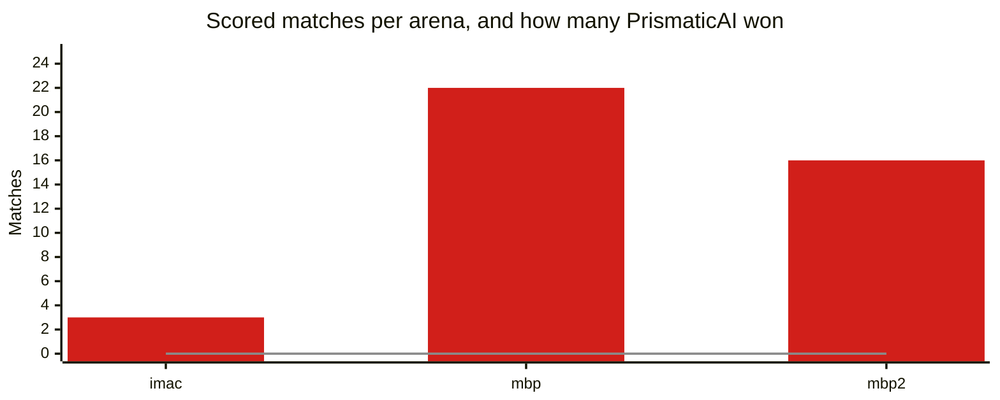

# battle-20261120T061707-9d2ebb68

Derived from `battle-20261120T061707-9d2ebb68.json` by `tools/research/ai-battle/battle.py report`; do not edit.

- Edition `9d2ebb6846a17a3b`: PrismaticAI and referee at `cbd774f94108d495482a04435618a1effe17f9fc`, base set `opengfx-8.0.tar`
- 20-year free-for-all from 1960, map 256x256 temperate, breakdowns 1
- 41 scored match(es) on `imac` (20261119-master-gdf1e05e7d8), `mbp` (20261120-master-m7a925f73d1), `mbp2` (20261119-master-gdf1e05e7d8)
- Replays: 0 of 0 identical to their original on another arena

| # | Contestant | Played | Wins | Points | Points/match | Avg rank | Avg final value | Squirrel errors | Matches with anomalies |
|---|---|---|---|---|---|---|---|---|---|
| 1 | AAAHogEx | 41 | 41 | 164 | 4.0 | 1.0 | 103.6 M | 0 | 0 |
| 2 | PrismaticAI pre-elite | 7 | 0 | 21 | 3.0 | 2.0 | 14.8 M | 0 | 0 |
| 3 | PrismaticAI GA g106.brainSafe | 7 | 0 | 21 | 3.0 | 2.0 | 14.5 M | 0 | 0 |
| 4 | PrismaticAI | 6 | 0 | 18 | 3.0 | 2.0 | 14.2 M | 0 | 3 |
| 5 | PrismaticAI GA g106.3 | 6 | 0 | 18 | 3.0 | 2.0 | 8.4 M | 0 | 1 |
| 6 | PrismaticAI GA g106.0 | 9 | 0 | 25 | 2.778 | 2.22 | 12.9 M | 0 | 0 |
| 7 | PrismaticAI GA g106.brainExplore | 6 | 0 | 13 | 2.167 | 2.83 | 3.1 M | 0 | 0 |
| 8 | AdmiralAI | 41 | 0 | 88 | 2.146 | 2.85 | 6.3 M | 0 | 0 |
| 9 | LuDiAI AfterFix | 41 | 0 | 35 | 0.854 | 4.15 | 1.3 M | 0 | 1 |
| 10 | CivilAI | 41 | 0 | 7 | 0.171 | 4.83 | 571.6 k | 0 | 6 |

```mermaid
---
config:
  xyChart:
    width: 900
    height: 360
  themeVariables:
    xyChart:
      plotColorPalette: "#d11f1a, #8a8a8a, #0b0b0b, #ece4d6"
---
xychart-beta
    title "Final company value per scored match: winner vs best PrismaticAI"
    x-axis ["m-0001", "m-0002", "m-0003", "m-0004", "m-0005", "m-0006", "m-0007", "m-0008", "m-0009", "m-0010", "m-0011", "m-0012", "m-0013", "m-0014", "m-0015", "m-0016", "m-0017", "m-0018", "m-0019", "m-0020", "m-0021", "m-0022", "m-0023", "m-0024", "m-0025", "m-0026", "m-0027", "m-0028", "m-0036", "m-0037", "m-0038", "m-0039", "m-0040", "m-0041", "m-0042", "m-0043", "m-0044", "m-0050", "m-0062", "m-0063", "m-0065"]
    %% series: Winner | Best PrismaticAI
    %% links: battle-20261120T061707-9d2ebb68.md?col=Match&filter=m-0001 | battle-20261120T061707-9d2ebb68.md?col=Match&filter=m-0002 | battle-20261120T061707-9d2ebb68.md?col=Match&filter=m-0003 | battle-20261120T061707-9d2ebb68.md?col=Match&filter=m-0004 | battle-20261120T061707-9d2ebb68.md?col=Match&filter=m-0005 | battle-20261120T061707-9d2ebb68.md?col=Match&filter=m-0006 | battle-20261120T061707-9d2ebb68.md?col=Match&filter=m-0007 | battle-20261120T061707-9d2ebb68.md?col=Match&filter=m-0008 | battle-20261120T061707-9d2ebb68.md?col=Match&filter=m-0009 | battle-20261120T061707-9d2ebb68.md?col=Match&filter=m-0010 | battle-20261120T061707-9d2ebb68.md?col=Match&filter=m-0011 | battle-20261120T061707-9d2ebb68.md?col=Match&filter=m-0012 | battle-20261120T061707-9d2ebb68.md?col=Match&filter=m-0013 | battle-20261120T061707-9d2ebb68.md?col=Match&filter=m-0014 | battle-20261120T061707-9d2ebb68.md?col=Match&filter=m-0015 | battle-20261120T061707-9d2ebb68.md?col=Match&filter=m-0016 | battle-20261120T061707-9d2ebb68.md?col=Match&filter=m-0017 | battle-20261120T061707-9d2ebb68.md?col=Match&filter=m-0018 | battle-20261120T061707-9d2ebb68.md?col=Match&filter=m-0019 | battle-20261120T061707-9d2ebb68.md?col=Match&filter=m-0020 | battle-20261120T061707-9d2ebb68.md?col=Match&filter=m-0021 | battle-20261120T061707-9d2ebb68.md?col=Match&filter=m-0022 | battle-20261120T061707-9d2ebb68.md?col=Match&filter=m-0023 | battle-20261120T061707-9d2ebb68.md?col=Match&filter=m-0024 | battle-20261120T061707-9d2ebb68.md?col=Match&filter=m-0025 | battle-20261120T061707-9d2ebb68.md?col=Match&filter=m-0026 | battle-20261120T061707-9d2ebb68.md?col=Match&filter=m-0027 | battle-20261120T061707-9d2ebb68.md?col=Match&filter=m-0028 | battle-20261120T061707-9d2ebb68.md?col=Match&filter=m-0036 | battle-20261120T061707-9d2ebb68.md?col=Match&filter=m-0037 | battle-20261120T061707-9d2ebb68.md?col=Match&filter=m-0038 | battle-20261120T061707-9d2ebb68.md?col=Match&filter=m-0039 | battle-20261120T061707-9d2ebb68.md?col=Match&filter=m-0040 | battle-20261120T061707-9d2ebb68.md?col=Match&filter=m-0041 | battle-20261120T061707-9d2ebb68.md?col=Match&filter=m-0042 | battle-20261120T061707-9d2ebb68.md?col=Match&filter=m-0043 | battle-20261120T061707-9d2ebb68.md?col=Match&filter=m-0044 | battle-20261120T061707-9d2ebb68.md?col=Match&filter=m-0050 | battle-20261120T061707-9d2ebb68.md?col=Match&filter=m-0062 | battle-20261120T061707-9d2ebb68.md?col=Match&filter=m-0063 | battle-20261120T061707-9d2ebb68.md?col=Match&filter=m-0065
    y-axis "Company value" 0 --> 152000000
    bar [102194852, 83974730, 97545490, 116315453, 94641609, 111926143, 106833309, 125825253, 135999881, 136741899, 137966849, 120467186, 73087238, 88690366, 91417311, 98952684, 80379132, 120151219, 112486608, 83888448, 79564244, 137120663, 124694587, 103166116, 95197340, 126073566, 92478697, 118608831, 115334783, 93824934, 103062800, 100219395, 100624739, 93990258, 102569142, 96689927, 84939700, 95724445, 84444124, 90531127, 90687985]
    line [9194521, 4273272, 3826295, 443692, 2851861, 13506838, 19943150, 17969598, 17352041, 3009490, 10111942, 14118922, 15883221, 10794364, 12031195, 3263212, 10185386, 14645794, 11051720, 11458955, 15712039, 1688387, 6072180, 13331110, 12119512, 7271398, 19354230, 4248906, 16275052, 17689723, 18196462, 20411910, 5741389, 10504736, 13320441, 17966169, 13973719, 22271831, 10082910, 12997702, 10477720]
```

<!-- battle-charts:begin -->
<!-- derived from battle-20261120T061707-9d2ebb68.json by `battle.py render`; `battle.py check` fails when it is stale -->

<!-- battle-charts:end -->

| Match | Arena | Seed | Winner | Value | Last | Anomalies |
|---|---|---|---|---|---|---|
| m-0001 | mbp | 95753311 | AAAHogEx | 102.2 M | CivilAI | CivilAI: no_vehicles |
| m-0002 | mbp | 95753311 | AAAHogEx | 84.0 M | CivilAI | CivilAI: no_vehicles |
| m-0003 | mbp | 95753311 | AAAHogEx | 97.5 M | CivilAI | - |
| m-0004 | mbp | 95753311 | AAAHogEx | 116.3 M | CivilAI | - |
| m-0005 | mbp | 95753311 | AAAHogEx | 94.6 M | CivilAI | - |
| m-0006 | mbp | 600360144 | AAAHogEx | 111.9 M | CivilAI | - |
| m-0007 | mbp | 600360144 | AAAHogEx | 106.8 M | CivilAI | - |
| m-0008 | mbp | 600360144 | AAAHogEx | 125.8 M | CivilAI | - |
| m-0009 | mbp | 600360144 | AAAHogEx | 136.0 M | CivilAI | CivilAI: no_vehicles |
| m-0010 | imac | 600360144 | AAAHogEx | 136.7 M | CivilAI | - |
| m-0011 | imac | 600360144 | AAAHogEx | 138.0 M | CivilAI | - |
| m-0012 | imac | 506083156 | AAAHogEx | 120.5 M | CivilAI | PrismaticAI: fleet_drop:81->42 |
| m-0013 | mbp2 | 506083156 | AAAHogEx | 73.1 M | CivilAI | - |
| m-0014 | mbp2 | 506083156 | AAAHogEx | 88.7 M | CivilAI | - |
| m-0015 | mbp2 | 506083156 | AAAHogEx | 91.4 M | CivilAI | - |
| m-0016 | mbp2 | 506083156 | AAAHogEx | 99.0 M | CivilAI | - |
| m-0017 | mbp2 | 506083156 | AAAHogEx | 80.4 M | CivilAI | - |
| m-0018 | mbp2 | 1458696128 | AAAHogEx | 120.2 M | CivilAI | PrismaticAI: fleet_drop:47->30 |
| m-0019 | mbp2 | 1458696128 | AAAHogEx | 112.5 M | CivilAI | - |
| m-0020 | mbp2 | 1458696128 | AAAHogEx | 83.9 M | CivilAI | - |
| m-0021 | mbp2 | 1458696128 | AAAHogEx | 79.6 M | CivilAI | CivilAI: fleet_drop:49->30 |
| m-0022 | mbp2 | 1458696128 | AAAHogEx | 137.1 M | LuDiAI AfterFix | - |
| m-0023 | mbp2 | 1458696128 | AAAHogEx | 124.7 M | LuDiAI AfterFix | - |
| m-0024 | mbp2 | 1370488416 | AAAHogEx | 103.2 M | CivilAI | - |
| m-0025 | mbp2 | 1370488416 | AAAHogEx | 95.2 M | LuDiAI AfterFix | - |
| m-0026 | mbp2 | 1370488416 | AAAHogEx | 126.1 M | CivilAI | CivilAI: no_vehicles |
| m-0027 | mbp2 | 1370488416 | AAAHogEx | 92.5 M | LuDiAI AfterFix | CivilAI: fleet_drop:50->32 |
| m-0028 | mbp2 | 1370488416 | AAAHogEx | 118.6 M | CivilAI | - |
| m-0036 | mbp | 57985523 | AAAHogEx | 115.3 M | CivilAI | PrismaticAI: fleet_drop:114->77 |
| m-0037 | mbp | 57985523 | AAAHogEx | 93.8 M | CivilAI | - |
| m-0038 | mbp | 57985523 | AAAHogEx | 103.1 M | CivilAI | - |
| m-0039 | mbp | 57985523 | AAAHogEx | 100.2 M | CivilAI | LuDiAI AfterFix: fleet_drop:98->62 |
| m-0040 | mbp | 57985523 | AAAHogEx | 100.6 M | LuDiAI AfterFix | - |
| m-0041 | mbp | 57985523 | AAAHogEx | 94.0 M | CivilAI | PrismaticAI GA g106.3: fleet_drop:88->53 |
| m-0042 | mbp | 612281080 | AAAHogEx | 102.6 M | CivilAI | - |
| m-0043 | mbp | 612281080 | AAAHogEx | 96.7 M | CivilAI | - |
| m-0044 | mbp | 612281080 | AAAHogEx | 84.9 M | CivilAI | - |
| m-0050 | mbp | 374239677 | AAAHogEx | 95.7 M | CivilAI | - |
| m-0062 | mbp | 853090451 | AAAHogEx | 84.4 M | CivilAI | - |
| m-0063 | mbp | 853090451 | AAAHogEx | 90.5 M | LuDiAI AfterFix | - |
| m-0065 | mbp | 853090451 | AAAHogEx | 90.7 M | LuDiAI AfterFix | - |
