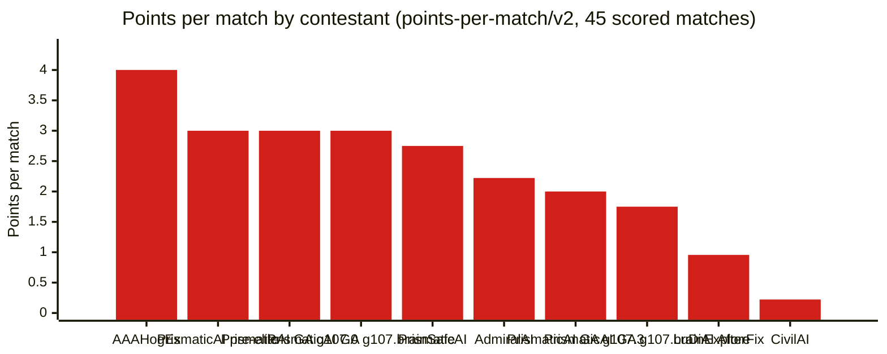
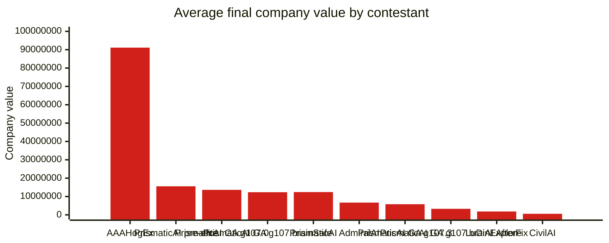
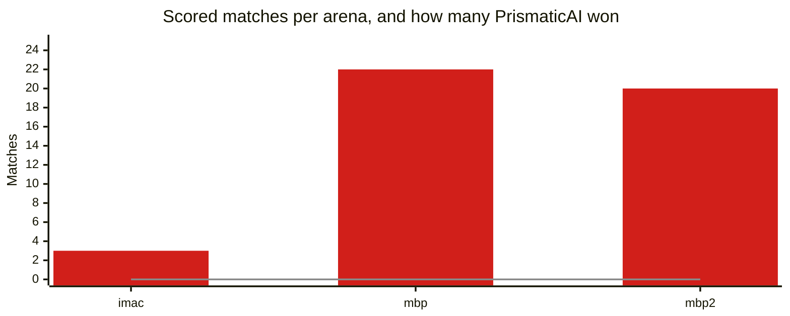

# battle-20261120T062708-b6d4d394

Derived from `battle-20261120T062708-b6d4d394.json` by `tools/research/ai-battle/battle.py report`; do not edit.

- Edition `b6d4d394bc950adf`: PrismaticAI and referee at `cbd774f94108d495482a04435618a1effe17f9fc`, base set `opengfx-8.0.tar`
- 20-year free-for-all from 1960, map 256x256 temperate, breakdowns 1
- 45 scored match(es) on `imac` (20261119-master-gdf1e05e7d8), `mbp` (20261120-master-m7a925f73d1), `mbp2` (20261119-master-gdf1e05e7d8)
- Replays: 0 of 0 identical to their original on another arena

| # | Contestant | Played | Wins | Points | Points/match | Avg rank | Avg final value | Squirrel errors | Matches with anomalies |
|---|---|---|---|---|---|---|---|---|---|
| 1 | AAAHogEx | 45 | 45 | 180 | 4.0 | 1.0 | 91.1 M | 0 | 0 |
| 2 | PrismaticAI pre-elite | 8 | 0 | 24 | 3.0 | 2.0 | 15.6 M | 0 | 1 |
| 3 | PrismaticAI GA g107.0 | 8 | 0 | 24 | 3.0 | 2.0 | 13.6 M | 0 | 0 |
| 4 | PrismaticAI GA g107.brainSafe | 7 | 0 | 21 | 3.0 | 2.0 | 12.3 M | 0 | 0 |
| 5 | PrismaticAI | 8 | 0 | 22 | 2.75 | 2.25 | 12.4 M | 0 | 5 |
| 6 | AdmiralAI | 45 | 0 | 100 | 2.222 | 2.78 | 6.7 M | 71 | 3 |
| 7 | PrismaticAI GA g107.3 | 6 | 0 | 12 | 2.0 | 3.0 | 5.8 M | 0 | 0 |
| 8 | PrismaticAI GA g107.brainExplore | 8 | 0 | 14 | 1.75 | 3.25 | 3.3 M | 0 | 0 |
| 9 | LuDiAI AfterFix | 45 | 0 | 43 | 0.956 | 4.04 | 1.8 M | 0 | 2 |
| 10 | CivilAI | 45 | 0 | 10 | 0.222 | 4.78 | 585.1 k | 3625 | 9 |

```mermaid
---
config:
  xyChart:
    width: 900
    height: 360
  themeVariables:
    xyChart:
      plotColorPalette: "#d11f1a, #8a8a8a, #0b0b0b, #ece4d6"
---
xychart-beta
    title "Final company value per scored match: winner vs best PrismaticAI"
    x-axis ["m-0001", "m-0002", "m-0003", "m-0004", "m-0005", "m-0006", "m-0007", "m-0008", "m-0009", "m-0010", "m-0011", "m-0012", "m-0013", "m-0014", "m-0015", "m-0016", "m-0017", "m-0018", "m-0019", "m-0020", "m-0021", "m-0022", "m-0023", "m-0024", "m-0025", "m-0026", "m-0027", "m-0028", "m-0036", "m-0037", "m-0038", "m-0039", "m-0040", "m-0041", "m-0042", "m-0043", "m-0044", "m-0045", "m-0046", "m-0047", "m-0052", "m-0054", "m-0060", "m-0061", "m-0062"]
    %% series: Winner | Best PrismaticAI
    %% links: battle-20261120T062708-b6d4d394.md?col=Match&filter=m-0001 | battle-20261120T062708-b6d4d394.md?col=Match&filter=m-0002 | battle-20261120T062708-b6d4d394.md?col=Match&filter=m-0003 | battle-20261120T062708-b6d4d394.md?col=Match&filter=m-0004 | battle-20261120T062708-b6d4d394.md?col=Match&filter=m-0005 | battle-20261120T062708-b6d4d394.md?col=Match&filter=m-0006 | battle-20261120T062708-b6d4d394.md?col=Match&filter=m-0007 | battle-20261120T062708-b6d4d394.md?col=Match&filter=m-0008 | battle-20261120T062708-b6d4d394.md?col=Match&filter=m-0009 | battle-20261120T062708-b6d4d394.md?col=Match&filter=m-0010 | battle-20261120T062708-b6d4d394.md?col=Match&filter=m-0011 | battle-20261120T062708-b6d4d394.md?col=Match&filter=m-0012 | battle-20261120T062708-b6d4d394.md?col=Match&filter=m-0013 | battle-20261120T062708-b6d4d394.md?col=Match&filter=m-0014 | battle-20261120T062708-b6d4d394.md?col=Match&filter=m-0015 | battle-20261120T062708-b6d4d394.md?col=Match&filter=m-0016 | battle-20261120T062708-b6d4d394.md?col=Match&filter=m-0017 | battle-20261120T062708-b6d4d394.md?col=Match&filter=m-0018 | battle-20261120T062708-b6d4d394.md?col=Match&filter=m-0019 | battle-20261120T062708-b6d4d394.md?col=Match&filter=m-0020 | battle-20261120T062708-b6d4d394.md?col=Match&filter=m-0021 | battle-20261120T062708-b6d4d394.md?col=Match&filter=m-0022 | battle-20261120T062708-b6d4d394.md?col=Match&filter=m-0023 | battle-20261120T062708-b6d4d394.md?col=Match&filter=m-0024 | battle-20261120T062708-b6d4d394.md?col=Match&filter=m-0025 | battle-20261120T062708-b6d4d394.md?col=Match&filter=m-0026 | battle-20261120T062708-b6d4d394.md?col=Match&filter=m-0027 | battle-20261120T062708-b6d4d394.md?col=Match&filter=m-0028 | battle-20261120T062708-b6d4d394.md?col=Match&filter=m-0036 | battle-20261120T062708-b6d4d394.md?col=Match&filter=m-0037 | battle-20261120T062708-b6d4d394.md?col=Match&filter=m-0038 | battle-20261120T062708-b6d4d394.md?col=Match&filter=m-0039 | battle-20261120T062708-b6d4d394.md?col=Match&filter=m-0040 | battle-20261120T062708-b6d4d394.md?col=Match&filter=m-0041 | battle-20261120T062708-b6d4d394.md?col=Match&filter=m-0042 | battle-20261120T062708-b6d4d394.md?col=Match&filter=m-0043 | battle-20261120T062708-b6d4d394.md?col=Match&filter=m-0044 | battle-20261120T062708-b6d4d394.md?col=Match&filter=m-0045 | battle-20261120T062708-b6d4d394.md?col=Match&filter=m-0046 | battle-20261120T062708-b6d4d394.md?col=Match&filter=m-0047 | battle-20261120T062708-b6d4d394.md?col=Match&filter=m-0052 | battle-20261120T062708-b6d4d394.md?col=Match&filter=m-0054 | battle-20261120T062708-b6d4d394.md?col=Match&filter=m-0060 | battle-20261120T062708-b6d4d394.md?col=Match&filter=m-0061 | battle-20261120T062708-b6d4d394.md?col=Match&filter=m-0062
    y-axis "Company value" 0 --> 138000000
    bar [69172317, 93387096, 72830481, 69714261, 113783161, 78917875, 77756833, 93061890, 87274839, 88381082, 75439726, 75368374, 96832755, 85632341, 76312191, 93396560, 68003721, 68426935, 80747206, 52457831, 89945699, 84495380, 65740131, 97098961, 88380715, 104031238, 104371275, 107793672, 120611945, 82086415, 100170846, 116231742, 107961090, 102834436, 103353742, 99790620, 107374427, 99504541, 87278483, 110364974, 125790572, 84698986, 100319474, 105265972, 89155751]
    line [11985011, 18679360, 13222996, 609751, 7109124, 8833717, 12691519, 11180127, 10520927, 2436001, 4092118, 13790774, 15160490, 12046389, 13613889, 1576582, 7374586, 12915505, 19786298, 9397657, 12612692, 4428376, 8872980, 15460496, 18973621, 13082978, 11028475, 647283, 19390379, 17264359, 18143533, 13397160, 3252568, 6454668, 15175730, 15464567, 12068916, 11971908, 8559003, 869106, 4775635, 7995442, 5762506, 13122420, 14353819]
```

<!-- battle-charts:begin -->
<!-- derived from battle-20261120T062708-b6d4d394.json by `battle.py render`; `battle.py check` fails when it is stale -->

<!-- battle-charts:end -->

| Match | Arena | Seed | Winner | Value | Last | Anomalies |
|---|---|---|---|---|---|---|
| m-0001 | mbp | 65083767 | AAAHogEx | 69.2 M | CivilAI | CivilAI: fleet_drop:20->13 |
| m-0002 | mbp | 65083767 | AAAHogEx | 93.4 M | CivilAI | - |
| m-0003 | mbp | 65083767 | AAAHogEx | 72.8 M | CivilAI | LuDiAI AfterFix: fleet_drop:156->96 |
| m-0004 | mbp | 65083767 | AAAHogEx | 69.7 M | CivilAI | - |
| m-0005 | mbp | 65083767 | AAAHogEx | 113.8 M | CivilAI | CivilAI: squirrel_errors:3625 |
| m-0006 | mbp | 1270794215 | AAAHogEx | 78.9 M | LuDiAI AfterFix | PrismaticAI: fleet_drop:82->53 |
| m-0007 | mbp | 1270794215 | AAAHogEx | 77.8 M | LuDiAI AfterFix | CivilAI: fleet_drop:13->8; LuDiAI AfterFix: no_vehicles |
| m-0008 | mbp | 1270794215 | AAAHogEx | 93.1 M | CivilAI | - |
| m-0009 | mbp | 1270794215 | AAAHogEx | 87.3 M | CivilAI | - |
| m-0010 | imac | 1270794215 | AAAHogEx | 88.4 M | CivilAI | CivilAI: fleet_drop:11->7 |
| m-0011 | imac | 1270794215 | AAAHogEx | 75.4 M | LuDiAI AfterFix | - |
| m-0012 | imac | 1476418760 | AAAHogEx | 75.4 M | LuDiAI AfterFix | PrismaticAI: fleet_drop:94->61 |
| m-0013 | mbp2 | 1476418760 | AAAHogEx | 96.8 M | CivilAI | - |
| m-0014 | mbp2 | 1476418760 | AAAHogEx | 85.6 M | LuDiAI AfterFix | - |
| m-0015 | mbp2 | 1476418760 | AAAHogEx | 76.3 M | CivilAI | - |
| m-0016 | mbp2 | 1476418760 | AAAHogEx | 93.4 M | CivilAI | - |
| m-0017 | mbp2 | 1476418760 | AAAHogEx | 68.0 M | LuDiAI AfterFix | - |
| m-0018 | mbp2 | 822217673 | AAAHogEx | 68.4 M | CivilAI | PrismaticAI: fleet_drop:89->49; CivilAI: fleet_drop:36->19 |
| m-0019 | mbp2 | 822217673 | AAAHogEx | 80.7 M | CivilAI | - |
| m-0020 | mbp2 | 822217673 | AAAHogEx | 52.5 M | CivilAI | CivilAI: fleet_drop:33->22 |
| m-0021 | mbp2 | 822217673 | AAAHogEx | 89.9 M | CivilAI | AdmiralAI: squirrel_errors:27 |
| m-0022 | mbp2 | 822217673 | AAAHogEx | 84.5 M | CivilAI | - |
| m-0023 | mbp2 | 822217673 | AAAHogEx | 65.7 M | CivilAI | - |
| m-0024 | mbp2 | 313324803 | AAAHogEx | 97.1 M | CivilAI | - |
| m-0025 | mbp2 | 313324803 | AAAHogEx | 88.4 M | CivilAI | PrismaticAI pre-elite: fleet_drop:104->71 |
| m-0026 | mbp2 | 313324803 | AAAHogEx | 104.0 M | CivilAI | AdmiralAI: fleet_drop:216->113 |
| m-0027 | mbp2 | 313324803 | AAAHogEx | 104.4 M | CivilAI | - |
| m-0028 | mbp2 | 313324803 | AAAHogEx | 107.8 M | PrismaticAI GA g107.brainExplore | - |
| m-0036 | mbp | 476740505 | AAAHogEx | 120.6 M | CivilAI | PrismaticAI: fleet_drop:99->65; CivilAI: fleet_drop:67->40 |
| m-0037 | mbp | 476740505 | AAAHogEx | 82.1 M | CivilAI | CivilAI: no_vehicles |
| m-0038 | mbp | 476740505 | AAAHogEx | 100.2 M | CivilAI | - |
| m-0039 | mbp | 476740505 | AAAHogEx | 116.2 M | CivilAI | - |
| m-0040 | mbp | 476740505 | AAAHogEx | 108.0 M | CivilAI | - |
| m-0041 | mbp | 476740505 | AAAHogEx | 102.8 M | CivilAI | - |
| m-0042 | mbp | 1610048713 | AAAHogEx | 103.4 M | LuDiAI AfterFix | - |
| m-0043 | mbp | 1610048713 | AAAHogEx | 99.8 M | CivilAI | - |
| m-0044 | mbp | 1610048713 | AAAHogEx | 107.4 M | CivilAI | - |
| m-0045 | mbp2 | 1610048713 | AAAHogEx | 99.5 M | CivilAI | AdmiralAI: squirrel_errors:44 |
| m-0046 | mbp2 | 1610048713 | AAAHogEx | 87.3 M | CivilAI | - |
| m-0047 | mbp2 | 1610048713 | AAAHogEx | 110.4 M | PrismaticAI GA g107.3 | - |
| m-0052 | mbp2 | 76174905 | AAAHogEx | 125.8 M | AdmiralAI | - |
| m-0054 | mbp | 484709246 | AAAHogEx | 84.7 M | CivilAI | PrismaticAI: fleet_drop:99->64 |
| m-0060 | mbp | 327702634 | AAAHogEx | 100.3 M | CivilAI | - |
| m-0061 | mbp | 327702634 | AAAHogEx | 105.3 M | CivilAI | CivilAI: fleet_drop:51->25 |
| m-0062 | mbp | 327702634 | AAAHogEx | 89.2 M | CivilAI | - |
