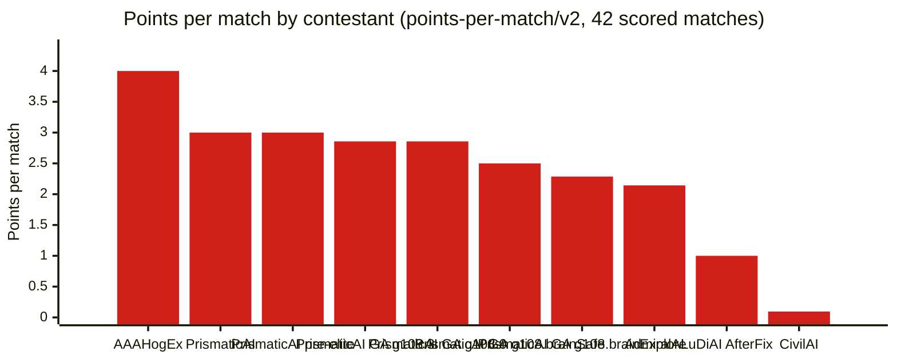
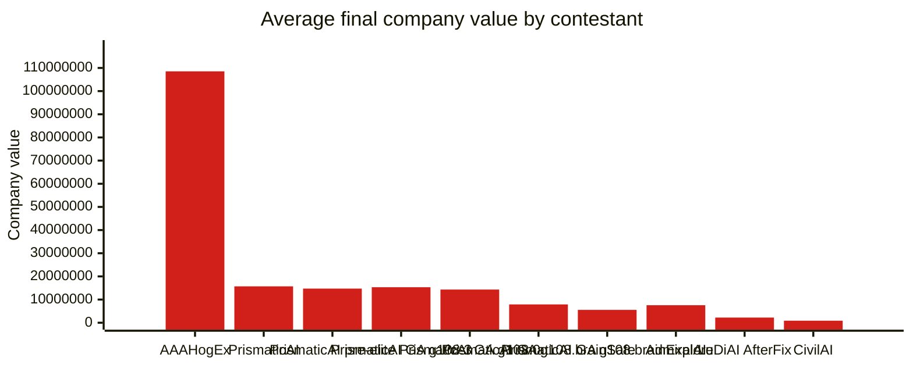
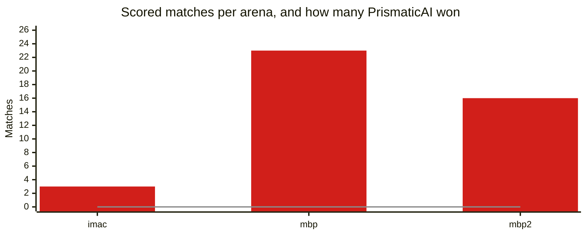

# battle-20261120T063607-25ac8f6f

Derived from `battle-20261120T063607-25ac8f6f.json` by `tools/research/ai-battle/battle.py report`; do not edit.

- Edition `25ac8f6fd49d736b`: PrismaticAI and referee at `cbd774f94108d495482a04435618a1effe17f9fc`, base set `opengfx-8.0.tar`
- 20-year free-for-all from 1960, map 256x256 temperate, breakdowns 1
- 42 scored match(es) on `imac` (20261119-master-gdf1e05e7d8), `mbp` (20261120-master-m7a925f73d1), `mbp2` (20261119-master-gdf1e05e7d8)
- Replays: 0 of 0 identical to their original on another arena

| # | Contestant | Played | Wins | Points | Points/match | Avg rank | Avg final value | Squirrel errors | Matches with anomalies |
|---|---|---|---|---|---|---|---|---|---|
| 1 | AAAHogEx | 42 | 42 | 168 | 4.0 | 1.0 | 108.5 M | 0 | 0 |
| 2 | PrismaticAI | 7 | 0 | 21 | 3.0 | 2.0 | 15.7 M | 0 | 2 |
| 3 | PrismaticAI pre-elite | 8 | 0 | 24 | 3.0 | 2.0 | 14.7 M | 0 | 1 |
| 4 | PrismaticAI GA g108.3 | 7 | 0 | 20 | 2.857 | 2.14 | 15.3 M | 0 | 1 |
| 5 | PrismaticAI GA g108.0 | 7 | 0 | 20 | 2.857 | 2.14 | 14.3 M | 0 | 0 |
| 6 | PrismaticAI GA g108.brainSafe | 6 | 0 | 15 | 2.5 | 2.5 | 7.9 M | 0 | 0 |
| 7 | PrismaticAI GA g108.brainExplore | 7 | 0 | 16 | 2.286 | 2.71 | 5.5 M | 0 | 0 |
| 8 | AdmiralAI | 42 | 0 | 90 | 2.143 | 2.86 | 7.6 M | 0 | 1 |
| 9 | LuDiAI AfterFix | 42 | 0 | 42 | 1.0 | 4.0 | 2.2 M | 0 | 0 |
| 10 | CivilAI | 42 | 0 | 4 | 0.095 | 4.9 | 877.9 k | 3660 | 9 |

```mermaid
---
config:
  xyChart:
    width: 900
    height: 360
  themeVariables:
    xyChart:
      plotColorPalette: "#d11f1a, #8a8a8a, #0b0b0b, #ece4d6"
---
xychart-beta
    title "Final company value per scored match: winner vs best PrismaticAI"
    x-axis ["m-0001", "m-0002", "m-0003", "m-0004", "m-0005", "m-0006", "m-0007", "m-0008", "m-0009", "m-0010", "m-0011", "m-0012", "m-0013", "m-0014", "m-0015", "m-0016", "m-0017", "m-0018", "m-0019", "m-0020", "m-0021", "m-0022", "m-0023", "m-0024", "m-0025", "m-0026", "m-0027", "m-0028", "m-0036", "m-0037", "m-0038", "m-0039", "m-0040", "m-0041", "m-0042", "m-0043", "m-0044", "m-0046", "m-0047", "m-0053", "m-0054", "m-0055"]
    %% series: Winner | Best PrismaticAI
    %% links: battle-20261120T063607-25ac8f6f.md?col=Match&filter=m-0001 | battle-20261120T063607-25ac8f6f.md?col=Match&filter=m-0002 | battle-20261120T063607-25ac8f6f.md?col=Match&filter=m-0003 | battle-20261120T063607-25ac8f6f.md?col=Match&filter=m-0004 | battle-20261120T063607-25ac8f6f.md?col=Match&filter=m-0005 | battle-20261120T063607-25ac8f6f.md?col=Match&filter=m-0006 | battle-20261120T063607-25ac8f6f.md?col=Match&filter=m-0007 | battle-20261120T063607-25ac8f6f.md?col=Match&filter=m-0008 | battle-20261120T063607-25ac8f6f.md?col=Match&filter=m-0009 | battle-20261120T063607-25ac8f6f.md?col=Match&filter=m-0010 | battle-20261120T063607-25ac8f6f.md?col=Match&filter=m-0011 | battle-20261120T063607-25ac8f6f.md?col=Match&filter=m-0012 | battle-20261120T063607-25ac8f6f.md?col=Match&filter=m-0013 | battle-20261120T063607-25ac8f6f.md?col=Match&filter=m-0014 | battle-20261120T063607-25ac8f6f.md?col=Match&filter=m-0015 | battle-20261120T063607-25ac8f6f.md?col=Match&filter=m-0016 | battle-20261120T063607-25ac8f6f.md?col=Match&filter=m-0017 | battle-20261120T063607-25ac8f6f.md?col=Match&filter=m-0018 | battle-20261120T063607-25ac8f6f.md?col=Match&filter=m-0019 | battle-20261120T063607-25ac8f6f.md?col=Match&filter=m-0020 | battle-20261120T063607-25ac8f6f.md?col=Match&filter=m-0021 | battle-20261120T063607-25ac8f6f.md?col=Match&filter=m-0022 | battle-20261120T063607-25ac8f6f.md?col=Match&filter=m-0023 | battle-20261120T063607-25ac8f6f.md?col=Match&filter=m-0024 | battle-20261120T063607-25ac8f6f.md?col=Match&filter=m-0025 | battle-20261120T063607-25ac8f6f.md?col=Match&filter=m-0026 | battle-20261120T063607-25ac8f6f.md?col=Match&filter=m-0027 | battle-20261120T063607-25ac8f6f.md?col=Match&filter=m-0028 | battle-20261120T063607-25ac8f6f.md?col=Match&filter=m-0036 | battle-20261120T063607-25ac8f6f.md?col=Match&filter=m-0037 | battle-20261120T063607-25ac8f6f.md?col=Match&filter=m-0038 | battle-20261120T063607-25ac8f6f.md?col=Match&filter=m-0039 | battle-20261120T063607-25ac8f6f.md?col=Match&filter=m-0040 | battle-20261120T063607-25ac8f6f.md?col=Match&filter=m-0041 | battle-20261120T063607-25ac8f6f.md?col=Match&filter=m-0042 | battle-20261120T063607-25ac8f6f.md?col=Match&filter=m-0043 | battle-20261120T063607-25ac8f6f.md?col=Match&filter=m-0044 | battle-20261120T063607-25ac8f6f.md?col=Match&filter=m-0046 | battle-20261120T063607-25ac8f6f.md?col=Match&filter=m-0047 | battle-20261120T063607-25ac8f6f.md?col=Match&filter=m-0053 | battle-20261120T063607-25ac8f6f.md?col=Match&filter=m-0054 | battle-20261120T063607-25ac8f6f.md?col=Match&filter=m-0055
    y-axis "Company value" 0 --> 199000000
    bar [98979908, 95036633, 85038427, 84825720, 94298423, 102486515, 103832877, 84430159, 95090651, 107102589, 111428329, 112942207, 131429117, 160020542, 138363814, 141788997, 150276090, 101119971, 84414519, 103681966, 114594881, 113244150, 116040290, 100102546, 89015415, 91607473, 99041611, 96415477, 87219864, 90299077, 90151778, 104425496, 119822174, 87896045, 162046352, 147614130, 158946912, 180542214, 153093988, 65372035, 56747109, 47465633]
    line [9310158, 18371291, 8382664, 10951125, 18975820, 14087447, 15429094, 12861504, 11930374, 6941052, 15219280, 18089851, 25018068, 14612252, 4840306, 5281515, 17052682, 19854558, 20682475, 17745372, 11747511, 1156670, 17374976, 11217328, 7207337, 9984541, 5615603, 11054346, 19121193, 10105707, 16237460, 4907109, 2124435, 14552399, 19490973, 16030365, 10415580, 1317070, 18095852, 6041742, 8062852, 14092250]
```

<!-- battle-charts:begin -->
<!-- derived from battle-20261120T063607-25ac8f6f.json by `battle.py render`; `battle.py check` fails when it is stale -->

<!-- battle-charts:end -->

| Match | Arena | Seed | Winner | Value | Last | Anomalies |
|---|---|---|---|---|---|---|
| m-0001 | mbp | 1209592147 | AAAHogEx | 99.0 M | CivilAI | - |
| m-0002 | mbp | 1209592147 | AAAHogEx | 95.0 M | CivilAI | CivilAI: fleet_drop:44->22 |
| m-0003 | mbp | 1209592147 | AAAHogEx | 85.0 M | CivilAI | - |
| m-0004 | mbp | 1209592147 | AAAHogEx | 84.8 M | CivilAI | - |
| m-0005 | mbp | 1209592147 | AAAHogEx | 94.3 M | CivilAI | - |
| m-0006 | mbp | 65881457 | AAAHogEx | 102.5 M | CivilAI | PrismaticAI: fleet_drop:99->52 |
| m-0007 | mbp | 65881457 | AAAHogEx | 103.8 M | CivilAI | CivilAI: fleet_drop:47->28 |
| m-0008 | mbp | 65881457 | AAAHogEx | 84.4 M | CivilAI | - |
| m-0009 | mbp | 65881457 | AAAHogEx | 95.1 M | CivilAI | - |
| m-0010 | imac | 65881457 | AAAHogEx | 107.1 M | CivilAI | - |
| m-0011 | imac | 65881457 | AAAHogEx | 111.4 M | CivilAI | AdmiralAI: fleet_drop:383->262; CivilAI: fleet_drop:31->19 |
| m-0012 | imac | 693237269 | AAAHogEx | 112.9 M | CivilAI | - |
| m-0013 | mbp2 | 693237269 | AAAHogEx | 131.4 M | CivilAI | - |
| m-0014 | mbp2 | 693237269 | AAAHogEx | 160.0 M | CivilAI | - |
| m-0015 | mbp2 | 693237269 | AAAHogEx | 138.4 M | CivilAI | - |
| m-0016 | mbp2 | 693237269 | AAAHogEx | 141.8 M | CivilAI | - |
| m-0017 | mbp2 | 693237269 | AAAHogEx | 150.3 M | CivilAI | - |
| m-0018 | mbp2 | 994927622 | AAAHogEx | 101.1 M | LuDiAI AfterFix | CivilAI: fleet_drop:90->59 |
| m-0019 | mbp2 | 994927622 | AAAHogEx | 84.4 M | CivilAI | CivilAI: fleet_drop:66->38 |
| m-0020 | mbp2 | 994927622 | AAAHogEx | 103.7 M | CivilAI | - |
| m-0021 | mbp2 | 994927622 | AAAHogEx | 114.6 M | CivilAI | - |
| m-0022 | mbp2 | 994927622 | AAAHogEx | 113.2 M | LuDiAI AfterFix | - |
| m-0023 | mbp2 | 994927622 | AAAHogEx | 116.0 M | CivilAI | - |
| m-0024 | mbp2 | 1041024149 | AAAHogEx | 100.1 M | CivilAI | - |
| m-0025 | mbp2 | 1041024149 | AAAHogEx | 89.0 M | CivilAI | - |
| m-0026 | mbp2 | 1041024149 | AAAHogEx | 91.6 M | CivilAI | - |
| m-0027 | mbp2 | 1041024149 | AAAHogEx | 99.0 M | CivilAI | - |
| m-0028 | mbp2 | 1041024149 | AAAHogEx | 96.4 M | CivilAI | - |
| m-0036 | mbp | 1553446110 | AAAHogEx | 87.2 M | CivilAI | - |
| m-0037 | mbp | 1553446110 | AAAHogEx | 90.3 M | CivilAI | PrismaticAI pre-elite: fleet_drop:68->46 |
| m-0038 | mbp | 1553446110 | AAAHogEx | 90.2 M | CivilAI | - |
| m-0039 | mbp | 1553446110 | AAAHogEx | 104.4 M | CivilAI | - |
| m-0040 | mbp | 1553446110 | AAAHogEx | 119.8 M | LuDiAI AfterFix | CivilAI: squirrel_errors:3660 |
| m-0041 | mbp | 1553446110 | AAAHogEx | 87.9 M | CivilAI | - |
| m-0042 | mbp | 628624370 | AAAHogEx | 162.0 M | CivilAI | PrismaticAI: fleet_drop:132->76 |
| m-0043 | mbp | 628624370 | AAAHogEx | 147.6 M | CivilAI | CivilAI: fleet_drop:82->32 |
| m-0044 | mbp | 628624370 | AAAHogEx | 158.9 M | CivilAI | - |
| m-0046 | mbp | 628624370 | AAAHogEx | 180.5 M | CivilAI | - |
| m-0047 | mbp | 628624370 | AAAHogEx | 153.1 M | CivilAI | PrismaticAI GA g108.3: fleet_drop:135->75; CivilAI: fleet_drop:118->63 |
| m-0053 | mbp | 1311356465 | AAAHogEx | 65.4 M | LuDiAI AfterFix | CivilAI: fleet_drop:55->32 |
| m-0054 | mbp | 1426717308 | AAAHogEx | 56.7 M | CivilAI | - |
| m-0055 | mbp | 1426717308 | AAAHogEx | 47.5 M | CivilAI | - |
